# Spec 023 – Werkstatt-Konfigurator (Metiejo) – Plan

**Spec:** [`spec.md`](spec.md) (Fassung vom 2026-10-21, 12:56, unverändert kopiert; SHA-256 `6f45b414…05f2de`) · **Basis:** `main` nach #94 (`59ab620`), parallel zu Nachlese 8 ① bis ③ · **Regel 0** gilt: der Weg, den das Repo schon geht (Art. XI), sonst die kleinste Änderung mit Eintrag hier; keine neuen Tokens, keine neuen Eroj, keine Regulo-Semantik, keine Constitution; nie eine Grenze aufweichen, um grün zu werden. Was fehlt, ist ein Manko. Kein Eingriff in den CHANGELOG-Abschnitt 0.2.0, die Versionen, die Gvidanto-Erkennung, das Figma-Plugin oder die Vitrino.

Zwei Runden: ① Runde 1 (dieser Plan), ② Runde 2 (Quellen mit Token-Import, KI-Adapter mit drei Anbietern und Fake, Ansicht „Fluss“) nach dem Merge von ①.

## ① Runde 1

**Branch:** `261021-spec-023-runde-1-145b74` (von `main` `59ab620`, nach dem Rebase auf `3759b67` mit Nachlese 8 ①–③ und Release 0.2.0) · **Datum:** 2026-10-21/22 · **Stand:** zur Abnahme. Die Entscheidungen des Maintainers vom 22.10. zu O-1 bis O-7 sind eingearbeitet (Nachtrag unten): Paketname `metiejo` bestätigt, Marken außerhalb des Repos (`FM_MARKEN_DIR`), Schriftdateien aus dem npm-Paket, F-13 grün nach dem Rebase.

### Zusammenfassung

1. **Paket `packages/metiejo`** (`@fundamento/metiejo`, privat, Art. XI: ein neues Paket) und der Befehl **`pnpm fm metiejo`**: ein kleiner lokaler Server auf `127.0.0.1` (Standard-Port 7301, wie `fm mcp --http` auf 7300), der die Bildschirme rendert, den Entwurf hält, Vorschau und Prüfung ableitet, speichert, exportiert und mit dem privaten Schriften-Repo spricht. Der Browser spricht nur mit diesem Server (§4.3: der Schlüssel erscheint nie im Browser).
2. **Schritte 1 und 3 bis 7** als neun Bildschirme: Start, Farbe, Schrift, Form, Raum, Schriftgröße, Icons, Vorschau, Fertig. Jeder Bildschirm ist eine Frage (`fm-titolo level=1 focusable`, das Fokusziel der `pagxo`), ein Satz Erklärung, ein Formular (`fm-formularo`) mit höchstens einem Hauptknopf (`emphasis="high"`), „Zurück“ (low) und „Weiter“ (medium), dazu die Vorschau. M-2 zählt das (`sxtupoj.test.ts`, `screenInventory`). Die Oberfläche ist aus Fundamento gebaut: `fm-sxelo` als Rahmen, `fm-pagxo`, `fm-formularo`, die Eroj `kampo`, `elekto`, `elektilo`, `markobutono`, `sxaltilo`, `alsxutilo`, `avizo`, `teksto`, `titolo`, `ligilo`, `butono`, `navigado`; die Begriffe des Vortaro stehen nur im Link zur Expertenansicht (Test: kein `Aspekto`, `Agordo`, `Regulo`, `Jugxo`, `Vortaro`, `Sxablono` im sichtbaren Text).
3. **Dieselbe Ableitung wie `fm agordilo derive` und die Werkstatt** (§4.1): `derivationBasis` (Paletten und Gestalt, 114 ms) für die Vorschau, `deriveAspekto` mit allen Prüfungen der CI (1,6 s) für den Bericht. Die Vorschau ist das Stylesheet des CSS-Celo für ein Modelo, in das der Entwurf komponiert ist (`previewCss`), in einem eigenen Dokument im Rahmen (`<iframe>`), so dass `data-fm-aspekto` und `data-fm-color-scheme` an dessen Wurzel die Marke schalten wie in einem Projekt. Gleiche Werte, gleiche Bytes (M-3, `eksporto.test.ts`).
4. **Klartext** (`klartext.ts`): aus den strukturierten Feldern der Raporto (Paare, Prüfungen, Stufen, Verstöße mit `apply`) deutsche Sätze – was gut ist, was angepasst wurde (Sättigung gesenkt, Farbton verschoben, Hinweise), je Problem ein Satz und **ein** Vorschlag. Hat der Vorschlag einen Patch, ist er der Hauptknopf „Vorschlag übernehmen“ (Schritt Farbe); ein Klick setzt ihn.
5. **Schriften (K-3, §4.7):** der Katalog `data/tiparoj.json` mit Herkunft (Art. VII: Quelle `https://api.fontsource.org/v1/fonts`, Tag 2026-10-21, 2100 von 2103 Familien behalten) aus dem Import `pnpm --filter @fundamento/metiejo tiparoj:import` (der einzige Netzzugriff des Pakets, vom Maintainer, nie von Build oder Test). Nur Familien mit einer SPDX-Lizenz der Liste (OFL-1.1, Apache-2.0, UFL-1.0, CC0-1.0, MIT, Unlicense) und mindestens einem Schriftsystem (ISO 15924 aus den Fontsource-Subsets). Eine gewählte Webfont wird als `Fonto` mit Lizenz, Quelle, `redistributable: true` und Schriftsystemen in die Agordo eingetragen.
6. **Lizenzierte Schriften (§4.5):** `FM_TIPAROJ_REPO` aus der `.env` im Wurzelordner des Checkouts ist die einzige Quelle; `.env` ist ignoriert (Test), `.env.example` steht im Repo mit den Namen der Spec, `FM_MARKEN_DIR` (O-3) und leeren Werten (Test: gleich `envExampleText()`). Ohne Variable ist der Upload gesperrt, mit einem Satz warum. Ein Upload liegt zuerst in `marken/<name>/fontoj/` (mit `.gitignore`), dann sagt der Bildschirm „Diese Datei geht in dein privates Repo (FM_TIPAROJ_REPO)“ und der Hauptknopf „In privates Repo hochladen“ bestätigt: zuerst die Sichtbarkeit über die GitHub-API (`gh api repos/<repo> --jq .private`), nur „privat“ erlaubt den Push; „öffentlich“ oder „nicht feststellbar“ ergeben keinen Push, mit einem Satz. Clone und Push laufen über `git` mit der vorhandenen Anmeldung des Maintainers in einen Zwischenspeicher **außerhalb des Checkouts** (`$XDG_CACHE_HOME` oder `~/Library/Caches`, `fundamento/tiparoj/<Hash des Repo-Namens>`). Die Marke nennt die Schrift mit Namen, `license: proprietary`, `redistributable: false`, Quelle „lizenziert, nicht enthalten“; der Rückfall bleibt der Stapel des `font.family`-Tokens. Kein Satz und kein Ordnername trägt den Repo-Namen (Tests).
7. **Byte-Check `pnpm check:tiparoj`** (§4.5, M-4): je bekannte Schrift (Cache des privaten Repos, `marken/*/fontoj/`) drei Fenster von 48 Bytes (Anfang, Mitte, Ende), roh und als base64 in drei Ausrichtungen; durchsucht werden `.fundamento` (alle `projekcioj*`, `release`) und `packages`. Ein Fund nennt Datei und Schrift und bricht mit Exit 1 ab. Der Export des Konfigurators läuft vor dem Ergebnis durch denselben Check und entfernt ein Ergebnis mit Fund. In der CI ist keine Schrift bekannt; der Schritt beweist den Weg und sagt das.
8. **Export (Schritt 7):** `<Markenordner>/<name>/eksporto/aspekto-<name>/` wie `fm agordilo derive`, dazu über eine `fundamento.config.json` daneben `projekcioj/css/` und `projekcioj/figma/plugin/` aus `buildProjekcioj` mit `celoj: ["css"|"figma"]` und festem `build: "metiejo"`. Die Dateien jeder Webfont kommen mit Lizenz aus dem npm-Paket `@fontsource/<id>` in `aspekto-<name>/tiparoj/<id>/` (LICENSE, Latin regular und bold als woff2, `herkunto.json` mit Paket, Version, Lizenz, Tarball und Tag), dazu `eksporto/tiparoj.css` mit den `@font-face`-Regeln (O-4, D-15). Speichern schreibt `agordo.json` mit einem `historio`-Eintrag je Bewegung (Regeln von `save_agordo`: nur im Arbeitsordner, nur `*.json`, nie über eine Datei, die keine Agordo ist); nichts bewegt, nichts angehängt.
9. **Link zur Expertenansicht:** die Werkstatt der Vitrino aus `.fundamento/projekcioj/vitrino/index.html`, vom Server unter `/vitrino/` ausgeliefert, mit `#aspekto=komuna&modus=werkstatt&agordo=<deflate-raw, base64url>` wie der Link von `propose_agordo`. Ohne gebaute Vitrino steht ein Satz mit dem Build-Befehl.
10. **M-7:** kein Wert der `.env` in einer Antwort oder einem Logeintrag (Test mit einem Fake-Schlüssel und dem Repo-Namen); der Server loggt nur „gesetzt“ oder „nicht gesetzt“.
11. **Kleinste Änderungen daneben:** `.gitignore` `!.env.example` (Abweichung 1); `fm metiejo` in der CLI; `check:tiparoj` als Wurzelskript, in der `check`-Kette und als Schritt des Jobs `checks` (Pins in `workflow.test.ts`); README (Paket, Check, Abschnitt „Der Konfigurator (Metiejo)“); Vojmapo (Zeile 8a'').

### Entwurfsentscheidungen

#### D-01 Ein Server, ein Browser-Dokument je Schritt
Die Werkstatt der Vitrino rechnet im Browser (Worker, gebündelter Agordilo). Der Konfigurator rechnet im Server: dieselbe Bibliothek, ein Prozess, kein zweites Bündel, kein Schlüssel im Browser (§4.3, Runde 2 braucht den Server ohnehin für den KI-Adapter). Die Bildschirme sind reine Funktionen (`screen(input)` → HTML), der Server gibt die Eingabe; das Client-Skript (`metiejo.js`) sendet Formulare, Live-Werte und Vorschläge und rechnet nichts.

#### D-02 Die Vorschau ist das CSS des Celo in einem eigenen Dokument
Das Stylesheet des CSS-Celo schaltet Aspekto und Dimensioj nur an `:root`. Darum ist die Vorschau ein eigenes Dokument im Rahmen (`/marko/<name>/vorschau?sxtupo=…&breite=…&scheme=…`) mit `data-fm-aspekto="<name>"` und `data-fm-color-scheme` an der Wurzel; es lädt `/marko/<name>/vorschau.css?rev=<n>` – das `css/fundamento.css` eines Modelo, in das der Entwurf komponiert ist (`composeFiles`, `buildModelo`, `CSS_CELO.generate`), rund 200 ms. Jede Änderung erhöht `rev`; der Rahmen lädt neu. So trägt die Vorschau genau die Werte, die der Export schreibt, auch die Glyphen des Icon-Gewichts.

#### D-03 Sofort und geprüft
„Vorschau sofort“ heißt: 150 ms nach der letzten Eingabe geht der Wert an den Entwurf, die Vorschau folgt (D-02). Die Prüfung (1,6 s) läuft entprellt (500 ms) nur am Schritt Farbe und auf dem Bildschirm Fertig; sie schreibt den Klartext in die rechte Spalte. Die Regler der Gestalt ändern keine Farbe und brauchen keine Prüfung je Zug; der Bericht am Ende prüft alles.

#### D-04 Klartext aus Feldern, nicht aus Prosa
Die Raporto ist englisch (Spec 016). Die Sätze des Konfigurators entstehen aus ihren Feldern: `summary.pairs`, `checks`, `palettes[].chroma|toneKept|overridden`, `hints`, `violations[].rule|subject|combination|fixed|apply`. Die Regel bekommt einen deutschen Namen (`RULE_NAMES`), die Kombination schrumpft auf das, was ein Mensch schaltet (hell/dunkel, hoher Kontrast). Der Vorschlag kommt aus dem Patch (`Leitfarbe #5c5300 setzen.`, `Kontrast auf 0,2 setzen.`); nur ohne Patch bleibt der englische Satz des Agordilo (Abweichung 8).

#### D-05 Eine Frage je Schritt der Gestalt
Spec §3 Schritt 5: je ein Bildschirm für Form, Raum, Schrift und Ikono, je ein Regler. Gewählt sind `form.radius` („Wie rund?“), `raum.abstand` („Wie luftig?“), `schrift.groesse` („Wie groß?“) und `ikono.gewicht` („Wie kräftig?“, eine Wahl aus den Gewichten, die im Repo liegen, aus `structure.ikonoGewichte`). Die übrigen Regler der Stufe 2 (Rahmen, Schatten, Höhe, Skala, Gewicht) bleiben der Expertenansicht; der Entwurf trägt sie weiter, wenn eine geöffnete Agordo sie hat.

#### D-06 Eine Schrift für Anzeige und Fließtext
„Welche Schrift?“ ist eine Frage. Die gewählte Webfont gilt für `display` und `body`; `code` bleibt die der Struktur. Je Rolle wählt die Expertenansicht (Abweichung 2). Die Suche findet den genauen Namen zuerst, dann Anfang, dann Teil, höchstens zwölf Treffer, als `fm-elekto` mit Familie, Lizenz und Kategorie.

#### D-07 Die lizenzierte Schrift: Datei, Bestätigung, Sichtbarkeit, Push
Reihenfolge nach §4.5: Die Datei landet in `marken/<name>/fontoj/` (bleibt lokal, §4.6). Der Bildschirm sagt, wohin sie geht, und nennt die Variable, nie das Repo. Der Hauptknopf bestätigt. Dann fragt die App die GitHub-API; nur `private: true` lässt den Push zu. Der Zwischenspeicher liegt außerhalb des Checkouts und heißt nach einem Hash, damit auch ein Ordnername den Repo-Namen nicht verrät. Tests laufen gegen ein lokales bare-Repo (`git init --bare`) und einen Fake für die Sichtbarkeit (`PrivataDeps`); die Identität für den Commit kommt aus der Konfiguration des Maintainers, im Test aus `-c user.name`. Das echte Repo und die `.env` des Maintainers werden nie berührt.

#### D-08 Fenster statt Hash: so findet der Check eine Schrift auch in einem Data-URL
Ein Hash über die ganze Datei fände nur die ganze Datei. Drei Fenster von 48 Bytes (ein Vielfaches von 3, darum base64 ohne Padding) am Anfang, in der Mitte und am Ende, je roh und als base64 in drei Ausrichtungen, finden eine Kopie in einem Stylesheet, einem Bündel und einem Data-URL, gleich wo sie beginnt. `Buffer.indexOf` je Nadel; die Schriften selbst, `node_modules` und `.git` werden übersprungen. M-4 ist so getestet: sauber besteht, ein absichtlich hineinkopiertes Muster (roh, base64, verschoben) bricht ab, zehn Bytes reichen nicht.

#### D-09 Der Markenordner liegt außerhalb des Repos
Entscheidung O-3 (22.10.): Marken liegen nie im Checkout. Der Ordner kommt aus `FM_MARKEN_DIR` in der `.env` (`~` wird aufgelöst, ein relativer Pfad gegen den Wurzelordner des Checkouts), ohne Eintrag `~/Fundamento/marken`; `--workdir` wählt einen anderen. Je Marke ein Unterordner: `agordo.json` (gespeichert, mit `historio`), `entwurf.json` (zwischen den Schritten), `fontoj/` (Uploads, mit `.gitignore`), `eksporto/`. `markoDir` – der eine Weg zu jedem Ordner einer Marke – wirft, wenn der Markenordner im Checkout liegt; so schreiben Anlegen, Entwurf, Speichern und Export nie in den Checkout (Test). Zusätzlich steht `marken/` in der `.gitignore`. Die erste Fassung (21.10.) nahm `marken/` im Checkout nach dem Beispiel von `save_agordo`.

#### D-10 Die Historie zählt Bewegungen
Jedes Speichern hängt einen `historio`-Eintrag mit dem Diff der Regler seit dem letzten Speichern an (`historioEintrag`, Wunsch „Hand“); bewegt sich nichts, wird nichts angehängt. So gibt dasselbe Speichern zweimal hintereinander dieselbe `agordo.json`, und der Export daraus dieselben Bytes (M-3).

#### D-11 Export über eine Konfiguration daneben
Das Paket entsteht wie bei `fm agordilo derive` (`writePackage`). CSS und Figma kommen aus `buildProjekcioj` über eine `fundamento.config.json` im Exportordner, die nur das Paket nennt – der Weg, den „Eine Marke in fünf Minuten“ beschreibt. Nur die gewählten Celoj werden gebaut (`celoj`); die Parität schreibt dabei nichts (so verhält sich die Funktion bei einer Auswahl). `build: "metiejo"` statt des Commits hält das Manifest bytegleich.

#### D-12 Native Regler und Farbwähler, Schrittanzeige als Text
Für den Schieberegler und den Farbwähler gibt es kein Ero; die Werkstatt der Vitrino nutzt `input type=range` und `input type=color`, der Konfigurator auch (Manko-Kandidaten, unten). Eine Schrittanzeige fehlt als Ero; der Konfigurator zeigt „Schritt n von 9“ als Text im `principal`-Bereich der `sxelo` und die Schritte als `fm-navigado`, kein Eigenbau.

#### D-13 Eigene Problemtypen neben den ValidationIssues
`ValidationIssue.rule` ist im Modelo eine geschlossene Vereinigung der bekannten Regeln. Der Konfigurator führt seine eigenen (`name-invalid`, `marko-exists`, `tiparo-in-result`) als `MetiejoIssue` mit derselben Form (Pfad, Regel, Meldung, Vorschlag) und rührt das Modelo nicht an.

#### D-15 Die Dateien einer Webfont kommen aus dem npm-Paket
Entscheidung O-4 (22.10.): Die Vorschau lädt eine Webfont vom Fontsource-CDN; Export und Paket nehmen die Datei mit Lizenz aus dem npm-Paket. Der Export fragt die Registry nach `@fontsource/<id>` (`/latest`: Version, Lizenz, Tarball), liest aus dem Tarball LICENSE und die Latin-Schnitte 400 und 700 (aufrecht, woff2) und legt sie mit `herkunto.json` in einen Zwischenspeicher außerhalb des Checkouts (`<Cache>/fundamento/tiparoj-npm/<id>@<version>/`, Art. VII). Von dort kopiert jeder Export nach `aspekto-<name>/tiparoj/<id>/`; ein zweiter Export braucht kein Netz und gibt dieselben Bytes (M-3). Das Entpacken ist ein kleiner ustar-Leser über `gunzipSync`, keine neue Abhängigkeit. Kann eine Schrift nicht gelesen werden (kein Netz, kein Cache), ist das ein Satz im Ergebnis, keine Ablehnung: die Marke nennt die Schrift weiter mit Lizenz. Die Tests arbeiten mit einer Fake-Registry und einem Tarball aus dem Test (`test-doubles/tar.ts`); `checkPackageDir` nimmt das Paket mit dem Ordner `tiparoj/` unverändert an.

#### D-14 Nur die Variablen der Spec
`parseEnv` liest `KEY=VALUE`, Anführungszeichen, `export`, Kommentare; es nimmt nur die sechs Namen der Spec und gibt nur `FM_TIPAROJ_REPO` als Wert weiter – die Schlüssel der Anbieter kommen in Runde 2 im Prozess zum Adapter und verlassen das Modul auch dann nur als „vorhanden“.

### Bildschirmfotos

Aufgenommen am 2026-10-21 in Chromium (1280 × 900) am Server `pnpm fm metiejo --port 7399` mit der Marke `provo-neu` (Start „Beispiel komuna“, Leitfarbe `#1f6f8b`, Inter, Radius 1,8, Abstand 1,3, Schriftgröße 0,4, Icons bold).

1. Start – „Wie heißt deine Marke? Womit fängst du an?“, Hauptknopf „Anlegen“: 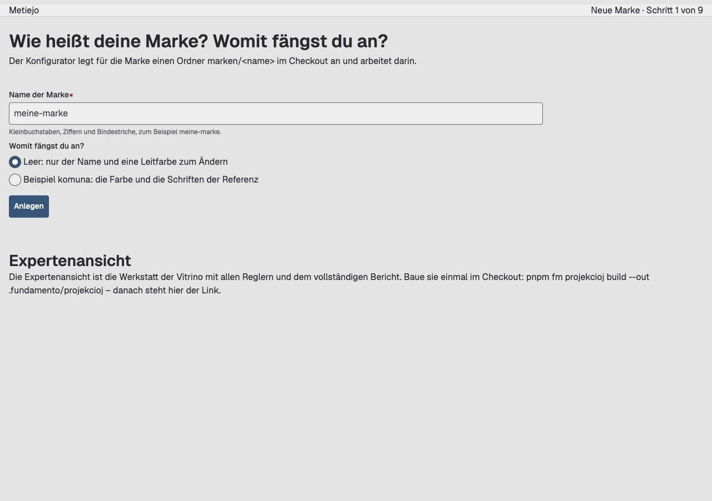
2. Farbe – „Ist das deine Leitfarbe?“, Prüfung grün, Vorschau: 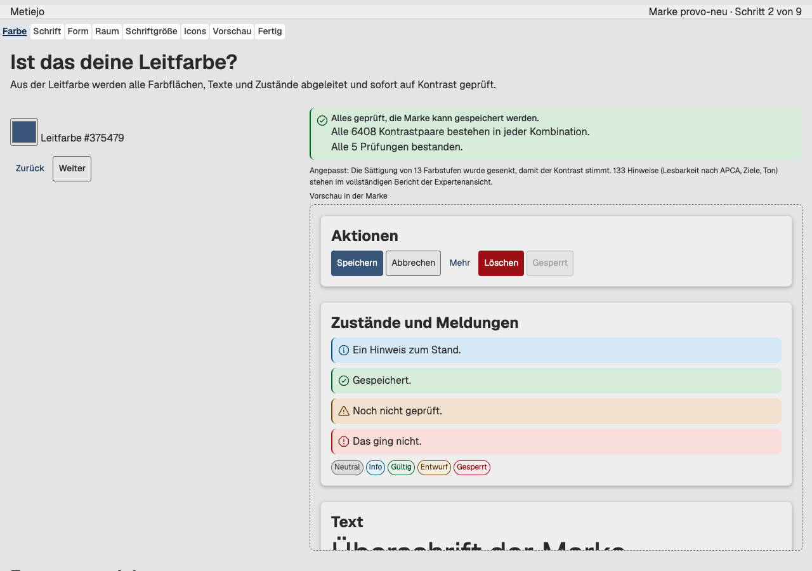
   Mit einer Leitfarbe, die eine anpassbare Regel verletzt (`#e8d300`): das Problem in Klartext, ein Vorschlag als Hauptknopf: 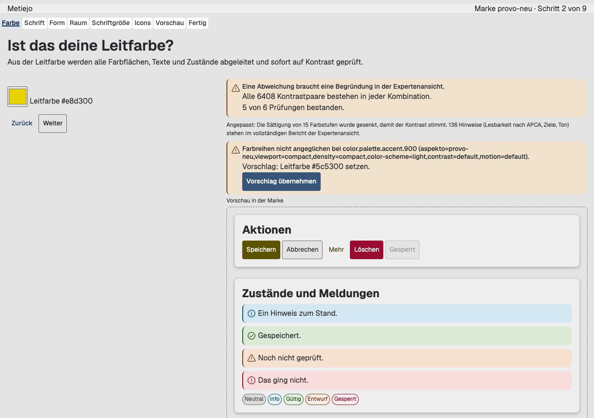
3. Schrift – „Welche Schrift?“, Suche „inter“, Upload gesperrt (keine `.env`): 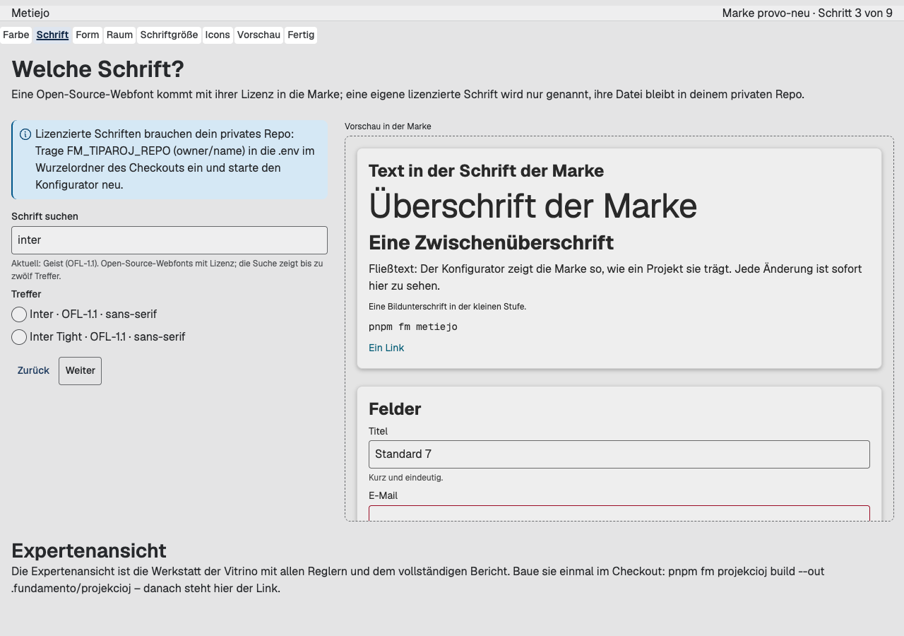
   Mit `FM_TIPAROJ_REPO` und einer hochgeladenen Datei: die Bestätigung, der Hauptknopf „In privates Repo hochladen“: 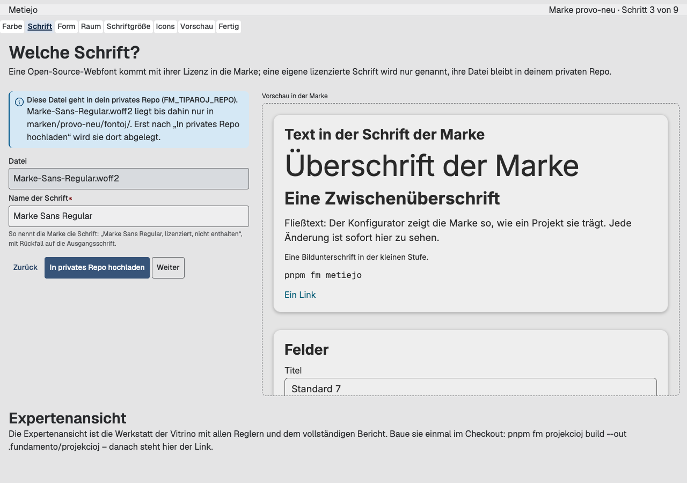
4. Form – „Wie rund soll die Marke sein?“, Radius 1,8: 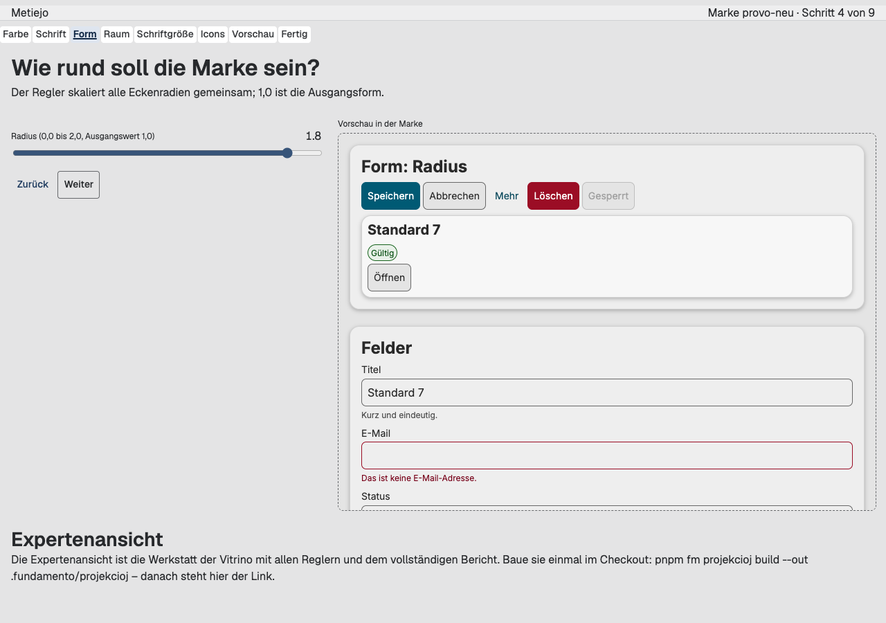
5. Raum – „Wie luftig soll die Marke sein?“, Abstand 1,3: 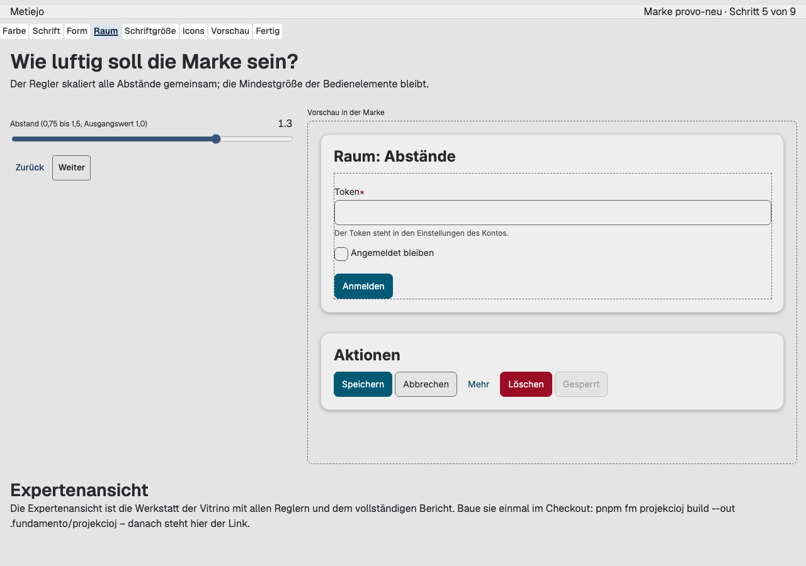
6. Schriftgröße – „Wie groß soll die Schrift sein?“, 0,4: 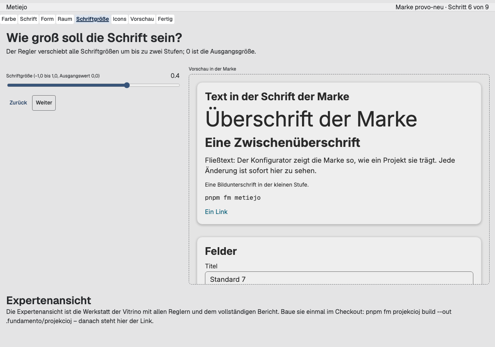
7. Icons – „Wie kräftig sollen die Icons sein?“, bold: 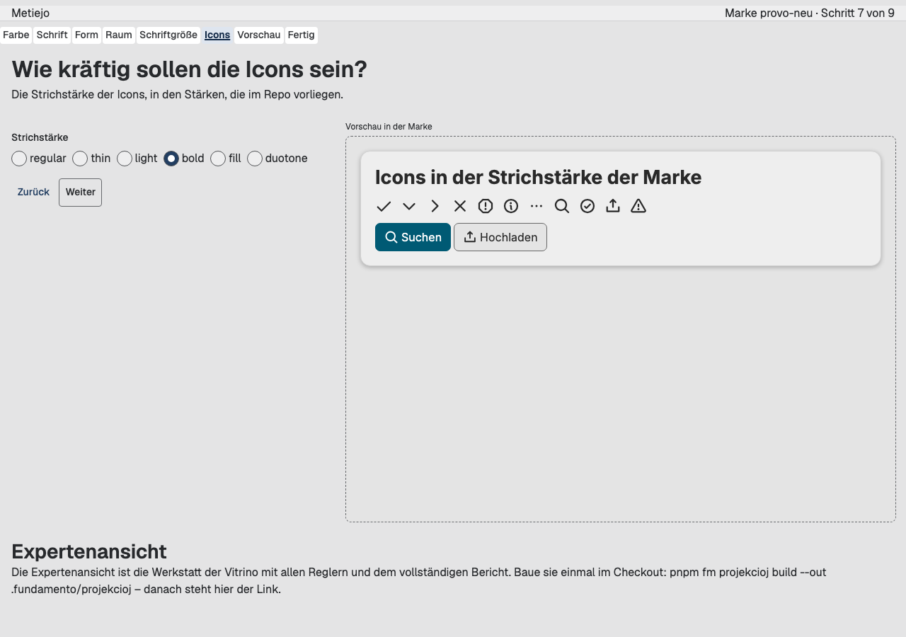
8. Vorschau – „Passt das?“, hell: 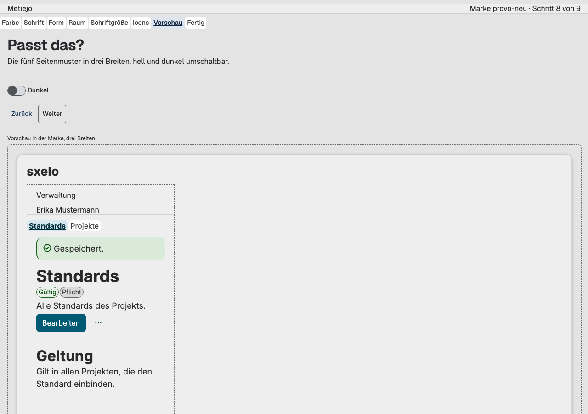 · dunkel: 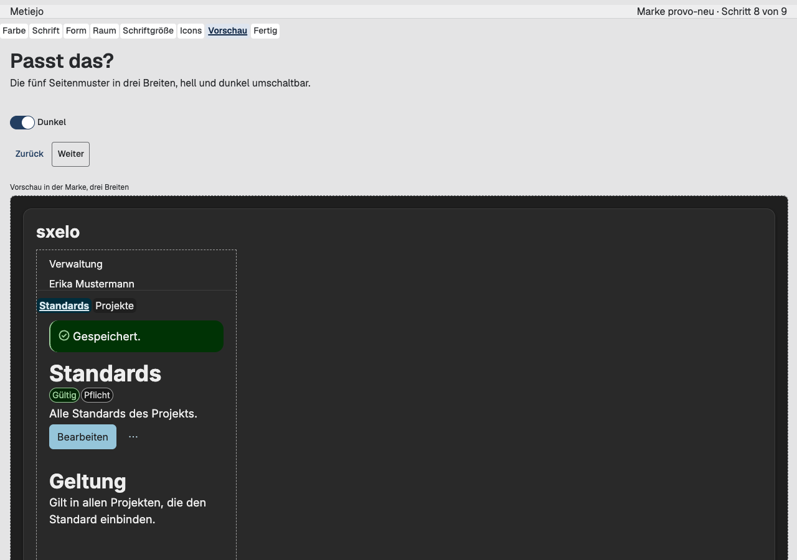
   Das Vorschau-Dokument in voller Länge, die fünf Sxablonoj in drei Breiten: hell 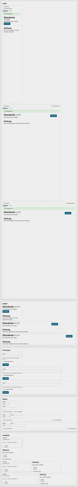 · dunkel 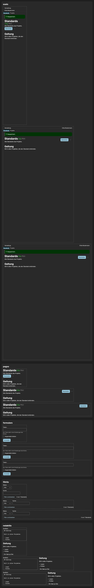
9. Fertig – „Speichern?“, Prüfbericht, Exporte zur Wahl: 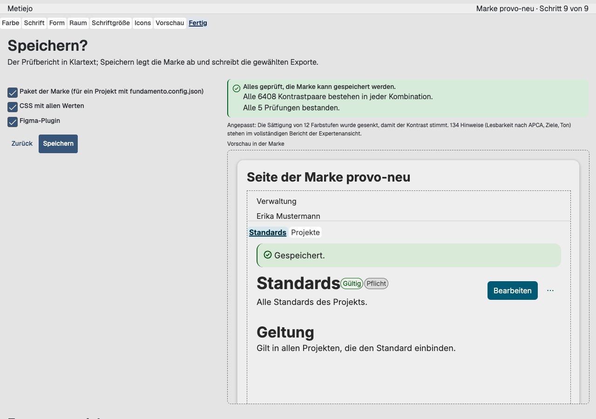 · nach dem Speichern mit den drei Exporten: 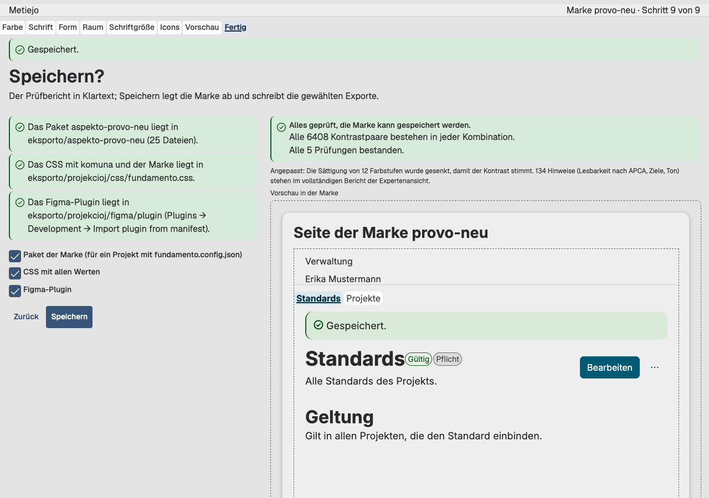

### Abweichungen

1. **`.gitignore` bekommt `!.env.example` und `marken/`.** Die Spec will `.env.example` im Repo; `.env.*` in der `.gitignore` ignorierte sie. Die Ausnahme ist die kleinste Änderung; `.env` bleibt ignoriert (Test). `marken/` ist ignoriert, obwohl der Konfigurator dort nie schreibt (O-3, D-09).
2. **Eine Schrift für Anzeige und Fließtext** (D-06). Die Spec nennt „Welche Schrift?“ als eine Frage; je Rolle wählt die Expertenansicht.
3. **Nur vier Regler der Gestalt** (D-05): Radius, Abstand, Schriftgröße, Icon-Gewicht. Die Spec nennt je Gruppe „ein Regler“; die übrigen Regler der Stufe 2 bleiben der Expertenansicht.
4. **Figma-Export rot bis F-13.** Der Test erwartet eine eigene Plugin-ID (`fundamento-apply-plan-<Hash>`) und den Markennamen im Plugin-Namen, wie Nachlese 8 ① F-13 es baut (Branch `261021-nachlese-8-gvidanto-116ba2`, `pluginManifest` mit `brandsOf` und `shortHash`). Auf dieser Basis schreibt der Export noch `fundamento-apply-plan`; nach dem Rebase auf `main` mit ① wird der Test grün, ohne Änderung am Plugin (das Plugin wird hier nicht angefasst). Ein Probe-Rebase auf den Branch von #95 am 21.10. bestätigt das: kein Konflikt, `eksporto.test.ts` 4 von 4 grün.
5. **`check:tiparoj` ist kein Check des Modelo-Läufers.** `CHECK_NAMES` im Modelo und `run.js` sind an die Checks des Modelo gebunden; der Byte-Check lebt im Paket `metiejo` (`dist/node/kontrolo-cli.js`), als Wurzelskript, in der `check`-Kette und als Schritt im Job `checks` nach „Check: Release“. Die Pins in `workflow.test.ts` sind um diesen Schritt ergänzt (`ERO_CHECK_STEPS`, `CHECKS_STEPS`), der Modelo-Läufer ist unverändert.
6. **Die Vorschau lädt eine Webfont vom Fontsource-CDN** (`https://cdn.jsdelivr.net/fontsource/fonts/<id>@latest/latin-400|700-normal.woff2`, nur https); Export und Paket nehmen die Dateien mit Lizenz aus dem npm-Paket (O-4, D-15). Ohne Netz zeigt die Vorschau den Rückfall; Tests laden nichts.
7. **Eigenes Beispiel-Markup der fünf Sxablonoj** (`vorschau-korpo.ts`). Das Markup der Vitrino ist nicht exportiert, und die Vitrino bleibt unangetastet; die Beispiele folgen den Regionen der Skemoj mit deutschem Beispielinhalt.
8. **Vorschläge ohne Patch bleiben englisch** (D-04). Die deutschen Regeltexte kommen mit Nachlese 8 ③; dann können die Sätze der Raporto übernommen werden.
9. **Paketversion:** `0.1.1` auf der ersten Basis, `0.2.0` seit dem Rebase auf `main` mit Nachlese 8 ① (keine Änderung an fremden Versionen).
10. **Der Hauptknopf des Starts ist „Anlegen“, der des Endes „Speichern“;** dort gibt es kein „Weiter“ (M-2 prüft: Weiter auf jedem Bildschirm dazwischen, Zurück auf jedem außer dem Start).
11. **Keine neue CI-Umgebung:** der Test des privaten Repos erzeugt sein bare-Repo mit `git init --bare -b main` und übergibt dem Commit eine Identität per `-c`, damit der Läufer ohne `user.name` auskommt.

### Befunde / Mankoj

- **B-1 Manko-Kandidat Schrittanzeige:** Es gibt kein Ero für eine Schrittfolge („Schritt 3 von 9“ mit Zustand je Schritt). Der Konfigurator zeigt Text und `fm-navigado` (D-12). Schließbedingung: ein Ero mit Regionen für die Schritte und `current` existiert und der Konfigurator setzt es ein.
- **B-2 Manko-Kandidat Farbwähler und Regler:** `input type=color` und `input type=range` sind nativ (wie in der Werkstatt, O-3 aus Spec 016 ②). Schließbedingung: `fm-kampo kind=color` oder ein eigenes Ero, und ein Ero für den Regler mit Label, Wert und Zurücksetzen.
- **B-3 `ValidationIssue.rule` ist geschlossen** (D-13). Ein Paket außerhalb des Modelo kann keine eigene Regel als ValidationIssue melden, ohne das Modelo zu ändern. Kein Manko, ein Hinweis für Runde 2 (die KI-Fehler brauchen dasselbe).
- **B-4 Fontsource:** 3 von 2103 Familien ohne Lizenz der Liste oder ohne Schriftsystem fallen weg; 20 Subsets haben noch keine ISO-15924-Zuordnung (der Import nennt sie: `beria-erfe`, `buhid`, `hanunoo`, `indic-siyaq-numbers`, `kana-extended`, `kirat-rai`, `makasar`, `mayan-numerals`, `meroitic`, `meroitic-cursive`, `meroitic-hieroglyphs`, `ottoman-siyaq-numbers`, `phags-pa`, `signwriting`, `sunuwar`, `tagbanwa`, `tamil-supplement`, `todhri`, `yi`, `znamenny`). Eine Familie mit nur solchen Subsets fiele weg; keine der 2103 ist betroffen.
- **B-5 Zeiten** (dieser Rechner): `derivationBasis` 114 ms, `deriveAspekto` mit Prüfung 1 620 ms, Vorschau-Stylesheet ≈ 200 ms, Export mit CSS und Figma ≈ 4 s, Speichern bis „Gespeichert“ im Browser ≈ 4 s.
- **B-6 Die `sxelo` nimmt in der Vorschau die volle Höhe** (wie V-3 aus Nachlese 8 ②, in der Vitrino); hier nicht geändert.
- **B-7 Keine Konsolenfehler** in Chromium über alle neun Bildschirme (nur `favicon.ico` 404, jetzt 204).

### Offen (für den Maintainer)

Entschieden am 22.10. (Nachtrag unten): O-1 bis O-7. Offen bleibt nichts aus Runde 1.

- **O-1 Paketname:** `metiejo` – **bestätigt.**
- **O-2 Schrift je Rolle:** eine Frage für Anzeige und Fließtext (D-06) – **in Runde 1 so;** Runde 2 optional eine zweite Schrift für Überschriften, Standard „gleiche Schrift“.
- **O-3 Ort der Marken:** **nicht** `marken/` im Checkout – Marken liegen außerhalb des Repos, im Ordner aus `FM_MARKEN_DIR`, ohne Eintrag `~/Fundamento/marken`; `marken/` in der `.gitignore`; ein Test prüft, dass Export und Speichern nie in den Checkout schreiben (D-09).
- **O-4 Webfont vom CDN in der Vorschau:** **ja;** Export und Paket nehmen die Datei mit Lizenz aus dem npm-Paket (D-15).
- **O-5 Standard-Port 7301:** **ja.**
- **O-6 Hinweise im Klartext:** **so lassen.**
- **O-7 F-13:** mit dem Rebase erledigt, der Figma-Test ist grün.

### Messanleitung

Alle Befehle im Checkout des Maintainers `/Users/thorstenjankowski/n8n-compose/20260918_fundamento-ds`, nach dem Merge dieses PR (nach Nachlese 8 ①). Einmal vorbereiten:

```sh
cd /Users/thorstenjankowski/n8n-compose/20260918_fundamento-ds
pnpm install
pnpm build
pnpm fm projekcioj build --out .fundamento/projekcioj   # einmal: die Expertenansicht (Werkstatt der Vitrino)
```

Die Einstellungen stehen in `/Users/thorstenjankowski/n8n-compose/20260918_fundamento-ds/.env` (Vorlage: `/Users/thorstenjankowski/n8n-compose/20260918_fundamento-ds/.env.example`). Für Runde 1 zählen `FM_TIPAROJ_REPO=<owner/name>` des privaten Schriften-Repos und `FM_MARKEN_DIR=<Ordner der Marken>`; ohne `FM_MARKEN_DIR` liegen die Marken in `/Users/thorstenjankowski/Fundamento/marken`. Ein Ordner im Checkout wird abgelehnt. Alles andere bleibt leer. Der Server liest die Datei beim Start und zeigt keinen Wert.

Im Folgenden steht `<Markenordner>` für den Ordner aus `FM_MARKEN_DIR`, also ohne Eintrag `/Users/thorstenjankowski/Fundamento/marken`.

**Starten:**

```sh
cd /Users/thorstenjankowski/n8n-compose/20260918_fundamento-ds
pnpm fm metiejo --open
```

Dann **http://localhost:7301** (der Server antwortet nur auf diesem Rechner; `--port` wählt einen anderen Port, `--workdir` einen anderen Ordner als `<Markenordner>`). Die Startzeile nennt den Markenordner.

**M-1 (Stoppuhr, höchstens 10 Minuten, ohne Doku):** Von „leer“ bis zum Figma-Export: Start (Name, „Leer“ oder „Beispiel komuna“, Anlegen) → Farbe (Farbwähler; ein Problem zeigt einen Vorschlag als Hauptknopf) → Schrift (Suche, Treffer wählen, Weiter) → Form, Raum, Schriftgröße, Icons (je ein Regler oder eine Wahl, Weiter) → Vorschau (Dunkel umschalten) → Fertig (Speichern). Danach liegt `<Markenordner>/<name>/eksporto/projekcioj/figma/plugin/manifest.json` (ohne `FM_MARKEN_DIR`: `/Users/thorstenjankowski/Fundamento/marken/<name>/eksporto/projekcioj/figma/plugin/manifest.json`); in Figma: Plugins → Development → Import plugin from manifest. Die Dateien der Webfont liegen in `<Markenordner>/<name>/eksporto/aspekto-<name>/tiparoj/<id>/` mit `LICENSE` und `herkunto.json`, die `@font-face`-Regeln in `<Markenordner>/<name>/eksporto/tiparoj.css`. Bitte die gemessene Zeit im Abnahme-Ergebnis notieren.

**M-2 (ein Test zählt):** `pnpm --filter @fundamento/metiejo exec vitest run src/sxtupoj.test.ts` – je Bildschirm eine Frage, höchstens ein Hauptknopf, Zurück und Weiter.

**M-3 (bytegleich):** zweimal Speichern ohne Änderung, dann:

```sh
cp -R "<Markenordner>/<name>/eksporto" /tmp/metiejo-eksporto-1
# im Browser noch einmal „Speichern“, dann:
diff -r /tmp/metiejo-eksporto-1 "<Markenordner>/<name>/eksporto" && echo bytegleich
```

Ohne Browser: `pnpm --filter @fundamento/metiejo exec vitest run src/eksporto.test.ts` leitet `provo` zweimal ab und vergleicht alle Hashes.

**M-4 (Byte-Check):** Mit gesetztem `FM_TIPAROJ_REPO` im Schritt Schrift „Eigene Schrift hochladen“ (eine lizenzierte Testschrift), „In privates Repo hochladen“ bestätigen; der Satz nennt den Pfad `tiparoj/<familie>/<datei>` im privaten Repo und nie dessen Namen. Dann:

```sh
cd /Users/thorstenjankowski/n8n-compose/20260918_fundamento-ds
pnpm check:tiparoj                                                    # PASS: 1 Schrift bekannt, nichts gefunden
cat "<Markenordner>/<name>/fontoj/<datei>" >> .fundamento/projekcioj/css/planted.css   # ein Muster absichtlich hineinkopieren
pnpm check:tiparoj; echo "exit=$?"                                    # FAIL, exit 1, nennt planted.css und die Schrift
rm .fundamento/projekcioj/css/planted.css
pnpm check                                                            # die Kette endet mit check:tiparoj
```

Der Cache des privaten Repos liegt unter `/Users/thorstenjankowski/Library/Caches/fundamento/tiparoj/<hash>/` (oder `$XDG_CACHE_HOME`), nie im Checkout. Ohne `FM_TIPAROJ_REPO` ist der Upload gesperrt (Satz im Schritt Schrift), und `pnpm check:tiparoj` sagt „No licensed font is known here“.

**M-7 (kein Schlüssel):** einen Schlüssel in `/Users/thorstenjankowski/n8n-compose/20260918_fundamento-ds/.env` eintragen (z. B. `OPENAI_API_KEY=test-123`), den Server starten, alle Schritte durchgehen, dann:

```sh
cd /Users/thorstenjankowski/n8n-compose/20260918_fundamento-ds
grep -r "test-123" "<Markenordner>" .fundamento 2>/dev/null; echo "exit=$? (1 = nirgends)"
```

Die Ausgabe des Servers nennt nur „weitere Variablen gesetzt: 1“. Der Test `src/servilo.test.ts` prüft dasselbe mit einem Fake-Schlüssel und dem Repo-Namen in jeder Antwort und jedem Logeintrag.

**Expertenansicht:** Auf jedem Bildschirm steht der Link „Expertenansicht“ (bei gebauter Vitrino) – er öffnet `http://localhost:7301/vitrino/index.html#aspekto=komuna&modus=werkstatt&agordo=…` mit dem Entwurf. Dieselbe Werkstatt direkt: `open "file:///Users/thorstenjankowski/n8n-compose/20260918_fundamento-ds/.fundamento/projekcioj/vitrino/index.html#modus=werkstatt"`.

**Figma (F-13, Abweichung 4):** `<Markenordner>/<name>/eksporto/projekcioj/figma/plugin/manifest.json` trägt eine `id` `fundamento-apply-plan-<hash>` und den Markennamen im `name`; das Plugin erscheint in Figma als eigener Eintrag neben dem komuna-Build. Grüne Tests sind für Figma keine Abnahme: bitte in einer neuen leeren Datei laufen lassen.

### Nachtrag 22.10.

**Entscheidungen des Maintainers vom 2026-10-22** (O-1 bis O-7, siehe oben), umgesetzt im selben PR nach dem Rebase auf `main` `3759b67` (Nachlese 8 ①–③, Release 0.2.0 veröffentlicht):
- **O-3:** `FM_MARKEN_DIR` als siebte Variable in `.env` und `.env.example`; `markenDirOf` (D-09); `assertOutsideCheckout` in `markoDir`; `marken/` in der `.gitignore`; Tests in `marko.test.ts` und `eksporto.test.ts` („never inside the checkout“), `env.test.ts`. `fm metiejo --help` und `check:tiparoj --help` nennen den neuen Standard. Die Bildschirmfotos vom 21.10. zeigen noch den Satz „Ordner marken/<name> im Checkout“ im Schritt Start; der Satz lautet jetzt „im Markenordner (FM_MARKEN_DIR in der .env, sonst ~/Fundamento/marken)“.
- **O-4:** `tiparoj-npm.ts` (D-15), `exportMarko` mit `npm`, `tiparoj.css`; Tests `tiparoj-npm.test.ts` und drei in `eksporto.test.ts`.
- **Version:** `metiejo` auf 0.2.0; der Figma-Test ist grün (F-13 auf `main`).
