# Spec 024 – Studio: jeder Aspekt jeder Komponente je Marke – Plan

**Spec:** [`spec.md`](spec.md) (Fassung vom 2026-10-21, unverändert kopiert; SHA-256 `89c68df8…e57558`) · **Basis:** `main` nach #98 (`ec17396`) · **Regel 0** gilt: der Weg, den das Repo schon geht (Art. XI), sonst die kleinste Änderung mit Eintrag hier; keine neuen Tokens, keine neuen Eroj, keine neue Regulo-Semantik, keine Constitution in dieser Runde (das Amendment v2.3 ist Runde 2); nie eine Grenze aufweichen, um grün zu werden. **Clean Room (§ 8, Art. V):** kein fremder Style-Guide wurde gesucht oder geöffnet; Grundlage ist allein die Spec.

Drei Runden: ① Runde 1 (dieser Plan: K-1 bis K-6, Studio-Rahmen, Grundlagen und Semantik, Raster-Vorschlag, Anzeigenamen, Aspiroj „nur verschärfen“, Schnellstart und Studio auf denselben Daten), ② Runde 2 (Amendment v2.3, Ero-Tokens, Komponentenseiten), ③ Runde 3 (Quellen, KI, Fluss).

## ① Runde 1

**Branch:** `261022-spec-024-runde-1-145b74` (von `main` `ec17396`) · **Datum:** 2026-10-22 · **Stand:** zur Abnahme. Der Maintainer entscheidet das Palettenraster (unten, Raster-Vorschlag).

### Zusammenfassung

1. **K-1 bis K-6 im Schnellstart:** K-1 der Name wird angenommen, wie er geschrieben wird („Bluna“, „Über Größe & Co.“); die Kennung (`bluna`, `ueber-groesse-co`) leitet `identOf` ab und zeigt sie beim Tippen klein unter dem Feld; der geschriebene Name steht in der Agordo als `etikedoj.marko` und jeder Bildschirm sagt „Marke Bluna (bluna)“. K-2 die Fehlermeldung des Starts verschwindet, sobald die Eingabe eine Kennung ergibt. K-3 die Schriftsuche fragt beim Tippen (`GET /api/marko/<name>/tiparoj?q=`) und zeigt die Treffer ohne Enter. K-4 ohne Treffer steht der Satz „Keine Schrift gefunden für „…“: Versuche einen Teil des Namens, zum Beispiel „Sans“ oder „Serif“, oder lade eine eigene Schrift hoch.“ K-5 die Form ist eine Wahl aus vier (eckig 0, leicht 0,5, rund 1, ganz rund 2 als Faktor `form.radius`); „ganz rund“ setzt dazu `radius.role.control` auf `radius.full` (die Bedienelemente werden zur Pille), die Flächenrolle bleibt groß gerundet. K-6 die Ursache: Enter im Suchfeld schickte das Formular mit leerem `tiparo` an den nächsten Schritt statt an die Suche; jetzt sucht Enter, und eine gewählte Schrift (Prata, OFL, im Katalog) wird übernommen (Test und im Browser bestätigt). Dazu fragt die Vorschau nur die Schnitte an, die das Paket hat (Prata: nur 400; der Katalog trägt jetzt `weights`).
2. **Dieselben Daten (M-6):** Schnellstart und Studio arbeiten auf dem einen Entwurf einer Marke (Agordo + die daraus abgeleitete Aspekto). Was das Studio setzt, steht in der Agordo in `festgelegt` (Token → `wert` oder `alias`, je Dimensio-Bedingung in `modoj`), Anzeigenamen in `etikedoj` (Modelo-Schema, `$defs/Agordo`, `$defs/AgordoFestgelegt`; `aspekto.json#/etikedoj`). Die Ableitung (`fm agordilo derive`, Werkstatt, Metiejo) schreibt einen gesetzten Wert, wo sie sonst ableiten würde, einen Alias, wo die Marke eine Rolle umbelegt, und einen Wert je Dimensio in den Konjunktions-Set der Marke zu dieser Bedingung (`aspekto/<name>+viewport/compact` …, mit `$type`, in `$themes.json`). Der Bericht markiert eine gesetzte Stufe (`gesetzt`). Gleiche Agordo, gleiche Bytes.
3. **Das Studio** (`/studio/<name>/<seite>`): links die Navigation (Farbe, Schrift, Raum, Form, Tiefe, Bewegung, Semantik, Schnellstart), in der Mitte die Live-Vorschau mit den Umschaltern hell/dunkel, Dichte, Kontrast und Viewport, rechts die Eigenschaften der Seite; Kopfzeile mit Marke, Prüfung (Zahl der Probleme) und Speichern. Jede Zeile ist ein Token des Modelo mit dem Entwurf komponiert: Wert in der gewählten Kombination, Herkunft (Struktur, abgeleitet, gesetzt), Alias mit seinen Kandidaten, bei Farben OKLCH und Kontrast gegen Hell und Dunkel, bei Rollen und Stufen der Wert in dunkel, bei Schriftgrößen der Wert je Viewport, bei Bewegung der Wert bei reduzierter Bewegung. Gebaut aus `fm-sxelo`, `fm-navigado`, `fm-pagxo`, `fm-formularo`, `fm-faldilo`, `fm-elektilo`, `fm-elekto`, `fm-kampo`, `fm-tekstareo`, `fm-insigno`, `fm-teksto`, `fm-butono`.
4. **Grundlagen vollständig (§ 4):** Farbe – die sieben Paletten (sechs plus `shade`) mit Anzeigename, je Stufe Wert (Hex, OKLCH), Kontrast gegen Hell und Dunkel, Herkunft, Wert hell und dunkel setzbar, Zurücksetzen je Stufe; „Aus Leitfarbe neu ableiten“ ist der Dauerzustand: die Ableitung trägt jede nicht gesetzte Stufe, eine gesetzte bleibt, bis sie zurückgesetzt wird (D-04). Schrift – die drei Familien, je Schriftstil Größe (je Viewport als Stufe der Skala), Stärke, Zeilenhöhe, Laufweite, dazu die Zusammensetzung der Stile zum Lesen; die Typo-Leiter als Vorschau. Raum – Abstandsskala, benannte Abstände, Höhen der Bedienelemente, Größenskala, Raster und Container. Form – Radien bis `radius.full`, Radius je Rolle, Rahmenstärken je Skala und Rolle, Fokusring. Tiefe – Schatten (als Zusammensetzung), Ebenen, Schattenfarben, Deckkraft. Bewegung – Dauern, Dauer je Rolle, Kurven, Kurve je Rolle, je mit dem Wert bei reduzierter Bewegung.
5. **Semantik (§ 4):** je Rolle (Text, Flächen, Rahmen, Aktionen, Status, Fokus, Navigation, Links, Marke, Abdunklung) und Zustand die Palettenstufe, die sie nutzt, hell und dunkel, als Wahl aus allen Stufen, dazu ein Anzeigename. Nach jeder Änderung läuft die Prüfung; die betroffenen Reguloj stehen unter der Seite und die Zahl der Probleme in der Kopfzeile.
6. **Grenzen (§ 5, M-5):** Ein Wert, der eine feste Regel bricht (oder das Schema), wird nicht übernommen: Antwort 409 mit einem Satz (Klartext aus `satzOf`) und einem Vorschlag; das Bedienelement zeigt wieder den Wert, der gilt. Eine anpassbare Regel wird übernommen und braucht ein Jugxo wie heute. Kein neuer Prop, keine Achse, kein Zustand: das Studio kennt nur Tokens.
7. **Aspiroj „nur verschärfen“ (§ 3 B, S-2):** die Regel `aspiro-loosens-regulo` im Modelo: ein Aspiro, dessen Metrik eine Regulo mit `sojlo` misst (`wcag2-reserve` → `contrast-reserve`, `oklch-l-step-consistency` → `palette-even`, `oklch-l-align` → `palette-aligned`, `type-scale-consistency` → `type-scale`), darf deren Schranke nur verschärfen; ein `min` darunter oder ein `max` darüber ist ein Fehler mit beiden Schranken im Satz. Ein Aspiro, der nur die andere Schranke nennt, lockert nichts.
8. **Raster-Vorschlag** (unten): gemessen, nicht geändert – die Entscheidung liegt beim Maintainer.
9. **Kleinste Änderungen daneben:** `RULE_IDS` +1 (178), der Zähler in `contracts.test.ts`; `RaportoStep.gesetzt`; der Katalog der Webfonts trägt `weights`; README (Abschnitt „Studio“), Vojmapo (8a''').

### Constitutional Compliance Review

- **Art. I (Modelo-First):** konform. Nichts wird von Hand in eine Projekcio geschrieben; das Studio ändert die Agordo, die Ableitung schreibt das Paket, die Projekcioj folgen. `festgelegt` und `etikedoj` sind Einträge des Modelo-Schemas.
- **Art. II (Unu Vortaro):** konform. Anzeigenamen (`etikedoj`) sind Beschriftungen; die kanonischen Namen bleiben in Sets, CSS, Figma und Code (§ 3 B). Kein Bezeichner wird vereinbart, keiner erfunden.
- **Art. III (Maschinenlesbarkeit):** konform. Alles, was das Studio zeigt, kommt aus `resolveCombination` über das komponierte Modelo und dem Bericht der Ableitung; `preview_agordo` des Gvidanto liest dieselbe Agordo (mit `festgelegt`). Kein neues MCP-Werkzeug in Runde 1 (Runde 3).
- **Art. IV (Multmarkeco):** konform. Ein Alias zählt als Belegung; ein gesetzter Wert steht im Set der Marke, ein Wert je Dimensio im Konjunktions-Set der Marke; `aspekto-complete` bleibt erfüllt (Test: die Ableitung mit `festgelegt` besteht alle Prüfungen).
- **Art. V (Clean Room):** konform. Kein fremder Style-Guide wurde geöffnet; der Katalog der Webfonts ist Fontsource mit Herkunft; keine Namen oder Werte aus fremden Systemen.
- **Art. VI (Regularo kun Kialoj):** konform. Keine neue Regulo mit Semantik; `aspiro-loosens-regulo` ist eine Prüfung der Aspiroj gegen vorhandene Schranken, mit Satz und Vorschlag. Feste Regeln bleiben im Studio unantastbar (M-5); anpassbare brauchen ein Jugxo. Was fehlt, steht als Manko-Kandidat unten.
- **Art. VII (Agenta Dokumentado, Herkunft):** konform. Jeder Wert trägt seine Herkunft (Struktur, abgeleitet, gesetzt) im Studio; die Agordo reist mit dem Paket als Ursprung; Webfonts tragen `herkunto.json`.
- **Art. VIII (Web-first, mobiles Modell):** konform. `festgelegt` nimmt DTCG-Werte und Aliasse, keine CSS-Eigenschaften; die Dimensio-Bedingungen sind die des Modelo (`viewport=compact`).
- **Art. IX (Vertikaler Durchstich):** konform. Keine neue Fähigkeit an Eroj; das Studio nutzt vorhandene Eroj und Sxablonoj.
- **Art. X (Test-first):** konform. Rot in `062e3ec` (Modelo, Agordilo, Metiejo), dann grün; die vier Prüfungen der CI unverändert.
- **Art. XI (Einfachheit):** konform. Kein neues Paket (das Studio liegt in `metiejo`), keine neue Abhängigkeit; die drei Module `studio.ts`, `ident.ts`, die Regel in `aspiroj.ts`.
- **Art. XII (Interoperabilität):** konform. DTCG bleibt das einzige Speicherformat; ein Konjunktions-Set je Dimensio-Bedingung der Marke folgt der Tokens-Studio-Konvention wie `+color-scheme/dark`.
- **Art. XIII (Einfachheit der Nutzung):** konform. Der Schnellstart bleibt der Weg in zehn Minuten (M-1); das Studio ist der Feinschliff dahinter, ein Link hin und zurück. Ein Designer tippt keinen Token-Namen: die Aliasse sind eine Wahl aus Kandidaten.

### Entwurfsentscheidungen

#### D-01 Das Studio liest das komponierte Modelo, nicht die Agordo
Die Zeilen entstehen aus `composeDraft` (die Ableitung ohne Prüfung, 114 ms, dann `composeFiles` und `buildModelo`) und `resolveCombination` je gewählter Kombination. So zeigt das Studio genau, was ein Projekt bekommt – auch die Wirkung der Dimensio-Sets des Kerns –, und die Herkunft folgt aus drei Mengen: `festgelegt` (gesetzt), die Tokens, die die Ableitung schreibt (Paletten, Gestalt, Schriftfamilien: abgeleitet), der Rest (Struktur).

#### D-02 `festgelegt` statt eines zweiten Datenmodells
Die Spec will „Agordo + Aspekto“ als eine Quelle für Schnellstart und Studio. Ein eigenes Speicherformat des Studios hätte zwei Wahrheiten gemacht. `festgelegt` ist ein Feld der Agordo: Token → `{ wert | alias, modoj: { "<dimensio>=<valoro>": { wert | alias } } }`; die Ableitung wendet es als letzten Schritt auf jeden Set an (D-03). Der Schnellstart ändert die Regler und die Leitfarbe, das Studio die Tokens; beides steht in derselben Datei, `historio` zählt beides als Bewegung.

#### D-03 Wo ein gesetzter Wert hingeht
Haupt-Set der Marke: `wert` oder `{alias}`, vor Paletten, Gestalt und Schriften (was das Studio setzt, gewinnt). Dunkel: `modoj["color-scheme=dark"]` in den Konjunktions-Set `+color-scheme/dark`, den die Referenz schon hat. Jede andere Bedingung (`viewport=compact`, `density=compact`, `contrast=high`, `motion=reduced`): ein Set der Marke `aspekto/<name>+<dimensio>/<valoro>` mit typisierten Tokens (`$type` aus dem Kern, weil der neue Set keine Gruppentypen erbt), eigener ID aus dem Lock und Bedingungen; `$themes.json` nimmt ihn über `deriveThemeFragment` auf. Für Schriftgrößen je Viewport nimmt das Studio nur Aliasse auf Skalenstufen – so, wie die Viewport-Sets des Kerns es tun.

#### D-04 Eine gesetzte Palettenstufe bleibt eine Stufe des Berichts
`withFestgelegtSteps` ersetzt in den abgeleiteten Paletten den Schritt: Wert, OKLCH, erreichter Kontrast gegen die Fläche des Modus neu gemessen, `gesetzt: true`; `onTarget` sagt, ob er das Ziel noch trifft. So zeigt der Bericht die Wahrheit, und „Aus Leitfarbe neu ableiten“ ist kein Knopf, sondern die Regel: nur nicht gesetzte Stufen werden abgeleitet.

#### D-05 Ablehnen heißt vorher prüfen
`festlegen` leitet den Kandidaten mit allen Prüfungen ab (1,3 s warm, 3,1 s beim ersten Mal) und vergleicht die Issues mit denen des Entwurfs davor: ein neues Issue einer festen Regel (oder des Schemas) lehnt ab – 409 mit `satzOf` und `vorschlagOf` des Verstoßes – und der Entwurf bleibt, wie er war; ein neues Issue einer anpassbaren Regel wird übernommen und als Problem gezählt. „Betroffen“ sind die Reguloj, deren Verstöße den Token nennen, und die neuen.

#### D-06 Kandidaten eines Alias
Ein Alias darf auf die Stufen derselben Skala zeigen: für eine Palettenstufe auf jede Stufe jeder Palette (eine Rolle wechselt auch die Palette), für `radius.*` auf jeden Radius bis `radius.full`, sonst auf das Präfix des Ziels ohne den letzten Teil (`font.size.scale.*`, `font.weight.*`, `spacing.scale.*`, `size.scale.*`, `motion.duration.scale.*`, `motion.easing.curve.*`, `border.width.scale.*`). Nur Literale sind Kandidaten; Rollen zeigen nicht auf Rollen.

#### D-07 Eine Form als Wahl, die Pille als Alias
K-5 braucht zwei Dinge: den Faktor der Radien (vorhanden, `form.radius`) und die Pille nur für Bedienelemente. Die Rolle `radius.role.control` zeigt im Kern auf `radius.medium`; „ganz rund“ setzt sie auf `radius.full` – als `festgelegt`-Alias, denselben Weg, den das Studio nimmt. `radius.role.surface` bleibt beim Faktor 2 (`radius.large` → 16 px), also groß gerundet, keine Pille. Die Wahl liest sich aus der Agordo zurück (`formWahlOf`).

#### D-08 Die Kennung
`identOf`: Kleinbuchstaben, Umlaute als ae/oe/ue/ss, Akzente entfernt, alles andere zu einem Bindestrich, Ränder bereinigt. Ergibt ein Name keine Kennung („!!!“), bleibt der Start mit dem Satz, der die Kennung erklärt. Der geschriebene Name steht nur in `etikedoj.marko`; die Kennung ist der Name der Aspekto und des Ordners.

#### D-09 Die Suche beim Tippen
200 ms nach dem letzten Zeichen fragt der Browser den Server; die Trefferliste (`fm-elekto`) wird als Ganzes ersetzt, damit das Ero sie neu liest; ohne Treffer bleibt das Suchfeld, und die `fm-avizo` mit dem Satz erscheint (K-4). Enter im Suchfeld sucht serverseitig (K-6); die Wahl plus Weiter übernimmt die Schrift.

#### D-10 Die Umschalter der Kopfzeile sind die Kombination der Seite
Hell/dunkel, Dichte, Kontrast und Viewport sind Abfrageparameter der Studio-Seite: der Server löst die Zeilen für diese Kombination auf und die Vorschau bekommt die `data-fm-*`-Attribute an der Wurzel. So ist jeder Zustand ein Link.

#### D-11 Schatten und Zusammensetzungen als JSON
Für Schatten (Ebenen aus Versatz, Unschärfe, Farbe) und Kurven gibt es kein Ero mit mehreren Maßen; das Studio zeigt sie als Text und nimmt den Wert als DTCG-JSON in einer `fm-tekstareo kind="code"` an. Die Schriftstile (`typography.*`) sind nur zum Lesen: ihre Teile werden über die Rollen gesetzt (Größe, Stärke, Zeilenhöhe, Laufweite). Die Schreibweise (Großbuchstaben) steht in einer Erweiterung des Tokens; sie ist in Runde 1 lesbar, nicht setzbar (Abweichung 3).

#### D-12 Ein Aspiro verschärft nur
Die Reguloj der Spec 004 tragen `sojlo.metric` und `min`/`max`; `boundingRegulo` findet zur Metrik eines Aspiro die Regulo und vergleicht nur die genannte Schranke. Die Prüfung läuft in `aspirojIssues` neben `aspiro-missed`, also in `validateModeloFiles` für jedes Paket.

### Raster-Vorschlag

Gemessen am Vortaro und an der Kalibrierung des Agordilo (`packages/agordilo/data/calibration.json`, Kontrastziele je Stufe gegen die Fläche des Modus):

| Palette | Stufen heute | Ziele hell (WCAG, gegen Weiß) |
|---|---|---|
| neutral | 17: 0, 25, 50, 100, 150, 200, 300, 400, 500, 600, 700, 800, 850, 900, 950, 975, 1000 | 1,00 · 1,07 · 1,16 · 1,27 · 1,39 · 1,53 · 1,87 · 2,57 · 3,79 · 5,51 · 7,77 · 10,86 · 12,68 · 14,59 · 16,45 · 18,10 · 21,00 |
| accent, success, warning, danger, info | 11: 50, 100, 200, 300, 400, 500, 600, 700, 800, 900, 950 | accent: 1,16 · 1,27 · 1,53 · 1,86 · 2,57 · 3,78 · 5,50 · 7,76 · 10,87 · 14,61 · 16,46 |

Was üblichen Rastern fehlt, um sie abzubilden: an den Enden der farbigen Paletten. Zwischen Weiß und 50 (Kontrast 1,16) liegt keine Stufe für sehr helle Tönungen (Hintergründe von Hinweisen, Hover auf Weiß); zwischen 100 und 200 fehlt die Stufe für helle Rahmen; am dunklen Ende fehlen die Stufen für Text auf sehr dunklen Flächen und für den tiefsten Grund im Dunkelmodus (die neutrale Palette hat dafür 850, 975 und 1000).

**Vorschlag:** Die farbigen Paletten bekommen die vier Stufen der neutralen Palette, die ihnen fehlen – **25, 150, 850, 975** –, also 15 Stufen je Palette (die neutrale behält 17 mit 0 und 1000). Ziele je Stufe als geometrisches Mittel der Nachbarn, am Rand gegen die Fläche (1,00 bzw. 21): accent hell 25 ≈ 1,08 · 150 ≈ 1,39 · 850 ≈ 12,6 · 975 ≈ 18,1; dunkel spiegelbildlich. Die Stufen, die eine Marke nicht nutzt, belegt die Ableitung (§ 3 B).

**Folgen:** eine Token-Änderung durch Spec, kein Amendment: 24 neue Kern-Tokens (4 Stufen × 6 Paletten, `shade` bleibt), ihre Werte in komuna (gemessen auf der Kalibrierung) und ekzemplo, die Fixtures provo und provo-kompakta neu abgeleitet, `calibration.json` mit den neuen Zielen, die KontrastParoj unverändert (keine Rolle zeigt auf die neuen Stufen, bis eine Spec es will). Das ist ein eigener PR nach der Entscheidung.

### Bildschirmfotos

Aufgenommen am 2026-10-22 in Chromium am Server `pnpm fm metiejo --port 7398` mit der Marke „Bluna“ (Kennung `bluna`, Start „Beispiel komuna“, Schrift Prata, Form ganz rund, Anzeigename „Ozean“ für die Akzentpalette, Stufe accent.700 gesetzt).

**Schnellstart (K-1 bis K-6):**
- K-1/K-2 Start mit dem Namen „Über Größe & Co.“ und der Kennung `ueber-groesse-co` beim Tippen: 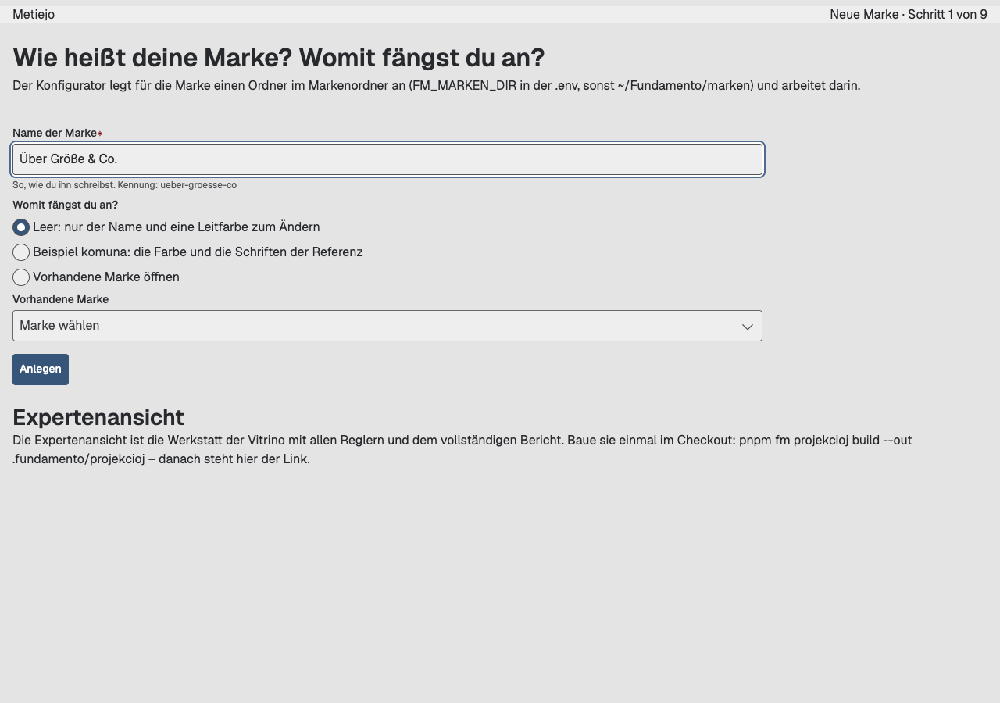
- K-3 Suche beim Tippen („prata“, Treffer ohne Enter): 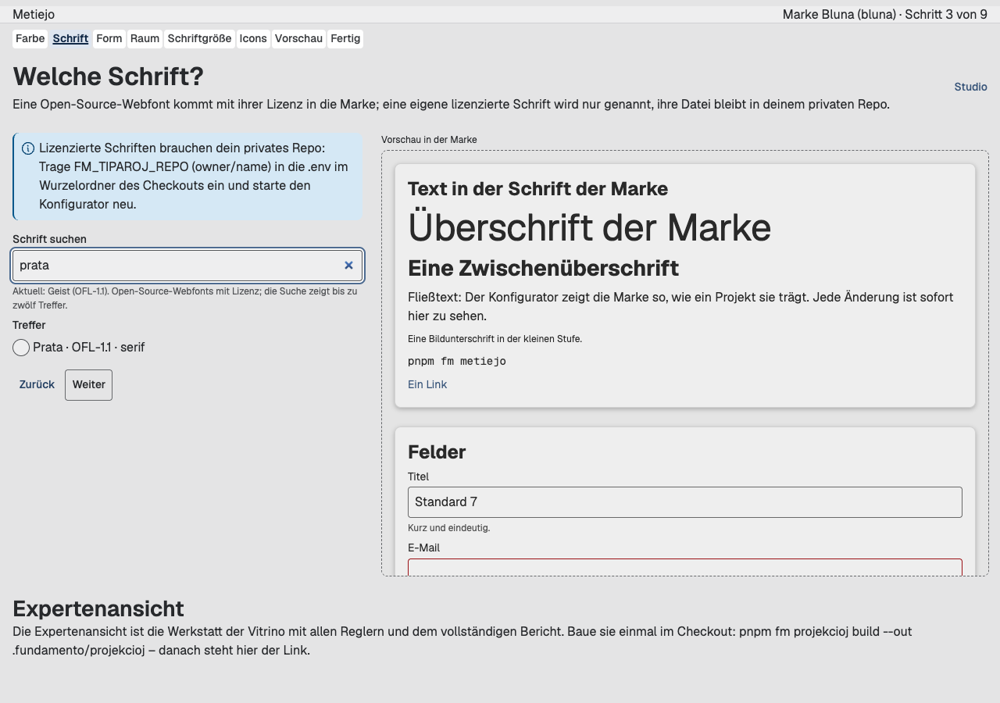
- K-4 ohne Treffer der Satz, was zu tun ist: 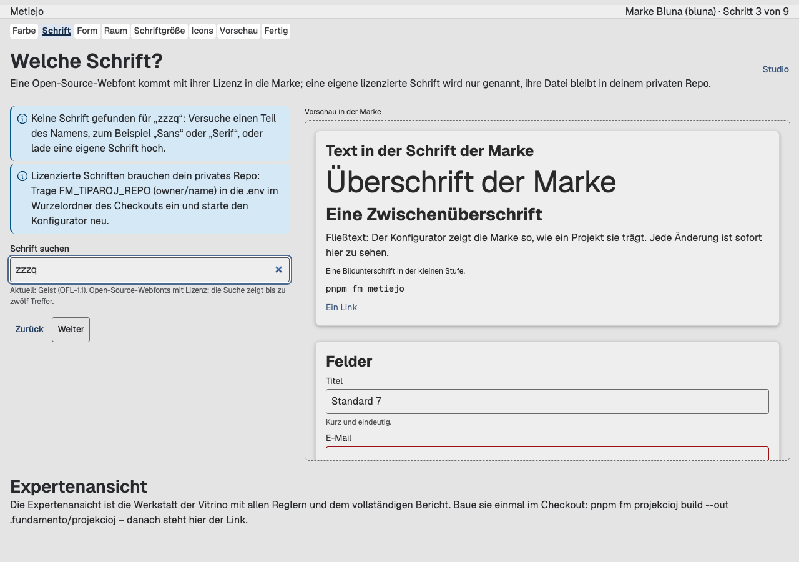
- K-5 Form als Wahl, „ganz rund“: Knöpfe und Felder als Pille, die Karte groß gerundet (Schrift Prata, K-6): 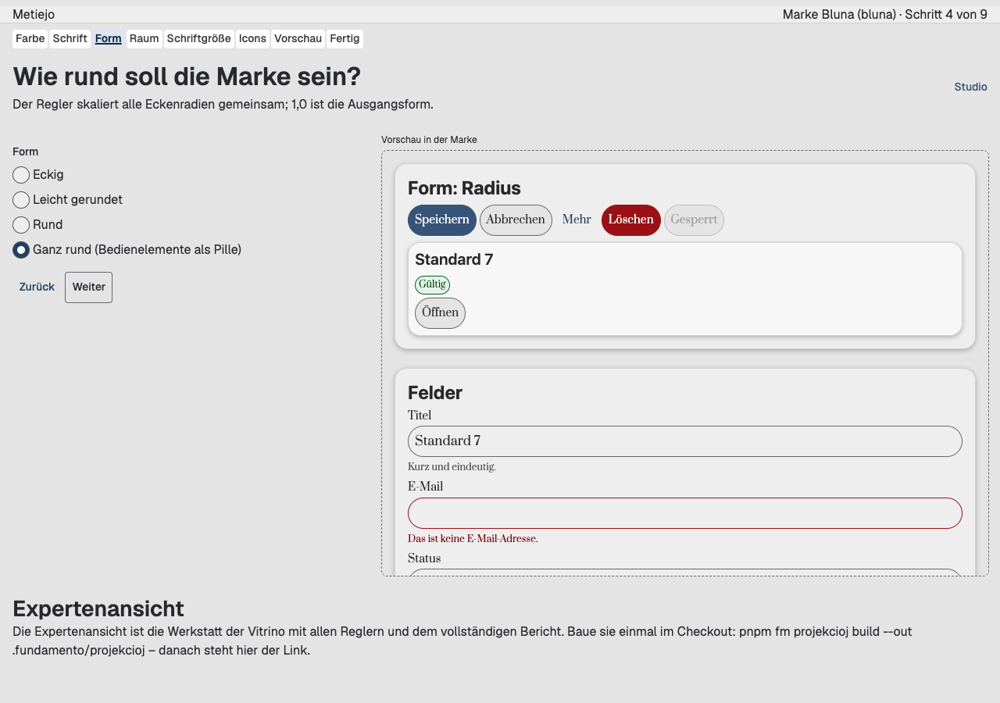

**Studio (1440 × 1000):**
- Farbe – Paletten mit Anzeigename „Ozean“, je Stufe Wert, OKLCH, Kontrast hell/dunkel, Herkunft: 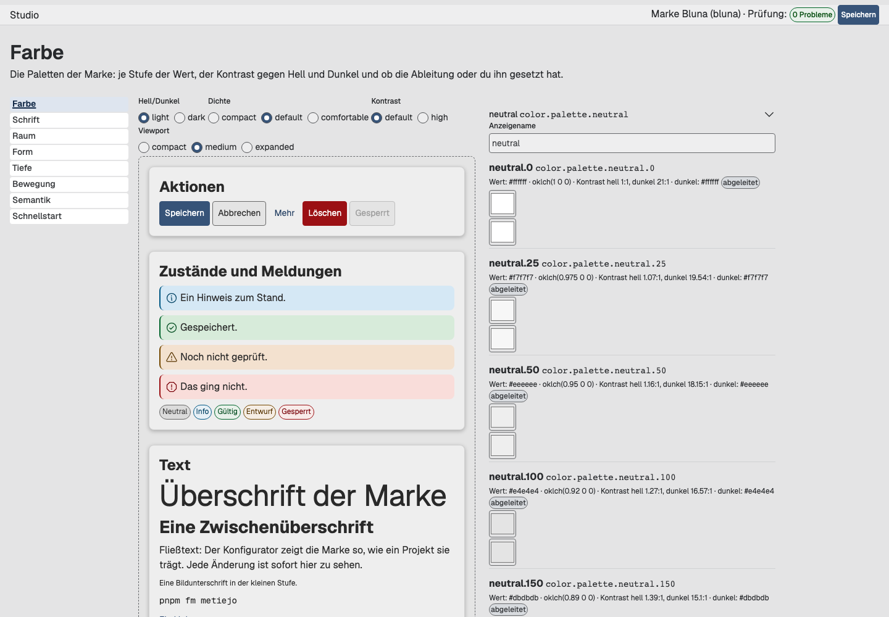
- Schrift – Familien, Größe je Viewport, Stärke, Zeilenhöhe, Laufweite, Typo-Leiter: 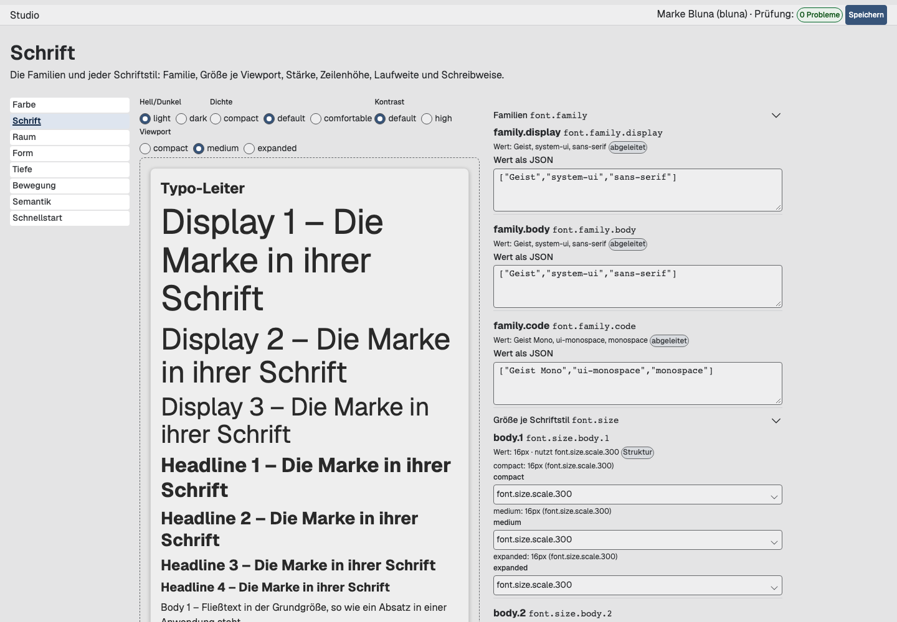 · dunkel und Viewport compact über die Kopfzeile: 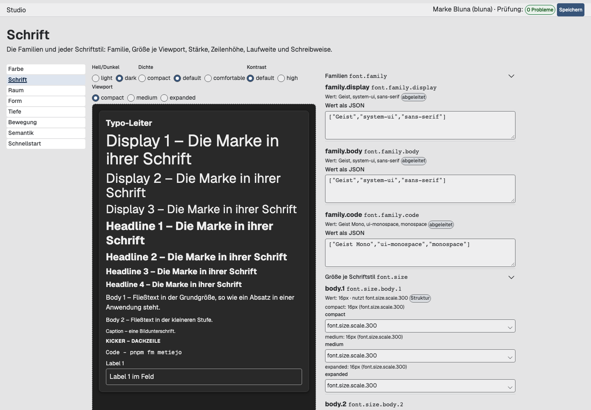
- Raum: 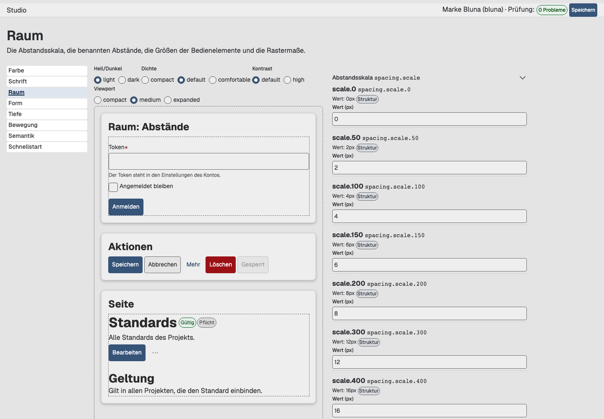
- Form: 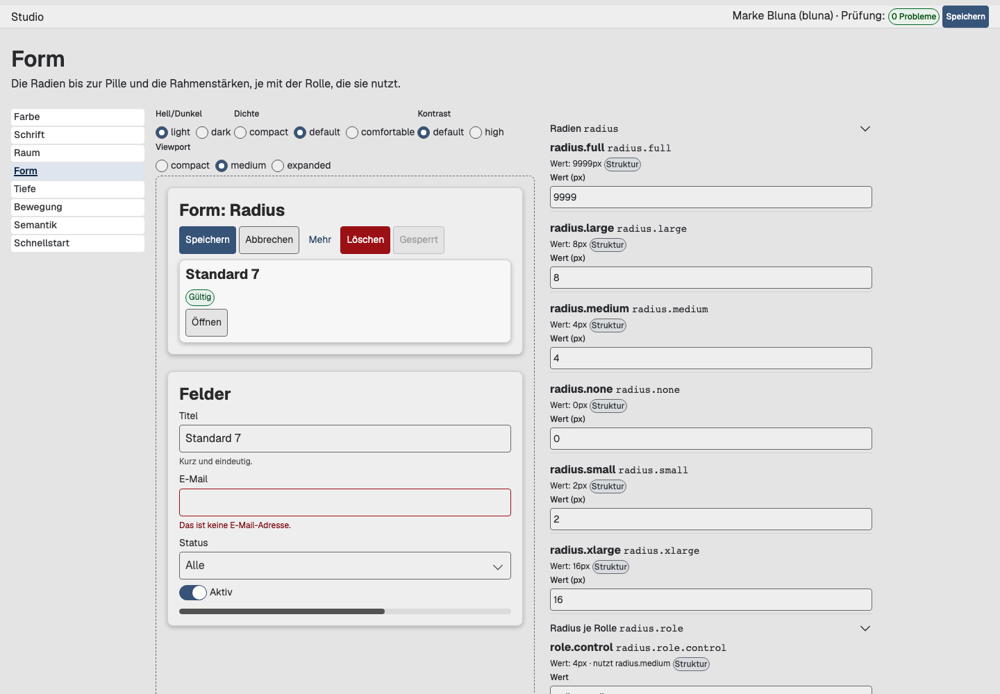
- Tiefe: 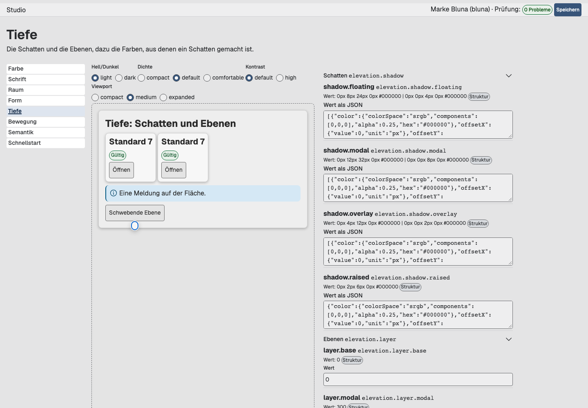
- Bewegung: 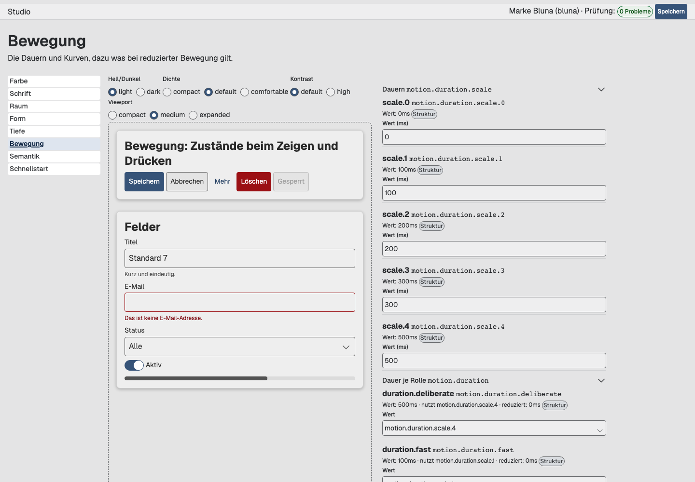
- Semantik – je Rolle die Stufe hell und dunkel mit Kandidaten: 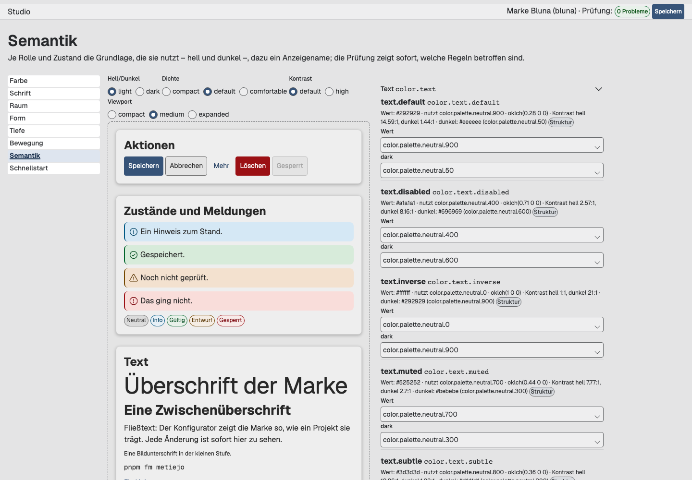 · ein Wert, der eine feste Regel bricht (Text auf neutral.100), wird abgelehnt – Satz, Vorschlag, das Feld zeigt wieder den Wert, der gilt (M-5): 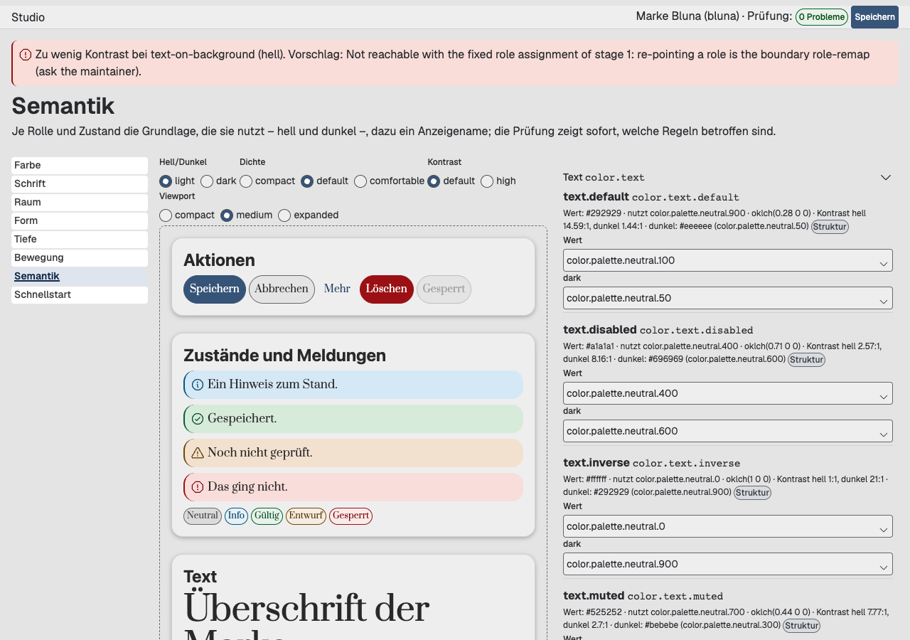

### Abweichungen

1. **Der Vorschlag bei einer Ablehnung ist der des Agordilo.** Bei einer umbelegten Rolle sagt er heute „re-pointing a role is the boundary role-remap (ask the maintainer)“ (englisch, aus Spec 016). Ein Vorschlag, der die nächste Stufe nennt, die besteht, braucht je Kandidat eine Ableitung (1,3 s); das ist ein Kandidat für Runde 2 (O-3).
2. **„Aus Leitfarbe neu ableiten“ ist kein Knopf** (D-04): die Ableitung trägt jede nicht gesetzte Stufe immer; eine gesetzte wird je Stufe zurückgesetzt.
3. **Die Schreibweise (Großbuchstaben) der Schriftstile ist lesbar, nicht setzbar** (D-11): sie steht in einer Token-Erweiterung, nicht im Wert; `festgelegt` setzt Werte und Aliasse.
4. **Schatten und Kurven werden als JSON gesetzt** (D-11): kein Ero für zusammengesetzte Maße (Manko-Kandidat B-2).
5. **Eine Schrift für Anzeige und Fließtext** bleibt wie in Spec 023 (O-2 dort); im Studio sind die drei Familien einzeln lesbar, gesetzt werden sie über den Schnellstart und `schriften`.
6. **`shade` ist die siebte Palette** des Studios (die Deckkraftstufen der Schatten), obwohl der Agordilo sechs ableitet: sie gehört zur Struktur und ist setzbar.
7. **Die Prüfung je Änderung dauert 1,3 s** (warm; 3,1 s die erste): das Studio prüft bei jedem Setzen, nicht beim Ziehen – es gibt keine Regler im Studio, jede Änderung ist ein Wert.
8. **Keine Zahl der Ero-Tokens und keine Figma-Variablen in Runde 1:** Ero-Tokens kommen mit dem Amendment in Runde 2; die Figma-Variablen sind unverändert (ein Konjunktions-Set der Marke je Dimensio wird zu Werten derselben Variablen in den Modi, keine neue Variable).

### Befunde / Mankoj

- **B-1 Manko-Kandidat Regler und Farbwähler** (wie Spec 023 B-2): im Studio ist der Farbwähler nativ (`input type=color`), alles andere ein Ero.
- **B-2 Manko-Kandidat zusammengesetzte Maße:** ein Ero für einen Schatten (Versatz, Unschärfe, Farbe) oder eine Kurve fehlt; Schließbedingung: ein Ero mit Feldern je Teil, das Studio setzt es ein.
- **B-3 Die Sxablono `sxelo` legt die Navigation unter den Kopf**, nicht links. Das Studio stellt die `fm-navigado` darum in die Seite (Raster aus drei Spalten); die Region `nav` der `sxelo` bleibt leer. Ein Sxablono „Arbeitsplatz“ mit Seitenleiste ist ein Kandidat für die Sxablonoj-Runde 2.
- **B-4 Der Vorschlag des Agordilo bei einer umbelegten Rolle** (Abweichung 1).
- **B-5 Fontsource trägt die Schnitte je Familie;** Prata hat nur 400, die Vorschau fragte 700 an (404 im Browser). Der Katalog trägt jetzt `weights`, die Vorschau fragt nur vorhandene Schnitte.
- **B-6 Zeiten:** Studio-Seite 75–140 ms, Vorschau-Stylesheet 60 ms, Prüfung je Setzen 1,3 s warm (3,1 s kalt), Speichern mit allen Exporten ≈ 4 s.
- **B-7 Ero-Tokens:** 0 (Runde 2). **Figma-Variablen:** unverändert gegenüber 0.2.0.
- **B-8** Eine gesetzte Stufe mit einem eigenen Wert kann `palette-even`/`palette-aligned` (anpassbar) verletzen; das Studio übernimmt sie und zählt das Problem – das Jugxo trägt die Expertenansicht ein (wie heute).

### Offen (für den Maintainer)

- **O-1 Palettenraster:** der Vorschlag oben (25, 150, 850, 975 für die farbigen Paletten) – Entscheidung des Maintainers, eigener PR.
- **O-2 Die Vorschau im Studio** zeigt je Seite einen festen Ausschnitt (Aktionen, Zustände, Text, Felder, Typo-Leiter, Tiefe); sollen die fünf Sxablonoj dazu?
- **O-3 Vorschlag bei Ablehnung:** die nächste Stufe, die besteht, berechnen (je Kandidat 1,3 s) – in Runde 2?
- **O-4 Schatten als JSON** (Abweichung 4): so lassen, oder Felder je Teil?

### Messanleitung

Alle Befehle im Checkout des Maintainers `/Users/thorstenjankowski/n8n-compose/20260918_fundamento-ds`, nach dem Merge dieses PR. Die Einstellungen stehen in `/Users/thorstenjankowski/n8n-compose/20260918_fundamento-ds/.env` (`FM_MARKEN_DIR` für den Markenordner, sonst `/Users/thorstenjankowski/Fundamento/marken`; `FM_TIPAROJ_REPO` wie in Spec 023). Die Testmarken der Messlatte (§ 7, nach Runde 2) bleiben in diesem Ordner.

```sh
cd /Users/thorstenjankowski/n8n-compose/20260918_fundamento-ds
pnpm install && pnpm build
pnpm fm projekcioj build --out .fundamento/projekcioj   # einmal, für die Expertenansicht
pnpm fm metiejo --open                                   # http://localhost:7301
```

**K-1 bis K-6 (Schnellstart):** http://localhost:7301 – Name „Bluna“ eintippen: die Kennung `bluna` erscheint klein unter dem Feld (K-1); ein Name ohne Buchstaben („!!!“) ergibt den Satz zur Kennung, der verschwindet, sobald der Name eine ergibt (K-2). Im Schritt Schrift „prata“ tippen: Treffer ohne Enter (K-3); „zzzq“ tippen: der Satz, was zu tun ist (K-4); Prata wählen, Weiter: die Vorschau steht in Prata, und `<Markenordner>/bluna/entwurf.json` trägt `schriften.body.family: "Prata"` (K-6). Im Schritt Form „Ganz rund“ wählen: Knöpfe und Felder sind Pillen, die Karte groß gerundet (K-5).

**M-1:** der Schnellstart von „leer“ bis zum Figma-Export in höchstens 10 Minuten, mit Stoppuhr, wie in Spec 023.

**Studio:** http://localhost:7301/studio/bluna (öffnet Farbe). Links die Seiten, in der Mitte die Vorschau mit den Umschaltern, rechts die Eigenschaften.
- Farbe: in der Akzentpalette den Anzeigenamen „Ozean“ eintragen; eine Stufe über den Farbwähler setzen – die Zeile sagt „gesetzt“, die Vorschau folgt, „Zurücksetzen“ nimmt es zurück.
- Schrift: über die Kopfzeile Viewport „compact“ wählen; bei `font.size.display.1` die Stufe für compact ändern – die Zeile zeigt den Wert je Viewport.
- Semantik: bei `color.text.default` die Stufe `color.palette.neutral.100` wählen: **abgelehnt** mit Satz und Vorschlag, das Feld springt zurück (M-5); `color.palette.neutral.950` wählen: übernommen, die betroffenen Regeln stehen unter der Seite, die Kopfzeile zählt die Probleme.

**M-5:** wie oben (Semantik): ein Wert, der eine feste Regel bricht, wird nicht übernommen; ein Wert, der eine anpassbare Regel bricht (Farbe: eine Stufe weit weg von ihren Nachbarn, `palette-even`), wird übernommen und als Problem gezählt; das Jugxo trägt die Expertenansicht ein.

**M-6 (dieselben Daten):** Im Studio eine Stufe setzen, dann „Schnellstart“ links: der Schritt Farbe zeigt die gesetzte Stufe in der Vorschau; dort die Leitfarbe ändern, zurück ins Studio: die nicht gesetzten Stufen sind neu abgeleitet, die gesetzte steht. Speichern im Studio und im Schnellstart schreiben dieselbe `agordo.json` (`festgelegt`, `etikedoj`, `historio`):

```sh
cat "<Markenordner>/bluna/agordo.json" | head -60
```

**Aspiro nur verschärfen:** in `<Markenordner>/bluna/agordo.json` ein `aspiroj: [{ "metriko": "wcag2-reserve", "min": 0.02, "kialo": "Test" }]` eintragen und `pnpm fm agordilo derive "<Markenordner>/bluna/agordo.json" --out /tmp/bluna-test` – abgelehnt mit `aspiro-loosens-regulo` und beiden Schranken; mit `min: 0.1` geschrieben.

**Expertenansicht:** der Link auf jedem Bildschirm, oder direkt `open "file:///Users/thorstenjankowski/n8n-compose/20260918_fundamento-ds/.fundamento/projekcioj/vitrino/index.html#modus=werkstatt"`.

**Tests:** `pnpm --filter @fundamento/metiejo exec vitest run src/studio.test.ts src/servilo.test.ts` (Studio, K-1 bis K-6, M-5, M-6), `pnpm --filter @fundamento/agordilo exec vitest run src/festgelegt.test.ts` (festgelegt, etikedoj, bytegleich), `pnpm --filter @fundamento/modelo exec vitest run src/validate/aspiroj-loosen.test.ts`.

## O-1 Palettenraster (eigener PR)

**Branch:** `261022-spec-024-o1-raster-f87267` (von `main` `8915fa6`, nach #99) · **Datum:** 2026-10-22 · **Stand:** zur Abnahme. Entscheidung des Maintainers vom 22.10. zu O-1: der Raster-Vorschlag aus ① gilt – die farbigen Paletten bekommen die vier Stufen der neutralen Palette, die ihnen fehlten, **25, 150, 850, 975**, für alle Marken abgeleitet. Eine Token-Änderung durch Spec, kein Amendment (§ 3 B).

### Zusammenfassung

1. **20 neue Kern-Tokens:** `color.palette.{accent,success,warning,danger,info}.{25,150,850,975}`, je mit ID aus dem Lock (`pnpm id:new token --count 20`), Rolle `palette` und Beschreibung; die farbigen Paletten haben 15 Stufen, die neutrale behält 17 (mit 0 und 1000), `shade` und `tint` bleiben. Plan ① zählte 24 (4 × 6) – die neutrale Palette hat die Stufen schon, also 20.
2. **Die Werte von komuna** (D-13): je neue Stufe die OKLCH-Helligkeit der gleichnamigen neutralen Stufe, die Buntheit als geometrisches Mittel der Nachbarn, der Farbton der Nachbarn, in den sRGB-Farbraum gebracht. Der erreichte Kontrast gegen Weiß entspricht dem geometrischen Mittel der Nachbarn aus dem Vorschlag in ① (25 ≈ 1,07 · 150 ≈ 1,39 · 850 ≈ 12,7 · 975 ≈ 18,1).
3. **Kalibrierung neu gemessen** (`pnpm --filter @fundamento/agordilo calibrate`): `calibration.json` trägt je farbiger Palette 15 Stufen mit Ziel hell und dunkel und relativer Buntheit; die Ableitung schreibt die neuen Stufen für jede Marke (§ 3 B: „Die Stufen, die eine Marke nicht nutzt, belegt die Ableitung“).
4. **Alle vorhandenen Marken belegen die Stufen (Art. IV):** komuna im Kern, `provo` und `provo-kompakta` neu abgeleitet (`fm agordilo derive`, Herkunft mit neuem Fingerabdruck der Struktur), `ekzemplo` von Hand mit erfundenen Werten nach derselben Regel aus seinen eigenen Paletten.
5. **Die Reguloj bleiben grün:** `palette-even`, `palette-aligned`, `srgb-gamut` und das Aspiro `oklch-l-step` (0,04–0,2 je 100 Stufeneinheiten) von komuna – gemessen, nicht gelockert. Keine Rolle zeigt auf eine neue Stufe, die KontrastParoj sind unverändert.
6. **Studio und Werkstatt** zeigen die neuen Stufen von selbst (die Zeilen und Kandidaten kommen aus dem Modelo): je Stufe Wert, OKLCH, Kontrast, Herkunft, setzbar und zurücksetzbar.

### Constitutional Compliance Review

- **Art. I:** konform – die Tokens stehen im Kern, Kalibrierung und Fixtures sind aus ihm abgeleitet; keine Projekcio von Hand.
- **Art. II:** konform – kanonische Namen `color.palette.<palette>.<stufe>`, die Bezeichner der Celoj folgen mechanisch.
- **Art. III:** konform – `resolve` und `describe` nennen die neuen Tokens ohne Änderung.
- **Art. IV:** konform – jede Aspekto belegt jede neue Stufe (Test je Fixture); `aspekto-incomplete` erzwingt es.
- **Art. V:** konform – kein fremder Style-Guide geöffnet; die Werte sind aus komuna gerechnet.
- **Art. VI:** konform – keine Regulo geändert, keine Schranke gelockert; das Aspiro von komuna hält (D-13).
- **Art. VII:** konform – die Beschreibung jeder Stufe nennt Spec und Entscheidung; die Fixtures tragen den Fingerabdruck der Struktur.
- **Art. VIII:** konform – DTCG-Farbwerte, nichts Webspezifisches.
- **Art. IX:** konform – keine neue Fähigkeit an Eroj.
- **Art. X:** konform – rot in `23dec57`, dann grün; alle Prüfungen laufen unverändert.
- **Art. XI:** konform – kein Paket, kein Code; 20 Tokens, eine Messung, drei Fixtures.
- **Art. XII:** konform – DTCG; `$themes.json` unverändert (kein neuer Set).
- **Art. XIII:** konform – der Schnellstart ändert sich nicht; das Studio zeigt vier Stufen mehr je Palette.

### Entwurfsentscheidungen

#### D-13 Die neue Stufe nimmt die Helligkeit der neutralen Stufe
Der Vorschlag in ① nannte als Ziel das geometrische Mittel der Nachbarkontraste. Gerechnet ergibt das für 975 einen Schritt von 0,21–0,22 OKLCH-L je 100 Stufeneinheiten (950 → 975), über dem Aspiro `oklch-l-step ≤ 0,2` von komuna; die neutrale Palette macht denselben Schritt mit 0,16. Darum nimmt jede neue Stufe die OKLCH-Helligkeit der gleichnamigen neutralen Stufe (25: 0,975 · 150: 0,89 · 850: 0,32 · 975: 0,2): `palette-aligned` hält damit von selbst (Spreizung 0 an diesen Stufen), `palette-even` und das Aspiro messen dieselben Schritte wie bei neutral, und der Kontrast landet beim geometrischen Mittel der Nachbarn. Die Buntheit ist das geometrische Mittel der Nachbarn (am Rand die halbe Buntheit des einen Nachbarn), der Farbton der Mittelwert der Nachbarn, die Buntheit auf den sRGB-Farbraum begrenzt (`maxChroma`).

### Messungen

| Stufe | accent | success | warning | danger | info | Kontrast hell (≈) |
|---|---|---|---|---|---|---|
| 25 | `#f5f7f9` | `#f4f8f4` | `#faf6f1` | `#fbf5f4` | `#f3f7fb` | 1,07 |
| 150 | `#d1dce9` | `#c9e3cd` | `#ecd7bb` | `#f7d1ca` | `#c5dff2` | 1,39 |
| 850 | `#1a3454` | `#013f06` | `#4b2a01` | `#660100` | `#01345d` | 12,7 |
| 975 | `#0e1721` | `#0c1a0b` | `#1e130b` | `#270d0a` | `#0b1724` | 18,1 |

Schritte in OKLCH-L je 100 Stufeneinheiten nach der Änderung (komuna, hell): 25 → 50 0,099 · 100 → 150 0,06 · 150 → 200 0,06 · 800 → 850 0,076 · 850 → 900 0,084 · 950 → 975 0,16 – alle innerhalb 0,04–0,2. Kern-Tokens 356 → 376 (im Band 250–400). Figma-Variablen 856 → 876 (+20 in der Sammlung `aspekto`, eine je Token, jede Marke ein Modus).

### Abweichungen

1. **20 statt 24 Tokens** (Plan ① zählte die neutrale Palette mit, die die Stufen schon hatte).
2. **Ziel nicht das geometrische Mittel, sondern die Helligkeit der neutralen Stufe** (D-13); der erreichte Kontrast entspricht dem Mittel auf die zweite Stelle.
3. **Keine Rolle nutzt die neuen Stufen** – wie in ① gesagt, bis eine Spec es will; die KontrastParoj bleiben.
4. **Die Prüfsummen der Stufe-1-Ableitung** (`packages/agordilo/fixtures/stufe1-provo.json`, Spec 019 ①: „Standard der Regler = Stufe 1“) sind mit den neuen Stufen neu gerechnet; die Eigenschaft bleibt geprüft (`stufe2.test.ts`), die Herkunft im Fixture sagt es.

### Messanleitung

```sh
cd /Users/thorstenjankowski/n8n-compose/20260918_fundamento-ds
pnpm install && pnpm build
pnpm -s fm modelo validate                                  # grün, 376 Tokens
pnpm --filter @fundamento/agordilo calibrate -- --check     # die Kalibrierung ist die Messung von komuna
pnpm fm projekcioj build --out .fundamento/projekcioj
open "file:///Users/thorstenjankowski/n8n-compose/20260918_fundamento-ds/.fundamento/projekcioj/vitrino/index.html"   # Paletten mit 15 Stufen
pnpm fm metiejo --open                                      # http://localhost:7301/studio/<name>/farbe – je farbige Palette 15 Stufen
```

Tests: `pnpm --filter @fundamento/modelo exec vitest run src/data/raster-024.test.ts`, `pnpm --filter @fundamento/agordilo exec vitest run src/raster-024.test.ts src/calibration.test.ts src/derive.test.ts`, `pnpm --filter @fundamento/metiejo exec vitest run src/studio.test.ts`.

## ② Runde 2

**Branch:** `261022-spec-024-runde-2-ero-tokens-f87267` (gestapelt auf O-1 `261022-spec-024-o1-raster-f87267`, #100, von `main` `8915fa6` nach #99) · **Datum:** 2026-10-22 · **Stand:** zur Abnahme. Der erste Commit ist das **Constitution Amendment v2.3** (`c6396cf`), freigegeben vom Maintainer am 21.10., 21:23. **Clean Room (§ 8, Art. V):** kein fremder Style-Guide wurde gesucht oder geöffnet; Grundlage ist allein die Spec. Entscheidungen des Maintainers (22.10.): O-2 Muster in der Studio-Vorschau ja; O-3 Vorschlag mit der nächsten Stufe der eigenen Palette ja; O-4 Schatten als Felder (x, y, Unschärfe, Ausdehnung, Farbe). Pflicht: zwei Schriftfamilien (Anzeige und Fließtext), Schreibweise setzbar, Vorschläge auf Deutsch aus den Übersetzungen.

### Zusammenfassung

1. **Amendment v2.3** (eigener erster Commit): Terminologie **Ero-Tokeno** („Ein Token des Vortaro je Ero, Teil, Variante und Zustand, mechanisch aus dem Skemo abgeleitet; standardmäßig ein Alias auf einen Rollen-Token; eine Marke darf ihn umbelegen“), Art. IV „Das Vortaro hat drei Ebenen: Grundlagen (Paletten, Skalen), Rollen (semantisch) und Ero-Tokens (je Komponente). Jeder Aspekto belegt alle drei; ein Alias ist eine Belegung“, Historie v2.3 mit Grund und Migration; der Begriff in der Ontologio (21 Begriffe der Tabelle; ein Begriff darf einen Bindestrich tragen: Prüfung und Schema der Ontologio).
2. **Die Ero-Tokens** (`packages/modelo/src/eroj/ero-tokenoj.ts`, D-14): je Teil-Eigenschaft jedes Ero und jeder Sxablono ein Token je erlaubter Kombination seiner Schlüssel – `ero.butono.surface.fill.emphasis.high.intent.neutral.hover`, `ero.butono.border.width`, `ero.butono.label.typography.size.medium`, `sxablono.pagxo.frame.gap` –, mechanisch aus dem Skemo (Art. II): Art, Ero, Teil, Eigenschaft, je Achse Name und Wert, zuletzt der Zustand; ein Bindestrich des Skemo wird ein Segment der Token-Grammatik. Der Wert ist der Alias auf den Rollen-Token, den das Skemo bindet; ein Zustand ohne eigene Bindung bekommt den Token von `rest` als Alias, so hat jede Zelle der Matrix einen Token (D-17). **908 Ero-Tokens:** 874 der 34 Eroj, 34 der 5 Sxablonoj. 30 Zellen, die an ein Schlüsselwort (`inherit`, `none`) oder einen Lagebegriff gebunden sind, haben keinen Token (D-16); ein `sameAs` folgt seinem Ziel.
3. **Der Kern trägt die dritte Ebene** (D-15): `pnpm vortaro:ero-tokenoj [--root | --config] [--check]` (`eroj/ero-tokenoj-cli.ts`) schreibt die Gruppen `ero` und `sxablono` ans Ende von `core.json` – je Token `$type`, `$value` als Alias, `$description`, ID aus dem Lock, bei Farben die Rolle `ero` –, hält vorhandene Werte und IDs, entfernt, was kein Skemo mehr ableitet (ID zurückgezogen), und mit `--config` dieselben Aliasse in den Haupt-Set jeder Aspekto eines Projekts. Zwei Regeln im Modelo (RULE_IDS 180): `ero-tokeno-missing` (ein abgeleiteter Token fehlt im Kern oder hat den falschen Typ) und `ero-tokeno-unknown` (ein Token der dritten Ebene, den kein Skemo ableitet); zwei Fixtures beweisen beide.
4. **Migration als Alias (Art. IV, M-3):** komuna im Kern, `ekzemplo` und das Fixture `aspekto-incomplete` über `--config`, `provo` und `provo-kompakta` neu abgeleitet (die Ableitung kopiert den Kern, also auch die dritte Ebene), die 80 Fixture-Modelle mit Eroj über `--root`; eine Marke des Metiejo bekommt die Ebene beim nächsten Speichern von selbst. Der Test `ero-tokenoj.test.ts` (Modelo) prüft: jeder Ero-Token löst in komuna, provo, provo-kompakta und ekzemplo in hell und dunkel auf denselben Wert wie sein Rollen-Token, auch die Schreibweise.
5. **Projekcioj und Eroj lesen die Ero-Tokens** (D-21): der Web-Celo bindet jeden Teil an seinen Ero-Token (`var(--fm-ero-butono-surface-fill-emphasis-high-intent-neutral-hover)`, Typografie je Feld, der Fokusring, der Chevron des Elektilo, die Listen des Light DOM, die Sxablonoj an `--fm-sxablono-…`); der CSS-Celo schreibt die dritte Ebene als Alias-`var()`, die Schreibweise eines Alias folgt seinem Ziel (D-20, auch im Resolver); der Figma-Celo macht jeden Ero-Token zur Variable der Sammlung `aspekto` (je Marke ein Modus, der Wert ein Alias auf die Rolle) und bindet die Komponenten, die Stand-ins und den Schatten an sie; ein Ero-Token eines Gewichts (`ero.navigado.items.weight.current.true`) bekommt wie `font.weight.*` seinen STRING-Zwilling für den Schnitt (F30, vier Zwillinge: `…/items/style/current/true`), den das Plugin an `fontStyle` bindet; Tailwind hat für `ero.*` kein Ziel (`--fm-*` bleibt), Penpot und Tokens Studio bekommen die Aliasse als DTCG; der Paritäts-Inventar der Skemo-Seite liest die Zelle über ihren Ero-Token. **Figma-Variablen:** 876 → 2 439 (Repo: komuna, ekzemplo über die Release-Fixture nicht mitgezählt; provoj-Plan 2 441), davon 1 563 der dritten Ebene – ein Typografie-Token zählt sechs Felder, ein Schatten fünf je Ebene, ein Ring drei (Abweichung 5).
6. **Pixelgleich (M-3):** ohne Umbelegung ist jeder Ero-Token ein Alias auf genau den Token, den der Web-Celo vorher schrieb; `projekcioj/src/ero-tokenoj.test.ts` misst es über jede Marke × Farbschema × Kontrast (komuna, provo, provo-kompakta, ekzemplo): keine Abweichung. Die Celo-Suiten lesen die erzeugten Stylesheets und den Figma-Plan **durch die Rollen** (`test-doubles/tra-roloj.ts`, D-21): die Aufzeichnung, was jedes Ero bindet, bleibt lesbar, die Übersetzung ist die Ableitung selbst.
7. **Feste Reguloj auf der dritten Ebene (§ 5 Grenze 1, D-19):** eine Zelle, deren Text oder Fläche eine Marke von der Rolle wegbelegt, wird als Kontrastpaar gemessen (`eroKontrastParojOf`, in `evaluateAlirebleco`), mit der Kategorie des erklärten Rollenpaars; ohne Umbelegung sind es die erklärten Paare – nichts doppelt. Ein Alias auf einen Rollen- oder Palettentoken ist erlaubt, ein Farbliteral nicht (`semantic-colors-alias-palette` ausgeweitet, D-18); die Rolle `ero` (TokenRole) hält die Paarpflicht der Rollen davon frei.
8. **`festgelegt` auf der dritten Ebene** (Agordilo): ein Alias oder ein Wert je Ero-Token wie bei jeder Rolle, je Dimensio-Bedingung (`modoj`); dazu **`schreibweise`** (none, uppercase, lowercase, capitalize) je Schriftrolle, geschrieben als `textTransform` in die Erweiterung des Tokens im Haupt-Set – die eine Erweiterung, die ein Override tragen darf. Der Kontrast-Verstoß einer wegbelegten Zelle ist ein fester Verstoß der Raporto; das Studio lehnt ab (M-5).
9. **Komponentenseiten (§ 4 Komponenten, M-4, D-22):** `/studio/<name>/ero/<ero>` und `/studio/<name>/sxablono/<sxablono>` aus dem Skemo (`metiejo/src/komponentoj.ts`): links unter den Grundlagen die 39 Komponenten (`fm-faldilo` „Komponenten“), die **Anatomie** (jeder Teil mit deutschem Namen und seinen Eigenschaften), die **Matrix** Varianten × Zustände (die Achsen des Skemo, die Zustände; ein Klick wählt die Zelle, sie steht in der URL `?zelo=emphasis=high,intent=neutral,size=medium,state=hover`; die erste Zelle sind die Standardwerte der Props), rechts die **Ero-Tokens der Zelle** je Teil – Alias mit Kandidaten (Farben: alle Rollen, dann die Palettenstufen; sonst die Familie der Rolle), Maße als Wert, Typografie als Wahl des Schriftstils, Herkunft, Zurücksetzen –, dazu das **Verhalten** (Achsen und Props des Skemo, Lagebegriffe) und der **Gebrauch** auf Deutsch aus den Übersetzungen (Zweck, Stattdessen, Grenzen, Do, Don't, Tastatur, Schreibregeln). Die Vorschau zeigt das Ero in jeder Variante und je Zelle die Farbfelder ihrer Ero-Tokens (D-23). M-4 ist mit dem Test-Skemo `ero-minimal` geprüft: die Seite entsteht aus einem fremden Modelo ohne Code.
10. **O-2:** unter jeder Seite der Grundlagen stehen die fünf Sxablonoj in der mittleren Breite. **O-3:** ein abgelehnter Alias auf eine Palettenstufe bekommt als Vorschlag die nächste Stufe derselben Palette, die besteht (nach Abstand, höchstens vier Versuche, je eine Ableitung; D-24). **O-4:** Schatten sind Felder je Ebene – x, y, Unschärfe, Ausdehnung, Farbe als Alias oder Farbwähler mit Deckkraft (D-25). **Zwei Schriftfamilien:** der Schnellstart fragt „Für welche Schrift?“ (Anzeige, Fließtext, beide), das Studio sucht je Familie (Anzeige, Fließtext, Code) mit eigener Trefferliste (D-26). **Schreibweise:** je Schriftstil eine Wahl (Wie geschrieben, Versalien, Kleinbuchstaben, Große Anfangsbuchstaben), die Zeile sagt sie. **Vorschläge auf Deutsch:** Satz und Vorschlag einer Ablehnung kommen aus den deutschen Namen der Regeln, sonst aus den übersetzten Statements der Reguloj (`reguloIn(…, "de")`); kein englischer Satz des Agordilo mehr.
11. **Kleinste Änderungen daneben:** `TokenRole` + `ero` (zehn Rollen), die Ontologie erlaubt einen Bindestrich im Begriff, das Band 250–400 misst die ersten zwei Ebenen (`coverage.test.ts`), der Penpot-Test zählt die übersprungenen Typen statt 24 zu nennen, die Test-Doubles erzeugen nach einer Skemo-Änderung die dritte Ebene neu (`withEroTokenoj`), die Motion-Regel misst nur die Rollen, die Celo-Suiten lesen durch die Rollen (`tra-roloj.ts`), README („Ero-Tokens“, `vortaro:ero-tokenoj`), Vojmapo.

### Constitutional Compliance Review

- **Art. I (Modelo-First):** konform. Die dritte Ebene ist eine Gruppe des Kerns, aus dem Skemo erzeugt wie `$themes.json` aus den Sets; die Projekcioj lesen sie, keine schreibt von Hand; `ero-tokeno-missing`/`-unknown` halten Skemo und Kern zusammen.
- **Art. II (Unu Vortaro):** konform. Der Name eines Ero-Tokens folgt mechanisch aus dem Skemo (D-14); CSS, Figma, Tailwind und Penpot leiten ihre Bezeichner wie bisher ab; das Beispiel der Spec steht in der Grammatik des Vortaro (Abweichung 1).
- **Art. III (Maschinenlesbarkeit):** konform. `resolve`, `describe`, `modelo.json` und die Penpot-Ordner tragen die Ero-Tokens; ein eigenes MCP-Werkzeug je Komponentenseite ist Runde 3 (Offen).
- **Art. IV (Multmarkeco):** konform, nach dem Amendment: jeder Aspekto belegt die dritte Ebene, ein Alias zählt; `aspekto-incomplete` erzwingt es (Test je Fixture-Marke).
- **Art. V (Clean Room):** konform. Kein fremder Style-Guide; keine Namen oder Werte von außen.
- **Art. VI (Regularo kun Kialoj):** konform. Zwei Prüfregeln mit Satz und Vorschlag; `semantic-colors-alias-palette` ausgeweitet, nicht gelockert; die feste Kontrastregel gilt auf der dritten Ebene (D-19).
- **Art. VII (Agenta Dokumentado):** konform. Jeder Ero-Token trägt seine Beschreibung (Ero, Teil, Zelle, Herkunft v2.3); die Komponentenseiten lesen Uzo und Reguloj aus dem Modelo, auf Deutsch aus `tradukoj.json`.
- **Art. VIII (Web-first, mobiles Modell):** konform. Ero-Tokens sind DTCG-Typen (color, dimension, typography, shadow, strokeStyle, …), keine CSS-Eigenschaft; die Abbildung auf CSS und Figma bleibt Celo-Wissen.
- **Art. IX (Vertikaler Durchstich):** konform. Die Ebene läuft vom Skemo durch Kern, Aspektoj, alle Celoj, Eroj, Studio und Prüfung – für alle 34 Eroj, weil die Ableitung mechanisch ist.
- **Art. X (Test-first):** konform. Rot in `a8f5858`, dann grün; die vier Prüfungen laufen; M-3 als Test, M-4 mit Test-Skemo.
- **Art. XI (Einfachheit):** konform. Kein neues Paket, keine Abhängigkeit; drei Module (`ero-tokenoj.ts`, `ero-tokenoj-cli.ts`, `komponentoj.ts`), ein Test-Helfer.
- **Art. XII (Interoperabilität):** konform. DTCG bleibt das Speicherformat; die Ero-Tokens sind Variablen der Sammlung `aspekto`, Marken bleiben Modi (§ 3 A).
- **Art. XIII (Einfachheit der Nutzung):** konform. Niemand tippt einen Token-Namen: die Zelle ist ein Klick, der Alias eine Wahl aus Kandidaten; der Schnellstart bleibt der Weg in 10 Minuten (M-1 unverändert).

### Entwurfsentscheidungen

#### D-14 Der Name eines Ero-Tokens ist das Skemo in der Grammatik des Vortaro
`<art>.<ero>.<teil>.<eigenschaft>[.<achse>.<wert>]*[.<zustand>]`: die Spec nennt `ero.butono.emphasis-high.fill.hover`; die Grammatik des Vortaro (`[a-z0-9]+`, mit Punkt) kennt keinen Bindestrich, und `fill` ohne Teil wäre nicht eindeutig (Farbe hat Beschriftung, Rahmen und Icon). Darum tragen die Segmente Ero, Teil, Eigenschaft, je Achse Name und Wert (nur die Achsen, die die Eigenschaft schlüsseln) und den Zustand bloß; `focus-ring` wird `focus.ring`, `inline-padding` wird `inline.padding`. Das Skemo ist die einzige Quelle; die Namen über das mechanische Schema hinaus entscheidet der Maintainer (§ 8).

#### D-15 Der Kern trägt die dritte Ebene als erzeugte Gruppe
Art. I verlangt, dass alles im Modelo steht, Art. XII, dass das Vortaro DTCG ist, Art. IV, dass jede Aspekto jeden Token belegt. Darum liegen die Ero-Tokens als Gruppen `ero` und `sxablono` in `core.json` und im Haupt-Set jeder Aspekto, wie `$themes.json` aus den Sets erzeugt: `pnpm vortaro:ero-tokenoj` schreibt nur diese Gruppen (der Rest des von Hand geschriebenen Kerns bleibt Byte für Byte), hält vorhandene Werte und IDs (komuna darf umbelegen), zieht die ID eines entfernten Tokens zurück, und die beiden Regeln melden jede Drift. Ein Lader, der die Ebene nur im Speicher erzeugte, hätte sie Tokens Studio und Penpot verschwiegen.

#### D-16 Ein Schlüsselwort und ein Lagebegriff haben keinen Token
`inherit` (ein Link im Satz erbt) und `none` (kein Rahmen, kein Haken) sind Struktur, keine Werte einer Marke; `start`/`end` ist ein Begriff. Diese 30 Zellen bleiben im Skemo; ein `sameAs` folgt seinem Ziel und hat keinen eigenen Token (das Icon nimmt die Farbe der Beschriftung – ein eigener Token wäre eine neue Fähigkeit, § 5 Grenze 3).

#### D-17 Jede Zelle der Matrix hat einen Token
Ein Zustand ohne eigene Bindung fiel im Web-Celo auf `rest` zurück; die Ableitung macht daraus einen Token je Zustand mit dem Alias auf den Token von `rest`. So kann eine Marke `hover` belegen, wo das Skemo keinen eigenen Wert kennt, und die Matrix ist vollständig (§ 4: „ein Klick wählt die Zelle“).

#### D-18 Ein Ero-Token aliasiert eine Rolle oder eine Palettenstufe, nie ein Farbliteral
`semantic-colors-alias-palette` verlangt von jeder semantischen Farbe einen Alias auf die Palette, damit eine Marke eine Palettenstufe ändert und jede Verwendung folgt. Für die dritte Ebene heißt das: Alias auf eine Rolle (die zweite Ebene) oder eine Stufe (die erste), nie ein Literal und nie ein anderer Ero-Token. Maße, Schatten und Schriftstile nehmen einen eigenen Wert wie bisher. Regel 0: nicht gelockert, nur auf die neue Ebene gezogen.

#### D-19 Kontrast auf der dritten Ebene: nur die Zellen, die abweichen
Jede Zelle, deren Text oder Fläche eine Marke anders belegt als das Skemo bindet, wird als Paar gemessen (Text-Teil auf Fläche, je Kombination, ohne `disabled`), mit der Kategorie des erklärten Paars der Rollen, sonst `text-normal`. Zellen ohne Abweichung sind die erklärten Paare, die schon gemessen werden – so bleiben Raporto und Prüfzahlen der vorhandenen Marken unverändert, und die Studio-Ablehnung (M-5) greift genau dort, wo eine Umbelegung die feste Regel bricht.

#### D-20 Die Schreibweise folgt dem Alias
`textTransform` steht neben dem Wert, nicht darin; ein Alias ohne eigene Schreibweise nahm bisher keine. Ein Ero-Token auf `typography.kicker` muss die Versalien der Rolle tragen: der Resolver folgt der Alias-Kette bis zum ersten Token mit Schreibweise, der CSS-Celo schreibt für einen Alias `text-transform: var(--fm-<ziel>-text-transform)`. Ein gesetzter Wert gewinnt weiterhin (`schreibweise` in `festgelegt`).

#### D-21 Die Celoj lesen die Ero-Tokens, die Suiten lesen durch die Rollen
Web-Celo, Sxablono-Vorlage, CSS-Celo, Figma-Celo und der Paritäts-Inventar nehmen je Zelle `eroTokenOf` (sonst den gebundenen Token). Die bestehenden Suiten der Celoj sind die Aufzeichnung, was jedes Ero bindet (`var(--fm-color-action-primary-rest)`, `color/action/primary/rest`); statt 470 Erwartungen umzuschreiben, lesen sie die Ausgaben durch die Rollen, die die Ero-Tokens standardmäßig aliasieren (`tra-roloj.ts`: die Übersetzung ist `eroTokenojOfModelo`, nie eine eigene Liste; nur die Bindungen, nie die Variablen). Dass die Ausgaben die Ero-Tokens nennen, beweist `ero-tokenoj.test.ts` je Celo.

#### D-22 Die Komponentenseite ist eine Funktion des Skemo
`komponentoViewOf(kontext, ref, kombination, zelo)` nimmt irgendein Modelo mit dem Ero (M-4): Anatomie aus `parts`, Matrix aus `variantKeys` × `states` (Constraints ausgeschlossen), die Zelle aus der URL mit den Standardwerten der Props als Vorgabe, die Zeilen aus den Ero-Tokens der Zelle (eine Eigenschaft, die ein Schlüssel außerhalb der Matrix schlüsselt – der Zustand eines Eintrags –, bekommt je Wert eine Zeile), Kandidaten je Typ (Farben: Rollen, dann Stufen; sonst die Familie der Rolle), Verhalten aus `props` und Lagebegriffen, Gebrauch aus Uzo und Reguloj über `uzoIn`/`reguloIn` auf Deutsch. Eine Sxablono ist ein Skemo aus Teilen allein: eine Zelle.

#### D-23 Die Vorschau zeigt das Ero je Variante und je Zelle ihre Farbfelder
Zeigen, Drücken und Fokus sind Pseudoklassen des Browsers; eine Vorschau kann sie nicht erzwingen. Darum steht je Variante das Element (mit seinen Props und einem Wort im Standard-Slot) und je Zelle ein Farbfeld je Füllung und Farbe aus den Ero-Tokens der Zelle (`var(--fm-ero-…)`), live aus demselben Stylesheet. Eroj ohne Textslot stehen bloß (Abweichung 9).

#### D-24 Der Vorschlag ist die nächste Stufe, die besteht
Bei einem abgelehnten Alias auf `color.palette.<p>.<n>` probiert der Server die Stufen von `p` nach Abstand zu `n` (heller und dunkler im Wechsel), höchstens vier, je eine Ableitung mit allen Prüfungen (1,3 s), und nennt die erste ohne neuen festen Verstoß; besteht keine, sagt er das und rät zu einer anderen Palette. Sonst der deutsche Vorschlag des Agordilo (Patch) oder das übersetzte Statement der Regel.

#### D-25 Schatten als Felder je Ebene
Ein Schatten ist eine Liste von Ebenen (Versatz x, y, Unschärfe, Ausdehnung, Farbe); das Studio zeigt sie als `fm-kampo kind=number` je Maß in der Einheit des Werts und die Farbe als Wahl (`fm-elektilo`, wenn sie ein Alias auf `color.shadow.*` ist) oder als Farbwähler mit Deckkraft; der Client setzt aus den Feldern den DTCG-Wert zusammen und sendet ihn wie jeden Wert. Die JSON-Fläche bleibt nur für einen Schatten, der ein Alias ist.

#### D-26 Zwei Schriftfamilien und die Schreibweise im selben Datenmodell
`schriften.display` und `schriften.body` gab es (Spec 023 schrieb beide gleich); der Schnellstart fragt jetzt die Rolle (`rolle`: display, body, beide), das Studio sucht je Familie und setzt über `POST /api/marko/<name>/schrift` mit `rolle`. Die Schreibweise ist `festgelegt[token].schreibweise` – dieselbe Datei, dieselbe `historio`, bytegleich.

### Bildschirmfotos

Aufgenommen am 2026-10-22 in Chromium am Server `pnpm fm metiejo --port 7398` mit der Marke „Bluna“ (Start „Beispiel komuna“).

- Komponentenseite des `butono`: Anatomie, Matrix Varianten × Zustände, die Zelle `emphasis=high · intent=neutral · size=medium · hover`, rechts die Ero-Tokens der Zelle, der Gebrauch: 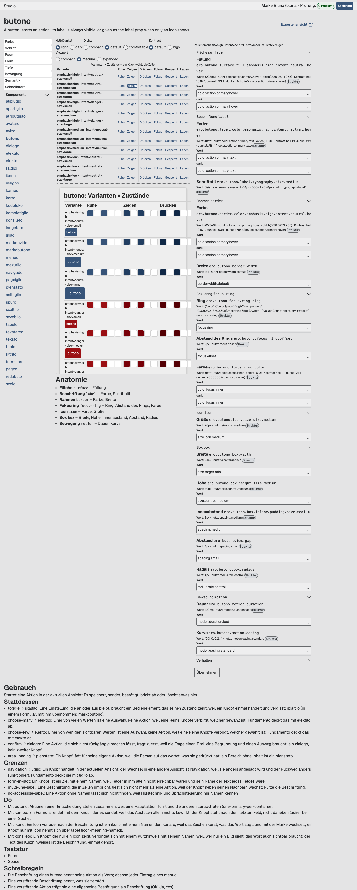
- Komponentenseite der Sxablono `pagxo`: 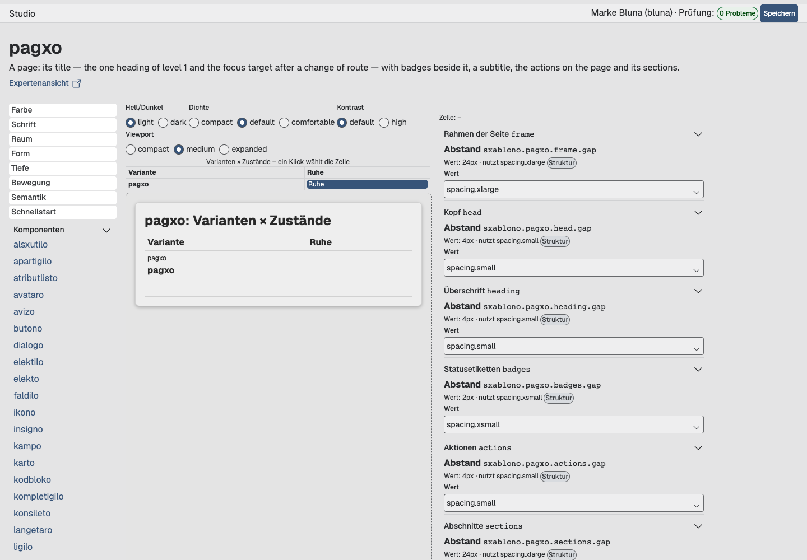
- Ein umbelegter Ero-Token (gesetzt, Zurücksetzen) und die Ablehnung mit dem Vorschlag der nächsten Stufe (O-3): 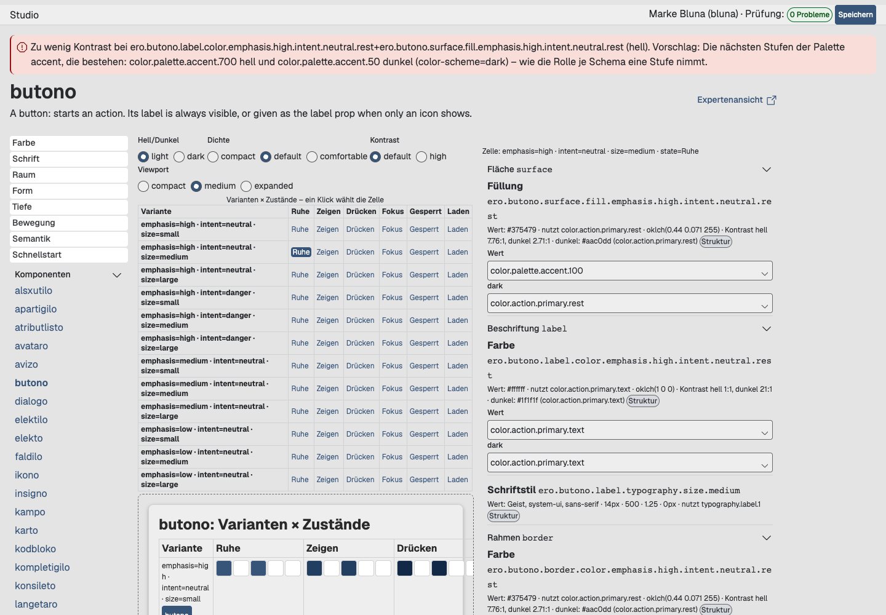
- Tiefe mit Schatten als Feldern (O-4): 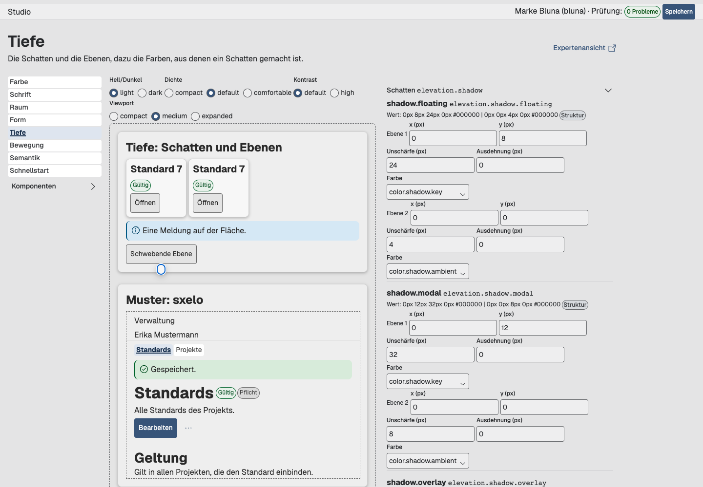
- Schrift mit zwei Familien und der Schreibweise: 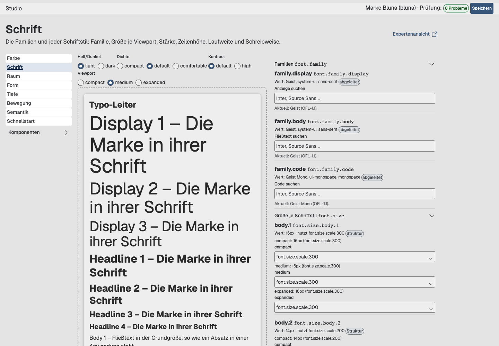
- Farbe mit den Mustern in der Vorschau (O-2): 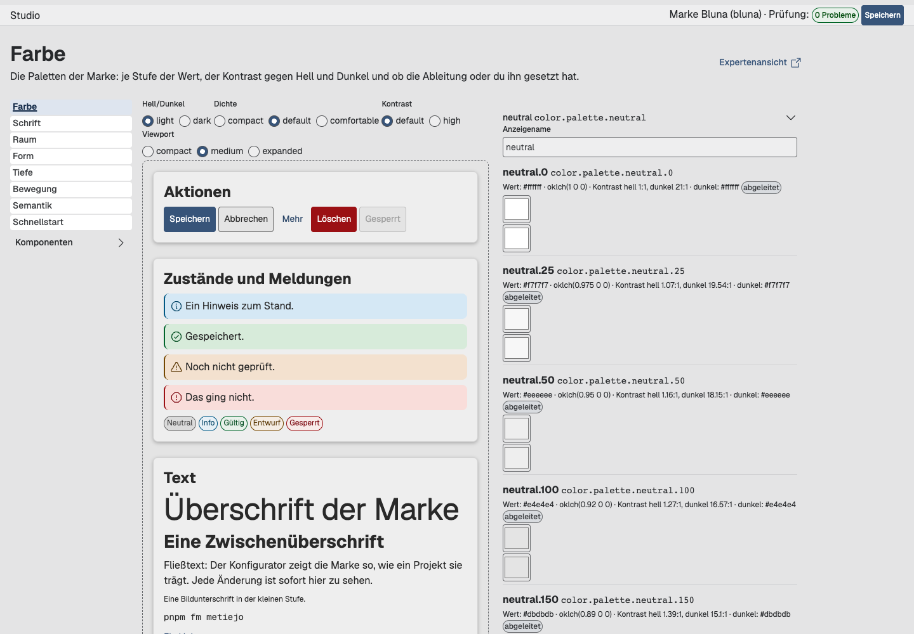

### Abweichungen

1. **Der Name des Beispiels** `ero.butono.emphasis-high.fill.hover` steht in der Grammatik als `ero.butono.surface.fill.emphasis.high.intent.neutral.hover` (D-14).
2. **30 Zellen haben keinen Token** (Schlüsselwort, Lagebegriff, D-16); eine Marke kann dort nichts umbelegen.
3. **Ein Farbliteral auf einem Ero-Token wird abgelehnt** (D-18): „eigener Wert“ gilt für Maße, Schatten und Schriftstile; eine Farbe ist eine Wahl aus Rollen und Stufen.
4. **Die Vorschau erzwingt keine Zustände** (D-23): Zeigen, Drücken, Fokus sind Farbfelder, kein gehaltenes Element.
5. **Figma-Variablen 876 → 2 636:** ein Typografie-Token sind sechs Variablen, ein Schatten fünf je Ebene, ein Ring drei; alle in der Sammlung `aspekto`, unter der Grenze von 5 000 je Sammlung. Nicht in einer echten Figma-Datei gemessen (Testing-Standard: ein grüner Lauf ist für Figma keine Abnahme); der Plan wartet mit den offenen Figma-PRs auf die Messung des Maintainers.
6. **Das Band 250–400 misst die ersten zwei Ebenen** (376), die dritte zählt gegen die Skemoj (1 032 nach dem Merge von Spec 025, davor 908).
7. **Die Celo-Suiten lesen durch die Rollen** (D-21) statt 470 Erwartungen umzuschreiben.
8. **Kontrastpaare nur für abweichende Zellen** (D-19); die Raporto der vorhandenen Marken bleibt gleich.
9. **Ein Ero ohne Textslot steht in der Vorschau bloß** (Tabelle, Dialog): die Vitrino hat die Beispiele, das Studio die Matrix.
10. **Die Werkstatt der Vitrino zeigt die dritte Ebene nicht** (kein Reiter „Komponenten“ dort); das Studio ist der Ort, die Expertenansicht bleibt bei Grundlagen und Rollen (Runde 3: Fluss mit den drei Ebenen).
11. **`get_ero` nennt die Ero-Tokens nicht eigens**: `resolve` und `modelo.json` tragen sie; ein Werkzeug je Komponentenseite ist Runde 3 (Art. III).

### Befunde / Mankoj

- **B-9 Ero-Tokens:** 1 032 (998 der 36 Eroj, 34 der 5 Sxablonoj); Kern 376 + 1 032 = 1 408 Tokens; 32 Zellen an Schlüsselwörtern oder Lagebegriffen ohne Token. Vor dem Merge von `main` mit Spec 025 (#101, #102: `datelektilo`, `glitilo`, `kampo` mit `kind=time` und Schrittknöpfen) waren es 908 (874 der 34 Eroj), Kern 1 284, 30 Zellen; `pnpm vortaro:ero-tokenoj` hat die 124 Tokens der neuen Zellen nach dem Merge abgeleitet (D-15 M-2: ein neues Skemo, kein Handgriff).
- **B-10 Figma-Variablen:** 2 636 (Repo, 36 Sets), 2 638 (Plan mit provo und provo-kompakta); 1 760 der dritten Ebene. Vor dem Merge von Spec 025: 2 439 / 2 441, 1 563.
- **B-11 Zeiten im Studio:** Komponentenseite ≈ 0,3 s (Ableitung 114 ms, Seite), Prüfung je Setzen 1,8–1,9 s warm (`POST /api/marko/bluna/festlegen`, ein Alias, der besteht), Ablehnung mit O-3 4,5 s (Alias `color.palette.accent.100` auf der Fläche des Butono: Satz, Vorschlag 700 hell / 50 dunkel – zwei Ableitungen mehr als die Prüfung selbst); gemessen am 22.10. mit `curl` am Server `pnpm fm metiejo --port 7398 --workdir <Marken>` nach dem Lauf der Suiten; `pnpm vortaro:ero-tokenoj` 1,2 s.
- **B-12 Manko-Kandidat:** eine Vorschau, die einen Zustand hält (Zeigen, Drücken, Fokus) – kein Ero kann ihn setzen, der Browser hält ihn; Schließbedingung: ein Attribut am Ero, das den Zustand erzwingt, durch eine Eroj-Runde.
- **B-13 Manko-Kandidat Farbliteral auf der dritten Ebene** (Abweichung 3): wenn eine Marke eine Fläche braucht, die keine Stufe ist, fehlt die Stufe in der Palette – die Palette ist der Ort (§ 3 B).
- **B-14** Die Suiten der Plugin-Läufe (`plugin-lauf`, `plugin-rahmen-beispiele`) sind mit 2 636 Variablen langsamer (je Lauf das Double mit allen Variablen); gemessen im Lauf unten.
- **B-15 Zeiten des Modelo mit der dritten Ebene:** `validateModeloFiles` wuchs mit 1 284 Tokens (nach dem Merge von Spec 025: 1 408) von ≈ 0,4 s auf 1,4 s (der Aufwand je Auflösung ist proportional zur Zahl der Tokens), `check_contrast` ohne Zuweisung von ≈ 40 ms auf 113 ms je Aufruf, der Start des MCP-Servers auf 3,3 s (Budget 2 s, AK-07). Behoben ohne Änderung eines Ergebnisses: die Schriftregel liest die geteilten Auflösungen (`resolutionsOf`) statt eigens aufzulösen; der Resolver kopiert Werte mit einem einfachen Durchlauf statt `structuredClone`, hält die sortierten Kernnamen und die Überlagerung je Folge aktiver Sets je Modelo (ein Modelo wird nach dem Bau nicht geändert, wie der Auflösungs-Cache schon annahm); der Geltungsbereich einer Aspiro wird je Tokenname einmal entschieden; die OKLCH-Helligkeit einer Farbe wird gemerkt. Danach: Validierung 0,7 s, `check_contrast` 8 ms (Median), Start 1,9 s lokal (CI-Budget 6 s; der O-1-Lauf brauchte dort 2,5 s), `resolve` 2,4 ms je Kombination. Der erste CI-Lauf (39738147880) blieb dennoch rot: zwei Spawn-Tests der CLI (`fm agordilo derive` zweimal plus `check` und `validate`, Budget 120 s; `fm modelo export`, Budget 30 s) überschritten ihr Budget auf dem Runner, der die Unit-Suiten aller Pakete nebeneinander laufen lässt – im O-1-Lauf brauchten sie dort schon 92 s und 22 s. Zweiter Schritt, ohne Änderung eines Bytes der Ausgaben (verglichen mit `diff -r`): `validateModeloFiles` nimmt das gebaute Modelo entgegen, `checkAspekto` und `prepareModeloExport` geben ihres weiter, `evaluateAlirebleco` und `buildRezolvojJson` lesen die geteilten Auflösungen statt eigens aufzulösen, die Schreibweisen-Tabelle liegt neben der Überlagerung. Eine Ableitung 2,6 s → 1,9 s, ein Export 3,5 s → 2,4 s lokal (O-1: ≈ 1,2 s und ≈ 2 s). Ein direkter kanonischer Serialisierer war langsamer als Kopie plus `JSON.stringify` (959 ms gegen 710 ms) und blieb draußen; die Schlüsselsortierung als Schleife statt `Object.fromEntries` sparte 125 ms. Dritter Schritt, nach zwei Timeouts der Alirebleco-Tests in der CI (30 s): `evaluateAlirebleco` löst ohne vorangegangene Validierung nur die Tokens auf, die die Paare nennen (Vorder- und Hintergrund, Aux, Backdrop oder Flächenleiter) samt Alias-Ketten – `resolveCombination` mit `names` –, mit Validierung liest es deren Auflösungen; die drei Tests „über jede bekannte Aspekto“ 2,2 → 1,3 s, der gebaute Runner 2,8 → 1,5 s lokal, die Ableitung byteidentisch.
- **B-17 Der Export-Test der CLI ist in der CI rot** (Lauf 39741149168): `fm modelo export` der ekzemplo-Fixture brauchte auf dem Runner 34,4 s bei einem Budget von 30 s (O-1-Lauf: 22 s; lokal 2,3 s nach den Schritten von B-15, davon Validierung ≈ 1,1 s und das Schreiben der 144 MB Rezolvoj ≈ 0,8 s). Der Maintainer hat am 16.10. den CI-Faktor dieses Tests zurückgenommen und bestimmt: wird der Lauf rot, bleibt der Faktor aus und der Bericht sagt es – so hier. Die Ursache ist diesmal nicht die Last des Runners, sondern der Export selbst, der mit der dritten Ebene 3,4-mal so viele Tokens trägt (B-16). Der Ableitungs-Test daneben (`derives provo twice`, Budget 120 s) brauchte 101,7 s (O-1: 92,5 s) und ist grün. Im nächsten Lauf (39742860574, `df32211`, mit der Schleife der Schlüsselsortierung) war der Test grün: 25,3 s im ersten Versuch, 20,3 s im zweiten; die Ableitung 103 s und 65 s. Der erste Versuch fiel an drei Flakes des Runners (Vitrino: fünf Minuten Warten auf `filechooser` beim Alsxutilo, zwei Alirebleco-Tests im 30-s-Timeout – kein Eroj- oder Alirebleco-Code war zwischen den Läufen geändert), der zweite Versuch der zwei Jobs war grün. Die Reihe des Export-Tests über die Läufe des PR: 34,4 s (rot), 25,3 s, 20,3 s, 26,8 s, 23,9 s, 30,1 s (rot, Lauf 39749336845 des letzten Doku-Commits, der Runner dort langsam: Alirebleco-Eroj 12,5 statt 4 min, „Rendered checks“ nach 15 min abgebrochen), 31,6 s (rot, zweiter Versuch). Das Budget hat keine Reserve mehr; der letzte Lauf mit Code-Änderung (39747762364) war grün, der des reinen Doku-Commits ist rot an diesem einen Test. Entscheidung des Maintainers (O-9): 30 → 45 s mit dem Grund „dritte Ebene“, oder die Rezolvoj ohne die dritte Ebene (O-8), was den Export auf das Maß von O-1 bringt; bis dahin bleibt der Test rot, wenn der Runner langsam ist.
- **B-16 `rezolvoj.json` ist 144 MB** (ekzemplo-Export: 1 284 Tokens × 144 Kombinationen, je Token Wert, Herkunft und Alias-Kette) statt ≈ 45 MB; das Schreiben kostet den Export und den CI-Lauf Zeit. Die dritte Ebene ist dort ein Alias je Zelle – ob die Rezolvoj die dritte Ebene tragen sollen oder nur die ersten zwei, entscheidet der Maintainer (O-8).

### Offen (für den Maintainer)

- **O-5 Namen der dritten Ebene** über das mechanische Schema hinaus (D-14): bleibt es bei `ero.<ero>.<teil>.<eigenschaft>.<achse>.<wert>.<zustand>`?
- **O-9 Budget des Export-Tests** (B-17): 30 → 45 s wegen der dritten Ebene, oder O-8. Der Test lag in sieben Läufen zwischen 20,3 und 34,4 s, dreimal über 30 s; der letzte Lauf des PR (Doku-Commit `e6009cb`) ist an ihm rot, der letzte Lauf mit Code (`dfc9c6c`, 39747762364) war grün.
- **O-8 Rezolvoj der dritten Ebene:** `rezolvoj.json` trägt alle 1 284 Tokens je Kombination (144 MB, B-16). Vorschlag: die Ero-Tokens als Alias-Verweis statt als aufgelöster Wert, oder nur die ersten zwei Ebenen – eine Frage der Projekcioj, die die Rezolvoj lesen (Tokens Studio, MCP `resolve`).
- **O-6 Figma messen:** die 2 636 Variablen und die Bindungen der 36 Sets in einer echten Datei (Abweichung 5), zusammen mit den offenen Figma-PRs.
- **O-7 Ein eigenes Werkzeug `get_ero_tokenoj`** (Art. III) für Runde 3, neben dem Fluss mit den drei Ebenen.

### Messanleitung

Alle Befehle im Checkout des Maintainers, nach dem Merge von #100 (O-1) und diesem PR.

```sh
cd /Users/thorstenjankowski/n8n-compose/20260918_fundamento-ds
pnpm install && pnpm build
pnpm -s fm modelo validate                        # grün, 1 408 Tokens
pnpm vortaro:ero-tokenoj --check                  # „Nothing would change.“ – die dritte Ebene ist aktuell
pnpm fm projekcioj build --out .fundamento/projekcioj
python3 -c "import json;p=json.load(open('.fundamento/projekcioj/figma/plan.json'));print(sum(len(c['variables']) for c in p['collections']))"   # 2636
pnpm fm metiejo --open                            # http://localhost:7301
```

**M-3 (pixelgleich):** `pnpm --filter @fundamento/projekcioj exec vitest run src/ero-tokenoj.test.ts` – jede Marke × Schema × Kontrast ohne Abweichung; in der Vitrino `open "file:///Users/thorstenjankowski/n8n-compose/20260918_fundamento-ds/.fundamento/projekcioj/vitrino/index.html"`: dieselben Eroj wie vor dem Merge; im Figma-Plan `.fundamento/projekcioj/figma/plan.json` die Paints je Variante wie vorher (`parity/figma.json` unverändert in den Werten).

**M-4 (Komponentenseite ohne Code):** http://localhost:7301/studio/bluna/ero/butono – Anatomie, Matrix, Zelle wählen, rechts die Ero-Tokens; `pnpm --filter @fundamento/metiejo exec vitest run src/komponentoj.test.ts` („M-4“ mit dem Test-Skemo `ero-minimal`). Ein neues Ero: `data/eroj/<name>/skemo.json` anlegen, `pnpm vortaro:ero-tokenoj`, `pnpm build` – die Seite steht unter `/studio/bluna/ero/<name>`.

**M-5 auf der dritten Ebene:** auf der Seite des butono die Zelle `emphasis=high · intent=neutral · size=medium · rest`, Fläche (`ero.butono.surface.fill…rest`) auf `color.palette.accent.100` setzen: abgelehnt, Satz „Zu wenig Kontrast bei …“ und Vorschlag „Die nächste Stufe der Palette accent, die besteht: color.palette.accent.<n> …“ (O-3); auf `color.action.secondary.rest` setzen: übernommen, „gesetzt“, Zurücksetzen stellt die Rolle her.

**O-2:** http://localhost:7301/studio/bluna/farbe – unter Aktionen, Zuständen, Text und Feldern die fünf Muster. **O-4:** http://localhost:7301/studio/bluna/tiefe – je Schatten die Felder x, y, Unschärfe, Ausdehnung, Farbe. **Schreibweise:** http://localhost:7301/studio/bluna/schrift – bei `typography.label.1` „Versalien“ wählen; die Vorschau und `agordo.json` (`festgelegt["typography.label.1"].schreibweise`) folgen. **Zwei Familien:** dort „Anzeige suchen“ und „Fließtext suchen“ je mit eigener Trefferliste; im Schnellstart (Schritt Schrift) „Für welche Schrift?“.

**Tests:** `pnpm --filter @fundamento/modelo exec vitest run src/eroj/ero-tokenoj.test.ts`, `pnpm --filter @fundamento/projekcioj exec vitest run src/ero-tokenoj.test.ts`, `pnpm --filter @fundamento/agordilo exec vitest run src/ero-tokenoj.test.ts`, `pnpm --filter @fundamento/metiejo exec vitest run src/komponentoj.test.ts src/studio.test.ts src/servilo.test.ts`.
