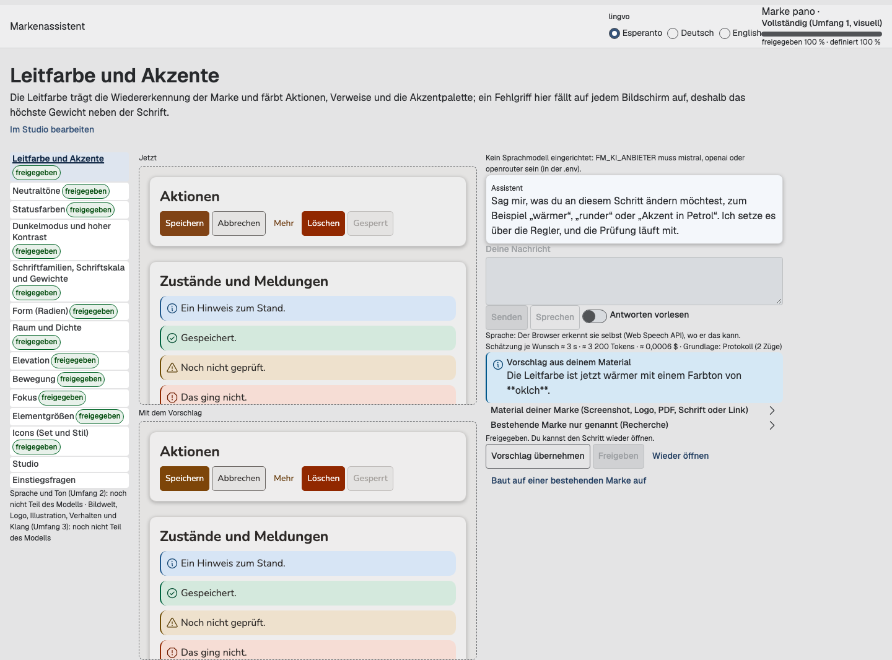
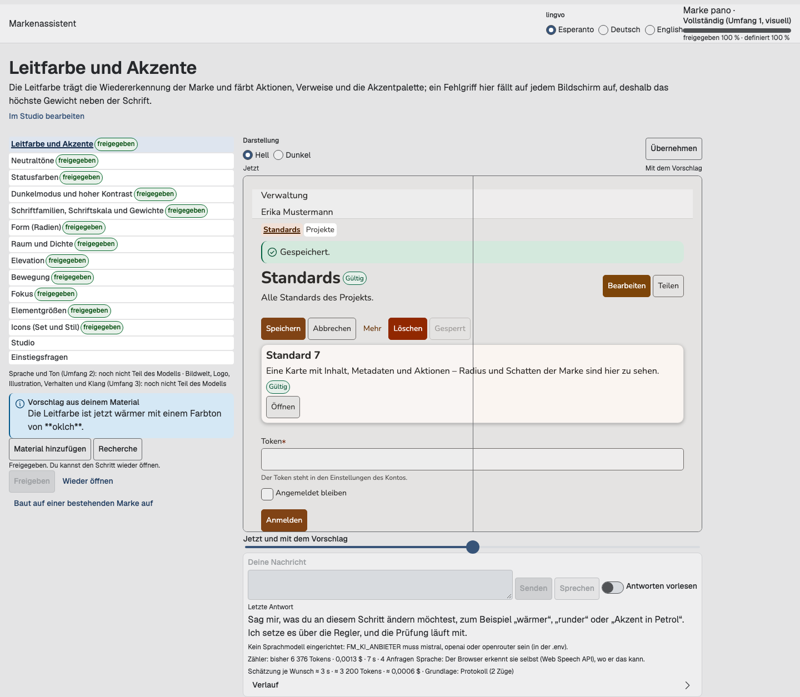
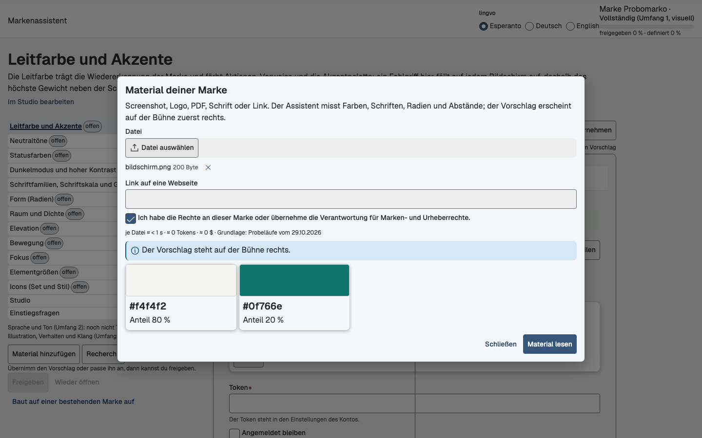
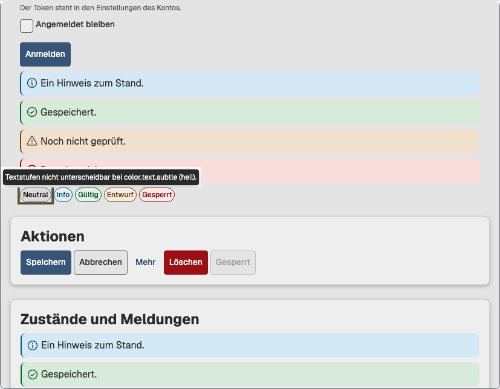

# Spec 036 – Markenassistent: Bühne, Farbrollen und Qualität · Spec 029 zu Ende · neutrale Namen – Plan

**Spec:** [`spec.md`](spec.md) (Fassung vom 2026-10-31, unverändert kopiert; SHA-256 `a0cc66beda58be0bcc0a4dcaf28179cd178d4ec3ed79afa51bdddfea1c55acfa`, 12 845 Bytes) · **Basis (BASIS):** `main` `f2b5a058` (`f2b5a0585b772dc4cd83eb672a4bd956242610a8`, „Merge pull request #129“, Spec 035 vollständig; am 2026-10-31 festgehalten und am Ende des Laufs unverändert, D-13) · **Regel 0** gilt: der Weg, den das Repo schon geht, sonst die kleinste Änderung mit Eintrag hier. **Keine Budgets und keine Grenzen angehoben. Nichts gemergt.**

**Datum:** 2026-11-02 · **Stand:** Lauf abgeschlossen und gegen AC-1 bis AC-15 geprüft (S36-7.1: Doku-Test und Audit über alle PRs; 14 erfüllt, 1 teilweise (AC-4), 0 nicht erfüllt). Elf PRs offen, keiner gemergt, keiner Entwurf, kein Auto-Merge, alle mergeable. CI: zehn PRs grün (einer nach einem Neustart wegen eines Abbruchs der Infrastruktur), #142 ②b-5 nach dem einen erlaubten Neustart wieder rot an M5 (B-6.1-1, Grenze unverändert). Von den 31 Befunden der Liste sind 29 erledigt, 2 teilweise (②b-2: `months` des datelektilo; ②b-5: drei Befunde aus Spec 025), 0 offen; neue Befunde aus dem Lauf im Bericht. Merge-Simulation in der vorgeschlagenen Reihenfolge mit Teil 6 zuletzt (nach Neulauf des Skripts) bestätigt; zwei neue Befunde dort (B-6.2-1 zu entscheiden; B-6.2-2 inzwischen in #133 behoben). Modellkosten **0,00442 $** von 0,50 $, nur `ministral-14b-2512`. In der `.env` ist nichts einzutragen. Alle Entscheidungen angewandt und vom Maintainer zu bestätigen; die zu entscheidenden stehen im Bericht. **QA-Lauf 1 (2026-11-02):** sechs Befunde der QA in #136, #137 und #138 behoben, je rot vor grün (B-QA-1 bis B-QA-6), neun Beobachtungen als B-QA-7 bis B-QA-15 im Bericht; Entscheidungen D-348 bis D-355. Bericht am Ende.

**Ablage (D-01):** `spec.md`, `plan.md`, `tasks.md` und die Bildschirmfotos (`bilder/`, D-34) liegen nur auf dem Branch von Teil 1 (`261031-spec-036-t1-abnahme`, #134). Die übrigen PRs verlinken auf diesen plan. Jedes Ticket des Laufs schrieb seinen Beitrag in eine eigene Datei außerhalb des Repos; dieser Doku-Commit führt sie zusammen.

**Wortregel (R-12, D-14):** Das Wort aus R-12 und der Name des privaten Schriften-Repos stehen nur in der wortgleichen `spec.md`. Hier heißen sie „das Wort aus R-12“ und „das private Schriften-Repo“; echte Marken heißen „Marke 1“, „Marke 2“. Entscheidungen aus Spec 035 heißen hier immer „Spec 035 D-nn“; ein „D-nn“ ohne Zusatz ist eine Entscheidung dieses plans (D-S36-6.3-1).

**Commit-Identität (Befund 6.5, D-15):** Vor dem ersten Commit des Laufs ist `user.email` lokal im Repo des Laufs auf `189642209+thojank@users.noreply.github.com` gesetzt (ID über `gh api user`). Nicht global, nicht im Checkout des Maintainers, die Historie bleibt unverändert. Nebenwirkung: Die Einstellung gilt für jeden Worktree dieses Repos (auch für andere Läufe desselben Purple-Workspace), jeweils mit der Noreply-Adresse derselben Person. Jeder Commit des Laufs trägt diese Adresse als Autor und Committer.

### Branches und PRs

Alle Branches enthalten BASIS (AC-2); jeder gestapelte Kopf enthält den Kopf seines Basis-PRs. Je Branch ein eigener Worktree unter `/tmp/s036-*`; der unveränderte, gebaute Worktree `/tmp/s036-main` (losgelöst BASIS) war der Bezug für jede Messung „vorher“.

| Teil | PR | Branch | Basis | Head | Befunde |
|---|---|---|---|---|---|
| 1 | [#134](https://github.com/thojank/fundamento/pull/134) „Spec 036 Teil 1 – Fehler aus der Abnahme“ | `261031-spec-036-t1-abnahme` | `main` | `ff20545f` (Code), danach nur Doku-Commits | 1.1–1.7, `specs/036-assistent-buehne/` |
| 2a | [#135](https://github.com/thojank/fundamento/pull/135) „Spec 036 Teil 2a – Farbrollen: unbunte Marken und Bildgewicht“ | `261031-spec-036-t2a-farbrollen` | `main` | `2d81d594` | 2.1, 2.3 |
| 2b | [#138](https://github.com/thojank/fundamento/pull/138) „Spec 036 Teil 2b – Farbrollen: Zweitfarbe (gestapelt auf 2a)“ | `261031-spec-036-t2b-zweitfarbe` | `261031-spec-036-t2a-farbrollen` (D-18) | `4d5c87ab` (QA-Lauf 1; vorher `6ff31655`) | 2.2 |
| 3 | [#136](https://github.com/thojank/fundamento/pull/136) „Spec 036 Teil 3 – Bühne“ | `261031-spec-036-t3-buehne` | `main` | `1414714e` (QA-Lauf 1; vorher `8c7ab1a9`) | 3.1–3.7 |
| 4 | [#137](https://github.com/thojank/fundamento/pull/137) „Spec 036 Teil 4 – Übernahme aus dem Material“ | `261031-spec-036-t4-uebernahme` | `main` | `8c798c40` (QA-Lauf 1; vorher `9de43b6d`) | 4.1–4.3 |
| 5 ②b-2 | [#139](https://github.com/thojank/fundamento/pull/139) „Spec 036 Teil 5 ②b-2 – Achsen und Werte (Spec 029)“ | `261031-spec-036-t5-2b2` | `main` (D-05) | `55768dc1` | ②b-2 |
| 5 ②b-3 | [#140](https://github.com/thojank/fundamento/pull/140) „Spec 036 Teil 5 ②b-3 – Anatomie und Slots (gestapelt)“ | `261031-spec-036-t5-2b3` | `261031-spec-036-t5-2b2` | `f6c9f061` | ②b-3 |
| 5 ②b-4 | [#141](https://github.com/thojank/fundamento/pull/141) „Spec 036 Teil 5 ②b-4 – Verhalten (gestapelt)“ | `261031-spec-036-t5-2b4` | `261031-spec-036-t5-2b3` | `1aa0d4f4` | ②b-4 |
| 5 ②b-5 | [#142](https://github.com/thojank/fundamento/pull/142) „Spec 036 Teil 5 ②b-5 – kodbloko, Schrift, Form (gestapelt)“ | `261031-spec-036-t5-2b5` | `261031-spec-036-t5-2b4` | `f4fff0fb` | ②b-5 |
| 5 ③ | [#143](https://github.com/thojank/fundamento/pull/143) „Spec 036 Teil 5 ③ – Doku je Ero (gestapelt)“ | `261031-spec-036-t5-3-doku` | `261031-spec-036-t5-2b5` | `427f7d94` | ③ |
| 6 | [#133](https://github.com/thojank/fundamento/pull/133) „Spec 036 Teil 6 – neutrale Namen“ | `261031-spec-036-t6-neutrale-namen` | `main` | `1445ae90` (vor S36-6.2-B2 `30ae1068`) | 6.1–6.6 |

Lokale Hilfsbranches von Teil 1 (nie gepusht, in #134 aufgegangen, D-16): `261031-spec-036-t1-form` (`8f5e56ff`), `261031-spec-036-t1-figma` (`119518c6`), `261031-spec-036-t1-assistent` (`3f594d56`). Merge-Simulation im losgelösten Worktree `/tmp/s036-sim` (Scratch-Commits, nie gepusht).

## Zusammenfassung je Teil

### Teil 1 – Fehler aus der Abnahme (#134)

- **1.1 Pille nur für einzeilige Bedienelemente:** neue additive Rolle `radius.role.multiline` = `{radius.medium}` in jedem Aspekto; `tekstareo.box` (auch im Muster `redaktilo`), `kodbloko.box`, `konsileto.surface` binden sie statt `radius.role.control`. Mit Pille bleiben sie begrenzt, ohne Pille ändert sich kein Pixel (rot `1eab68f4` → grün `38212e62`; kein eigener „Bildtest neu“-Commit, D-49 (D-S36-1.1-5)).
- **1.2 „Eckiger“ von der Pille → Stufe 2:** `wuensche.json` `danach.zurueck: 2`; Agordilo und MCP `propose_agordo` (rot `701d83d3` → grün `e39c3ef3`). Spec 035 D-83 gilt für Spec 036 als geändert (D-48, D-S36-1.1-4).
- **1.3 Nutzersprache im Chat:** Systemtext aus Daten (Schrittnamen, Reglerbeschriftungen), deterministische Prüfung der Antwort ersetzt interne Begriffe oder verwirft den Satz (rot `dbbfc753` → grün `956e87ec`).
- **1.4 Weg C:** der Satz zu den gelesenen Seiten kommt aus `esploro.ts` (`gelesenSatz`), Schlussworte des Modells entfallen (rot `4e9815bd` → grün `00fc5f05`).
- **1.5 Reste aus Spec 035:** Spec 035 D-95 Satz „ohne Browser“ vor der Weiterleitung mit Link „Weiter zum Assistenten“, ohne Zeitlimit (`eab29787` → `569cc23f`); Spec 035 D-96 `ekrano.ts` nutzt `freigabeOf` (`e995351d` → `5bde22b5`); Spec 035 D-99 Weg-A-Skript mit Kornblumenblau als zweiter kräftiger Farbe (`a83ecefa` → `ff20545f`).
- **1.6 Figma:** `elekto` nicht gewählt = leerer Ring – die Ursache lag in den Werten von komuna, darum ändert sich auch das Web von `elekto` in komuna (D-62, D-S36-1.3-1, **zu entscheiden**) (`b0506068` → `e2bcce1b`); Beschriftung von `markobutono`/`sxaltilo` mittig (`2c53a06e` → `91ee07ff`, Bildtest neu `ccee6aab`); Spec 035 D-64 Monatsknöpfe des `datelektilo` mit Größe und Füllung (`f6c23f72` → `4776abdd`, Bildtest neu `a44150f0`). Sichtprüfung im Desktop-Plugin beim Maintainer.
- **1.7 G5 kalibriert:** Urteil relativ zur Referenzlast des Runners wie die Ableitung, Grenze 50 ms bleibt, Gegenprobe 80 ms × k rot (`83cf8bef` → `3b8257f8`).
- Zusammengeführt per Cherry-pick (Form/G5 → Figma → Assistent), jeder rote Test auf seinem neuen Eltern-Commit erneut rot (D-71, D-S36-1.4-2). CI 14/14 grün im ersten Lauf. AC-10 1336/1338 zweimal, die zwei Unterschiede sind `vitrino/elekto@komuna` hell/dunkel (gewollt).

### Teil 2a – unbunte Marken und Bildgewicht (#135)

- **2.1 (V-1):** Weg B und Weg C erkennen eine unbunte Marke (Schwellen `kreilo.json › unbunt` mit Kialo) und schlagen ein sehr dunkles Neutral vor, mit Satz „unbunt“; der Agordilo behält eine schwarze Leitfarbe für Aktionen und Verweise (`agordilo/src/unbunt.ts`); neue Regulo `link-distinct-from-text` verlangt die Unterstreichung, wenn ein Verweis dem Text zu nah ist (sojlo 0,3). Drei Rot/Grün-Paare. AC-10 1338/1338 zweimal.
- **2.3:** Weg C kennt die Klasse „großes Bild im ersten Bildschirm“ (Gewicht 6 ab 25 %, alle Gewichte als Daten in `kreilo.json › weg_c`); synthetische Seite vorher verfehlt (Hintergrund), nachher getroffen; Marke 2 lokal unverändert getroffen. Vier Modellläufe, 0,00112 $.

### Teil 2b – Zweitfarbe (#138, gestapelt auf 2a)

- **2.2 (V-2):** Agordo-Feld `zweitfarbe { farbe, herkunft? }`, Palette `color.palette.sekundo` (15 Stufen) und fünf Rollen `color.sekundo.*` (Fläche, Illustration, Abzeichen ×2, Diagramm) als vollständige additive Tokens in jedem Aspekto (D-20, **zu entscheiden**); vier Kontrastpaare, Regulo `sekundo-not-action`, Projekcioj ohne verlorene Zeile; erfundene Marke `dukolora` in der Vitrino. Weg A, B, C setzen die Zweitfarbe mit Herkunft (Spec 035 D-80 aufgehoben), zu nah → leer mit Satz; „Zweitfarbe für Knöpfe“ wird in Nutzersprache abgelehnt; Feld im Schritt „Leitfarbe und Akzente“. AC-10 1338/1338 zweimal (+80 neue `dukolora`-Seiten).

### Teil 3 – Bühne (#136)

- **3.1–3.3:** Bühne auf acht von zwölf Spalten aus echten Eroj, hell/dunkel; zwei überlagerte Rahmen „Jetzt“/„Mit dem Vorschlag“ mit fm-glitilo, schmal fm-sxaltilo; Chat und Regler erscheinen zuerst rechts, „Übernehmen“ zieht nach links (D-129, D-S36-3.1-5); Chat als Leiste unter der Bühne mit Verlauf.
- **3.4–3.6:** Material und Recherche im fm-dialogo mit Kacheln (Farbfläche, Anteil); offene Probleme der Prüfung als Warnrahmen mit Satz bei Hover und Fokus; Live-Region für die letzte Antwort, Enter sendet; axe 0 Befunde in Chromium, Firefox, WebKit. Manko E7 teilweise gelöst (ohne neues Ero).
- **3.7:** Weg A mit Modell (0,00128 $) und Material-Lauf; Bildschirmfotos unter Messungen. Keine Manko-Einträge (D-126, D-S36-3.1-2).

### Teil 4 – Übernahme aus dem Material (#137)

- **4.1–4.2:** je Schritt ein Vorschlag mit Herkunft oder „offen“ mit Satz (Invariante „kein Wert ohne Herkunft“ als Test); Leitfarbe, Neutraltöne (Grund, Fläche, hell/dunkel, Tönung), Schrift (erkannt / ähnlich mit Begründung / offen), Form (Stufe aus Knöpfen), Elevation (Schattenband), Dichte (Blöcke und Lücken) aus Bildern und Links; Zweitfarbe mit Verweis auf 2b (D-03).
- **4.3:** Material-Lauf `abnahme-weg-b.ts`; synthetisch alle Schritte getroffen, echte Marken anonym unter Messungen. Zwei Modellläufe, 0,00202 $.

### Teil 5 – Spec 029 zu Ende (#139 → #140 → #141 → #142 → #143)

- **②b-2 Achsen und Werte (#139, teilweise):** zwei Größen mit `large` als veraltetem Alias (`deprecatedValues`, Regel `prop-value-deprecated`), `readonly`, `label-side`, `max-*`, `unit`, drei Größen für Listenfelder, Größen, Darstellungen, Dichte, `lines` statt `rules` (kein Alias, D-185 (D-S36-4.2-5)), Zweck-Achse `dismiss` des dialogo (M-3) u. a.; fünf „Bildtest neu“-Commits (zwei aus S36-4.1, drei aus S36-4.2). Offen: `months` des datelektilo (D-187, D-S36-4.2-7 → D-267 (D-S36-4.6-16)).
- **②b-3 Anatomie und Slots (#140):** Hilfe, Beschreibung einer Option, Markierungen, Upload-Icon, Gruppen mit Überschrift und Trenner, „alle wählen“, Icons in Menü und Navigation, `max-lines` mit Tooltip, Titel, Fuß, Schließen, erste/letzte Seite, drei Phosphor-Icons; zwei „Bildtest neu“-Commits.
- **②b-4 Verhalten (#141):** Rollen nach Status und Zweck (warning/danger `alert`, `alertdialog`), Streamen, Springen per Tippen, Link im Menü, Überlauf der Reiter, unbekannte Gesamtzahl, Download (Phosphor-Icon), ausgelassene Mitte; drei Engines 78/78.
- **②b-5 kodbloko, Schrift, Form (#142, teilweise):** Ersatzschrift nach Kategorie und nächstes Gewicht (über das Agordo, ohne Import der Metiejo), `signeto` und `insigno` unterscheidbar (`radius.role.tag`, D-256 (D-S36-4.6-5), **zu entscheiden**), Syntaxfarben als fünf Rollen mit 15 Kontrastpaaren, kodbloko mit Zeilennummern, Umbruch, Sprache, hervorgehobenen Zeilen. Offen: zwei Vitrino-Befunde aus Spec 025 (Spec 026 O-2, O-3) und glitilo B-5 (D-266, D-S36-4.6-15). CI: M5 rot nach einem Neustart (B-6.1-1).
- **③ Doku je Ero (#143):** Uzo-Felder „Wann nicht“, Do/Don't, Tastatur in Deutsch und Englisch für alle 40 Eroj, Prüfung `check:dokumentaro` (40/40), volle Antwort von `get_ero`, Ero-Seite der Vitrino mit neun Abschnitten; Kurzprofile unverändert (kampo 747 < 750).

### Teil 6 – neutrale Namen (#133)

- **6.1–6.4:** Codemod `scripts/neutrale-namen/` (deterministisch, zweiter Lauf 0 Änderungen), `check:privat` (rot auf BASIS mit 749 Dateien, nach dem Skript-Lauf 0), Leser für alte und neue Namen eine Version lang, Ausgaben nach Normalisierung byte-gleich, CHANGELOG-Hinweis, Constitution Amendment v2.6 (redaktionell, D-24). Erweiterungsschlüssel `fundamento`, Schemata `urn:fundamento:schema:<pfad>`, Ontologie `urn:fundamento:ontologio`.
- **6.5:** Commit-Identität des Laufs gesetzt (D-15); Anleitung für den Maintainer im Bericht.
- **6.6:** Das private Schriften-Repo bleibt, wie es ist; kein Code braucht seinen Namen als Pfad (D-22 bestätigt): **In der `.env` ist nichts einzutragen.** Familienvergleich gleich.
- Auf dem simulierten Endstand neu gelaufen (D-33): 779 Dateien → 0, zweiter Lauf 0. B-6.2-2: der Generator der Agordilo-Fixtures kannte `dukolora` aus 2b nicht (in #133 behoben: `45179c59` → `7a9193ca`, Skript-Lauf neu `1445ae90`, CI 41356924882 grün; der Generator findet jede abgeleitete Fixture aus den Daten, auf dem simulierten Endstand auch `dukolora`).

### Über alle Teile

- CI aller elf PRs gesammelt: zwei Neustarts nach R-8/D-32 (#139 Abbruch der Infrastruktur → grün; #142 M5 → wieder rot, B-6.1-1). Lokal auf dem gemergten Stand M5 p90 0 ms.
- `main` unverändert (`f2b5a058` am Anfang und am Ende). Merge-Simulation in der vorgeschlagenen Reihenfolge: 6 von 10 Merge-Schritten mit Konflikten (49 Dateien, alle erzeugt, gezählt, Fixture, Liste oder CHANGELOG), ein semantischer Konflikt, B-6.2-1 (403 Kern-Tokens > 400); keine Reihenfolge mit weniger Konflikten.
- Modellkosten 0,00442 $ in sieben Läufen.

## Entscheidungen, vom Maintainer zu bestätigen

Der Lauf war unbeaufsichtigt (R-1). Wo die Spec offen ließ, galt der Vorschlag. „angewandt“ = so umgesetzt; **zu bestätigen** = angewandt, vom Maintainer zu bestätigen; **zu entscheiden** = Abweichung oder offene Frage, bei der der Lauf eine Wahl getroffen oder offen gelassen hat und die Alternative nennt. Alle Einträge sind vom Maintainer zu bestätigen. Die Liste der zu entscheidenden steht im Bericht (› Entscheidungen).

### Vorschläge der Spec (V-1 bis V-3)

| ID | Frage | Vorschlag | Ergebnis im Lauf | Stand |
|---|---|---|---|---|
| V-1 | 2.1 Unbunte Marken | Eine Marke darf unbunt sein: Leitfarbe Schwarz bzw. sehr dunkles Neutral; Aktionen, Verweise und Fokus bleiben prüfbar (Verweise brauchen dann ein zweites Merkmal, die Regel prüft es); Weg B und C erkennen eine unbunte Marke und schlagen das vor. | Umgesetzt in #135: Erkennung mit Schwellen in `kreilo.json › unbunt` (D-75, D-S36-2.1-1), Ableitung behält Schwarz (D-78, D-S36-2.1-4), Regulo `link-distinct-from-text` mit sojlo 0,3 (D-82, D-S36-2.1-8); das zweite Merkmal sind die vorhandenen Ero-Tokens der Unterstreichung (D-80, D-S36-2.1-6, **zu entscheiden**). | angewandt · **zu bestätigen** |
| V-2 | 2.2 Zweitfarbe der Marke | Optionale Zweitfarbe als eigene Palette (z. B. `color.palette.sekundo`) mit wenigen Rollen, nicht Aktionen; additiv, Marken ohne Zweitfarbe pixelgleich; Faceto „Leitfarbe und Akzente“; Weg A, B, C setzen sie, sonst bleibt sie leer; Projekcioj, Prüfungen, Vitrino ziehen nach. | Umgesetzt in #138 als vollständige additive Tokens (D-20, **zu entscheiden**); Palette `color.palette.sekundo`, Rollen `color.sekundo.*` (D-98, D-S36-2.3-2); Marken ohne Zweitfarbe zeigen auf die Neutraltöne und sind pixelgleich (1338/1338); Weg A/B/C setzen sie mit Herkunft (D-114, D-S36-2.4-1); Ablehnung als Aktion (D-122, D-S36-2.4-9). | angewandt · **zu bestätigen** |
| V-3 | Teil 6 neutrale Namen ohne fremde Domain | Erweiterungsschlüssel `fundamento`; Schema-IDs `urn:fundamento:schema:<name>`; Ontologie `urn:fundamento:ontologio`; das private Schriften-Repo nur über `FM_TIPAROJ_REPO`. | Umgesetzt in #133 per Codemod und Skript-Lauf; Leser für beide Formen; `check:privat` 0 Treffer; auf dem simulierten Endstand erneut gelaufen. | angewandt · **zu bestätigen** |

### Vorschläge des Auftrags (D-01 bis D-12)

| ID | Frage | Vorschlag | Ergebnis im Lauf | Stand |
|---|---|---|---|---|
| D-01 | Wo liegen spec, plan, tasks? | `specs/036-assistent-buehne/` nur im PR von Teil 1; Beiträge je Ticket außerhalb des Repos, ein Doku-Commit führt sie zusammen. | So gemacht: Gerüst `e49b4002`, Bilder `31d9cb7c`, Zusammenführung in diesem Doku-Commit; jeder andere PR-Text verlinkt den plan. | angewandt · **zu bestätigen** |
| D-02 | Teil 2 in einem oder zwei PRs? | 2a = 2.1 + 2.3, 2b = 2.2. | #135 (2a) und #138 (2b, gestapelt). | angewandt · **zu bestätigen** |
| D-03 | Teil 4 und die Zweitfarbe | Teil 4 von `main`; die Zweitfarbe setzen Weg A/B/C in 2b; Teil 4 führt sie mit Verweis auf 2b; Merge 2b vor 4. | Teil 4 führt den Schritt Zweitfarbe „offen“ mit Satz und Verweis (D-148, D-S36-3.3-4); 2b setzt sie. Reihenfolge 2b vor 4 in der Simulation bestätigt. | angewandt · **zu bestätigen** |
| D-04 | Teil 4 und die Bühne | Vorschläge über den `propono`-Weg (Spec 035 D-92); Merge 3 vor 4. | So umgesetzt (D-150, D-S36-3.3-6); Teil 3 und Teil 4 mischen ohne Konflikt, Metiejo auf dem gemeinsamen Stand 500/500. | angewandt · **zu bestätigen** |
| D-05 | Teil 5: Stapel oder von `main`? | Stapel ②b-2 → ②b-3 → ②b-4 → ②b-5 → ③, Basis von ②b-2 ist `main`. | Stapel #139 → #140 → #141 → #142 → #143; keiner musste neu aufgesetzt werden (untere Köpfe unverändert). | angewandt · **zu bestätigen** |
| D-06 | Teil 1 (Figma) und ②b-2 berühren `elekto`, `markobutono`, `sxaltilo` | Teil 1 zuerst; ②b-2 setzt nach Teil 1 auf, `git merge-tree` vor dem Push. | ②b-2 begann nach #134 (`ff20545f`); Skemoj, Figma- und Web-Generatoren mergen ohne Konflikt; Konflikte nur in erzeugten und gezählten Dateien (7). | angewandt · **zu bestätigen** |
| D-07 | Reihenfolge der Modellläufe | 1.3 nur Attrappe → 3.7 Weg A → 4 Material-Lauf → 2.3 Weg C vorher/nachher. | Alle sieben Läufe reserviert in dieser Reihenfolge und gebucht; das Budget wurde nicht knapp (0,00442 $). | angewandt · **zu bestätigen** |
| D-08 | Zählt G5 zu den bekannten Zeittests? | Ja, bis 1.7 gemergt ist. | G5 war auf keinem Kopf rot (Messungen). | angewandt · **zu bestätigen** |
| D-09 | Neuer Schlüssel und IDs (V-3) | Erweiterung `fundamento`, Schemata `urn:fundamento:schema:<name>`, Ontologie `urn:fundamento:ontologio`; privates Schriften-Repo und sein Ordner nicht umbenannt. | So umgesetzt (D-25, D-295 (D-S36-5.1-5)); nichts außerhalb des öffentlichen Repos umbenannt. | angewandt · **zu bestätigen** |
| D-10 | Ort von `check:privat` | Weitere Prüfung in `packages/modelo/src/checks/`, `pnpm check:privat`, in der CI. | `packages/modelo/src/checks/privat/`, Schritt „Check: Privat“, Kette `pnpm check`. | angewandt · **zu bestätigen** |
| D-11 | Ort des Codemods | `scripts/neutrale-namen/`, deterministisch, idempotent. | So umgesetzt; zweiter Lauf 0 Änderungen (BASIS und simulierter Endstand). | angewandt · **zu bestätigen** |
| D-12 | Mockups der Bühne | Keine eigene Vitrino-Seite, kein HTML-Mockup; Bühne aus vorhandenen Eroj; Bildschirmfotos hier. | So umgesetzt (D-125, D-S36-3.1-1); Fotos unter Messungen (D-34). | angewandt · **zu bestätigen** |

### Entscheidungen der Arbeitsteilung (D-13 bis D-34)

| ID | Frage | Vorschlag | Ergebnis im Lauf | Stand |
|---|---|---|---|---|
| D-13 | BASIS und ein bewegtes `main` | BASIS = `f2b5a058`; bewegt sich `main`, bleiben die Branches auf BASIS, Teil 6 wird neu aufgesetzt. | `origin/main` am Anfang und am Ende `f2b5a058`, nicht bewegt; kein Neuaufsetzen nötig. | angewandt · **zu bestätigen** |
| D-14 | `spec.md` wortgleich gegen R-7/R-12 | AC-1 geht für diese Datei vor; nur sie ist von der Marken- und R-12-Regel ausgenommen, nie von der Schlüsselregel. | `pruefen` und `check:privat` (`escepoj.json`, per SHA-256) nehmen nur diese Datei aus. | angewandt · **zu bestätigen** |
| D-15 | Commit-Identität (6.5) | Noreply-Adresse lokal im Repo des Laufs, nicht global, Historie unverändert. | Gesetzt vor dem ersten Commit (D-35, D-S36-0.1-1); gilt für alle Worktrees des Workspace-Repos. | angewandt · **zu bestätigen** |
| D-16 | Teil 1 parallel | Drei Hilfsbranches, Zusammenführung Form/G5 → Figma → Assistent, Rot erneut belegt. | So gemacht, per Cherry-pick statt Rebase (D-71, D-S36-1.4-2). | angewandt · **zu bestätigen** |
| D-17 | Start der Spuren | M, A, E nach S36-1.4; N nach dem Aufsetzen. | So gemacht. | angewandt · **zu bestätigen** |
| D-18 | 2b gestapelt auf 2a | 2b setzt auf 2a auf; Rückfall 2b von BASIS. | #138 auf #135; Rückfall nicht nötig. | angewandt · **zu bestätigen** |
| D-19 | Teil 4 und Teil 3 | Teil 4 von BASIS, nach Teil 3 bearbeitet, nur Verdrahtungszeilen in gemeinsamen Dateien. | So gemacht; neue Module unter `enportilo/uebernahme/`. | angewandt · **zu bestätigen** |
| D-20 | Zweitfarbe und Art. IV | Vollständige additive Tokens, jedes Aspekto belegt sie, Marken ohne Zweitfarbe pixelgleich; Abweichung von der technical-spec („keine zusätzlichen Tokens“). Alternative: optionale Gruppe plus Amendment von Art. IV. | So umgesetzt in #138 (20 Tokens je Aspekto, neue Variablen, keine bisherige Ausgabezeile verloren). Folge: Teil 1, 2b und ②b-5 zusammen überschreiten das Band der Kern-Tokens (B-6.2-1). | angewandt · **zu entscheiden** |
| D-21 | Modellläufe | Reservierungen in D-07-Reihenfolge, jedes Ticket fährt seinen Lauf, Listenpreis. | Sieben Läufe gebucht, Preis aus `prezoj.json` (D-312, D-S36-6.1-6). | angewandt · **zu bestätigen** |
| D-22 | Braucht es `FM_TIPAROJ_DIR`? | Nein (vorläufig); „In der `.env` ist nichts einzutragen.“ | Bestätigt von S36-5.2 und auf dem simulierten Endstand: der Name des privaten Repos steht 22-mal in 11 Markdown-Dateien, keinmal im Code; der Cache-Ordner trägt einen Hash. | angewandt · **zu bestätigen** |
| D-23 | Alte Namen in Prüfung und Skript | Hash-Vergleich; alte Zeichenketten zur Laufzeit zusammengesetzt; Ausnahmen nur SHA-gepinnte Spec-Kopien und `spec.md` von Spec 036. | So umgesetzt (D-291, D-S36-5.1-1 bis D-293 (D-S36-5.1-3)); 17 Ausnahmen, keine für Skript oder Tests. | angewandt · **zu bestätigen** |
| D-24 | Das Wort aus R-12 außerhalb der Token-Daten | Codemod schreibt LICENSE, README, Vojmapo, alte Pläne und Testaussagen um; Constitution als „Constitution Amendment v2.6 (redaktionell)“ (Abschnitt unten). Alternative: Constitution auf die Ausnahmeliste bis zu einer eigenen Amendment-Spec. | So umgesetzt im Skript-Lauf von #133 (D-296, D-S36-5.1-6); Text des Amendments unten. | angewandt · **zu bestätigen** |
| D-25 | Zuordnung der IDs | `fundamento`; `urn:fundamento:schema:<pfad>`; `urn:fundamento:ontologio`. | So umgesetzt; keine relativen Verweise zwischen Schemadateien (Test). | angewandt · **zu bestätigen** |
| D-26 | Erzeugte und geteilte Dateien | Nie von Hand mischen, neu erzeugen bzw. beide Einträge behalten; Rezept im Bericht. | In der Simulation für jeden Konflikt angewandt (Rezept R1–R14). | angewandt · **zu bestätigen** |
| D-27 | Echte Marken | Eingaben an Ort und Stelle, Ergebnisse nur unter `.fundamento/spec036/marken/`, hier anonym. | So gemacht (Weg C und Material-Lauf, Rechte 600). | angewandt · **zu bestätigen** |
| D-28 | 6.6 Vergleich der Familien | Hilfsskript außerhalb des Repos, `.env` nur an Ort und Stelle gelesen, nur Zahl und „gleich ja/nein“. | `/tmp/s036-werkzeug/familien`; gleich ja (BASIS gegen Teil 6 und gegen den simulierten Endstand). | angewandt · **zu bestätigen** |
| D-29 | Größe von Teil 5 | ②b-2, ②b-3, ③ je zwei Tickets, ②b-4, ②b-5 je eins; ein PR je Unterteil; ③-Felder nur in der vollen Antwort. | So gemacht; Kurzprofile ohne ③ (D-275, D-S36-4.7-5). | angewandt · **zu bestätigen** |
| D-30 | AC-10 Pixelgleichheit | Zwei-Commit-Vergleich mit `ac10`, PNG byte-gleich; Figma über den Bildtest; keine PNG-Referenzen im Repo. | `ac10` dreimal verbessert (D-70, D-S36-1.4-1, D-181 (D-S36-4.2-1), D-283 (D-S36-4.8-1)), immer byte-genau ohne Toleranz. | angewandt · **zu bestätigen** |
| D-31 | Bekannte Zeittests (R-8) | M5, Gegenprobe 2, Ableitung, G5. | Ein R-8-Neustart (M5 auf #142, wieder rot → B-6.1-1). | angewandt · **zu bestätigen** |
| D-32 | CI und Neustarts | Nur S36-6.1/6.2 starten Jobs neu, über das `r8`-Ledger. | So gemacht (D-307, D-S36-6.1-1). | angewandt · **zu bestätigen** |
| D-33 | Teil 6 vor der Übergabe | Neu aufsetzen: Commits ohne Lauf übertragen, Skript erneut, ein Lauf-Commit. | Auf dem simulierten Endstand belegt (`main` hat sich nicht bewegt); Rezept im Bericht. | angewandt · **zu bestätigen** |
| D-34 | Bildschirmfotos der Bühne | Nur erfundene Marke, in `specs/036-assistent-buehne/bilder/`, verlinkt. | Sieben PNG in `bilder/` (`31d9cb7c`, D-334 (D-S36-6.3-5)). | angewandt · **zu bestätigen** |

### In Spec 036 geänderte Entscheidungen aus Spec 035

| ID | Frage | bisher (Spec 035) | jetzt (Spec 036) | Stand |
|---|---|---|---|---|
| Spec 035 D-83 | „Eckiger“ von der Pille | Stufen 0 · 0,5 · 1 · 2 · Pille; „eckiger“ von der Pille ließ den Regler auf seinem Wert. | „Eckiger“ von der Pille nimmt die Pille zurück und setzt den Regler auf Stufe 2 (Befund 1.2, `wuensche.json` `danach.zurueck: 2`, `701d83d3` → `e39c3ef3`, D-48 (D-S36-1.1-4)). Spec 035 bleibt unverändert. | geändert · **zu bestätigen** |
| Spec 035 D-80 | Akzent von Weg A | nur als Vorschlag, nicht gesetzt | aufgehoben: Weg A, B, C setzen die Zweitfarbe (D-118, D-S36-2.4-5). | geändert · **zu bestätigen** |

### Entscheidungen aus dem Lauf (D-35 ff.)

Die Tickets vergaben vorläufige IDs `D-<Ticket>-<n>`. Hier sind sie in Ticketreihenfolge (S36-0.1 → 1.1 → 1.2 → 1.3 → 1.4 → 2.1 → 2.2 → 2.3 → 2.4 → 3.1 → 3.2 → 3.3 → 3.4 → 4.1 → … → 4.8 → 5.1 → 5.2 → 6.1 → 6.2 → 6.2-B2 → 6.3 → 7.1 → QA-Lauf 1) als D-35 ff. nummeriert; die Spalte „vorläufig“ ist die Zuordnung (die Beiträge und PR-Texte zitieren die vorläufige ID). Die Entscheidungen der Nachbesserung S36-6.2-B2 (PR #133) kamen erst nach der Zusammenführung von S36-6.3 und stehen in Ticketreihenfolge vor dessen Entscheidungen; deren Nummern rückten dadurch um fünf (vorher D-325 bis D-333, D-339 (D-S36-7.1-1)). Befunde (B-…) sind keine Entscheidungen; sie stehen im Bericht.

| ID | vorläufig | Frage | Wahl und Grund | gilt in | Stand |
|---|---|---|---|---|---|
| D-35 | D-S36-0.1-1 | Wo gilt die neue Commit-Identität? | In der lokalen Konfiguration des gemeinsamen Git-Verzeichnisses von `$P0` (D-15); gilt damit für alle Worktrees dieses Workspace-Repos, auch anderer Läufe, immer mit der Noreply-Adresse derselben Person; `user.name` unverändert. Ohne `--global` anders nicht erreichbar. | Lauf (Git-Konfiguration) | angewandt · **zu bestätigen** |
| D-36 | D-S36-0.1-2 | Welche Seiten vergleicht `ac10`? | Vitrino-Abschnitt jedes Ero in fünf Marken hell/dunkel, alle wörtlichen Beispiel-Markups der Eroj-Tests in `komuna` und `komuna-0-2` hell/dunkel, 15 Metiejo-Vorschauen einer erfundenen Marke hell/dunkel (auf BASIS 1338 Seiten). Beispiele in allen Marken hätten die Laufzeit mehr als verdoppelt. | Werkzeug `ac10` (außerhalb des Repos) | angewandt · **zu bestätigen** |
| D-37 | D-S36-0.1-3 | Welche Bäume baut `ac10`? | `/tmp/s036-main` nur lesen, sonst Wegwerf-Worktree `/tmp/s036-ac10-<sha8>` mit Baumarke und Sperre; ein unsauberer Baum bricht ab. Beide Seiten mit dem Chromium des Vorher-Baums. | Werkzeug `ac10` | angewandt · **zu bestätigen** |
| D-38 | D-S36-0.1-4 | Was zählt als Unterschied? | Jede nicht byte-gleiche PNG, jede nachher fehlende Seite, eine leere Auswahl; Seiten nur nachher heißen „neu“ und zählen nicht; gewollte Änderungen nur per `--seiten !<glob>` mit Zeile „Bildtest neu“. | Werkzeug `ac10` | angewandt · **zu bestätigen** |
| D-39 | D-S36-0.1-5 | Wie beweist der Selbsttest, dass `ac10` einen Unterschied findet? | Schalter `--stoerung` (ein Magenta-Pixel je Nachher-Seite) muss exit 1 geben; dazu entfernte Seite und leere Auswahl; voller Selbstvergleich BASIS gegen BASIS getrennt (4 × 1338/1338). | Werkzeug `selbsttest` | angewandt · **zu bestätigen** |
| D-40 | D-S36-0.1-6 | Was übernimmt das Werkzeug aus Spec 035? | Alle Regeln unverändert (auch die Ausnahme des Token-ID-Schlüssels in erzeugter Token-JSON); geändert nur Pfade, Markenliste, `S036_*`, Ledger und die Ausnahme nur für `specs/036-assistent-buehne/spec.md`. | Schutzwerkzeug | angewandt · **zu bestätigen** |
| D-41 | D-S36-0.1-7 | Inhalt der Markenliste von Spec 036 | Unverändert die Liste von Spec 035 (Rechte 600, nirgends kopiert, nie ausgegeben); die Quell-Spec nennt keine echte Marke beim Namen. | Schutzwerkzeug | angewandt · **zu bestätigen** |
| D-42 | D-S36-0.1-8 | Welcher Artikel deckt „echte Marken nur lokal“? | Im Gerüst Art. V (Pura Cxambro); die Quell-Spec schreibt „Art. VI“. Prüfung durch S36-6.3: beide treffen, siehe D-332 (D-S36-6.3-3) und Compliance Review. | plan | gelöst durch D-332 (D-S36-6.3-3) · **zu bestätigen** |
| D-43 | D-S36-0.1-9 | Wie zählt `tasks.md` den Gerüst-Commit? | Im Gerüst keine eigene Zeile (alle Aufgaben ungehakt); S36-6.3 trägt `e49b4002` nach (T3623). | tasks | angewandt · **zu bestätigen** |
| D-44 | D-S36-0.1-10 | `ac10` war im ersten vollen Selbstvergleich nicht wiederholbar (eine Graustufe an Rundungen im `datelektilo`). | Chromium startet mit festen Raster-Schaltern (`--num-raster-threads=1` u. a.); Vergleich bleibt byte-genau, keine Toleranz, kein Wiederholen bis gleich; danach 4 × 1338/1338. | Werkzeug `ac10` | angewandt · **zu bestätigen** |
| D-45 | D-S36-1.1-1 | Wie bindet man mehrzeilige Teile um, ohne CSS-Ausnahme und ohne Bildänderung ohne Pille? | Neue additive Rolle `radius.role.multiline` = `{radius.medium}` (ID angehängt), in jedem Aspekto belegt; `radius.role.surface` hätte 10 → 12 px geändert. | #134 | angewandt · **zu bestätigen** |
| D-46 | D-S36-1.1-2 | Welche Teile gelten als mehrzeilig, Karte oder Fläche? | Aus den Daten: Teile an `radius.role.surface` oder `surface`, die `box` eines Ero mit `rows` und die `box` des `kodbloko`; umgebunden nur `tekstareo.box`, `kodbloko.box`, `konsileto.surface`. | #134 | angewandt · **zu bestätigen** |
| D-47 | D-S36-1.1-3 | Wie folgen die Referenzmarken der neuen Bindung (der Generator behält Werte)? | Einmal-Skript außerhalb des Repos zeigt komuna, komuna-0-2 und ekzemplo auf die neue Rolle; provo/provo-kompakta per `fm agordilo derive`; Fingerabdruck, Prüfsummen und Zählungen nachgezogen. | #134 | angewandt · **zu bestätigen** |
| D-48 | D-S36-1.1-4 | Wo steht „Pille → Stufe 2“? | `packages/agordilo/data/wuensche.json` `stufen["form.radius"].danach.zurueck: 2`; **Spec 035 D-83 gilt für Spec 036 als geändert** (Spec 035 bleibt unverändert, Zeile im Abschnitt D-01 bis D-34). | #134 | angewandt · **zu bestätigen** |
| D-49 | D-S36-1.1-5 | Ein Commit „Bildtest neu: 1.1“? | Keiner: im Repo stand kein Bild der Pille-Zustände der mehrzeiligen Teile; die gewollte Änderung halten die neuen Bildtests des roten Commits fest, das Figma-Bild blieb grün. Abweichung vom Ticket-Wortlaut. | #134 | angewandt · **zu bestätigen** |
| D-50 | D-S36-1.1-6 | Wie wird G5 „wie M5“ kalibriert? | Wie die Ableitung: `m5Urteil` mit optionaler Referenzlast, Teilung durch k = max(1, Referenz / 41,5 ms); ohne Referenz byte-gleich wie vorher; Grenze 50 ms bleibt, Gegenprobe 80 ms × k rot. | #134 | angewandt · **zu bestätigen** |
| D-51 | D-S36-1.1-7 | CHANGELOG für die neue Rolle? | Eintrag „Unveröffentlicht / Hinweis für Nutzer“: eigene Aspekto-Pakete ergänzen `radius.role.multiline` (Art. IV, sonst unvollständig). | #134 | angewandt · **zu bestätigen** |
| D-52 | D-S36-1.1-8 | AC-10, wenn eine neue Grundlagen-Zeile alle Ero-Abschnitte verschiebt | Zusätzlicher Vergleich mit ausgeblendetem Abschnitt „Form“ (400/400 zweimal); später durch D-70 (D-S36-1.4-1) im Werkzeug gelöst. | #134, Werkzeug | angewandt, im Werkzeug abgelöst durch D-70 (D-S36-1.4-1) · **zu bestätigen** |
| D-53 | D-S36-1.2-1 | Woher kommen die Wörter der Oberfläche? | Schrittnamen aus `facetoj.json` (`nomo.de`), Reglerbeschriftungen des Agordilo, allgemeine Begriffe in `packages/metiejo/data/nutzersprache.json`; Daten statt Code. | #134 | angewandt · **zu bestätigen** |
| D-54 | D-S36-1.2-2 | Begriff ersetzen oder Satz verwerfen? | Mit Wort der Oberfläche ersetzen; ohne Wort in Klammern weglassen, sonst Satz verwerfen; bleibt nichts, der vorhandene Ersatzsatz. | #134 | angewandt · **zu bestätigen** |
| D-55 | D-S36-1.2-3 | Satz der Werkzeuge am Reglerende nennt `(waehle_form)` | `iloj.ts` unverändert (das Modell braucht den Werkzeugnamen); die Prüfung der Antwort nimmt den Ausdruck heraus. | #134 | angewandt · **zu bestätigen** |
| D-56 | D-S36-1.2-4 | Exportierte Konstante `SYSTEM_ASISTANTO` | Entfällt zugunsten `systemAsistantoOf(…)` (Text aus Daten); niemand im Repo nutzte sie, Paket privat. | #134 | angewandt · **zu bestätigen** |
| D-57 | D-S36-1.2-5 | 1.4: Schlussworte des Modells filtern oder weglassen? | Weglassen; Satz „Gelesen: n Seite(n) (…)“ aus den Daten, Systemtext bittet nur um „Fertig.“. | #134 | angewandt · **zu bestätigen** |
| D-58 | D-S36-1.2-6 | Spec 035 D-95: wie „vor der Weiterleitung“ zeigen? | Kein Zeitlimit (WCAG 2.2.1): Antwort trägt `notoj`, der Client zeigt sie und den Link „Weiter zum Assistenten“; ohne Satz sofort weiter. Zwei Zeilen außerhalb der Zone (`servilo.ts`, `html.ts`). | #134 | angewandt · **zu bestätigen** |
| D-59 | D-S36-1.2-7 | Spec 035 D-95 im Browsertest (dort gibt es immer einen Browser) | Playwright mit Antwort-Attrappe; dass der Server `notoj` ohne Browser liefert, prüft ein Vitest-Servertest. | #134 | angewandt · **zu bestätigen** |
| D-60 | D-S36-1.2-8 | Spec 035 D-99: wie prüft ein Test die Bilder des Skripts? | Bilder nach `src/test-doubles/weg-a.ts` ausgelagert (im roten Commit, byte-gleich); der grüne Commit ändert nur `weizen.png` (Kornblumenblau, Abstand 0,26 ≥ 0,15). | #134 | angewandt · **zu bestätigen** |
| D-61 | D-S36-1.2-9 | Route `faceto` lehnt „Freigeben“ mit dem alten Satz ab (Zone Teil 3) | In Teil 1 nicht geändert, an Teil 3 übergeben; gelöst durch D-130 (D-S36-3.1-6). | #134 → #136 | **zu entscheiden** → gelöst durch D-130 (D-S36-3.1-6) |
| D-62 | D-S36-1.3-1 | `elekto`: Ursache liegt in den Werten von komuna, die Web und Figma teilen; das Ticket verlangte „Web unverändert“ | Werte korrigiert: Figma und Web zeigen den leeren Ring (Parität bleibt); Web-Bild von `elekto` in komuna hell/dunkel gewollt anders. Alternative: beide Commits (`b0506068`, `e2bcce1b`) weglassen, dann bleibt Figma schwarz. | #134 | angewandt · **zu entscheiden** |
| D-63 | D-S36-1.3-2 | Wert des nicht gewählten Kreises | Alias des Skemo `{color.background.default}` in allen Zuständen (keine erfundene Herkunft); eine Neumessung an der Fonto lief nicht. | #134 | angewandt · **zu bestätigen** |
| D-64 | D-S36-1.3-3 | Herkunft der falsch gemessenen Werte | Acht Einträge in `packages/aspekto-komuna/deveno.json` entfernt; die zugehörige Jugxo bleibt unverändert. | #134 | angewandt · **zu bestätigen** |
| D-65 | D-S36-1.3-4 | Beschriftung mittig zu Kästchen/Schalter in Figma ohne eingetragene Werte | Zeile `label-line` (quer zentriert) mit Strebe `label-strut`, an dieselben Variablen gebunden wie der Ring; Struktur `field = [focus-ring, texts]` bleibt. Messung im Plugin offen. | #134 | angewandt · **zu bestätigen** |
| D-66 | D-S36-1.3-5 | Das Figma-Double kennt keine Queranordnung | Der Test rechnet die Mitte aus der Kette zentrierter Rahmen; Double unverändert (sonst ändert sich jedes Bild aller Sets). | #134 | angewandt · **zu bestätigen** |
| D-67 | D-S36-1.3-6 | Spec 035 D-64: Größe und Farbe der Monats-Glyphen | Aus dem butono, den das Web zusammensetzt (`ero.butono.icon.size.size.small`, Farbe wie ✕); keine Skemo-Änderung, neues Plan-Feld `monthIcon`. | #134 | angewandt · **zu bestätigen** |
| D-68 | D-S36-1.3-7 | Bildtests | Über `WANTED`; `bild-main.json` unverändert; Strukturtest strenger (`["label-line", "error"]`). | #134 | angewandt · **zu bestätigen** |
| D-69 | D-S36-1.3-8 | Der Fonto-Fall `elekto.mjs` misst weiter die gewählte Option | Nicht behoben; ein neuer Lauf brächte die falschen Werte zurück. Korrektur und Neumessung als Folgearbeit. | #134, Folgearbeit | angewandt · **zu entscheiden** |
| D-70 | D-S36-1.4-1 | `ac10` meldet unberührte Eroj verschieden, wenn eine Grundlagen-Zeile die Abschnitte verschiebt | Jeder Vitrino-Abschnitt bekommt vor der Aufnahme eine eigene Ebene (`will-change: transform`); byte-genau, keine Toleranz, nichts ausgenommen; zwei andere Wege verworfen; Selbsttest-Fall `--verschiebung`. | Werkzeug `ac10` | angewandt · **zu bestätigen** |
| D-71 | D-S36-1.4-2 | Rebase oder Cherry-pick? | Cherry-pick der Hilfsbranches auf `e49b4002` in der Reihenfolge Form → Figma → Assistent; Doku-Commit bleibt erster, Push ohne `--force`. | #134 | angewandt · **zu bestätigen** |
| D-72 | D-S36-1.4-3 | Integrations-Commit nötig? | Nein: 1.3 und 1.2 fügen keine Tokens hinzu; Generatoren melden keine Änderung. | #134 | angewandt · **zu bestätigen** |
| D-73 | D-S36-1.4-4 | Merge-tree gegen welche Heads? | Damals gab es keinen anderen gepushten Branch; geprüft informativ gegen den lokalen Teil-6-Kopf. | #134 | angewandt · **zu bestätigen** |
| D-74 | D-S36-1.4-5 | Messanleitung im Checkout des Maintainers | Mit `git switch --detach origin/<branch>`; ein eigener Worktree als Alternative daneben. | #134 | angewandt · **zu bestätigen** |
| D-75 | D-S36-2.1-1 | Schwellen der Erkennung unbunter Marken | `kreilo.json` › `unbunt` mit Kialo: `neutral_bis` 0.02, `dunkel_bis` 0.35, `dunkel_anteil_min` 5, `bunt_ab` 0.05, `pastell_ab` 0.8, `bunt_anteil_max` 3; unbunt ⇔ sehr dunkle Neutraltöne ≥ 5 % und kräftige Farben < 3 %; `akzent` unverändert. Risiko: eine bunte Marke unter 3 % gilt als unbunt, der Satz nennt ihre Farbe. | #135 | angewandt · **zu bestätigen** |
| D-76 | D-S36-2.1-2 | Satz in Wörtern der Oberfläche ohne den Mechanismus aus Teil 1 | Der Satz ist direkt in Bildschirmwörtern geschrieben (1.3 fehlt auf BASIS). | #135 | angewandt · **zu bestätigen** |
| D-77 | D-S36-2.1-3 | Zyklus `kreilo.ts` ↔ `rekono.ts` | Daten des Kreilo als eigenes Modul `kreilo/datoj.ts`, von `kreilo.ts` weiter exportiert. | #135 | angewandt · **zu bestätigen** |
| D-78 | D-S36-2.1-4 | Wie bleibt Schwarz Schwarz in der Ableitung? | `agordilo/src/unbunt.ts`: Paletten bleiben, nur Rollen auf accent.700 oder dunkler wandern zur Stufe der Leitfarbe, nie heller als ihre Stufe; graue Rampe um `neutral.1000`; eigener Satz hell + hoher Kontrast; dunkle Modi unverändert. | #135 | angewandt · **zu bestätigen** |
| D-79 | D-S36-2.1-5 | Roter Test der Ableitung weicht von der Vermutung der Spec ab | Auf BASIS leitet `#111111` ab und besteht alle Prüfungen, verliert aber die Leitfarbe (Aktionen `#525252`); der rote Test prüft diesen echten Mangel. | #135 | angewandt · **zu bestätigen** |
| D-80 | D-S36-2.1-6 | Unterstreichung als neues Token oder vorhandene Ero-Eigenschaft? | Kein neues Token: die Regulo verlangt die vorhandenen Ero-Tokens `ero.ligilo.underline.width.placement.inline.<zustand>` > 0; alle Marken byte- und pixelgleich. Alternative: Rolle `link.underline` (additiv). | #135 | angewandt · **zu entscheiden** |
| D-81 | D-S36-2.1-7 | Geltungsbereich der Verweis-Regulo | Nur Verweise im Fließtext (`placement inline`); allein stehende ausgenommen (WCAG 1.4.1/G183 betreffen Verweise im Satz; sonst müsste komuna neu zeichnen). | #135 | angewandt · **zu bestätigen** |
| D-82 | D-S36-2.1-8 | Schwelle der Verweis-Regulo | `sojlo` 0.3 OKLCH-Helligkeit aus G183 (3:1), fest; ein Test bindet Aussage und Kialo an die Zahl. | #135 | angewandt · **zu bestätigen** |
| D-83 | D-S36-2.1-9 | Name und Fehler der Regulo | `link-distinct-from-text` (`reg_01M69EBRPTBSYHBK390T905QZ6`), Fehler je Ero-Token-Zelle mit `path`, `rule`, `message`, `suggestion` (Unterstreichung, nie bunter Verweis). | #135 | angewandt · **zu bestätigen** |
| D-84 | D-S36-2.1-10 | Fixtures der Regulo | `fixtures/{invalid,valid}/regulo-link-unbunt-underline`; die negative meldet zwei Fehler (hell/standard, hell/hoch), exakt geprüft. | #135 | angewandt · **zu bestätigen** |
| D-85 | D-S36-2.1-11 | Messweg ohne Modell | `abnahme-weg-c.ts --unbunt` (synthetische Seite „Inko“). | #135 | angewandt · **zu bestätigen** |
| D-86 | D-S36-2.1-12 | Custom Properties der Fixture-Seite außerhalb `--fm-` | Im grünen Commit `2c7ea4f3` umbenannt (roter Commit war nicht mehr Kopf). | #135 | angewandt · **zu bestätigen** |
| D-87 | D-S36-2.1-13 | Ein Pastellakzent wird bei unbunten Marken Statusfarbe (wie auf BASIS) | Nicht geändert, offen für Spur M/Teil 4; Vorschlag: Pastelltöne in `proponojOf` nicht als Statusfarbe nehmen oder Statusschritt in die Übernahme. | #135, offen | offen · **zu entscheiden** |
| D-88 | D-S36-2.2-1 | Gewicht eines großen Bildes im ersten Bildschirm | 6 je Pixel: an der Schwelle wiegt das Bild so viel wie der übrige erste Bildschirm (25 % × 6 = 75 % × 2); gemessen: 4 verfehlt, 5 knapp, 6 mit Abstand. Alternative: 4. | #135 | angewandt · **zu entscheiden** |
| D-89 | D-S36-2.2-2 | Was ist „groß“? | Ab 25 % des ersten Bildschirms (1280 × 800), nur der Teil darin bekommt das Gewicht. | #135 | angewandt · **zu bestätigen** |
| D-90 | D-S36-2.2-3 | Welche Elemente sind ein Bild? | Geladene, sichtbare `` (auch in `<picture>`) und Elemente unter `body` mit `background-image: url()` und `cover`/`contain` oder `no-repeat`; keine Seitenhintergründe, Muster, Verläufe; höchstens 20 Kästen. | #135 | angewandt · **zu bestätigen** |
| D-91 | D-S36-2.2-4 | Gewichte als Daten | `kreilo.json` › `weg_c` (Logo 4, erster Bildschirm 2, darunter 1 unverändert, groß 6, ab 0.25) mit Kialo; ein Test bindet Kialo und Zahlen. | #135 | angewandt · **zu bestätigen** |
| D-92 | D-S36-2.2-5 | Überlappung | Höchstes Gewicht zählt; Ergebnis für BASIS-Eingaben gleich. | #135 | angewandt · **zu bestätigen** |
| D-93 | D-S36-2.2-6 | Renderer-Schnittstelle | `bildoj` optional, damit bestehende Attrappen gleich messen. | #135 | angewandt · **zu bestätigen** |
| D-94 | D-S36-2.2-7 | Messweg vorher und Messgröße | `abnahme-weg-c.ts --baum /tmp/s036-main` für „vorher“; Familie = OKLab-Abstand ≤ `akzent.gleich_bis`; Marke 2 nur in einer lokalen Eingabedatei, Ausgabe anonym, Ergebnis 600. | #135 | angewandt · **zu bestätigen** |
| D-95 | D-S36-2.2-8 | Browsertest | Eigene Datei `weg-c-bildgewicht-036.spec.ts` statt `weg-c.spec.ts` zu erweitern (weniger Überschneidung mit 2b). | #135 | angewandt · **zu bestätigen** |
| D-96 | D-S36-2.2-9 | Synthetische Marke | Erfundene Marke „Ruvelo“ (`ruvelo.example`): prägende Farbe nur im Produktfoto, Hintergrund als ernster Kandidat. | #135 | angewandt · **zu bestätigen** |
| D-97 | D-S36-2.3-1 | Form des Agordo-Felds | `zweitfarbe: { farbe, herkunft? }` (Schema `AgordoZweitfarbe`, `AgordoHerkunft` wie Vertrag 2.6); fehlendes Feld = keine Zweitfarbe. | #138 | angewandt · **zu bestätigen** |
| D-98 | D-S36-2.3-2 | Name der Palette und Rollen | `color.palette.sekundo` (nicht `secondary`, das neben `color.action.secondary` stünde); Rollen `color.sekundo.{surface, illustration, badge.fill, badge.text, chart}`; nie Aktion, Verweis, Fokus. | #138 | angewandt · **zu bestätigen** |
| D-99 | D-S36-2.3-3 | Werte bei Marken ohne Zweitfarbe | Jede `sekundo`-Stufe = `neutral`-Stufe gleicher Nummer; Rollen auf feste Stufen; nichts zeigt auf `accent` (sonst zöge die unbunte Ableitung mit). Kein Bild ändert sich. | #138 | angewandt · **zu bestätigen** |
| D-100 | D-S36-2.3-4 | Stufen von Illustration und Diagramm | 600/700 statt 500/600 (komunas 10 %-Reserve verfehlt mit 500); keine Schwelle geändert. | #138 | angewandt · **zu bestätigen** |
| D-101 | D-S36-2.3-5 | Kontrastpaare der Zweitfarbe | Vier Paare (zwei Text, zwei Nicht-Text 3:1 mit Kialo). | #138 | angewandt · **zu bestätigen** |
| D-102 | D-S36-2.3-6 | Regulo gegen Zweitfarbe an Aktionen | `sekundo-not-action` (`reg_01M69KM4J9STWVW0E2VZK64HC8`), statisch je Set; Vorschlag führt zur Leitfarbe; Katalog 195 → 196. | #138 | angewandt · **zu bestätigen** |
| D-103 | D-S36-2.3-7 | Ableitung der Palette | Wie die Akzentpalette aus der Zweitfarbe; ohne Zweitfarbe Verweise auf Neutraltöne; eine sehr bunte Zweitfarbe kann `palette-aligned` (anpassbar) verletzen, Erklärung schlägt eine dunklere vor. | #138 | angewandt · **zu bestätigen** |
| D-104 | D-S36-2.3-8 | Erfundene Marke mit Zweitfarbe | Neue Fixture `aspekto-dukolora` (sechste Marke der cxiuj-Sammlung, Werte erfunden); keine bestehende Marke geändert. | #138 | angewandt · **zu bestätigen** |
| D-105 | D-S36-2.3-9 | Folge der sechsten Marke für Figma | Plugin-Name und ID neu: Manifest nach dem Merge von 2b einmal neu importieren; Figma-Bildtest unverändert grün. | #138 | angewandt · **zu bestätigen** |
| D-106 | D-S36-2.3-10 | komunas eigenes dunkles Set | Nennt die dunklen Zweitfarbe-Rollen selbst (Spec 004 G9 gilt weiter). | #138 | angewandt · **zu bestätigen** |
| D-107 | D-S36-2.3-11 | Zählungen und Fingerabdrücke | Aus dem roten Lauf übernommen (kein Wert von Hand): Fingerabdruck, Prüfsummen, `ADDED_SINCE_MAIN` 295, Grundlagen 1902, Marken 6, Paare 93. | #138 | angewandt · **zu bestätigen** |
| D-108 | D-S36-2.3-12 | Der Zähltest der Kontrastpaare pinnt „60 bis 90“ (jetzt 93 Paare) | Plausibilitätsklammer auf 60–100 mit Kommentar „plausibility pin, no threshold“; Vorbild Spec 011 (70 → 80 → 90); keine Qualitätsgrenze. In der AC-4-Durchsicht geführt. | #138 | angewandt · **zu bestätigen** |
| D-109 | D-S36-2.3-13 | Korrektur am roten Test im grünen Commit | Pfad der Schemaverletzung `#/zweitfarbe/farbe`, Vergleich der Fixture mit ihrer Ableitung; nichts gelockert. | #138 | angewandt · **zu bestätigen** |
| D-110 | D-S36-2.3-14 | Beleg „jede Zeile von vorher steht nachher noch“ | Zeilenvergleich der Projekcioj außerhalb des Repos (gleiche fünf Marken): 0 verlorene Zeilen in CSS, Tailwind, Figma, Make Kit, Penpot; 139 geänderte Zähl-/Prüfsummenzeilen. | #138 | angewandt · **zu bestätigen** |
| D-111 | D-S36-2.3-15 | Eigener roter Test für die APCA-Zählung der Vitrino? | Nein: die bestehende Prüfung zählt mit (8694 → 8820, beratend), eigener grüner Commit. | #138 | angewandt · **zu bestätigen** |
| D-112 | D-S36-2.3-16 | CHANGELOG | „Unveröffentlicht › Hinweis für Nutzer“: neue Tokens, eigene Aspekto-Pakete ergänzen die 20 Tokens (Art. IV). | #138 | angewandt · **zu bestätigen** |
| D-113 | D-S36-2.3-17 | Schnitt der Commits | Ein roter Commit für alle Teile, grün in Gruppen; Zwischenstände nur für ihre Teile geprüft, der Kopf vollständig. | #138 | angewandt · **zu bestätigen** |
| D-114 | D-S36-2.4-1 | Wo entscheidet sich, ob Material eine Zweitfarbe hat? | Reines Modul `enportilo/zweitfarbe.ts` für Weg A, B, C; Regel und Schwellen wie der Akzent (`kreilo.json › akzent`, unverändert). | #138 | angewandt · **zu bestätigen** |
| D-115 | D-S36-2.4-2 | Weg B/C: direkt setzen oder Vorschlag? | Wie die Leitfarbe derselben Lesung im Vorschlag „Leitfarbe und Akzente“; Weg A setzt direkt. | #138 | angewandt · **zu bestätigen** |
| D-116 | D-S36-2.4-3 | Pastell als Zweitfarbe einer unbunten Marke | Nur über dieselben Schwellen; ein Pastell bleibt unter 0,15 („zu blass“), ein kräftiges Gelb wird Zweitfarbe; D-87 (D-S36-2.1-13) bleibt offen. | #138 | angewandt · **zu bestätigen** |
| D-117 | D-S36-2.4-4 | Welche Gründe bekommen einen Satz? | Nur „zu nah“ am Vorschlag bzw. in der Kreilo-Antwort; „klein“/„keine“ nur im Ergebnis (sonst hätte fast jedes Material den Satz). | #138 | angewandt · **zu bestätigen** |
| D-118 | D-S36-2.4-5 | Der Akzent von Spec 035 in Weg A | Ist jetzt die Zweitfarbe (Spec 035 D-80 aufgehoben); Feld `akzent` bleibt für Teil 1 und das Skript; drei Spec-035-Tests angepasst. | #138 | angewandt · **zu bestätigen** |
| D-119 | D-S36-2.4-6 | Korrektur am roten Prüfungstest | Ruhige erfundene Leitfarbe statt Orangerot (das allein `palette-aligned` verletzt); nichts gelockert. | #138 | angewandt · **zu bestätigen** |
| D-120 | D-S36-2.4-7 | Herkunft im Agordo-Format | `{ quelle, datei \| adresse, merkmal, anteil }`; von Hand gesetzt ohne Herkunft. | #138 | angewandt · **zu bestätigen** |
| D-121 | D-S36-2.4-8 | Gestalt des Felds im Schritt „Leitfarbe und Akzente“ | Farbfeld, `fm-kampo`, Stand, Knopf „Keine Zweitfarbe“ – nur Eroj, im Assistenten und im Schnellstart; `null` entfernt das Feld. | #138 | angewandt · **zu bestätigen** |
| D-122 | D-S36-2.4-9 | Wortlaut und Ort der Ablehnung „Zweitfarbe für Knöpfe“ | Ein Satz in Nutzersprache; Chat (vor dem Modell), Regler-Wunsch und Studio (409); Kroniko `sekundo-not-action`. | #138 | angewandt · **zu bestätigen** |
| D-123 | D-S36-2.4-10 | Sehr kräftige Zweitfarbe aus Material | Keine Dämpfung; die anpassbare Regel zeigt den Vorschlag, feste Regeln bleiben grün. | #138 | angewandt · **zu bestätigen** |
| D-124 | D-S36-2.4-11 | Echter Chromium-Lauf für Weg C? | Nein (optional); Renderer-Attrappe, echter Renderer seit S36-2.2 belegt. | #138 | angewandt · **zu bestätigen** |
| D-125 | D-S36-3.1-1 | Woraus besteht die Bühne? | Neue Vorschau-Seite `buehne-<seite>` aus vorhandenen Bausteinen (fm-sxelo, fm-pagxo, fm-butono, fm-karto, fm-formularo, fm-avizo), Steuerung mit vorhandenen Eroj; D-12: keine Vitrino-Seite, kein Mockup, kein neues Ero. | #136 | angewandt · **zu bestätigen** |
| D-126 | D-S36-3.1-2 | Manko-Einträge für fehlende Eroj? | Keiner: jede Rolle hat ein Ero; das Schema von `mankoj.json` beschreibt Lücken eines Celo, keine fehlende Ero-Familie; die Chat-Familie bleibt Manko E7. | #136 | angewandt · **zu bestätigen** |
| D-127 | D-S36-3.1-3 | Zwei Drittel und „schmal“ aus Tokens | Raster 12 Spalten, Schritte 4, Bühne 8; schmal unter `--fm-size-breakpoint-expanded` (der Client liest das Token); Testtoleranz ein Spaltenabstand. | #136 | angewandt · **zu bestätigen** |
| D-128 | D-S36-3.1-4 | Schieber und Umschalter | fm-glitilo 0–100 (Schnitt per `clip-path`), schmal fm-sxaltilo; verdeckter Rahmen `visibility: hidden`; ohne Vorschlag zeigen beide den Entwurf. | #136 | angewandt · **zu bestätigen** |
| D-129 | D-S36-3.1-5 | Chat und Regler erscheinen zuerst rechts (ändert den Chat-Pfad von Spec 035 Befund 4.4) | Ein Zug mit Schritt arbeitet auf einer Kopie; was sich ändert, wird der offene Vorschlag des Schritts (Kroniko `propono`); Entwurf und `rev` bleiben bis „Übernehmen“. API ohne Schritt und Studio-Regler wirken weiter direkt; drei bestehende Tests angepasst. | #136 | angewandt · **zu bestätigen** |
| D-130 | D-S36-3.1-6 | D-61 (D-S36-1.2-9): Ablehnungssatz der Route `faceto` | Die Route lehnt mit `freigabeOf(stand).freigabeSatz` ab, wie der Bildschirm. | #136 | angewandt · **zu bestätigen** |
| D-131 | D-S36-3.1-7 | Klick vor dem Binden der Handler | Der Client setzt `data-mt-bereit` am Ende; Tests warten darauf. | #136 | angewandt · **zu bestätigen** |
| D-132 | D-S36-3.1-8 | Warten im Übernehmen-Test | Auf die Antwort der Route und das neue Laden statt 5 s Pollen; keine Zeitgrenze geändert. | #136 | angewandt · **zu bestätigen** |
| D-133 | D-S36-3.1-9 | `change` der Bühne setzte das Schema zurück | Der Bühnen-Client hält `change` an; die ältere Ursache in `html.ts` bleibt (Beobachtung). | #136 | angewandt · **zu bestätigen** |
| D-134 | D-S36-3.1-10 | Neue Module statt Umschreiben | `buehne.ts`, `buehne-klient.ts` in `metiejo/src/` (vermeidet Konflikte mit Teil 1 bei der Importsortierung). | #136 | angewandt · **zu bestätigen** |
| D-135 | D-S36-3.1-11 | Material, Recherche, Freigeben in S36-3.1 | Bleiben in der linken Spalte als Falter; den Dialog baut S36-3.2. | #136 | angewandt · **zu bestätigen** |
| D-136 | D-S36-3.2-1 | Wie öffnen Material und Recherche? | Je ein fm-dialogo aus zwei Knöpfen; Hauptaktion hält den Dialog offen (Kacheln), „Schließen“ lädt neu; alte Falter-Handler entfernt. | #136 | angewandt · **zu bestätigen** |
| D-137 | D-S36-3.2-2 | Kacheln und Anteil | Material: Anteil an allen Farbfunden, höchstens acht; Recherche: Anteil aus der Herkunft, sonst „Anteil nicht gemessen“; `esploro.ts` unberührt. | #136 | angewandt · **zu bestätigen** |
| D-138 | D-S36-3.2-3 | Welche Komponente zeigt ein Problem? | Token oder Vordergrund des Paars über die Bindungen der Skemoj; nur Rahmen „Jetzt“ markiert. | #136 | angewandt · **zu bestätigen** |
| D-139 | D-S36-3.2-4 | Markierung als Tab-Stopp | `span` mit `role="group"` um die Komponente, `tabindex="0"` nur ohne eigenes Bedienelement (`delegatesFocus` der Eroj). | #136 | angewandt · **zu bestätigen** |
| D-140 | D-S36-3.2-5 | Live-Region und Enter | Nur die letzte Antwort ist `aria-live="polite"`; Enter sendet, Umschalt+Enter neue Zeile, im Client (Ero unverändert). | #136 | angewandt · **zu bestätigen** |
| D-141 | D-S36-3.2-6 | Absicherungstests im grünen Commit | Tastatur- und axe-Tests waren schon grün und stehen im grünen Commit; der rote enthält nur die fehlschlagenden. | #136 | angewandt · **zu bestätigen** |
| D-142 | D-S36-3.2-7 | Zwei Tests von S36-3.1 in WebKit | `expect.poll` und `checkVisibility()`; kein Fehler der Seite. | #136 | angewandt · **zu bestätigen** |
| D-143 | D-S36-3.2-8 | Weg A mit Bildschirmfotos | Skript unverändert (BASIS-Fassung) mit Vorlade-Datei außerhalb des Repos; vorher/nachher derselbe Stand der Marke in beiden Oberflächen ohne zweiten Modelllauf. | #136, plan (Bilder) | angewandt · **zu bestätigen** |
| D-144 | D-S36-3.2-9 | `change` in den Dialogen | Wird angehalten wie auf der Bühne. | #136 | angewandt · **zu bestätigen** |
| D-145 | D-S36-3.3-1 | Wo lebt die Übernahme? | Neuer Ordner `enportilo/uebernahme/` (Vertrag, je Schritt ein Modul, Speicher, Index); gemeinsame Dateien nur verdrahtet. | #137 | angewandt · **zu bestätigen** |
| D-146 | D-S36-3.3-2 | Chat-Vorschläge (Teil 3) und die Invariante „kein Wert ohne Herkunft“ | `Herkunft.quelle` kennt zusätzlich `chat` und `schriftdatei` (additive Erweiterung des Vertrags 2.6); Empfehlung für den gemergten Stand: Chat-Vorschläge mit Herkunft „Chat“. | #137 | angewandt · **zu bestätigen** |
| D-147 | D-S36-3.3-3 | Schritt-IDs und Facetoj | `leitfarbe, zweitfarbe, neutraltoene, schrift, form, elevation, dichte` mit fester Zuordnung zu Facetoj. | #137 | angewandt · **zu bestätigen** |
| D-148 | D-S36-3.3-4 | Zweitfarbe in Teil 4 | Offen mit Satz und Verweis auf 2b (D-03). | #137 | angewandt · **zu bestätigen** |
| D-149 | D-S36-3.3-5 | Form und Dichte vor S36-3.4 | Übernehmen den Wert, den die vorhandene Erkennung aus einem Link misst, sonst offen. Abweichung vom Ticket-Wortlaut. | #137 | angewandt · **zu bestätigen** |
| D-150 | D-S36-3.3-6 | Speicher und Anzeige | Faceto-Vorschlag über `propono` (D-04) mit `vorschlagoj`; Liste aller Schritte in `uebernahme.json`; neue Route `GET …/uebernahme`; Antwort von `materialo` unverändert. | #137 | angewandt · **zu bestätigen** |
| D-151 | D-S36-3.3-7 | Kroniko | `detaloj.vorschlagoj` je `propono`; offene Schritte kein `propono`. | #137 | angewandt · **zu bestätigen** |
| D-152 | D-S36-3.3-8 | Schwellen der Neutraltöne | Neue Daten `kreilo.json › uebernahme.neutraltoene` mit Kialo (ruhig < Chroma 0,05, Grund ab 20 %, hell ab L 0,6 …). | #137 | angewandt · **zu bestätigen** |
| D-153 | D-S36-3.3-9 | Eine nur genannte, unbekannte Schrift | Wird nicht mehr als lizenzierte Schrift vorgeschlagen, sondern als ähnliche Webfont mit Begründung oder offen (Verhaltensänderung gegen BASIS; Marke 1 verliert dadurch einen Treffer). Alternative: lizenziert wie bisher, Ähnliche nur im Satz. | #137 | angewandt · **zu entscheiden** |
| D-154 | D-S36-3.3-10 | Sicherheit der Leitfarbe | „hoch“ ab 10 % der gefundenen Farbe, sonst „mittel“. | #137 | angewandt · **zu bestätigen** |
| D-155 | D-S36-3.3-11 | Nur Route `materialo` verdrahtet | Weg C (`esplori`) und Weg A (`kreilo`) schreiben weiter die Vorschläge der Erkennung; Anschluss an `uebernahmeOf` offen. | #137, offen | angewandt, Anschluss offen · **zu bestätigen** |
| D-156 | D-S36-3.4-1 | Formen im Bild ohne Bildbibliothek | Reines Modul `bildformen.ts` (Flächen, Knöpfe, Karten, Eckradius aus fehlender Eckfläche); Schwellen in `kreilo.json › uebernahme.bild`. | #137 | angewandt · **zu bestätigen** |
| D-157 | D-S36-3.4-2 | Stufen der Form | Radius/Höhe des Knopfs < 0,08 → 0, < 0,23 → 0,5, < 0,4 → 1, < 0,47 → 2, sonst Pille; häufigste Stufe mehrerer Knöpfe. | #137 | angewandt · **zu bestätigen** |
| D-158 | D-S36-3.4-3 | Karte ohne Knopf | Nur „eckig“ (Stufe 0) wird gelesen; eine runde Karte ohne Knopf bleibt offen (Maßstab fehlt). | #137 | angewandt · **zu entscheiden** (stärkere Markierung, D-331 (D-S36-6.3-2)) |
| D-159 | D-S36-3.4-4 | Elevation ja/nein | Schattenband ≥ 2 Zeilen → Schatten 1, Karte ohne Band → 0, nur Knöpfe → offen; Link: `box-shadow` als neuer Fund `ombro`, ohne Schatten offen. | #137 | angewandt · **zu bestätigen** |
| D-160 | D-S36-3.4-5 | Dichte grob | Lücke/Block ab 3 Blöcken: < 0,5 kompakt, ≥ 1,2 luftig, dazwischen ausgewogen (`raum.abstand` 0,85/1/1,25). | #137 | angewandt · **zu bestätigen** |
| D-161 | D-S36-3.4-6 | Form, Elevation, Dichte aus einer PDF | Bleiben offen mit Grund (der Enportilo rendert keine PDF); gleiche Wertform für Bild und Link. | #137 | angewandt · **zu entscheiden** (stärkere Markierung, D-331 (D-S36-6.3-2)) |
| D-162 | D-S36-3.4-7 | Form, Elevation, Dichte bauen ihren Faceto-Vorschlag selbst | `eigen: true`; Herkunft in neuer Form („Radius (Zeile 2)“). | #137 | angewandt · **zu bestätigen** |
| D-163 | D-S36-3.4-8 | Grund eines Links | Nur Farben, die Flächen malen, und der Hintergrund von html/body/:root als Seitengrund (an zwei echten Marken gefunden). | #137 | angewandt · **zu bestätigen** |
| D-164 | D-S36-3.4-9 | Material-Lauf `abnahme-weg-b.ts` | Wie Weg C (Server im Prozess, Wegwerfmarke, `--baum`, `--mit-modell --env`); synthetisches Material aus dem Repo, echte nur von außerhalb, Ergebnisse 600. | #137 | angewandt · **zu bestätigen** |
| D-165 | D-S36-3.4-10 | Eingabe Marke 1 | Lokale Eingabedatei (600) aus dem Spec-035-Ergebnis, ohne prägende Farbe (Marke 1 ist unbunt). | #137, lokal | angewandt · **zu bestätigen** |
| D-166 | D-S36-4.1-1 | Wie bleibt `size="large"` (elekto, markobutono, sxaltilo) ein Release lang gültig? | Neues Skemo-Feld `deprecatedValues`: `large` zeichnet wie medium, Konsole warnt, Brief nennt `deprecated`, check_usage warnt; keine dritte Größe in Figma und Tokens (8 Ero-Tokens `retired`). | #139 | angewandt · **zu bestätigen** |
| D-167 | D-S36-4.1-2 | Neue Regel `prop-value-deprecated` | Regel-ID (Warnung); Katalog 194 → 195 (mit Teil 6 und den übrigen PRs summiert, Merge-Rezept R3). | #139 | angewandt · **zu bestätigen** |
| D-168 | D-S36-4.1-3 | React-Typ | Nimmt `large` weiter an (`/* deprecated */`). | #139 | angewandt · **zu bestätigen** |
| D-169 | D-S36-4.1-4 | `readonly` an elektilo und markobutono | Letztes Prop, kein eigener Zustand (Spec 035 V-1: sieht aus wie Ruhe); Nur-Lesen von A-elektilo-3/A-markobutono-3 damit erledigt. | #139 | angewandt · **zu bestätigen** |
| D-170 | D-S36-4.1-5 | `label-side` in Figma | Eigenschaft, keine Variantenachse (sonst alle Varianten umbenannt). | #139 | angewandt · **zu bestätigen** |
| D-171 | D-S36-4.1-6 | Werte von komuna für neue Tokens | Einmal-Skripte außerhalb des Repos; `deveno.json` mit „derivita“; Generator ohne Drift. | #139 | angewandt · **zu bestätigen** |
| D-172 | D-S36-4.1-7 | Zähler des tekstareo | `max-length` = Grenze der Plattform; Teil `count` unter dem Feld; Figma zeichnet ihn im leeren Feld nicht (neue Jugxo `jug_01M69HFBBF3PH19R6G7A8G95HB`). | #139 | angewandt · **zu bestätigen** |
| D-173 | D-S36-4.1-8 | Grenze character-count (②a-3) | Entfällt, Wörter führen zum tekstareo. | #139 | angewandt · **zu bestätigen** |
| D-174 | D-S36-4.1-9 | `max-files` | Nur mit `multiple`, die Hilfe nennt die Zahl. | #139 | angewandt · **zu bestätigen** |
| D-175 | D-S36-4.1-10 | Kurzprofil des kampo stieg mit `unit` auf 751 | Begründung `choose-few` der Uzo gekürzt (en/de) → 747; Grenze 750 unverändert. | #139 | angewandt · **zu bestätigen** |
| D-176 | D-S36-4.1-11 | `select-all` | Gehört nach der Quell-Spec zu ②b-3 (dort gebaut). | #139 → #140 | angewandt · **zu bestätigen** |
| D-177 | D-S36-4.1-12 | Offene Zeilen an S36-4.2 | `months` mit Spannen (A-datelektilo-1) und `readout` (A-glitilo-1) übergeben (R-9). | #139 | angewandt · **zu bestätigen** |
| D-178 | D-S36-4.1-13 | Arkitekturo-Test über alle Eroj (AC-14) | Fixture der Props von 0.2.0 (34 Eroj); jedes Prop da, gleiche Art, Reihenfolge als Teilfolge, jeder Wert angenommen; Gegenprobe ohne Alias rot. | #139 | angewandt · **zu bestätigen** |
| D-179 | D-S36-4.1-14 | Bildtests | Eigene Liste `WANTED_2B2` neben `WANTED` (konfliktfrei mit Teil 1). | #139 | angewandt · **zu bestätigen** |
| D-180 | D-S36-4.1-15 | AC-10: 84 Vitrino-Seiten unberührter Eroj verschieden (Teilpixel-Lage) | Als Messgrenze gewertet, nicht als Defekt; Vorschlag für das Werkzeug. Gelöst durch D-181 (D-S36-4.2-1). | #139, Werkzeug | **zu entscheiden** → gelöst durch D-181 (D-S36-4.2-1) |
| D-181 | D-S36-4.2-1 | `ac10`: Teilpixel-Verschiebungen färben die Abschnitte darunter | Jeder Abschnitt an ganzer Pixel-Lage (Rand oben bis zur nächsten ganzen Zahl, Höhe aufgerundet); byte-genau, keine Toleranz, keine Seite ausgenommen; Selbsttest-Schalter `--bruchteil`. Löst D-180 (D-S36-4.1-15). | Werkzeug `ac10` | angewandt · **zu bestätigen** |
| D-182 | D-S36-4.2-2 | Werte neuer und umgezogener Ero-Tokens | Neue tragen den Alias der Rolle; beim Umzug einer festen Bindung behält der Standardwert den alten Wert; Hilfsskript außerhalb des Repos. | #139 | angewandt · **zu bestätigen** |
| D-183 | D-S36-4.2-3 | `dialogo size="full"` ohne Literal `100%` (Gate 1 von Art. X) | full bindet die größte Container-Stufe und `radius.none`; die Lint-Liste bleibt unverändert. Alternative: Rolle „ganzer Viewport“ im Vortaro oder bewusste Ausnahme im Gate. | #139 | angewandt · **zu entscheiden** |
| D-184 | D-S36-4.2-4 | Achse der karto | Heißt `emphasis` (das Fonto-Wort ist seit Spec 007 F1 aus den Daten verbannt); low = keine eigene Fläche. | #139 | angewandt · **zu bestätigen** |
| D-185 | D-S36-4.2-5 | `rules` als Alias von `lines`? | Nein: `rules` stand nie in einem Release; die Quell-Spec sagt „`lines` statt `rules`“; ein Test hält fest, dass `rules` kein Prop ist. | #139 | angewandt · **zu bestätigen** |
| D-186 | D-S36-4.2-6 | Schnitt einzelner Zeilenteile | A-navigado-1 → ②b-3; `streaming` → ②b-4; `max-lines` mit Tooltip → ②b-3/②b-4; Verhalten von `dismiss` → ②b-4. | #139 | angewandt · **zu bestätigen** |
| D-187 | D-S36-4.2-7 | `months` des datelektilo | Nicht gebaut (Umbau des Kalenders in Web und Figma); `min-span`/`max-span` gebaut; Grenze `multiple-months` bleibt. Weitergereicht bis D-267 (D-S36-4.6-16). | #139, offen | offen · **zu entscheiden** → weitergereicht an D-267 (D-S36-4.6-16) |
| D-188 | D-S36-4.2-8 | Initiale des avataro | Alle Größen vor dem Standard (x-small, small) zeigen eine Initiale. | #139 | angewandt · **zu bestätigen** |
| D-189 | D-S36-4.2-9 | Gewicht nach der Typografie | Geht die Typografie eines Teils nach einer Achse, folgen die Gewichtsregeln ihr (pagxigilo, langetaro). | #139 | angewandt · **zu bestätigen** |
| D-190 | D-S36-4.2-10 | Dichte der tabelo | default zwischen compact und comfortable; die wirkungslose Mindesthöhe in Zellen unverändert (Pixelgleichheit). | #139 | angewandt · **zu bestätigen** |
| D-191 | D-S36-4.2-11 | Achsen der Anordnung | Am Attribut des Hosts, nicht über `data-*`; in Figma Eigenschaften. | #139 | angewandt · **zu bestätigen** |
| D-192 | D-S36-4.2-12 | Teile nur bei einem Eigenschaftswert | Neue Jugxo `jug_01M6A2EXBGT5473CTBGY1WRV5E` (Figma zeichnet sie nicht). | #139 | angewandt · **zu bestätigen** |
| D-193 | D-S36-4.2-13 | `field` des glitilo neben `readout="field"` | `field` bleibt volles Prop (kein Mechanismus für veraltete Props). Alternative: Prop-Abkündigung bauen. | #139 | angewandt · **zu entscheiden** |
| D-194 | D-S36-4.2-14 | „aufgeklappt“ der atributlisto | Boolean `expanded` (aria-expanded), kein Variantenzustand. | #139 | angewandt · **zu bestätigen** |
| D-195 | D-S36-4.2-15 | summary compact | Sichtbar „5 / 10“, gehört „Seite 5 von 10“. | #139 | angewandt · **zu bestätigen** |
| D-196 | D-S36-4.2-16 | Kleine Wahl der Werte | Bindungen je neuer Größe/Darstellung aus vorhandenen Rollen (Liste im Beitrag S36-4.2). | #139 | angewandt · **zu bestätigen** |
| D-197 | D-S36-4.2-17 | Vitrino | Neue Werte geschlüsselter Achsen als Zeilen im Raster; kein eigenes Markup. | #139 | angewandt · **zu bestätigen** |
| D-198 | D-S36-4.2-18 | Uzo | Keine Uzo-Änderung; jedes Kurzprofil < 750. | #139 | angewandt · **zu bestätigen** |
| D-199 | D-S36-4.3-1 | Zähler des tekstareo heißt `count`, abgleich.json sagt `counter` | Kein Umbenennen im gestapelten PR. Alternative: vor dem Merge von ②b-2 umbenennen. | #140 | angewandt · **zu bestätigen** |
| D-200 | D-S36-4.3-2 | Spinner von sxaltilo und kompletigilo | Schon gebaut (②b-1 M-5). | #140 | angewandt · **zu bestätigen** |
| D-201 | D-S36-4.3-3 | `help` an markobutono und sxaltilo | Slot zuletzt, zuerst gelesen; Figma zeichnet die Hilfe (gewollte Bildänderung). | #140 | angewandt · **zu bestätigen** |
| D-202 | D-S36-4.3-4 | Beschreibung einer Option des elekto | Aus dem Attribut `description`, `aria-describedby`; Flex statt Grid (Gate 1 unverändert). | #140 | angewandt · **zu bestätigen** |
| D-203 | D-S36-4.3-5 | Jugxoj für Teile ohne Knoten | Neue Jugxo `jug_01M6A96J2MG3AQAVBNWQ87Q5V1` für Teile aus Inhalt; Eigenschaftswerte erweitern die Jugxo von ②b-2. | #140 | angewandt · **zu bestätigen** |
| D-204 | D-S36-4.3-6 | Markierungen des glitilo | Boolean `ticks`, Markierung je Schritt, ungehört; beschriftete bleiben Grenze. | #140 | angewandt · **zu bestätigen** |
| D-205 | D-S36-4.3-7 | Upload-Icon in der Ablagefläche | Eigener Teil `icon` nur mit `dropzone`; der Knopf behält sein Icon (zwei Icons). Alternative: Icon des Knopfs in der Ablagefläche weglassen. | #140 | angewandt · **zu entscheiden** |
| D-206 | D-S36-4.3-8 | Gruppen von Optionen | Attribut `group`, `role="group"` mit Überschrift; elektilo über `optgroup` der Plattform; Trenner nur beim listelektilo. | #140 | angewandt · **zu bestätigen** |
| D-207 | D-S36-4.3-9 | plurelektilo mit Gruppen | Ordnet nicht um. | #140 | angewandt · **zu bestätigen** |
| D-208 | D-S36-4.3-10 | „alle wählen“ | Checkbox vor der Liste (außerhalb der Listbox), bis `max`, true/mixed/false. | #140 | angewandt · **zu bestätigen** |
| D-209 | D-S36-4.3-11 | Menü | Attribute `icon` und `group`; Trenner bleibt das apartigilo; neuer Abstand `item.gap`. | #140 | angewandt · **zu bestätigen** |
| D-210 | D-S36-4.3-12 | Navigation | Abschnittsüberschrift = Überschrift der Plattform; Slot `icon-start` dekorativ; Vitrino-Zeile „mit Icon“. | #140 | angewandt · **zu bestätigen** |
| D-211 | D-S36-4.3-13 | `max-lines` des teksto | Zahl, Zeilenlimit der Plattform am Element; ganzer Text bleibt im Baum. | #140 | angewandt · **zu bestätigen** |
| D-212 | D-S36-4.3-14 | `months` des datelektilo | Bleibt offen (Vorschlag ②b-4); ersetzt durch D-247 (D-S36-4.5-15). | #140, offen | offen · **zu entscheiden** → ersetzt durch D-247 (D-S36-4.5-15) |
| D-213 | D-S36-4.3-15 | Uzo-Zwecke nennen die neuen Attribute | Eigene Worte (Clean Room); Kurzprofile + 15–38, alle < 750. | #140 | angewandt · **zu bestätigen** |
| D-214 | D-S36-4.3-16 | Element-Vorlage kennt die Teile des Skemo | `ElementNames.parts`; neue Teile nur im Markup, wo das Skemo sie hat. | #140 | angewandt · **zu bestätigen** |
| D-215 | D-S36-4.3-17 | Bildtests | Eigene Liste `WANTED_2B3`. | #140 | angewandt · **zu bestätigen** |
| D-216 | D-S36-4.4-1 | A-markdovido-4 | Seit Spec 020 ③ geliefert; keine Arbeit. | #140 | angewandt · **zu bestätigen** |
| D-217 | D-S36-4.4-2 | Teil `more` der atributlisto | Kam mit `max-entries` in ②b-2. | #140 | angewandt · **zu bestätigen** |
| D-218 | D-S36-4.4-3 | Icon am Anfang an insigno, ligilo, spuro | Dekorativer Slot `icon-start` zuletzt; Figma: BOOLEAN bei insigno/ligilo, spuro ohne Knoten (Jugxo). | #140 | angewandt · **zu bestätigen** |
| D-219 | D-S36-4.4-4 | insigno am Ende des butono | Slot `icon-end` bleibt; die Uzo nimmt `insigno`; Teil `icon` misst alles außer einem insigno (Literal `auto` lehnte Gate 1 ab, Gate unverändert). | #140 | angewandt · **zu bestätigen** |
| D-220 | D-S36-4.4-5 | Titel der atributlisto | `fm-titolo` Ebene 2 über der Liste; in Figma nicht der Beschriftungsteil. | #140 | angewandt · **zu bestätigen** |
| D-221 | D-S36-4.4-6 | Titel und Symbol des plenstato | Slot `icon` über dem Titel; Titel in der Live-Region. | #140 | angewandt · **zu bestätigen** |
| D-222 | D-S36-4.4-7 | Vitrino zeigt die Titel | „Überschrift“ in jeder Zelle (gewollte Bildänderung, AC-10). | #140 | angewandt · **zu bestätigen** |
| D-223 | D-S36-4.4-8 | Fuß der Tabelle | Teil `foot` auf `tfoot`-Zellen; Vitrino-Tabelle ohne Fuß. | #140 | angewandt · **zu bestätigen** |
| D-224 | D-S36-4.4-9 | Schließen des sxvebilo | Nur mit Boolean `dismissible` (bestehende Verwendungen gleich). Alternative: Knopf immer zeigen. | #140 | angewandt · **zu entscheiden** |
| D-225 | D-S36-4.4-10 | Drei Namen im Ikonaro | `person`, `first`, `last` aus Phosphor 2.1.1 (Integrität geprüft); komuna-0-2 additiv. | #140 | angewandt · **zu bestätigen** |
| D-226 | D-S36-4.4-11 | Standard-Symbol des avataro | Teil `icon` (person) ohne `name`; Figma ohne Knoten. | #140 | angewandt · **zu bestätigen** |
| D-227 | D-S36-4.4-12 | Erste und letzte Seite | Boolean `first-last`, Teile `first`/`last`. | #140 | angewandt · **zu bestätigen** |
| D-228 | D-S36-4.4-13 | Tooltip des abgeschnittenen teksto | Stiller konsileto; der Absatz nimmt Fokus, solange abgeschnitten. | #140 | angewandt · **zu bestätigen** |
| D-229 | D-S36-4.4-14 | `months` | Bleibt offen (wie D-S36-4.3-14); ersetzt durch D-247 (D-S36-4.5-15). | #140, offen | offen · **zu entscheiden** → ersetzt durch D-247 (D-S36-4.5-15) |
| D-230 | D-S36-4.4-15 | „Bildtest neu“-Commits? | Keine: Figma-Bildvergleich blieb grün, `WANTED_2B3` unverändert. | #140 | angewandt · **zu bestätigen** |
| D-231 | D-S36-4.4-16 | Tests älterer Specs nachgezogen | Typtest ligilo (Spec 008), Ikonaro-Zahl 21 → 24, „letztes Prop“; keine Prüfung schwächer. | #140 | angewandt · **zu bestätigen** |
| D-232 | D-S36-4.4-17 | Icon am Host von spuro und navigado (CI-Befund Nachlese 11) | spuro stellt es an den Anfang des ersten Eintrags (zu bestätigen); navigado vor ihre Einträge (zu entscheiden). Alternative für navigado: kein Slot am Host. | #140 | angewandt · **zu entscheiden** (navigado) · **zu bestätigen** (spuro) |
| D-233 | D-S36-4.5-1 | Springen per Tippen im Skemo | Tastenname `Character` in `a11y.keys` (elektilo, listelektilo, menuo). Alternative: eigenes Feld (Schemaänderung). | #141 | angewandt · **zu bestätigen** |
| D-234 | D-S36-4.5-2 | Typeahead nach APG | Zeichen ohne Pause von 500 ms bilden die Wörter (`TYPE_AHEAD_PAUSE`, Verhaltenskonstante, keine Prüfgrenze); plurelektilo teilt den Code. | #141 | angewandt · **zu bestätigen** |
| D-235 | D-S36-4.5-3 | elektilo | Die Plattform springt selbst (in drei Engines gemessen); nichts gebaut, das Skemo sagt es. | #141 | angewandt · **zu bestätigen** |
| D-236 | D-S36-4.5-4 | Eintrag mit Ziel im menuo | Attribut `to` → `a` mit `role="menuitem"` und `href`. | #141 | angewandt · **zu bestätigen** |
| D-237 | D-S36-4.5-5 | Warnung als `alert` | warning und danger → `alert` (Verhaltensänderung, CHANGELOG). | #141 | angewandt · **zu bestätigen** |
| D-238 | D-S36-4.5-6 | Zweck des dialogo | free: Escape und Klick daneben; guarded (Standard): nur Escape; explicit: `alertdialog`, nur die Aktionen schließen. | #141 | angewandt · **zu bestätigen** |
| D-239 | D-S36-4.5-7 | Streamen | Boolean `streaming`, `aria-busy` auf der Fläche; kein Token, kein Bild. | #141 | angewandt · **zu bestätigen** |
| D-240 | D-S36-4.5-8 | Überlauf des langetaro | Der gewählte Reiter bleibt im Blick (ResizeObserver, ganze Pixel); Grenze many-tabs entschieden. | #141 | angewandt · **zu bestätigen** |
| D-241 | D-S36-4.5-9 | Unbekannte Gesamtzahl | Boolean `total-unknown`; `total-pages` bleibt Pflicht (0.2.0, AC-14). | #141 | angewandt · **zu bestätigen** |
| D-242 | D-S36-4.5-10 | Download am ligilo | Boolean `download`, Markierung ikono `download`, nie extern; Art und Größe nennt die Beschriftung. | #141 | angewandt · **zu bestätigen** |
| D-243 | D-S36-4.5-11 | ikono `download` | Phosphor `download-simple` 2.1.1 (Integrität geprüft), komuna-0-2 additiv. | #141 | angewandt · **zu bestätigen** |
| D-244 | D-S36-4.5-12 | Ausgelassene Mitte der spuro | Zahl `max-items`; ein `fm-menuo` mit den ausgelassenen Ebenen als Links; Teil `more` ohne neues Token. | #141 | angewandt · **zu bestätigen** |
| D-245 | D-S36-4.5-13 | Grenze der spuro (jede Uzo braucht eine) | Neue Grenze `sibling-menu` (not-supported). Alternative: collapsed-middle mit Verweis auf `max-items` stehen lassen. | #141 | angewandt · **zu entscheiden** |
| D-246 | D-S36-4.5-14 | Grenze grouped-options | Aus der Uzo des elektilo genommen (Gruppen kamen mit ②b-3). | #141 | angewandt · **zu bestätigen** |
| D-247 | D-S36-4.5-15 | `months` bleibt offen | Braucht Achse mit gebundener Kalenderbreite, zweites Raster, Tastatur über die Monatsgrenze, Figma-Varianten; nicht sicher grün in der Sitzung (R-9). Restarbeit im Beitrag S36-4.5. Weitergereicht an D-267 (D-S36-4.6-16). | #141, offen | offen · **zu entscheiden** → weitergereicht an D-267 (D-S36-4.6-16) |
| D-248 | D-S36-4.5-16 | Übrige Musterzeilen | M-1, M-2, M-5, M-6 mit ②b-1/②b-1b; M-3 hier; M-4, M-7 bis M-14 „behalten“. | #141 | angewandt · **zu bestätigen** |
| D-249 | D-S36-4.5-17 | „Bildtest neu“-Commits? | Keine; Figma-Bildvergleich grün. | #141 | angewandt · **zu bestätigen** |
| D-250 | D-S36-4.5-18 | Tests älterer Specs nachgezogen | Rolle der Warnung, Tasten, Grenzen, Zahlen ikono 480 → 500, Ikonaro 24 → 25; keine Prüfung schwächer. | #141 | angewandt · **zu bestätigen** |
| D-251 | D-S36-4.5-19 | Rote Tests im Grün angepasst | `toMatchObject` bei Vorschlägen; Grenze `sibling-menu` der spuro. | #141 | angewandt · **zu bestätigen** |
| D-252 | D-S36-4.6-1 | Weg der Schriftkategorie zum Agordilo (Blocker 11) | Optionale Felder `category` und `weights` der Fonto im Agordo, die Metiejo füllt sie aus `tiparoj.json`; kein Import der Metiejo. | #142 | angewandt · **zu bestätigen** |
| D-253 | D-S36-4.6-2 | Ersatz nach Kategorie | serif → `ui-serif, serif`; monospace → `ui-monospace, monospace`; übrige der Struktur. | #142 | angewandt · **zu bestätigen** |
| D-254 | D-S36-4.6-3 | Nächstes Gewicht | Jede Schriftrolle nimmt das nächste Gewicht der Schrift; `festgelegt` gewinnt. | #142 | angewandt · **zu bestätigen** |
| D-255 | D-S36-4.6-4 | Bestehende Marken | Ohne die Felder bleibt jede Ableitung byte-gleich. | #142 | angewandt · **zu bestätigen** |
| D-256 | D-S36-4.6-5 | Form von signeto und insigno | Neue Rolle `radius.role.tag` = `{radius.small}`; komuna-0-2 belegt sie ebenfalls (sonst zwei Pillen in provo): gewollt anders in komuna-0-2 (2 px), provo (3 px), provo-kompakta (1 px). Alternative: komuna-0-2 bildgleich halten, Agordilo nimmt die Rolle aus komuna. | #142 | angewandt · **zu entscheiden** |
| D-257 | D-S36-4.6-6 | Durchweg eckige Marke (ekzemplo) | signeto und insigno bleiben dort beide eckig. | #142 | angewandt · **zu bestätigen** |
| D-258 | D-S36-4.6-7 | Syntaxfarben | Fünf Rollen `color.syntax.*`, je auf die Palettenstufe ihres Vorbilds (Clean Room). | #142 | angewandt · **zu bestätigen** |
| D-259 | D-S36-4.6-8 | Kontrastpaare auf drei Gründen | 15 Paare; der Plausibilitätstest (55–90) zählt die Syntaxpaare für sich, keine Grenze angehoben. | #142 | angewandt · **zu bestätigen** |
| D-260 | D-S36-4.6-9 | Mechanismus der Hervorhebung | Das Element ordnet Wörter über kleine Grammatiken (`syntax.ts`, keine Abhängigkeit); unbekannte Sprache genannt, einfarbig. | #142 | angewandt · **zu bestätigen** |
| D-261 | D-S36-4.6-10 | Zeilenansicht | Nur mit neuen Props; sonst wie 0.2.0 (Pixel gleich); Nummern `aria-hidden`, nicht markierbar. | #142 | angewandt · **zu bestätigen** |
| D-262 | D-S36-4.6-11 | `highlight` | Zeilen und Bereiche ab 1; Marke als Schatten nach innen. | #142 | angewandt · **zu bestätigen** |
| D-263 | D-S36-4.6-12 | Sprache neben der Beschriftung | Teil `language` am Ende der Legende. | #142 | angewandt · **zu bestätigen** |
| D-264 | D-S36-4.6-13 | Abstand nach der Zeilennummer | `gap` am Teil `line-number`. | #142 | angewandt · **zu bestätigen** |
| D-265 | D-S36-4.6-14 | Figma | Neue Props als Eigenschaften, neue Teile ohne Knoten (Jugxo erweitert); keine „Bildtest neu“-Commits. | #142 | angewandt · **zu bestätigen** |
| D-266 | D-S36-4.6-15 | Vitrino-Befunde aus Spec 025 | Gelöst: Form des signeto; offen: Look einer deaktivierten Zeile (Spec 026 O-2, braucht neuen Eintragsschlüssel) und Vitrino-Beispiel über die Monatsgrenze (Spec 026 O-3). | #142, teilweise | teilweise offen · **zu entscheiden** |
| D-267 | D-S36-4.6-16 | `months` | Nicht gebaut; Vorschlag: eigener Folgeschritt (②b-6 oder mit Q); Grenze `multiple-months` bleibt. | #142, offen | offen · **zu entscheiden** |
| D-268 | D-S36-4.6-17 | Codeblöcke im markdovido | Die Sprache eines Code-Zauns geht noch nicht an den kodbloko (änderte Bilder); möglicher Folgeschritt. | #142 | angewandt · **zu bestätigen** |
| D-269 | D-S36-4.6-18 | Tests älterer Specs nachgezogen | `fontoOf`, Radius des signeto, Props des kodbloko, Zählungen; keine Prüfung schwächer. | #142 | angewandt · **zu bestätigen** |
| D-270 | D-S36-4.6-19 | Vitrino | Zwei neue Zeilen im Abschnitt kodbloko (gewollt, AC-10). | #142 | angewandt · **zu bestätigen** |
| D-271 | D-S36-4.7-1 | Feldnamen und Form der Doku je Ero | Drei optionale Uzo-Felder `when-not`, `do-dont`, `keyboard`, Texte `{ de, en }`. | #143 | angewandt · **zu bestätigen** |
| D-272 | D-S36-4.7-2 | Pflicht im Schema oder in der Prüfung? | Optional im Schema, Pflicht in `check:dokumentaro` (76 Fixtures ohne die Felder). Alternative: nach den Inhalten im Schema auf Pflicht stellen (siehe D-S36-4.8-2). | #143 | angewandt · **zu entscheiden** |
| D-273 | D-S36-4.7-3 | Platzhalter | `{ offen: { de, en } }` (`DOKU_OFFEN`), in der Prüfung ein Fehler, in `get_ero` weggelassen. | #143 | angewandt · **zu bestätigen** |
| D-274 | D-S36-4.7-4 | Name und Regeln der Prüfung | Eigene Prüfung `check:dokumentaro` mit vier Regeln und `--json`-Statistik. | #143 | angewandt · **zu bestätigen** |
| D-275 | D-S36-4.7-5 | Kurzprofil mit ③? | Nein: kampo steht bei 747/750; schon `"keyboard":[]` überschritte die Grenze; volle Antwort trägt die Felder. | #143 | angewandt · **zu bestätigen** |
| D-276 | D-S36-4.7-6 | `get_ero` und Platzhalter | Lässt sie weg; neue Schemateile ohne Verweis auf andere Schemadateien. | #143 | angewandt · **zu bestätigen** |
| D-277 | D-S36-4.7-7 | Wo steht die Doku-Seite? | Neue Sektion `#fm-vitrino-doku-<ero>` direkt nach dem Raster (Raster bleibt byte- und pixelgleich). | #143 | angewandt · **zu bestätigen** |
| D-278 | D-S36-4.7-8 | Lingvo | Texte in beiden Sprachen im HTML, Stylesheet zeigt die gewählte. | #143 | angewandt · **zu bestätigen** |
| D-279 | D-S36-4.7-9 | Kontrastmatrix je Zustand | Nennt nur von Alirebleco gemessene Paare mit schwächstem Verhältnis und Schwelle. | #143 | angewandt · **zu bestätigen** |
| D-280 | D-S36-4.7-10 | Theming und Beispiele | Eine Zeile je Ero-Token; Beispiele aus den Jugxoj. | #143 | angewandt · **zu bestätigen** |
| D-281 | D-S36-4.7-11 | Prüfung in CI und `pnpm check` | Schritt „Check: Dokumentaro“; auf dem Kopf von S36-4.7 gewollt rot. | #143 | angewandt · **zu bestätigen** |
| D-282 | D-S36-4.7-12 | AC-10: sechs spuro-Seiten verschieden | Artefakt der Aufnahme (Doku-Text in den Rahmen gemalt), belegt; kein Bildtest gesetzt; Werkzeug-Fix in D-283 (D-S36-4.8-1). | #143, Werkzeug | angewandt, Werkzeug-Fix D-283 (D-S36-4.8-1) · **zu bestätigen** |
| D-283 | D-S36-4.8-1 | `ac10` und die Doku-Sektionen | `visibility: hidden` auf `[data-fm-doku]` vor den Aufnahmen (nur Malen, kein Layout); byte-genau. | Werkzeug `ac10` | angewandt · **zu bestätigen** |
| D-284 | D-S36-4.8-2 | Felder nach den Inhalten im Schema Pflicht? | Nein: 77 von 82 Fixture-Uzoj tragen sie nicht; das Tor bleibt `check:dokumentaro`. Alternative: Pflicht plus Nachtrag in allen Fixtures. | #143 | angewandt · **zu entscheiden** |
| D-285 | D-S36-4.8-3 | Tastaturzeilen | Nur Tasten aus `a11y.keys` und Verhalten, das das Element hat. | #143 | angewandt · **zu bestätigen** |
| D-286 | D-S36-4.8-4 | Ziele von „Wann nicht“ | Aus `instead`/`boundary` der Uzo, nichts erfunden; Seitenmuster → Sxablonoj. | #143 | angewandt · **zu bestätigen** |
| D-287 | D-S36-4.8-5 | Stil der Texte | Ein Satz je Eintrag, de und en gleichen Inhalts, Wortverbote der Tests gelten. | #143 | angewandt · **zu bestätigen** |
| D-288 | D-S36-4.8-6 | Fünf Stapel zu je acht Eroj | Prüfung erst mit dem fünften grün; Korrektur als eigener Commit. | #143 | angewandt · **zu bestätigen** |
| D-289 | D-S36-4.8-7 | CHANGELOG | Hinweis für Nutzer und für MCP-Clients. | #143 | angewandt · **zu bestätigen** |
| D-290 | D-S36-4.8-8 | `pnpm check` unter Last | Die ganze Kette brach an Zeit-Tests des agordilo ab (Last bis 61); jedes Glied einzeln grün, CI 14/14; nichts geändert, kein Timeout angehoben. | #143 | angewandt · **zu bestätigen** |
| D-291 | D-S36-5.1-1 | Wie findet `check:privat` die Namen ohne Klartext? | SHA-256 über Fenster in Wortlänge in Buchstaben-und-Ziffern-Folgen; nur zwei Hashes und zwei Längen gespeichert (D-23). | #133 | angewandt · **zu bestätigen** |
| D-292 | D-S36-5.1-2 | Alte Namen in Skript und Tests | Zur Laufzeit aus Bruchstücken (`oldNames()`); ein Test prüft die Hashes; keine Ausnahme nötig. | #133 | angewandt · **zu bestätigen** |
| D-293 | D-S36-5.1-3 | Ausnahmeliste | `escepoj.json` für Prüfung und Codemod: 16 per SHA-256 gepinnte Spec-Kopien plus Spec 036; gilt nur bei passendem Hash. | #133 | angewandt · **zu bestätigen** |
| D-294 | D-S36-5.1-4 | Text ohne eigene Regel | Wird Platzhalter `privata`, Websites `privata.example`. | #133 | angewandt · **zu bestätigen** |
| D-295 | D-S36-5.1-5 | Privates Schriften-Repo | `owner/name` → `$FM_TIPAROJ_REPO`; Ordner-, Paket-, Archivname → `fundamento-tiparoj-privataj`. | #133 | angewandt · **zu bestätigen** |
| D-296 | D-S36-5.1-6 | Regeln je Datei (D-24) | LICENSE/README Autor ohne Domain; Constitution Amendment v2.6 mit Historie; Vojmapo, ein `kialo`, Test-Zusicherungen zur Laufzeit zusammengesetzt. | #133 | angewandt · **zu bestätigen** |
| D-297 | D-S36-5.1-7 | Generatoren statt Textersatz | Nach dem Text: Biome, `generate:types`, `pnpm build`, `vortaro:ero-tokenoj` (korrigiert durch D-S36-5.2-4). | #133 | angewandt, ergänzt durch D-303 (D-S36-5.2-4) · **zu bestätigen** |
| D-298 | D-S36-5.1-8 | Zone überschritten | `issues.ts`, Zählungen in `contracts.test.ts`, `index.test.ts`, e2e-Fixture zur Laufzeit; Codemod-Tests unter `checks/privat/`. | #133 | angewandt · **zu bestätigen** |
| D-299 | D-S36-5.1-9 | Binärdateien | Nur ungültiges UTF-8 gilt als binär (zwei Quelldateien enthalten ein wörtliches NUL). | #133 | angewandt · **zu bestätigen** |
| D-300 | D-S36-5.2-1 | Wo stehen die Leser für alt und neu? | `packages/modelo/src/contracts/names.ts` (öffentlich); alte Form zur Laufzeit gesetzt; Test gegen die Regeltabelle. | #133 | angewandt · **zu bestätigen** |
| D-301 | D-S36-5.2-2 | Richtung der Normalisierung | Auf die Form, die der Code schreibt; Schlüssel nur als Erweiterungsschlüssel umbenannt. | #133 | angewandt · **zu bestätigen** |
| D-302 | D-S36-5.2-3 | Ajv kennt beide IDs | Modelo-, Konfigurations- und gemeinsames MCP-Schema zusätzlich unter der anderen ID. | #133 | angewandt · **zu bestätigen** |
| D-303 | D-S36-5.2-4 | Generator für Fingerabdrücke und Prüfsummen | Neuer Generator `pnpm --filter @fundamento/agordilo fixtures [--check]`, letzter Schritt des Codemods (kennt provo, provo-kompakta; dukolora fehlt, B-6.2-2). | #133 | angewandt · **zu bestätigen** |
| D-304 | D-S36-5.2-5 | Fingerabdruck in `struktur-029.test.ts` | In der neuen Form gepinnt, kein Wert von Hand. | #133 | angewandt · **zu bestätigen** |
| D-305 | D-S36-5.2-6 | Schreiber- und v2.6-Tests | Rot bis zum Lauf; Versions-Tests lesen die Version aus der Historie der Constitution. | #133 | angewandt · **zu bestätigen** |
| D-306 | D-S36-5.2-7 | Ablauf des Lauf-Commits | Dreimal gelaufen; zwei Läufe verworfen, Ursachen vorher mit eigenem Commit behoben. | #133 | angewandt · **zu bestätigen** |
| D-307 | D-S36-6.1-1 | Wann wird der R-8-Eintrag geschrieben? | Direkt nach `gh run rerun` (sperrt einen zweiten Neustart), Ergebnis später in derselben Zeile unter Sperre. | `r8.tsv` | angewandt · **zu bestätigen** |
| D-308 | D-S36-6.1-2 | Abbruch beim Browser-Download in #139 | Infrastruktur, genau ein Neustart über `r8`; `timeout-minutes` unverändert. | #139 | angewandt · **zu bestätigen** |
| D-309 | D-S36-6.1-3 | Lauf-ID eines Neustarts | Bleibt die Lauf-ID („Versuch 2“), neue Job-IDs. | `r8.tsv` | angewandt · **zu bestätigen** |
| D-310 | D-S36-6.1-4 | Grundlage der Überschneidungsliste | Eigener Diff je PR gegen seine Basis (wie GitHub ihn zeigt). | Bericht | angewandt · **zu bestätigen** |
| D-311 | D-S36-6.1-5 | Merge-tree über alle Paare | Alle 55 Paare der elf Köpfe, als Spalte „Konflikt“. | Bericht | angewandt · **zu bestätigen** |
| D-312 | D-S36-6.1-6 | Preis | Aus `prezoj.json` (0,20 $ je 1 Mio. Tokens); bei Mistral kein Preis zu finden; selbst zehnfach 0,0442 $. | AC-5 | angewandt · **zu bestätigen** |
| D-313 | D-S36-6.2-1 | Form der Simulation | Je Schritt `git merge-tree`; ohne Konflikt Merge-Commit per `commit-tree`, mit Konflikt `git merge --no-commit`, Lösung nach D-26, Scratch-Commit. | `/tmp/s036-sim` | angewandt · **zu bestätigen** |
| D-314 | D-S36-6.2-2 | Beleg je Schritt | Build, Generatoren `--check`, Vitest der Pakete, Prüfungen, Playwright der PR-Specs; volle `pnpm check`-Kette vor Teil 6 und am Endstand. | Simulation | angewandt · **zu bestätigen** |
| D-315 | D-S36-6.2-3 | Daten-JSON | Dreiwege-Merge (`json3.mjs`) statt Zeilen; beide Ergänzungen bleiben, Bytes beider Seiten. | Merge-Rezept R7 | angewandt · **zu bestätigen** |
| D-316 | D-S36-6.2-4 | Zählungen | Summe der Zuwächse (Regeln 203, Tokens 2063, `ADDED_SINCE_MAIN` 296, APCA 9414, Marken 6), vom Testlauf bestätigt. | Merge-Rezept R3, R9, R10 | angewandt · **zu bestätigen** |
| D-317 | D-S36-6.2-5 | `kontrast.test.ts` nach 2b und ②b-5 | Filter der Syntaxpaare mit 2bs Obergrenze 100 (keine neue Grenze). | Merge-Rezept R8 | angewandt · **zu bestätigen** |
| D-318 | D-S36-6.2-6 | `stufe1-provo.json` | Felder dreiwegig, Notizen beider Seiten, Prüfsummen neu; Panne in Schritt 4/5 offen gesagt, in Schritt 6 behoben. | Merge-Rezept R4 | angewandt · **zu bestätigen** |
| D-319 | D-S36-6.2-7 | B-6.2-1: 403 Kern-Tokens > Band 250–400 | Offen gelassen (R-4); Optionen für den Maintainer unter „Blockiert“/Bericht. | #142, zuletzt gemergter der drei | offen (B-6.2-1) · **zu entscheiden** |
| D-320 | D-S36-6.2-8 | B-6.2-2 auf dem PR-Branch korrigieren? | Nein, nur auf Scratch belegt; Befund für den Teil-6-PR. | #133 | angewandt · **zu bestätigen** |
| D-321 | D-S36-6.2-9 | Fingerabdruck in neuer Form nach dem Cherry-pick | Wert aus dem gebauten Baum, kein Wert von Hand. | Merge-Rezept R13 | angewandt · **zu bestätigen** |
| D-322 | D-S36-6.2-10 | SHA im Lauf-Commit der Simulation | „Skript-Lauf auf `dfa56903`“ (der simulierte `main`). | Simulation | angewandt · **zu bestätigen** |
| D-323 | D-S36-6.2-11 | Hilfsskripte für den Maintainer | Nach `$M/.fundamento/spec036/merge-hilfen/` (gitignored, ohne Schlüssel und Marken). | Merge-Rezept | angewandt · **zu bestätigen** |
| D-324 | D-S36-6.2-12 | `bytegleich` BASIS gegen Endstand? | Nein; verglichen nur Teil 6 auf dem simulierten Stand. | Simulation | angewandt · **zu bestätigen** |
| D-325 | D-S36-6.2-B2-1 | Wie kann ein Test den Generator `agordilo fixtures` auf einer Temp-Kopie laufen lassen, ohne den Aufruf zu ändern? | Der Ablauf zieht im roten Commit aus `fixtures-cli.ts` nach `packages/agordilo/src/node/fixtures.ts` um (`deriveFixtures`, `derivedFixtures`); die CLI bleibt ein dünner Aufrufer mit den alten Pfaden, `fixtures [--check]` unverändert. Das Rot ist damit ein echtes „ignoriert“ (Assertion), kein fehlendes Modul. Eine verborgene Option oder Umgebungsvariable wäre neuer Vertrag. | #133 | angewandt · **zu bestätigen** |
| D-326 | D-S36-6.2-B2-2 | Woran erkennt der Generator eine abgeleitete Fixture? | Jeder direkte Unterordner von `packages/modelo/test/fixtures/valid/` mit `agordo.json` ist eine abgeleitete Marke, ihr Paket liegt in `<ordner>/<ordner>` (Konvention von provo, provo-kompakta, dukolora); alphabetisch; abgelehnte Ableitung → Exit 1 wie vorher. Damit findet der Lauf auf einem `main` mit 2b auch `dukolora` (B-6.2-2) ohne Liste. | #133 | angewandt · **zu bestätigen** |
| D-327 | D-S36-6.2-B2-3 | Wie viele Ableitungen darf der neue Test kosten? | Neun (eine im `beforeAll`, je vier in den zwei Tests); die echte Fixture-Liste wird nicht auf Gleichheit geprüft, weil sie mit 2b wächst; Zeitlimit 120 s unverändert. | #133 | angewandt · **zu bestätigen** |
| D-328 | D-S36-6.2-B2-4 | Nachricht des neuen Lauf-Commits | Betreff wortgleich „Spec 036 Teil 6: neutrale Namen (Skript-Lauf auf `f2b5a058`)“, Rumpf wortgleich bis auf die zwei Dateizahlen (3 731 versionierte Dateien, `check:privat` 3 715), die sonst falsch wären. | #133 | angewandt · **zu bestätigen** |
| D-329 | D-S36-6.2-B2-5 | `pnpm lint` war im ersten Versuch rot (`ENOTEMPTY` in `packages/eroj/src/generated/`) | Kein Code geändert: `eroj#build` und `eroj#lint` liefen gleichzeitig `scripts/generate.mjs` (Wettlauf in der Turbo-Pipeline, bestand schon vorher); nach `pnpm build` erneut `pnpm lint`, 17/17 grün. Als Hinweis geführt. | #133 (Werkzeugkette) | angewandt · **zu bestätigen** |
| D-330 | D-S36-6.3-1 | Wie werden die Laufentscheidungen nummeriert? | In Ticketreihenfolge (S36-0.1 → … → S36-6.2 → S36-6.3), innerhalb eines Tickets nach der vorläufigen Nummer, ab D-35; die Spalte „vorläufig“ ist die Zuordnung, die Beiträge zitieren weiter ihre vorläufigen IDs. Entscheidungen aus Spec 035 heißen hier immer „Spec 035 D-nn“, damit sie nicht mit D-35 ff. verwechselt werden. | plan, tasks, Bericht | angewandt · **zu bestätigen** |
| D-331 | D-S36-6.3-2 | Stand einer Entscheidung ohne Markierung oder mit widersprüchlicher Markierung | Ohne Markierung gilt „angewandt · zu bestätigen“ (R-1). Sagt der Beitrag „zu bestätigen“, die Rückmeldung des Tickets im Build-Log aber „zu entscheiden“ (D-S36-3.4-3, D-S36-3.4-6), gilt die stärkere Markierung. Durch eine spätere Entscheidung gelöste Fragen stehen als „gelöst durch D-nn“. | plan | angewandt · **zu bestätigen** |
| D-332 | D-S36-6.3-3 | Die Quell-Spec nennt für „echte Marken nur lokal“ Art. VI, das Gerüst Art. V (D-S36-0.1-8) | Beide stimmen: Art. VI (v2.5) „Plattform und Herausgeber“ sagt „Testnachbauten fremder Marken bleiben lokal und werden nie veröffentlicht“, Art. V regelt, was Fundamento selbst herausgibt. Die Compliance Review führt die Regel unter beiden Artikeln; `spec.md` bleibt wortgleich. | plan › Constitutional Compliance Review | angewandt · **zu bestätigen** |
| D-333 | D-S36-6.3-4 | Woraus folgt die Liste „zu entscheiden“? | Aus den Markierungen der Beiträge, gegengelesen mit dem Build-Log. D-24 und D-108 (D-S36-2.3-12) sind in ihren Quellen „zu bestätigen“ und stehen in der Liste der ausdrücklich zu bestätigenden, nicht unter „zu entscheiden“. | Bericht › Entscheidungen | angewandt · **zu bestätigen** |
| D-334 | D-S36-6.3-5 | Bildschirmfotos der Bühne (D-34) | Die sieben PNG aus dem Beitrag von S36-3.2 byte-gleich (`cmp`) nach `specs/036-assistent-buehne/bilder/`, eigener Doku-Commit `31d9cb7c`; vorher angesehen: nur die erfundenen Marken „pano“ und „Probomarko“ und der Platzhalter „Erika Mustermann“, keine Metadaten-Chunks. | #134 | angewandt · **zu bestätigen** |
| D-335 | D-S36-6.3-6 | Wie zählen die Befunde der Liste? | 31 Befunde (1.1–1.7, 2.1–2.3, 3.1–3.7, 4.1–4.3, ②b-2–②b-5, ③, 6.1–6.6). ②b-2 teilweise (`months` des datelektilo, A-datelektilo-1, nur dort gezählt), ②b-5 teilweise (Spec-025-Befunde O-2, O-3, glitilo B-5 offen); 1.6 erledigt mit ausstehender Sichtprüfung im Plugin (wie Spec 035 D-114). | Bericht › Befunde | angewandt · **zu bestätigen** |
| D-336 | D-S36-6.3-7 | Welche PR-Texte werden geändert? | Alle elf verlinken den plan schon. Geändert: #134 (neue Doku-Commits, neuer Kopf) und #142 (Nachtrag zu B-6.1-1 und B-6.2-1, die erst nach dem PR entstanden); #133 nur, falls S36-6.2-B2 seinen Kopf geändert hat, sonst unverändert. | PR-Texte | angewandt · **zu bestätigen** |
| D-337 | D-S36-6.3-8 | Form von `tasks.md` | Neu geschrieben aus den Aufgaben der Beiträge, T3601 ff. je Teil in A/B/C, gehakt mit den SHAs auf den PR-Branches (Teil 1 mit den neuen SHAs aus S36-1.4); offene Aufgaben ungehakt mit Grund; die 74 groben Zeilen des Gerüsts sind darin aufgegangen. | tasks | angewandt · **zu bestätigen** |
| D-338 | D-S36-6.3-9 | Prüfung gegen AC-1 bis AC-15 im Bericht | Jede Zeile mit Beleg aus dem Lauf; die Spalte „Urteil“ heißt „S36-7.1 prüft“ – das Urteil setzt der Doku-Test und das Audit von S36-7.1. | Bericht | angewandt · **zu bestätigen** |
| D-339 | D-S36-7.1-1 | Wo stehen die Entscheidungen von S36-6.2-B2, die nach der Zusammenführung von S36-6.3 kamen? | In Ticketreihenfolge zwischen S36-6.2 und S36-6.3 (D-325 bis D-329), wie es der Generator von S36-6.3 vorsah; die neun Entscheidungen von S36-6.3 rücken von D-325–D-333 auf D-330–D-338, die von S36-7.1 folgen ab D-339. Die Spalte „vorläufig“ hält die Zuordnung; außerhalb des plans nannte nur der PR-Text von #134 „D-333“ (angepasst) und das Build-Log (Verlauf, unverändert). Anhängen hinter D-333 hätte die Ticketreihenfolge des plans gebrochen. | plan, tasks, PR-Text #134 | angewandt · **zu bestätigen** |
| D-340 | D-S36-7.1-2 | Wie wird AC-3 („roter Test fällt auf dem roten Commit, besteht auf dem grünen“) gemessen? | Alle Paare neu gemessen: die Paare aus den Betreffs „(rot)“/„(grün)“ jedes Branches, die Testdateien aus dem Diff des roten Commits; grün ist das Ende der Folge von „(grün)“-Commits danach (Teil 6: rot ohne direktes Grün → Skript-Lauf `1445ae90`; ③-Inhalte: rot = Stand `7273deea`, grün `43fb4361`, wie D-288 (D-S36-4.8-6)); dazu jeder „Bildtest neu“-Commit gegen seinen Eltern-Commit. Ein Scratch-Worktree `/tmp/s036-7.1-ac3` für alle Commits (die Lockdatei ändert sich auf keinem Branch, ein `pnpm install` genügt), je Commit `pnpm build` mit gemeinsamem Turbo-Cache (`TURBO_CACHE_DIR`), Vitest je Datei, Playwright in Chromium; große Prüfdateien (`vitrino.check.ts`) mit `--grep` auf den Titel des Befunds; jeder Schritt unter `/tmp/s036-build.lock`. | Audit (außerhalb des Repos) | angewandt · **zu bestätigen** |
| D-341 | D-S36-7.1-3 | Zählt die Plausibilitätsklammer 90 → 100 in `kontrast.test.ts` (D-108, D-S36-2.3-12) als angehobene Grenze (AC-4)? | Urteil „teilweise“: Sie ist keine Qualitätsgrenze, aber eine erweiterte Obergrenze in einem Test, und AC-4 verlangt „keine angehobene Grenze“. Der Lauf hebt sie nicht zurück (2b hätte sonst 93 Paare über 90) und legt die Entscheidung dem Maintainer vor: bestätigt er D-108 (D-S36-2.3-12), ist AC-4 erfüllt. | Bericht › Prüfung gegen die Abnahmekriterien | angewandt · **zu bestätigen** |
| D-342 | D-S36-7.1-4 | Was liest der Doku-Test, was steht fest? | Alles aus spec, plan und tasks (Abschnitte, Tabellen, Zählungen, SHAs der „Bildtest neu“-Commits aus tasks); fest stehen nur die 31 Befund-IDs der Befundliste, die elf PR-Nummern und der SHA-256 der Spec (wie im Block von Spec 035). Eine D-nn mit „Spec 0xx“ davor ist eine Entscheidung einer früheren Spec und braucht hier keine Zeile. Der Block steht am Dateiende, fern von den Hunks, die der Skript-Lauf von Teil 6 in `docs.test.ts` ändert; er enthält weder das Wort aus R-12 noch einen Markennamen. | #134 (`packages/modelo/src/docs/docs.test.ts`) | angewandt · **zu bestätigen** |
| D-343 | D-S36-7.1-5 | CI des letzten Teil-1-Kopfs im Bericht? | Der Bericht kann den CI-Lauf des Commits, der ihn enthält, nicht nennen; er nennt die Läufe der Köpfe davor (41218448452, 41355721221). Den Lauf auf dem letzten Kopf nennen der Beitrag S36-7.1 und die Abschlussnachricht. | Bericht | angewandt · **zu bestätigen** |
| D-344 | D-S36-7.1-6 | Zwei „Bildtest neu“-Commits waren auf ihrem Eltern-Commit nicht rot (`a44150f0` Spec 035 D-64, `e6e8f1a6` ②b-2 drei Größen) | Kein Mangel: `WANTED` nahm diese Sets schon ganz als gewollt (`datelektilo` seit Abnahme #122 und Spec 035 2.3.1, `listelektilo`/`plurelektilo` ebenso); die Commits setzen den Grund (D-64, `WANTED_2B2`) und halten die Hashes des ganzen Bildes fest. Die übrigen sieben „Bildtest neu“-Commits sind auf ihrem Eltern-Commit rot und auf sich grün. Für AC-3 zählen die Rot/Grün-Paare, für AC-10 die Liste im plan. | AC-3, AC-10 | angewandt · **zu bestätigen** |
| D-345 | D-S36-7.1-7 | Sieben lokale Logs enthalten das Wort aus R-12 | Kein Verstoß gegen AC-6/AC-7: es sind Ausgaben roter Tests von Teil 6 und ③, die gefundene alte Namen auflisten; sie liegen nur unter `/tmp/s036-logs/`, sind keine Schlüssel und nie versioniert. R-12 gilt für neue Zeilen in Repo, Commits und PR-Texten; dort ist `pruefen` überall sauber. | Audit | angewandt · **zu bestätigen** |
| D-346 | D-S36-7.1-8 | Welche AC-10-Vergleiche wiederholt das Audit? | Je PR-Gruppe einer mit dem aktuellen `ac10` (ganzzahlige Lage, Doku-Sektionen verborgen), ohne `--zweimal` (Wiederholbarkeit belegten S36-0.1 bis S36-6.2): Teil 1 nur die vier Eroj von 1.6 ohne die gewollte `elekto@komuna`, 2a und 2b ganz, Teil 3 und 4 die Metiejo-Seiten, ②b-2 und ③ gegen ihre Basis ganz, Teil 6 `fd27376b` → `1445ae90` ganz. Die von `ac10` angelegten Bäume `f4053260`, `fd27376b`, `1445ae90` danach entfernt. | Audit, Messungen › AC-10 | angewandt · **zu bestätigen** |
| D-347 | D-S36-7.1-9 | Wie werden plan, tasks und Bericht korrigiert? | Mit den Generatoren von S36-6.3, kopiert nach `/tmp/s036-7.1/gen` (das Original bleibt unverändert): neue Werte der Platzhalter (Kopf und CI von #133, B-6.2-2 behoben, 18 Commits für D-33), Zeilen der Entscheidungen von S36-6.2-B2 und S36-7.1, Urteile je AC; vorher geprüft, dass die unveränderten Generatoren `f4053260` byte-gleich erzeugen. `bericht.md` wieder mit `bericht-ziehen.mjs`. | plan, tasks, Bericht | angewandt · **zu bestätigen** |
| D-348 | D-S36-QA1-1 | Woher nimmt der Schritt „Zweitfarbe“ seinen Wert (B-QA-1)? | Aus dem Vorschlag der Leitfarbe: `agordo.zweitfarbe` (`{ farbe, herkunft? }` aus 2b) als Daten gelesen, ohne Import aus 2b; Herkunft die des Vorschlags, sonst die des Materials mit Merkmal „Zweitfarbe <farbe>“ und dem Anteil der gefundenen Farbe; Sicherheit wie bei der Leitfarbe (`hoch_ab_anteil`). „Zu nah“ trägt 2b nur im Satz des Vorschlags („…; keine Zweitfarbe, denn …“): der Schritt nimmt diesen Teilsatz als Grund. | #137 | angewandt · **zu bestätigen** |
| D-349 | D-S36-QA1-2 | Welcher Satz, wenn der Vorschlag weder Zweitfarbe noch „zu nah“ trägt? | „Eine Zweitfarbe schlägt dein Material nicht vor; dieser Schritt bleibt offen.“ statt des alten Satzes mit „noch nicht“ (Abweichung vom Auftrag, der den alten Satz behalten wollte): nach dem Merge mit 2b (vor Teil 4, D-03) wäre „noch nicht“ falsch, und die QA nannte ihn auch für einfarbiges Material. Der neue Satz stimmt mit und ohne 2b. | #137 | angewandt · **zu bestätigen** |
| D-350 | D-S36-QA1-3 | Welche Lesefehler werden zu einem Satz (B-QA-6)? | Fehler mit `code` (zlib, Node), `RangeError`, `TypeError` und Nicht-Fehler: „Das Material ließ sich nicht lesen: die Datei ist beschädigt oder unvollständig.“ (bei einem Link: „… die Seite ließ sich nicht laden.“); eigene deutsche Meldungen des Enportilo (`NeLegebla`, PNG-Art, Interlacing, Status einer Seite) bleiben. Funktion `lesefehlerSatzOf` in `materialo.ts`, die Route ruft sie. | #137 | angewandt · **zu bestätigen** |
| D-351 | D-S36-QA1-4 | Wie beschreibt das Ausgabeschema `apply.zweitfarbe` (B-QA-2)? | Eingebettet (`farbe` Text, `herkunft` Objekt, `farbe` Pflicht, keine weiteren), nicht als `$ref` auf `AgordoZweitfarbe`: die bisherige `$id`-Form enthält das Wort aus R-12 (`pruefen` schlug an), ein relativer Verweis zwischen Dateien bricht nach den neuen IDs von Teil 6. `herkunft` wird übernommen, weil der Agordilo sie im Vorschlag mitgibt. `$id`s unverändert. | #138 | angewandt · **zu bestätigen** |
| D-352 | D-S36-QA1-5 | Was ändert sich in `chatTurn` außer der Ablehnung (B-QA-4)? | Nichts: ohne Modell bleibt jede andere Nachricht 503, auch bei einer noch nicht bestätigten bestehenden Marke (dort bleibt die 503 vor der 409). | #138 | angewandt · **zu bestätigen** |
| D-353 | D-S36-QA1-6 | Wie nennt die Prüfmarke den Ort statt des Tokens (B-QA-5)? | Komponente und Teil mit den deutschen Namen des Modelo (`tradukoj`, sonst die Teilnamen der Metiejo): „„Text““, „„Statusetikett · Text““; ersetzt wird das Subjekt des Satzes, dazu jeder übrige Token-Pfad. Der Servertest aus 3.5 verlangte den ganzen Satz der Prüfung; im Grün prüft er deren Problemnamen und keinen Token-Pfad. | #136 | angewandt · **zu bestätigen** |
| D-354 | D-S36-QA1-7 | AC-10 nach den QA-Fixes? | Nicht neu gelaufen: keine Änderung berührt eine Vorschau, die Vitrino, die Projekcioj oder ein Ero; der Bühnen-Satz erscheint nur mit offenem Problem (die `ac10`-Marke hat keins), die Begründung der Faceto nur auf der Schrittseite des Assistenten. | #136, #137, #138 | angewandt · **zu bestätigen** |
| D-355 | D-S36-QA1-8 | Wie kommen die Fixes auf den simulierten Endstand? | Cherry-pick der zwölf Commits auf `f6f6ad2b` ohne Konflikt (`/tmp/s036-sim`, Scratch, nie gepusht); Build, Metiejo, mcp, modelo, `check:privat` und Projektion dort neu, Server auf Port 7301 neu gestartet. | Simulation | angewandt · **zu bestätigen** |

## Constitution Amendment v2.6 (redaktionell)

D-24, **zu bestätigen**. Die Änderung liegt nur in #133 (Teil 6, Skript-Lauf, Regel `constitution-amendment` des Codemods); auf diesem Branch steht die Constitution unverändert bei v2.5. Wortlaut, wie der Skript-Lauf ihn setzt (aus S36-5.2):

> **Constitution Amendment v2.6 (redaktionell), Spec 036 Teil 6.** Geändert: Terminologio (Zeile **Aspekto**, Spalte Beispiele), Art. IV, Art. XIII (Benchmark für Entwickler) und die Phasenfolge (Phase 1). Statt des Beispielnamens einer externen, proprietären Marke steht dort „ein privates Aspekto-Paket“ bzw. `fm aspekto use <aspekto>`. Kopfzeile `Version 2.6 · 2026-10-31 · Status: ratifiziert`. Historie: „v2.6 (Spec 036 Teil 6, Constitution Amendment redaktionell, vom Maintainer zu bestätigen): Terminologio, Art. IV, Art. XIII und Phasenfolge nennen statt des Beispielnamens einer externen, proprietären Marke ein „privates Aspekto-Paket“. Grund: Das öffentliche Repo nennt keine fremde Marke und keine fremde Domain (Spec 036, V-3). Migration: keine; kein Grundsatz ändert sich.“

- **Geänderte Artikel:** Terminologio (Beispiel), Art. IV (Beispiel), Art. XIII (Beispielbefehl), Phasenfolge (Phase 1). Kein Grundsatz, keine Regel, keine Prüfung ändert sich.
- **Grund:** V-3, R-12; das öffentliche Repo nennt keine fremde Marke und keine fremde Domain.
- **Migration:** keine. Geprüft durch `packages/modelo/src/docs/docs.test.ts` › „Spec 036 Teil 6: Constitution Amendment v2.6 (redaktionell)“ (rot `11f9c367`, grün mit dem Skript-Lauf `1445ae90` (vor S36-6.2-B2 `30ae1068`)); die Versions-Tests von Spec 004 und Spec 033 lesen die Version aus der Historie (D-305, D-S36-5.2-6).
- **Alternative (D-24):** Die Constitution kommt auf die Ausnahmeliste von `check:privat`, bis eine eigene Amendment-Spec sie ändert.

## Constitutional Compliance Review

Gegen die Constitution v2.5 (auf BASIS); v2.6 kommt mit #133. Ein Eintrag je Artikel.

- **Art. I Modelo-First – konform.** Jede neue Fähigkeit beginnt im Modelo: Agordo-Feld `zweitfarbe` und `category`/`weights` der Fonto im Schema zuerst (D-97, D-S36-2.3-1, D-252 (D-S36-4.6-1)), Skemo-Feld `deprecatedValues` (D-166, D-S36-4.1-1), Uzo-Felder der Doku je Ero (D-271, D-S36-4.7-1), neue Reguloj als Daten. Projekcioj, Eroj und Figma folgen.
- **Art. II Unu Vortaro – konform.** Neue Werte sind Tokens (`radius.role.multiline`, `radius.role.tag`, `color.palette.sekundo`, `color.sekundo.*`, `color.syntax.*`, neue Ero-Tokens über `pnpm vortaro:ero-tokenoj`), keine Hardcodes; neue IDs nur über `pnpm id:new`, angehängt, nie umnummeriert. Die Achse der karto heißt `emphasis` statt des Fonto-Worts (D-184, D-S36-4.2-4).
- **Art. III Masxinlegebleco – konform.** `get_ero` liefert die ③-Felder in der vollen Antwort, das Kurzprofil `deprecated`; Ausgabeschemata erweitert; nach Teil 6 Schema-IDs als URN mit Lesern für beide Formen eine Version lang (6.3).
- **Art. IV Nativa Multmarkeco – konform, mit Entscheidung.** Jede neue Rolle (multiline, tag, syntax, Zweitfarbe) belegt jedes Aspekto vollständig; der CHANGELOG sagt Besitzern eigener Aspekto-Pakete, was sie ergänzen. Die Zweitfarbe ist darum vollständig statt optional (D-20, **zu entscheiden**); das weicht von der technical-spec ab, nicht von Art. IV. Alternative wäre ein Amendment von Art. IV.
- **Art. V Pura Cxambro – konform.** Keine Texte, Bezeichner oder Assets fremder Systeme: Syntaxfarben aus den Paletten der Marke (D-258, D-S36-4.6-7), Doku-Texte in eigenen Worten (`check:clean-room` grün), Icons nur aus Phosphor (offene Lizenz, gleiche Version und Integrität wie bisher, D-225 (D-S36-4.4-10), D-243 (D-S36-4.5-11)). Für alles, was Fundamento herausgibt, gilt Art. V: echte Marken nur lokal unter `.fundamento/spec036/marken/`, im Repo nur erfundene Marken („Inko“, „Ruvelo“, „Sablo“, `dukolora`, „pano“, „Probomarko“), im plan „Marke 1“, „Marke 2“.
- **Art. VI Regularo kun Kialoj – konform.** Neue Reguloj mit Kialo: `link-distinct-from-text` (sojlo 0,3), `sekundo-not-action` (dazu die Prüfregel `prop-value-deprecated`, kein Regulo, D-167 (D-S36-4.1-2), B-QA-10), vier Regeln von `check:dokumentaro`; neue Jugxoj mit Grund (`jug_01M69HFBBF3PH19R6G7A8G95HB`, `jug_01M6A2EXBGT5473CTBGY1WRV5E`, `jug_01M6A96J2MG3AQAVBNWQ87Q5V1`). „Plattform und Herausgeber“: Testnachbauten fremder Marken bleiben lokal – das ist die Stelle, die die Quell-Spec mit „(Art. VI)“ meint; der Gerüst-Eintrag nannte Art. V; beide treffen (D-332, D-S36-6.3-3, D-42 (D-S36-0.1-8)). „Lücken werden geführt“: Manko E7 (Chat-Familie) bleibt wie in Spec 035; der Rest steht als Satz im Bericht, nicht in `mankoj.json`, weil dessen Schema eine fehlende Ero-Familie nicht ausdrücken kann (D-126, D-S36-3.1-2).
- **Art. VII Agenta Dokumentado – konform.** ③ schreibt „Wann nicht“, Do/Don't und Tastatur für alle 40 Eroj; Herkunft je Vorschlag (Teil 4, Invariante als Test), Herkunft je abgeleitetem Wert in `deveno.json`.
- **Art. VIII Retejo Unue – konform.** Keine Web-Begriffe im Modelo (`uzo-web-term` über die ③-Texte); `dialogo size="full"` ohne `100%`-Literal (D-183, D-S36-4.2-3, **zu entscheiden**).
- **Art. IX Vertikala Tranĉo – konform.** Jeder Teil geht durch Modelo, Projekcioj, Eroj, Figma, Vitrino bzw. Metiejo bis zum Browsertest.
- **Art. X Kontrolo kaj Konformeco – konform, mit drei begründeten Formen.** Je Befund ein roter Commit vor dem grünen, auf dem Eltern-Commit beobachtet (AC-3); Konformitätsprüfungen grün; Gate 1 (Stil-Lint) nirgends geschwächt (D-183, D-S36-4.2-3, D-202 (D-S36-4.3-4), D-219 (D-S36-4.4-4)); neue Prüfungen `check:dokumentaro` und `check:privat` in der CI. Begründete Formen: 1.1 ohne eigenen „Bildtest neu“-Commit (D-49, D-S36-1.1-5); die Inhalte von ③ haben als Rot den Stand von S36-4.7 (D-288, D-S36-4.8-6); die 6.6-Tests sind ohne Rot, weil sich kein Verhalten ändert (D-22).
- **Art. XI Simpleco – konform.** Kein neues Paket, keine neue Abhängigkeit (Hervorhebung im kodbloko mit eigenen kleinen Grammatiken, D-260 (D-S36-4.6-9); Phosphor in derselben Version). Kein Complexity Tracking nötig.
- **Art. XII Interoperebleco – konform.** DTCG bleibt das Speicherformat; neue Variablen kommen in CSS, Tailwind, Figma dazu, keine bisherige Zeile geht verloren (D-110, D-S36-2.3-14); der Erweiterungsschlüssel wird `fundamento`, Leser lesen eine Version lang beide (6.3).
- **Art. XIII Simpleco de Uzo – konform.** Nutzersprache im Chat (1.3), Bühne mit Vorher/Nachher (Teil 3), Ablehnung in Nutzersprache (D-122, D-S36-2.4-9). Folge: das Figma-Plugin der cxiuj-Sammlung bekommt mit der sechsten Marke einen neuen Namen und eine neue ID – einmal neu importieren (D-105, D-S36-2.3-9). Das Beispiel in Art. XIII ändert das Amendment v2.6.
- **Governance – Amendment angezeigt.** Die Constitution ändert sich nur in #133 als „Constitution Amendment v2.6 (redaktionell)“ mit Artikel, Grund und Migration (Abschnitt oben, D-24, **zu bestätigen**). Dieser plan enthält den Abschnitt „Constitutional Compliance Review“.

## Entwurfsentscheidungen je Befund

- **1.1** Korrektur im Modelo, nicht in CSS: eine additive Rolle mit dem heutigen Wert, die Skemoj binden um (D-45, D-S36-1.1-1, D-46 (D-S36-1.1-2)); die Referenzmarken folgen (D-47, D-S36-1.1-3). **1.2** Stufe als Daten in `wuensche.json` (D-48, D-S36-1.1-4). **1.7** G5 relativ zur Referenzlast wie die Ableitung, ohne Referenz byte-gleich wie M5 (D-50, D-S36-1.1-6).
- **1.3** Wörter der Oberfläche aus Daten, Ersetzen-oder-Verwerfen (D-53, D-S36-1.2-1, D-54 (D-S36-1.2-2)). **1.4** Satz nur aus den Daten (D-57, D-S36-1.2-5). **1.5** „Weiter“-Link statt Zeitlimit (D-58, D-S36-1.2-6), `freigabeOf` beim ersten Aufbau, Akzentbild ausgelagert (D-60, D-S36-1.2-8).
- **1.6** Datenfehler von komuna in den Werten korrigiert (D-62, D-S36-1.3-1, **zu entscheiden**), Beschriftung mittig über eine Zeile mit Strebe (D-65, D-S36-1.3-4), Monats-Glyphen aus dem butono des Webs (D-67, D-S36-1.3-6).
- **2.1** Erkennung über Chroma und Helligkeit mit Daten-Schwellen (D-75, D-S36-2.1-1); Ableitung verschiebt Rollen, nicht die Rampe (D-78, D-S36-2.1-4); zweites Merkmal über vorhandene Ero-Tokens (D-80, D-S36-2.1-6, **zu entscheiden**).
- **2.2** Vollständige additive Tokens (D-20), Neutraltöne als Wert ohne Zweitfarbe (D-99, D-S36-2.3-3), ein reines Modul für alle drei Wege (D-114, D-S36-2.4-1), Feld nur aus Eroj (D-121, D-S36-2.4-8).
- **2.3** Eigene Gewichtsklasse mit Daten-Gewicht 6 (D-88, D-S36-2.2-1, **zu entscheiden**), Renderer liefert Bildkästen optional (D-93, D-S36-2.2-6).
- **3.1–3.3** Neue Vorschau-Seite aus vorhandenen Bausteinen (D-125, D-S36-3.1-1), Raster aus Tokens (D-127, D-S36-3.1-3), Chat und Regler als Vorschlag (D-129, D-S36-3.1-5). **3.4–3.6** fm-dialogo mit Kacheln (D-136, D-S36-3.2-1, D-137 (D-S36-3.2-2)), Markierungen über die Bindungen der Skemoj (D-138, D-S36-3.2-3), Live-Region nur für die letzte Antwort (D-140, D-S36-3.2-5). **3.7** Fotos ohne zweiten Modelllauf (D-143, D-S36-3.2-8).
- **4.1–4.3** Neuer Ordner `enportilo/uebernahme/` mit einem Modul je Schritt (D-145, D-S36-3.3-1), Chat als Quelle der Herkunft (D-146, D-S36-3.3-2), Bildformen ohne Bibliothek (D-156, D-S36-3.4-1), Material-Lauf wie Weg C (D-164, D-S36-3.4-9).
- **②b-2** Veraltete Werte als Eigenschaft des Props (D-166, D-S36-4.1-1), Achsen der Anordnung als Eigenschaften in Figma (D-170, D-S36-4.1-5, D-191 (D-S36-4.2-11)), eigene Bildtest-Listen je Unterteil (D-179, D-S36-4.1-14). **②b-3** Teile aus dem Skemo in der Element-Vorlage (D-214, D-S36-4.3-16), Gruppen über ein Attribut (D-206, D-S36-4.3-8). **②b-4** Typeahead nach APG (D-234, D-S36-4.5-2), Plattform springt im elektilo (D-235, D-S36-4.5-3). **②b-5** Kategorie über das Agordo (D-252, D-S36-4.6-1), eigene Rolle für das signeto (D-256, D-S36-4.6-5), Hervorhebung im Element (D-260, D-S36-4.6-9). **③** Felder in der Uzo, Tor in der Prüfung (D-272, D-S36-4.7-2), Seite nach dem Raster (D-277, D-S36-4.7-7).
- **6.1–6.4** Hash statt Klartext (D-291, D-S36-5.1-1), alte Namen zur Laufzeit (D-292, D-S36-5.1-2), Ausnahmen nur SHA-gepinnt (D-293, D-S36-5.1-3), Generatoren nach dem Textersatz (D-297, D-S36-5.1-7, D-303 (D-S36-5.2-4)). **6.3** Leser in `contracts/names.ts` (D-300, D-S36-5.2-1). **6.6** keine neue Variable (D-22).

## Bildtests als gewollte Änderung neu gesetzt

Jede Bildabweichung, die nicht in dieser Tabelle steht, ist ein Fehler (R-5, AC-10). Figma: der committete Bildtest `packages/projekcioj/src/celoj/figma/plugin-bauformen-bild.test.ts` mit `test-doubles/bild-main.json` (unverändert) und den Listen `WANTED`, `WANTED_2B2`, `WANTED_2B3`. Web: keine Referenzbilder im Repo (D-30); gewollte Web-Unterschiede stehen hier und unter Messungen › AC-10.

| Befund | Test/Datei | Komponenten und Zustände | Grund | Commit |
|---|---|---|---|---|
| 1.1 | `packages/eroj/test/form-036.spec.ts`; `packages/eroj/test/vitrino.check.ts` › at the pill the tekstareo, the kodbloko and the konsileto keep a bounded radius | nur mit Pille: `tekstareo` (auch im Muster `redaktilo`), `kodbloko`, `konsileto` – vorher `9999px`, nachher begrenzt; ohne Pille unverändert | Befund 1.1 | **kein „Bildtest neu“-Commit** (D-49, D-S36-1.1-5): im Repo stand kein Bild dieser Zustände; die neuen Bildtests des roten Commits halten die Änderung fest – rot `1eab68f4` → grün `38212e62` |
| 1.1 | Vitrino, Grundlagen-Abschnitt „Form“ (kein Bildtest im Repo) | eine Zeile mehr (`radius.role.multiline`), alle Marken, hell/dunkel | die neue Rolle steht wie jede Rolle in den Grundlagen | `38212e62` |
| 1.6 `elekto` | Web: Vitrino-Abschnitt `elekto` in komuna (kein Bildtest im Repo, D-30); Figma-Bild unverändert | `vitrino/elekto@komuna` hell und dunkel: nicht gewählte Optionen leerer Ring statt Scheibe | Werte von komuna korrigiert (D-62, D-S36-1.3-1, **zu entscheiden**) | kein Bildtest-Commit; `e2bcce1b` |
| 1.6 `markobutono`, `sxaltilo` | `plugin-bauformen-bild.test.ts` (`WANTED`) | `markobutono` 42/42, `sxaltilo` 36/36 Varianten | Beschriftung mittig zu Kästchen/Schalter | `ccee6aab` „Bildtest neu: 1.6 Beschriftung von markobutono und sxaltilo mittig“ |
| 1.6 Spec 035 D-64 | dieselbe Datei (`WANTED.datelektilo`) | `datelektilo` 16/32 Varianten (`expanded=true`) | Monatsknöpfe mit Größe und Füllung | `a44150f0` „Bildtest neu: 1.6 D-64 Monatsknöpfe des datelektilo mit Größe und Füllung“ |
| ②b-2 A-elekto-2, A-markobutono-2, A-sxaltilo-2 | `plugin-bauformen-bild.test.ts` (`WANTED_2B2`, `size=large`) | elekto, markobutono, sxaltilo ohne die Varianten `size=large` | `large` nur noch veralteter Alias | `8deae786` |
| ②b-2 A-listelektilo-2, A-plurelektilo-2, A-datelektilo-2 | dieselbe Datei (ganzes Set) | Achse `size` mit drei Werten (48, 48, 96 Varianten) | `size` ist Achse der Varianten | `e6e8f1a6` |
| ②b-2 A-ikono-2, A-signeto-2, A-avataro-2, A-pagxigilo-2, A-langetaro-2, A-dialogo-2 | dieselbe Datei | ikono `size=x-small`, signeto `size=large`, avataro fünf Größen, pagxigilo und langetaro `size`, dialogo `full` | neue Werte und Achsen | `0fcd9f32` |
| ②b-2 A-apartigilo-1, A-spuro-1, A-karto-1, A-avataro-1, A-avizo-1 | dieselbe Datei | apartigilo, spuro, karto `emphasis`; avataro `corner`; avizo `frame` | neue Achsen | `8804905c` |
| ②b-2 A-tabelo-1, A-markdovido-1, A-plenstato-1/2, A-teksto-1 | dieselbe Datei | tabelo `density=default`, markdovido `density`, plenstato `compact`, teksto `kind=label` | neue Werte und Achsen | `6722ce5e` |
| ②b-2 (Web) | Vitrino-Abschnitte im AC-10-Vergleich | 12 Abschnitte × 5 Marken × hell/dunkel (elekto, markobutono, sxaltilo, pagxigilo, langetaro, dialogo, avizo, spuro, tabelo, markdovido, plenstato, teksto) | neue Zeilen der geschlüsselten Achsen | Grüns von S36-4.1/S36-4.2 |
| ②b-3 A-markobutono-4, A-sxaltilo-4 | `plugin-bauformen-bild.test.ts` (`WANTED_2B3`) | markobutono 20, sxaltilo 16 Varianten (Hilfe unter der Beschriftung) | Slot `help` | `1f86b484` |
| ②b-3 A-alsxutilo-4 | dieselbe Datei (`WANTED_2B3`, `dropzone=true`) | alsxutilo, 6 Varianten mit Ablagefläche | Upload-Icon | `23a0fc33` |
| ②b-3 (S36-4.4) | Figma: keine (D-230, D-S36-4.4-15); Web: Vitrino und ein Beispiel | atributlisto, plenstato (Überschrift), insigno, spuro („mit Icon“), ikono (person, first, last); Beispiel avataro ohne Namen (Symbol) | neue Slots und Teile | kein Bildtest-Commit; `6fb97e82`, `f7a9bfad`, `b340315e` |
| ②b-4 | Figma: keine (D-249, D-S36-4.5-17); Web: Vitrino | ikono (`download` im Raster), ligilo (Spalte „download“), je 5 Marken × hell/dunkel | neues Icon, neues Boolean | kein Bildtest-Commit; `cf3fe059` |
| ②b-5 | Figma: keine (D-265, D-S36-4.6-14); Web: Vitrino und Beispiele (AC-10-Liste) | signeto in komuna-0-2 (2 px), provo (3 px), provo-kompakta (1 px) und plurelektilo (Schlagwörter) dort; kodbloko zwei neue Zeilen in allen Marken; Grundlagen mit fünf Syntaxrollen | `signeto` vom `insigno` unterscheidbar (D-256, D-S36-4.6-5, **zu entscheiden**); neue Props | kein Bildtest-Commit; `51b83e49`, `7bf59913`, `cf838703` |
| ③ | – | keine (Raster, Skemo, Token unverändert; neue Doku-Sektionen sind neue Seitenteile) | – | – |
| 2b | – | keine bestehende Seite; 80 neue Seiten `dukolora` | neue Marke | – |

## Messungen

Rechner des Laufs: lokaler Mac (10 Kerne), Chromium 153.0.8010.12 aus Playwright 1.63, 2026-10-31 und 2026-11-01; parallele Tickets erzeugten Last, schwere Läufe unter einer gemeinsamen Sperre, Last in den Beiträgen. Echte Marken nur als Zusammenfassung ohne Messwerte (R-7, AC-6); Einzelheiten nur lokal unter `/Users/thorstenjankowski/n8n-compose/20260918_fundamento-ds/.fundamento/spec036/marken/` (Rechte 600).

### Bühne vorher und nachher (3.7, D-34)

Chromium 1440 px breit, reduzierte Bewegung, nur erfundene Marken. Vorher = BASIS `f2b5a058`, nachher = Teil-3-Kopf `8c7ab1a9`. Weg A: dieselbe Marke „pano“ nach dem Lauf `3.7-weg-a` mit Modell in beiden Oberflächen; Material-Lauf: erfundene Marke „Probomarko“, synthetisches PNG (D-143, D-S36-3.2-8).

| Bild | Stand | Inhalt |
|---|---|---|
| [Weg A vorher](bilder/3.7-weg-a-vorher.png) | BASIS | Schritt „Leitfarbe und Akzente“: zwei Vorschauen untereinander, Chat rechts, Falter |
| [Weg A nachher](bilder/3.7-weg-a-nachher.png) | Teil 3 | Bühne auf zwei Dritteln, Schieber „Jetzt und mit dem Vorschlag“, Chat-Leiste; links der offene Chat-Vorschlag (B-1) |
| [Weg A nachher, dunkel](bilder/3.7-weg-a-nachher-dunkel.png) | Teil 3 | dasselbe in der Darstellung „Dunkel“ |
| [Material vorher](bilder/3.7-material-vorher.png) | BASIS | Vorschlag nach „Material lesen“ im Falter (Farbfläche, Ausschnitt) |
| [Material nachher, Dialog](bilder/3.7-material-nachher.png) | Teil 3 | Dialog „Material deiner Marke“ mit zwei Kacheln (`#f4f4f2` 80 %, `#0f766e` 20 %) |
| [Material nachher, Bühne](bilder/3.7-material-nachher-buehne.png) | Teil 3 | nach „Schließen“: Vorschlag links, rechts im Rahmen „Mit dem Vorschlag“ |
| [Prüfung nachher](bilder/3.7-pruefung-nachher.png) | Teil 3 | Rahmen „Jetzt“ mit offenem Problem: Statusetikett im Warnrahmen, Satz bei Fokus |






Barrierefreiheit der Bühne (S36-3.2): axe 0 Befunde in Chromium, Firefox und WebKit für hell/dunkel × breit (1440 px)/schmal (800 px) und mit offenem Material-Dialog; `buehne-036.spec.ts` in drei Engines 57/57; Tastatur: Schieber Pfeile ±1, Bild ab, Pos1/Ende 0/100, Umschalter Leertaste/Enter, Chat Enter/Umschalt+Enter, Markierung als Tab-Stopp mit dem Satz als Beschreibung.

### Übernahme je Schritt (4.3)

**Synthetisches Material** (erfundene Marke „Sablo“, ein Testbild je Schritt mit bekanntem Ziel, dazu PDF und vier Seiten auf 127.0.0.1; ohne Modell; vorher = BASIS `f2b5a058` über `--baum`, nachher = Teil-4-Kopf `9de43b6d`):

| Schritt | Ziele | vorher vorgeschlagen | nachher vorgeschlagen | getroffen vorher → nachher |
|---|---|---|---|---|
| Leitfarbe | 3 (Bild hell/dunkel, Link) | Farbe, Herkunft „10,0 % der Fläche“ | dieselbe Farbe, Herkunft „Farbe …, 10 %“, Sicherheit hoch | 3/3 → 3/3 |
| Zweitfarbe | – | kein Schritt | offen mit Satz, Verweis auf Teil 2b (D-03); gesetzt wird sie in #138 | siehe 2b |
| Neutraltöne | 6 (Bild hell/dunkel, PDF, drei Links) | nur Tönung, kein Hell/Dunkel; dunkles Bild nichts | Grund hell/dunkel, Farbton, Tönung mit Grund- und Flächenfarbe | 0/6 → 6/6 |
| Schrift | 2 (PDF Inter, Link Helvetica Neue) | Inter; „Helvetica Neue“ als lizenziert | Inter erkannt; Inter ähnlich (serifenlos) | 1/2 → 2/2 |
| Form | 6 (zwei Knöpfe Stufe 1, Pille, runde Karte ohne Knopf, Grundbild, PDF, Link) | nur Link | Stufe 1 (0,31 der Höhe), Pille, offen mit Satz, Link Radius 2 | 1/6 → 6/6 |
| Elevation | 6 (Schattenband, flach, Grundbild, PDF, zwei Links) | kein Schritt | mit Schatten, flach, offen mit Satz, Link „Schatten (Zeile 2)“ | 0/6 → 6/6 |
| Dichte | 5 (luftig, kompakt, Grundbild, PDF, Link) | nur Link | luftig 1,25, kompakt 0,85, offen mit Satz, Link luftig | 1/5 → 5/5 |

**Echte Marken, anonym** (lokal; Material je Marke: die Adresse als Link und der erste Bildschirm als Bild; Soll aus der gerenderten Seite; Zählung „getroffen“ über Link und Bild; nur Treffer, keine Werte):

| Schritt | Marke 1 vorher → nachher | Marke 2 vorher → nachher |
|---|---|---|
| Leitfarbe | kein Soll (unbunt) | 0/2 → 0/2 |
| Zweitfarbe | siehe 2b | siehe 2b |
| Neutraltöne | 0/2 → 2/2 | 0/2 → 2/2 |
| Schrift | 1/2 → 1/2 (Link: vorher getroffen, nachher offen, D-153 (D-S36-3.3-9)) | 0/2 → 1/2 |
| Form | 0/2 → 1/2 | 0/1 → 1/1 |
| Elevation | 0/2 → 1/2 | 0/2 → 0/2 |
| Dichte | kein Soll | kein Soll |

Der Lauf mit Modell gab dieselben Treffer. Schwächen an echten Bildschirmen (für eine Folgerunde, Bericht › neue Befunde): große dunkle Flächen zählen als Knopf; die Form eines Links ist der Median aller Radien der Stilvorlage; die Elevation eines Links nennt Schatten, die die Seite nicht zeigt.

### Weg C vorher und nachher (2.1, 2.3)

| Material | vorher (BASIS) | nachher | getroffen |
|---|---|---|---|
| Synthetische Seite „Ruvelo“, Produktfoto als `img`, `background-image`, `picture`, ohne Modell | Leitfarbe = Hintergrund `#5f86a8` (75 % der gefundenen Farbe); prägende Farbfamilie 13,7 % des gewichteten Bildschirms | `#c2255c` (26 %); Familie 28,9 % | nein → ja (alle drei Varianten) |
| dieselbe Seite mit Modell (`2.3-weg-c-synth-*`) | wie ohne Modell | wie ohne Modell | nein → ja |
| Marke 2, drei Seiten gelesen und gerendert, nicht blockiert, mit Modell (`2.3-weg-c-marke2-*`) | in der Familie der prägenden Farbe | dieselbe Leitfarbe; der Anteil der Familie sinkt leicht, weil große Bilder des ersten Bildschirms andere Farben tragen | ja → ja |
| Gewicht des großen Bildes (nur lokal, nicht committet) | 4: Hintergrund bleibt | 5: knapp getroffen; 6: mit Abstand (D-88, D-S36-2.2-1) | – |
| Unbunte Seite „Inko“ (2.1), ohne Modell | Weg B: Pastell `#f6c1cc` als Leitfarbe | `#111111`, Satz „unbunt“; Weg C ebenso | nein → ja |

### G5 je Runner (1.7)

| Wo | Stand | Last | Referenz | k | Skripte längstens | p90 Blockade | Ergebnis |
|---|---|---|---|---|---|---|---|
| lokal, `--grep G5` (S36-1.1, 31.10. 11:17 UTC) | Hilfsbranch `8f5e56ff` | 5,2 → 5,6 | 36,6 ms | 1,00 | 0 ms | 0,0 ms | grün; Gegenprobe 81 ms rot wie gewollt |
| lokal, `check:vitrino` (S36-1.1, 12:12–12:28) | `8f5e56ff` | 37,4 → 6,6 | 37,0 ms | 1,00 | 0 ms | 0,0 ms | grün; Gegenprobe rot |
| nachgespielt: CI-Lauf 41140304922 Versuch 2 (langsamer Runner) | `8f5e56ff` | – | 64,0 ms | 1,54 | 61 ms → 39,6 ms auf dem Bezugsrunner | – | vorher rot, jetzt grün; Gegenprobe 123 → 80 ms rot; auf diesem Runner wird G5 ab 77,1 ms Skripten rot |
| lokal, `check:vitrino` (S36-1.4, 13:49–14:03) | Teil-1-Kopf `ff20545f` | 12,7 → 6,0 | 36,6 ms | 1,00 | 0 ms | 0,0 ms | grün; Gegenprobe 81 ms rot |
| CI #134, Lauf 41218448452, westus | `ff20545f` | – | 64,5 ms | 1,55 | – | 0,0 ms | grün; Gegenprobe rot (108 ms auf dem Bezugsrunner) |
| CI der übrigen Köpfe (ohne 1.7) | je Kopf | – | – | – | – | – | grün auf jedem Kopf; auf #142 nicht gelaufen (der Job bricht nach dem roten M5 ab) |
| lokal auf dem gemergten Stand (S36-6.2) | `dfa56903` (vor Teil 6), `60c7e423` (Endstand) | 17,5 / 15,7 | – | – | – | 0,0 ms | grün |

### M5 je PR (Job „Rendered checks (Make Kit, Quickstart, Vitrino-Werkstatt)“, aus den CI-Logs, S36-6.1)

| PR | Lauf | Region | M5 p90 (Grenze 50 ms) | längste Blockade | Ableitung Median (Grenze 150 ms) |
|---|---|---|---|---|---|
| #134 Teil 1 | 41218448452 | westus | 0 ms | 0 ms | 147,5 ms |
| #135 2a | 41227757180 | westus3 | 0 ms | 52 ms | 143,8 ms |
| #138 2b | 41244251101 | eastus2 | 0 ms | 68 ms | 148,2 ms |
| #136 Teil 3 | 41230037829 | westus3 | 0 ms | 61 ms | 145,1 ms |
| #137 Teil 4 | 41239739211 | eastus | 0 ms | 52 ms | 140,0 ms |
| #139 ②b-2 | 41256180779 | southcentralus | 0 ms | 0 ms | 100,5 ms |
| #140 ②b-3 | 41285574442 | centralus | 0 ms | 60 ms | 104,3 ms |
| #141 ②b-4 | 41298181911 | centralus | 0 ms | 55 ms | 100,6 ms |
| #142 ②b-5 | 41310052743 Versuch 1 | eastus | **51 ms (rot)** | 56 ms | 146,0 ms |
| #142 ②b-5 | 41310052743 Versuch 2 | eastus | **53 ms (rot)** → B-6.1-1 | 60 ms | 146,8 ms |
| #143 ③ | 41327296891 | eastus | 0 ms | 75 ms | 141,1 ms |
| #133 Teil 6 (Kopf `30ae1068`, vor S36-6.2-B2) | 41213109051 | westus | 0 ms | 51 ms | 147,5 ms |
| #133 Teil 6 (Kopf `1445ae90`, S36-7.1 aus dem CI-Log) | 41356924882 | centralus | 0 ms | 0 ms | 100,6 ms |
| lokal, gemergter Stand vor Teil 6 `dfa56903` (S36-6.2) | – | Last 17,5 | 0 ms | 0 ms | 72,7 ms |
| lokal, Endstand `60c7e423` (S36-6.2) | – | Last 15,7 | 0 ms | 0 ms | 73,0 ms |

### AC-10 Pixelgleichheit (D-30)

Werkzeug `ac10` (außerhalb des Repos): zwei Commits auf demselben Rechner und Chromium gebaut und gerendert, PNG byte-gleich verglichen; Seiten: Ero-Abschnitte der Vitrino in fünf Marken hell/dunkel, wörtliche Beispiel-Markups der Eroj-Tests in `komuna` und `komuna-0-2` hell/dunkel, Metiejo-Vorschauen einer erfundenen Marke. Entwicklung des Werkzeugs (jede Stufe byte-genau, ohne Toleranz, ohne ausgenommene Seite, mit Selbsttest): feste Raster-Schalter (D-44, D-S36-0.1-10), jeder Abschnitt in eigener Ebene (D-70, D-S36-1.4-1), jeder Abschnitt an ganzer Pixel-Lage (D-181, D-S36-4.2-1, löst D-180 (D-S36-4.1-15)), Doku-Sektionen beim Aufnehmen verborgen (D-283, D-S36-4.8-1); Selbsttest 45 → 46 → 48 Fälle, 0 Fehler.

| Ticket | vorher | nachher | Seiten | gleich | Unterschiede |
|---|---|---|---|---|---|
| S36-0.1 | `f2b5a058` | `f2b5a058` | alle | 1338/1338 (viermal) | Selbstvergleich |
| S36-1.1 | `f2b5a058` | `8f5e56ff` | alle | 1177/1338; mit ausgeblendetem Abschnitt „Form“ 400/400 zweimal | Verschiebung um 59 px durch eine Grundlagen-Zeile (Werkzeug, behoben mit D-70 (D-S36-1.4-1)) |
| S36-1.3 | `f2b5a058` | `119518c6` | vier Eroj | 118/120 | `vitrino/elekto@komuna` hell/dunkel, gewollt |
| S36-1.4 | `f2b5a058` | `ff20545f` (Teil 1) | alle | 1336/1338 zweimal; ohne die gewollte Seite 1336/1336 | `vitrino/elekto@komuna` hell/dunkel, gewollt (D-62, D-S36-1.3-1) |
| S36-2.1 | `f2b5a058` | `b2b6bd90` | alle | 1338/1338 zweimal | keine |
| S36-2.2 | `b2b6bd90` | `2d81d594` (2a) | Metiejo | 30/30 | keine (2.3 berührt nur die Metiejo) |
| S36-2.3 | `2d81d594` | `144286b4` | alle | 1338/1338 zweimal, +80 neue Seiten `dukolora` | keine |
| S36-2.4 | `f2b5a058` | `6ff31655` (2b) | Metiejo | 30/30 zweimal | keine |
| S36-3.1 | `f2b5a058` | `4e71e79c` | Metiejo | 30/30 | keine |
| S36-3.2 | `f2b5a058` | `8c7ab1a9` (Teil 3) | Metiejo | 30/30 | keine |
| S36-3.4 | `f2b5a058` | `9de43b6d` (Teil 4) | Metiejo | 30/30 | keine |
| S36-4.1 | `f2b5a058` | `29560bd8` | alle | 1224/1338 zweimal | 30 gewollt (eine Größenzeile weniger), 84 Teilpixel-Lage (Werkzeug, behoben mit D-181 (D-S36-4.2-1)) |
| S36-4.2 | `f2b5a058` | `d135e904` | alle | 1308/1338 zweimal (neues Werkzeug) | genau die 30 gewollten |
| S36-4.2 | `f2b5a058` | `55768dc1` (②b-2) | alle | 1218/1338 zweimal | 120 = 12 gewollte Abschnitte × 5 Marken × hell/dunkel; alle 908 Beispiele und 30 Metiejo gleich |
| S36-4.3 | `55768dc1` | `a9920537` | alle | 1446/1486 zweimal | 40 = 4 gewollte Abschnitte × 5 × 2 |
| S36-4.4 | `55768dc1` | `1bd31f2a` | alle | 1385/1486 zweimal; ohne das Beispiel des avataro ohne Namen 1052/1052 Beispiele | 90 gewollte Vitrino-Seiten, 11 Beispiele (avataro ohne Namen und darunter mitgerückt) |
| S36-4.4 | `1bd31f2a` | `f6c9f061` (②b-3) | Beispiele, navigado, spuro, Metiejo | 1214/1214 zweimal | keine (CI-Fix) |
| S36-4.5 | `f6c9f061` | `47ab8f78` | alle | 1582/1602 zweimal | 20 gewollt (ikono `download`, ligilo Spalte „download“) |
| S36-4.6 | `1aa0d4f4` | `f4fff0fb` (②b-5) | alle | 1622/1662 zweimal | 40 gewollt (signeto in drei Marken, plurelektilo, kodbloko) |
| S36-4.7 | `f4fff0fb` | `7273deea` | alle | 1668/1674 zweimal | 6 `vitrino/spuro` Aufnahme-Artefakt (D-282, D-S36-4.7-12), mit neuem Werkzeug 400/400 |
| S36-4.8 | `f4fff0fb` | `427f7d94` (③) | alle | 1674/1674 zweimal | keine |
| S36-6.2 | `f2b5a058` | `f6f6ad2b` (simulierter Endstand) | alle | 1099/1338 zweimal, +80 neu | 222 den gewollten Änderungen zugeordnet; 17 Beispielseiten mit je 1–8 Pixeln um eine Farbstufe, einzeln gerendert 48/48 gleich – Effekt des langen Laufs, kein Produktfehler |
| S36-6.2 | `dfa56903` (vor Teil 6) | `f6f6ad2b` | alle | 1754/1754 | keine – der Skript-Lauf von Teil 6 ändert kein Pixel |
| S36-7.1 | `f2b5a058` | `f4053260` (Teil 1) | die vier Eroj von 1.6 (Vitrino und Beispiele) ohne `vitrino/elekto@komuna` | 118/118 | keine; die zwei ausgenommenen Seiten sind die gewollte Änderung (D-62) |
| S36-7.1 | `f2b5a058` | `2d81d594` (2a) | alle | 1338/1338 | keine |
| S36-7.1 | `2d81d594` | `6ff31655` (2b) | alle | 1338/1338, +80 neue `dukolora` | keine |
| S36-7.1 | `f2b5a058` | `8c7ab1a9` (Teil 3) | Metiejo | 30/30 | keine |
| S36-7.1 | `f2b5a058` | `9de43b6d` (Teil 4) | Metiejo | 30/30 | keine |
| S36-7.1 | `f2b5a058` | `55768dc1` (②b-2) | alle | 1218/1338 | genau 120 = die 12 gewollten Abschnitte (avizo, dialogo, elekto, langetaro, markdovido, markobutono, pagxigilo, plenstato, spuro, sxaltilo, tabelo, teksto) × 5 Marken × hell/dunkel; alle 908 Beispiele und 30 Metiejo gleich |
| S36-7.1 | `f4fff0fb` | `427f7d94` (③) | alle | 1674/1674 | keine |
| S36-7.1 | `fd27376b` | `1445ae90` (Teil 6, Kopf nach S36-6.2-B2) | alle | 1338/1338 | keine – Generator-Nachbesserung und Skript-Lauf ändern kein Pixel |

Ergebnis je Teil (AC-10): Bestehende Marken und `komuna-0-2` sind nach Teil 2 und Teil 5 pixelgleich bis auf die gewollten Änderungen der Tabelle „Bildtests als gewollte Änderung neu gesetzt“. S36-7.1 hat je PR-Gruppe einen Vergleich mit dem aktuellen Werkzeug (ganzzahlige Lage, Doku-Sektionen verborgen) wiederholt: jeder gleich, jeder Unterschied einer gewollten Änderung zugeordnet.

### Kurzprofile (Teil 5, Grenze 750 unverändert)

Gemessen wie der Test (`ceil(Bytes / 3)` des kompakten Kurzprofils von `get_ero`). Größtes Kurzprofil: kampo 740 (BASIS) → 747 (②b-2, `unit`, mit gekürzter Begründung, D-175 (D-S36-4.1-10)) → 747 bis ③. Die übrigen höchstens: butono 588, elektilo 555, kompletigilo 546, elekto 538. ③ ändert kein Kurzprofil (Felder nur in der vollen Antwort, D-275 (D-S36-4.7-5)). Tabellen je Ero in den Beiträgen S36-4.1 bis S36-4.8.

### `check:privat`, Codemod und Byte-Gleichheit (Teil 6)

| Stand | Dateien geprüft | mit Treffer | Treffer | Ausnahmen | Codemod |
|---|---|---|---|---|---|
| Teil 6 vor dem Lauf (Inhalt BASIS) | 3 706 | 749 | 4 927 | 16 (+1 fehlend) | Trockenlauf 748 Dateien per Text + 1 Generator |
| #133 nach dem Lauf `30ae1068` (alter Kopf) | 3 713 | 0 | 0 | 16 (+1 fehlend) | 752 Dateien im Lauf-Commit; zweiter Lauf 0 von 3 729 |
| #133 nach dem Lauf `1445ae90` (Kopf seit S36-6.2-B2; S36-7.1 nachgemessen) | 3 715 | 0 | 0 | 16 (+1 fehlend) | 752 Dateien im Lauf-Commit; zweiter Lauf 0 von 3 731 |
| BASIS `f2b5a058`, Prüfung aus `1445ae90` (S36-7.1 nachgemessen) | 3 696 | 749 | 4 927 | 16 (+1 fehlend) | – |
| simulierter Endstand vor dem Lauf (`8aa92553`) | 4 013 | 779 | 5 234 | 17 | – |
| simulierter Endstand nach dem Lauf (`60c7e423`) | 4 013 | 0 | 0 | 17 | 782 Dateien im Lauf-Commit; zweiter Lauf 0 von 4 030 |

Byte-Gleichheit (6.3, außerhalb des Repos): BASIS gegen Teil 6, 542 Dateien (Projektionen, `modelo/dist`, MCP-Schemata): 532 nach Abbildung alt → neu gleich, 2 nur Build-Stempel/Fingerabdruck, 6 nur Wortlaut der Regeltabelle (Autor ohne Domain, ein `kialo`), 1 nur Prüfsummen, 1 `vitrino/index.html` nur im eingebetteten Bundle mit den neuen Lesern. Auf dem simulierten Stand 619 Dateien mit demselben Bild. Im Repo prüft `legacy-names.test.ts` dieselbe Eigenschaft.

### Modellkosten

Nur `ministral-14b-2512`, Preis aus `packages/metiejo/data/prezoj.json` (0,20 $ je 1 Mio. Tokens ein und aus); Ledger `kosten.tsv` außerhalb des Repos, jede Zeile gebucht, keine Reservierung offen, kein Lauf entfallen.

| Lauf | Ticket | Modell | Anfragen | Tokens ein/aus | $ | Dauer | Commit |
|---|---|---|---|---|---|---|---|
| `2.3-weg-c-synth-vorher` | S36-2.2 | `ministral-14b-2512` | 2 | 789 / 90 | 0,00018 | 3,4 s | `f2b5a058` (Skript aus `2d81d594`, `--baum /tmp/s036-main`) |
| `2.3-weg-c-synth-nachher` | S36-2.2 | `ministral-14b-2512` | 2 | 789 / 75 | 0,00017 | 3,4 s | `2d81d594` |
| `2.3-weg-c-marke2-vorher` | S36-2.2 | `ministral-14b-2512` | 3 | 1 792 / 126 | 0,00038 | 29,2 s | `f2b5a058` |
| `2.3-weg-c-marke2-nachher` | S36-2.2 | `ministral-14b-2512` | 3 | 1 792 / 143 | 0,00039 | 25,1 s | `2d81d594` |
| `3.7-weg-a` | S36-3.2 | `ministral-14b-2512` | 4 | 6 195 / 181 | 0,00128 | 20,5 s | `8c7ab1a9` |
| `4-material-synth` | S36-3.4 | `ministral-14b-2512` | 2 | 3 223 / 194 | 0,00068 | 7,0 s | `9de43b6d` |
| `4-material-marken` | S36-3.4 | `ministral-14b-2512` | 4 | 6 446 / 278 | 0,00134 | 11,8 s | `9de43b6d` |
| **Summe** | | | **20** | **21 026 / 1 087** | **0,00442 $ von 0,50 $** | 100,4 s | |

## AC-4 Durchsicht

Durchgesehen: jede geänderte Zeile mit Grenzen, Budgets, Schwellen, Toleranzen, Zeitlimits und Vergleichsargumenten in den Diffs aller elf PRs gegen ihre Basis (aus den AC-4-Abschnitten der Beiträge; S36-7.1 wiederholt die Suche über `git diff BASIS...<head>`). Geschützte Werte unverändert: M5 50 ms, Probe 80 ms, Ableitung 150 ms, G5 50 ms, AK-07 2000 ms, Kurzprofile < 750, Größenlimits der Uploads, alle Playwright-/Vitest-Timeouts und `timeout-minutes` der CI.

| PR | Datei / Zeile | Änderung | Urteil |
|---|---|---|---|
| #134 | `packages/eroj/test/m5.ts` | `M5_GRENZE_MS = 50` unverändert; mit Referenzlast rechnen Skriptdauer und p90 auf den Bezugsrunner (k = max(1, Referenz / 41,5 ms)) | Kalibrierung, keine angehobene Grenze: auf dem Bezugsrunner und schneller 50 ms wie bisher; ohne Referenz (M5) byte-gleich; Gegenprobe 80 ms × k rot (D-50, D-S36-1.1-6) |
| #134 | `packages/eroj/test/vitrino.check.ts`, `form-036.spec.ts` | neue Erwartungen `toBeLessThan(100)` (Radius begrenzt), Gegenproben; `waitForTimeout(500)` nur verschoben | neue Prüfungen, nichts gelockert |
| #134 | neue Tests 1.3/1.4 (`new Budget(20_000/30_000)`), `metiejo-036.spec.ts` (Startschleife 100 × 200 ms wie `metiejo.spec.ts`), `weg-a-inspiro-036.test.ts` (`abstand_min` 0,15 festgehalten) | Eingaben von Attrappen, kopiertes Muster, Schwelle festgehalten | nichts angehoben; `kreilo.json` unverändert |
| #135 | `packages/metiejo/data/kreilo.json` › `unbunt` | neue Schwellen mit Kialo (D-75, D-S36-2.1-1) | neu, keine bestehende geändert (`akzent` unverändert) |
| #135 | `packages/modelo/data/reguloj.json` › `link-distinct-from-text.sojlo.min` 0,3 | neue Schwelle (D-82, D-S36-2.1-8) | neu, fest |
| #135 | `kreilo.json` › `weg_c`; `enportilo/farboj.ts` | Gewichte 4/2/1 aus dem Code in die Daten verschoben (Werte gleich), neu 6 und 0,25; höchstens 20 Bildkästen | Werte unverändert, neue Klasse (D-91, D-S36-2.2-4) |
| #135, #138, #139, #143, #133 | `packages/modelo/src/contracts/contracts.test.ts` | Zahl des Regelkatalogs 194 → 195/196/197/199/196 (je PR) | Zählung, keine Grenze; auf dem Endstand 203 (Summe) |
| #138 | `packages/modelo/src/data/kontrast.test.ts` | Plausibilitätsklammer der Paarzahl `toBeLessThanOrEqual(90)` → `toBeLessThanOrEqual(100)` (93 Paare) | **die einzige geänderte Obergrenze des Laufs**: Plausibilitätsklammer, keine Qualitätsgrenze, Vorbild Spec 011 (70 → 80 → 90); D-108 (D-S36-2.3-12), **zu bestätigen**. Auf dem Endstand gilt sie mit dem Filter der Syntaxpaare von ②b-5 (D-317, D-S36-6.2-5) |
| #138 | `packages/eroj/test/vitrino.check.ts` | erwartete Zahl beratender APCA-Hinweise 8694 → 8820 | Zählung (beratend), keine Schwelle (D-111, D-S36-2.3-15) |
| #138 | Zählungen `ADDED_SINCE_MAIN`, Grundlagen-Tokens, Marken, Paare | aus dem roten Lauf übernommen | Zählungen |
| #138 | `zweitfarbe-036.spec.ts` | wartet auf das Neuladen statt länger | kein Timeout geändert |
| #136 | `buehne-036.spec.ts` | neue Aussagen `toBeLessThanOrEqual(gutter)`, `toBeLessThan(100)`; Übernehmen-Test wartet auf die Antwort der Route (D-132, D-S36-3.1-8) | neue Prüfungen, keine Zeitgrenze geändert |
| #137 | `kreilo.json` › `uebernahme.{neutraltoene, schrift, leitfarbe, bild, form, dichte}` | neue Schwellen mit Kialo | neu; vorhandene Schwellen unverändert |
| #137 | `scripts/abnahme-weg-b.ts` | Seite laden 30 s, 1,5 s Ruhe; 30 000 Tokens je Zug unverändert | Wert eines Messskripts außerhalb jedes Tests |
| #139 | Zählungen (Varianten, Tokens 1882 → 1963, Regeln), Fingerabdrücke, Prüfsummen | neu gerechnet | Zählungen; Grenze 750 unverändert, neue Tests messen `< 750`; Gate 1 unverändert (D-183, D-S36-4.2-3); Kontrastprüfung überspringt nur eine neue erbende Fläche (D-184, D-S36-4.2-4) |
| #140 | ikono-Varianten 420 → 480, Ikonaro 21 → 24, Tokens 2001 → 2024 | nachgezogene Zählungen | keine Grenze |
| #141 | `TYPE_AHEAD_PAUSE = 500` ms im erzeugten Element; ikono 480 → 500, Ikonaro 24 → 25 | Verhaltenskonstante des APG-Typeahead (D-234, D-S36-4.5-2); Zählungen | keine Prüfgrenze |
| #142 | `kontrast.test.ts` | Grenzen 55 und 90 bleiben für alle Paare außer den 15 Syntaxpaaren, die für sich genau gezählt werden (D-259, D-S36-4.6-8) | nicht angehoben |
| #142 | `#markedLines` im kodbloko | Schutz gegen riesige Bereiche (10 000 Zeilen) im Element | keine Prüfgrenze |
| #142 | Vitrino-Tokens 2024 → 2042, APCA 8694 → 9288 | Zählungen | keine Grenze |
| #143 | `RULE_IDS` 195 → 199, `CHECK_NAMES` +1 | Zählungen | keine Grenze |
| #133 | neue Tests mit Untergrenzen (`stats.files > 3000`, `ids.length > 0` u. a.); Regel-IDs 194 → 196 | neue Prüfungen, Zählung | nichts angehoben |
| alle | `.github/workflows/ci.yml` `timeout-minutes` | unverändert (auch beim Abbruch in #139, D-308 (D-S36-6.1-2)) | – |
| Simulation | `packages/modelo/src/data/coverage.test.ts` (Band 250–400 Kern-Tokens) | auf dem gemergten Stand 403 → rot | **nicht angehoben** (B-6.2-1, D-319 (D-S36-6.2-7), **zu entscheiden**) |
| Werkzeug | `ac10` (außerhalb des Repos) | viermal geändert | immer byte-genau, keine Toleranz, keine ausgenommene Seite |

**Urteil:** Keine Grenze, kein Budget, keine Toleranz, kein Zeitlimit angehoben. Eine Plausibilitätsklammer einer Zählung wurde von 90 auf 100 erweitert (D-108, D-S36-2.3-12, zu bestätigen); B-6.2-1 bleibt rot statt die Grenze 400 anzuheben.

**Audit S36-7.1:** Die Suche über `git diff <Basis>...<Kopf>` aller elf PRs wiederholt (jede entfernte Zeile mit Grenzmuster, jede neue Zeile in Konfigurationen; 41 Hunks, jeder angesehen) und `kreilo.json` und `reguloj.json` jedes Branches als Daten gegen BASIS verglichen (kein bestehender Wert, keine `sojlo`, keine Schwere geändert; keine entfernte Zeile mit `timeout`). Ergebnis wie die Tabelle oben. Urteil zu AC-4: **teilweise** – die Klammer 90 → 100 ist streng gelesen eine angehobene Obergrenze in einem Test; bestätigt der Maintainer D-108 (D-S36-2.3-12), ist AC-4 erfüllt (D-341, D-S36-7.1-3). Liste im Beitrag S36-7.1.

## Messanleitung je Teil

Alles im Checkout des Maintainers `/Users/thorstenjankowski/n8n-compose/20260918_fundamento-ds` (der Lauf hat dort keinen Branch gewechselt, nichts gebaut, nichts installiert). Wer den eigenen Stand nicht wechseln will, legt je PR einen Worktree an: `git -C /Users/thorstenjankowski/n8n-compose/20260918_fundamento-ds worktree add --detach /tmp/fm-<teil> origin/<branch>` und ersetzt den Pfad (aufräumen mit `git worktree remove`). Nach jedem Wechsel: `pnpm install --frozen-lockfile && pnpm build`. Vitrino aller Marken bauen:

```sh
cd /Users/thorstenjankowski/n8n-compose/20260918_fundamento-ds
pnpm fm projekcioj build --config packages/modelo/test/fixtures/valid/aspekto-provo-kompakta/fundamento.cxiuj.config.json --out /Users/thorstenjankowski/n8n-compose/20260918_fundamento-ds/.fundamento/projekcioj-cxiuj
```

Vitrino: file:///Users/thorstenjankowski/n8n-compose/20260918_fundamento-ds/.fundamento/projekcioj-cxiuj/vitrino/index.html#aspekto=komuna · Figma-Plugin (Desktop, Plugins → Development → Import plugin from manifest): `/Users/thorstenjankowski/n8n-compose/20260918_fundamento-ds/.fundamento/projekcioj-cxiuj/figma/plugin/manifest.json`, in einer neuen Datei, **zweimal** laufen lassen (der zweite Lauf schreibt nichts); grüne CI ist für Figma keine Abnahme. Assistent: `pnpm fm metiejo --port 7301 --workdir /tmp/s036-qa-marken` → http://localhost:7301/ (ohne `.env` kein Modell).

### Teil 1 (#134)

```sh
cd /Users/thorstenjankowski/n8n-compose/20260918_fundamento-ds
git fetch origin && git switch --detach origin/261031-spec-036-t1-abnahme
pnpm install --frozen-lockfile && pnpm build
pnpm fm projekcioj build --config packages/modelo/test/fixtures/valid/aspekto-provo-kompakta/fundamento.cxiuj.config.json --out /Users/thorstenjankowski/n8n-compose/20260918_fundamento-ds/.fundamento/projekcioj-cxiuj
pnpm fm metiejo --port 7301 --workdir /tmp/s036-qa-marken          # http://localhost:7301/
pnpm --filter @fundamento/metiejo exec tsx scripts/abnahme-weg-a.ts --env /dev/null   # Weg A ohne Modell: „Akzent: #3b6fd1 vorgeschlagen …“, 0 Tokens
pnpm --filter @fundamento/metiejo exec tsx scripts/abnahme-weg-c.ts --env /dev/null   # Weg C ohne Modell: „Antwort: Gelesen: 2 Seiten (…)“
uptime; pnpm --filter @fundamento/eroj exec playwright test --config playwright.vitrino.config.ts --grep G5; uptime
```

- **1.1:** http://localhost:7301/ → Marke anlegen → Schritt Form „Ganz rund (Bedienelemente als Pille)“ → Vorschau: Schaltflächen rund, das Textfeld des Editors (`redaktilo`) begrenzt. Werkstatt: file:///Users/thorstenjankowski/n8n-compose/20260918_fundamento-ds/.fundamento/projekcioj-cxiuj/vitrino/index.html#aspekto=komuna&modus=werkstatt, Radius-Regler über das Ende („Pille“): Textbereich, Codeblock, Kurzhinweis begrenzt.
- **1.2:** `npx @modelcontextprotocol/inspector --cli node packages/mcp/dist/index.js --method tools/call --tool-name propose_agordo --tool-arg 'agordo={"name":"ekzemplo","leitfarbe":"#375479","form":{"radius":0.5},"festgelegt":{"radius.role.control":{"alias":"radius.full"}}}' --tool-arg 'wunsch=eckiger'` → `form.radius` 2, `festgelegt` leer.
- **1.3:** mit Modell in der `.env`: http://localhost:7301/asistanto/<marke>/formo, „Mach die Ecken komplett rund“ – die Antwort nennt „Radius“/„Pille“, nie interne Namen. Ohne Modell: `pnpm --filter @fundamento/metiejo exec vitest run src/asistanto/nutzersprache-036.test.ts src/asistanto/nutzersprache.test.ts`.
- **1.5:** Spec 035 D-95 im Browsertest `pnpm --filter @fundamento/eroj exec playwright test --project=chromium test/metiejo-036.spec.ts`; Spec 035 D-96: http://localhost:7301/asistanto/<marke>/neutralaj frisch laden → „… oder passe den Schritt im Chat oder an den Reglern an …“.
- **1.6 Figma-Plugin:** `elekto` (komuna hell und dunkel): nicht gewählte Optionen leerer Ring in allen Zuständen; `markobutono`, `sxaltilo`: Mitte der Beschriftung = Mitte von Kästchen bzw. Schalter (besonders `size=large`, `state=invalid`), Ebene `texts › label-line`; `datelektilo` `expanded=true`: Pfeile von prev/next sichtbar, an `ero/butono/icon/size/size/small` gebunden, gefüllt wie das ✕. Vitrino: file:///Users/thorstenjankowski/n8n-compose/20260918_fundamento-ds/.fundamento/projekcioj-cxiuj/vitrino/index.html#aspekto=komuna, Abschnitt `elekto`: leere Ringe (D-62, D-S36-1.3-1).

### Teil 2a und 2b (#135, #138)

```sh
cd /Users/thorstenjankowski/n8n-compose/20260918_fundamento-ds
git fetch origin && git switch --detach origin/261031-spec-036-t2b-zweitfarbe     # enthält 2a
pnpm install --frozen-lockfile && pnpm build
pnpm --filter @fundamento/metiejo exec tsx scripts/abnahme-weg-c.ts --unbunt          # „Leitfarbe: #111111 – unbunte Marke …“
pnpm --filter @fundamento/metiejo exec tsx scripts/abnahme-weg-c.ts --foto img        # auch: hintergrund, picture → „#c2255c getroffen“
pnpm fm modelo validate --path packages/modelo/test/fixtures/invalid/regulo-link-unbunt-underline --json   # zwei Fehler mit path, rule
pnpm --filter @fundamento/metiejo exec tsx scripts/abnahme-weg-a.ts                   # letzte Zeile „Zweitfarbe: …“
pnpm fm projekcioj build --config packages/modelo/test/fixtures/valid/aspekto-provo-kompakta/fundamento.cxiuj.config.json --out /Users/thorstenjankowski/n8n-compose/20260918_fundamento-ds/.fundamento/projekcioj-cxiuj
pnpm fm metiejo --port 7301 --workdir /tmp/s036-qa-marken
```

- Material ansehen: file:///Users/thorstenjankowski/n8n-compose/20260918_fundamento-ds/packages/metiejo/src/test-doubles/unbunt/bild.png und file:///Users/thorstenjankowski/n8n-compose/20260918_fundamento-ds/packages/metiejo/src/test-doubles/foto/seite-img.html.
- Vitrino mit Zweitfarbe: file:///Users/thorstenjankowski/n8n-compose/20260918_fundamento-ds/.fundamento/projekcioj-cxiuj/vitrino/index.html#aspekto=dukolora (Rampe `sekundo` türkis; bei `#aspekto=komuna` grau, Ero-Abschnitte wie vorher). Das Figma-Plugin heißt nach 2b anders: Manifest einmal neu importieren (D-105, D-S36-2.3-9).
- Assistent: http://localhost:7301/asistanto/<marke>/gvidkoloro → Feld „Zweitfarbe“, Material hochladen, „Vorschlag übernehmen“, „Keine Zweitfarbe“; im Chat „Zweitfarbe für Knöpfe“ → Ablehnung.
- „Vorher“ zum Vergleich mit einem gebauten `main`: `pnpm --filter @fundamento/metiejo exec tsx scripts/abnahme-weg-c.ts --foto img --baum <Worktree von origin/main>`; echte Marke nur lokal mit `--marke`/`--ergebnis` unter `/Users/thorstenjankowski/n8n-compose/20260918_fundamento-ds/.fundamento/spec036/marken/`; mit Modell `--mit-modell --env /Users/thorstenjankowski/n8n-compose/20260918_fundamento-ds/.env`.

### Teil 3 (#136)

```sh
cd /Users/thorstenjankowski/n8n-compose/20260918_fundamento-ds
git fetch origin && git switch --detach origin/261031-spec-036-t3-buehne
pnpm install --frozen-lockfile && pnpm build
pnpm fm metiejo --port 7301 --workdir /tmp/s036-qa-marken
```

http://localhost:7301/ → erfundene Marke „Probomarko“ (Basis leer) → http://localhost:7301/asistanto/probomarko/gvidkoloro: Bühne mit Schieber (Tab, Pfeile, Pos1, Ende), Fenster < 1024 px → Umschalter (Leertaste/Enter), „Darstellung“ Hell/Dunkel; „Material hinzufügen“ → PNG, Kästchen, „Material lesen“ → Kacheln, rechts der Vorschlag, „Schließen“; Prüfrahmen: `curl -X POST -H 'content-type: application/json' -d '{"token":"color.text.subtle","alias":"color.palette.neutral.1000"}' http://localhost:7301/api/marko/probomarko/festlegen`, neu laden, Schieber auf Ende → Warnrahmen, Satz bei Hover oder Tab. Weg A mit Modell: `pnpm --filter @fundamento/metiejo exec tsx scripts/abnahme-weg-a.ts --mit-modell --env /Users/thorstenjankowski/n8n-compose/20260918_fundamento-ds/.env`. Bildschirmfotos: `bilder/` neben diesem plan.

### Teil 4 (#137)

```sh
cd /Users/thorstenjankowski/n8n-compose/20260918_fundamento-ds
git fetch origin && git switch --detach origin/261031-spec-036-t4-uebernahme
pnpm install --frozen-lockfile && pnpm build
pnpm fm metiejo --port 7301 --workdir /tmp/s036-qa-uebernahme
pnpm --filter @fundamento/metiejo exec tsx scripts/abnahme-weg-b.ts                   # Material-Lauf ohne Modell, 0 Tokens
```

http://localhost:7301/ → Marke „Sablo“ (Basis komuna) → http://localhost:7301/asistanto/sablo/gvidkoloro, Material file:///Users/thorstenjankowski/n8n-compose/20260918_fundamento-ds/packages/metiejo/src/test-doubles/uebernahme/form-knopf.png lesen → http://localhost:7301/asistanto/sablo/formo („Form: Stufe 1 (rund) …“ mit Herkunft); ebenso `elevation-schatten.png` (…/elevacio), `dichte-luftig.png` (…/spaco), `grund-hell.png` (…/neutralaj; Form, Elevation, Dichte „Offen“ mit Satz). Alle Schritte als JSON: http://localhost:7301/api/marko/sablo/uebernahme. Echte Marken nur lokal: `… abnahme-weg-b.ts --marke /Users/thorstenjankowski/n8n-compose/20260918_fundamento-ds/.fundamento/spec036/marken/marke1.json --marke …/marke2.json --ergebnis …/weg-b-nachher.json`; mit Modell `--mit-modell --env /Users/thorstenjankowski/n8n-compose/20260918_fundamento-ds/.env`.

### Teil 5 (#139 … #143)

```sh
cd /Users/thorstenjankowski/n8n-compose/20260918_fundamento-ds
git fetch origin && git switch --detach origin/261031-spec-036-t5-3-doku     # enthält ②b-2 bis ③
pnpm install --frozen-lockfile && pnpm build
pnpm fm projekcioj build --config packages/modelo/test/fixtures/valid/aspekto-provo-kompakta/fundamento.cxiuj.config.json --out /Users/thorstenjankowski/n8n-compose/20260918_fundamento-ds/.fundamento/projekcioj-cxiuj
pnpm -s check:dokumentaro --json      # Exit 0, je Ero mankoj:<ero> = 0
npx @modelcontextprotocol/inspector --cli node packages/mcp/dist/index.js --method tools/call --tool-name get_ero --tool-arg name=butono --tool-arg lingvo=de
```

- Vitrino: file:///Users/thorstenjankowski/n8n-compose/20260918_fundamento-ds/.fundamento/projekcioj-cxiuj/vitrino/index.html#fm-vitrino-doku-datelektilo (neun Abschnitte, Deutsch/English), #fm-vitrino-kodbloko (Zeilennummern, Syntaxfarben, Umbruch), #fm-vitrino-signeto und #fm-vitrino-insigno nebeneinander; die neuen Zeilen der Abschnitte pagxigilo, langetaro, dialogo, avizo, tabelo, markdovido, plenstato, teksto, spuro, markobutono und sxaltilo („Hinweis“), alsxutilo (Upload-Icon), navigado („mit Icon“), atributlisto und plenstato („Überschrift“), ikono, ligilo („download“). Neue Attribute zum Ausprobieren stehen je Beitrag und je PR-Text (Konsole derselben Seite).
- Figma-Plugin, je Unterteil: **②b-2** elekto, markobutono, sxaltilo nur small/medium; listelektilo, plurelektilo, datelektilo drei Größen auf Höhe des kampo; ikono x-small, signeto large, avataro fünf Größen × `corner`; pagxigilo, langetaro `size`, dialogo `full`; Darstellungsachsen; Eigenschaften ohne Bild. **②b-3** `help` an markobutono und sxaltilo; Upload-Icon in der Ablage; `icon-start` an insigno und ligilo; ikono person, first, last. **②b-4** ikono `download`; Eigenschaften `download`, `total-unknown`, `streaming`, `max-items` ohne Bild. **②b-5** kodbloko-Eigenschaften; signeto mit `radius/role/tag` (komuna 6 px, komuna-0-2 2 px, provo 3 px, provo-kompakta 1 px, ekzemplo 0), insigno Pille; Variablen `color/syntax/*`. **③** ändert in Figma nichts. In einer älteren Datei bleiben alte Varianten stehen (das Plugin legt an, es löscht nicht).
- Einzelne Unterteile: `git switch --detach origin/261031-spec-036-t5-2b2` (bzw. `-2b3`, `-2b4`, `-2b5`).

### Teil 6 (#133)

```sh
cd /Users/thorstenjankowski/n8n-compose/20260918_fundamento-ds
git fetch origin && git switch --detach origin/261031-spec-036-t6-neutrale-namen
pnpm install --frozen-lockfile && pnpm build
pnpm check:privat                                       # PASS, 0 Treffer
pnpm -s check:privat --json | head -20
node scripts/neutrale-namen/codemod.mjs --help
node scripts/neutrale-namen/codemod.mjs --dry-run       # „0 of … tracked files would change.“
node scripts/neutrale-namen/codemod.mjs --check         # Exit 0
pnpm --filter @fundamento/agordilo fixtures --check     # Fixtures und Stufe-1-Prüfsummen aktuell
pnpm --filter @fundamento/modelo exec vitest run src/load/legacy-names.test.ts src/contracts/names.test.ts src/contracts/names-writers.test.ts
pnpm --filter @fundamento/metiejo exec vitest run src/env.test.ts src/privata.test.ts
pnpm check:tiparoj                                      # mit der eigenen .env: dieselbe Zahl Schriften wie vorher
```

Vor dem Skript-Lauf (auf BASIS) zeigt `pnpm check:privat` 749 Dateien. Die Vitrino sieht nach Teil 6 aus wie vorher (file:///Users/thorstenjankowski/n8n-compose/20260918_fundamento-ds/.fundamento/projekcioj-cxiuj/vitrino/index.html#aspekto=komuna). Familienvergleich außerhalb des Repos (Werkzeug des Laufs unter `/tmp`, nur solange es dort liegt): `/tmp/s036-werkzeug/familien [--sync] --env /Users/thorstenjankowski/n8n-compose/20260918_fundamento-ds/.env <vorher> <nachher> | /tmp/s036-werkzeug/filtern`.

## Merge-Reihenfolge mit Konfliktprüfung

**Bestätigt (S36-6.2, AC-15):** Teil 1 #134 → 2a #135 → 2b #138 → ②b-2 #139 → ②b-3 #140 → ②b-4 #141 → ②b-5 #142 → ③ #143 → Teil 3 #136 → Teil 4 #137 → **Teil 6 #133 zuletzt** (vorher auf dem dann aktuellen `main` neu aufgesetzt und das Skript erneut ausgeführt, D-33). Simuliert mit `git merge-tree --write-tree` nacheinander auf BASIS `f2b5a058` im losgelösten Worktree `/tmp/s036-sim` (Scratch-Commits, nie gepusht); jeder gelöste Schritt mit Build, Generator-Prüfungen und Tests belegt (D-313, D-S36-6.2-1, D-314 (D-S36-6.2-2)). Keine Reihenfolge hat weniger Konflikte: die erzeugten Agordilo-Dateien und die Zählungen ändern sich bei jedem Teil-5-PR und bei 2b, gleich in welcher Reihenfolge; Teil 3 und Teil 4 haben in jeder Lage 0 Konflikte. Gründe der Reihenfolge: Teil 1 ist klein und berührt alle Spuren; 2b vor Teil 4 (D-03) und vor Teil 5 (beide `core.json`); Teil 3 vor Teil 4 (D-04); Teil 6 zuletzt.

| Schritt | PR | Kopf | Ergebnis | Konflikte | Lösung | Beleg |
|---|---|---|---|---|---|---|
| 1 | Teil 1 #134 | `ff20545f` | `93ce9ce2` | 0 | – | CI #134 grün |
| 2 | 2a #135 | `2d81d594` | `8c1a1fe3` | 0 (automatisch: `esploro.ts`, `ids.lock.json`) | – | mit Schritt 3 |
| 3 | 2b #138 | `6ff31655` | `4ab7711b` | 8 | R1, R2, R3 (Tokens 1903, `ADDED_SINCE_MAIN` 296), R4, R5 (provo, provo-kompakta, dukolora) | grün |
| 4 | ②b-2 #139 | `55768dc1` | `67932b6f` | 8 | R1, R2, R3 (Regeln 197, Tokens 1984), R4, R5 | grün |
| 5 | ②b-3 #140 | `f6c9f061` | `3a99390f` | 6 | R3 (Tokens 2045), R4, R5, R6 | grün |
| 6 | ②b-4 #141 | `1aa0d4f4` | `81934da3` | 4 | R4, R5 | grün |
| 7 | ②b-5 #142 | `f4fff0fb` | `e2a054fe`, 7b `4a96389d` | 22 + 1 ohne Textkonflikt | R1–R5, R7, R8, R9 (APCA 9414), R3 (Tokens 2063); 7b: R10 | grün bis auf B-6.2-1 |
| 8 | ③ #143 | `427f7d94` | `db034735` | 1 | R3 (Regeln 201) | grün bis auf B-6.2-1 |
| 9 | Teil 3 #136 | `8c7ab1a9` | `e0c6a595` | 0 | – | mit Schritt 10 |
| 10 | Teil 4 #137 | `9de43b6d` | `dfa56903` | 0 (automatisch: `kreilo.json`, `ekrano.ts`, `servilo.ts`) | – | ganze `pnpm check`-Kette grün bis auf B-6.2-1; Metiejo 500/500 |
| 11 | **Teil 6 #133 zuletzt** | 16 Commits ohne Lauf + Skript-Lauf | `60c7e423` (Lauf auf `dfa56903`), `f6f6ad2b` (Nachtrag B-6.2-2) | 10 in 4 Cherry-picks | R11, R12, R1, R13; Skript-Lauf; R14 | `check:privat` 779 → 0 Dateien, zweiter Lauf 0, ganze Kette grün bis auf B-6.2-1 |

Zusammen: 6 der 10 Merge-Schritte mit Konflikten (49 Dateien), 1 semantischer Konflikt ohne Textkonflikt (7b), 1 Grenzbefund (B-6.2-1); Teil 6 mit 10 Konflikten in 4 Cherry-picks und B-6.2-2. Keine Konfliktdatei ist Produktcode.

**Jeder Konflikt (Datei – Seiten – Lösung):**

- **Schritt 3, 2b gegen Teil 1 (+2a):** `CHANGELOG.md` – Teil 1 / 2b – R1; `packages/modelo/data/ids.lock.json` – Teil 1 / 2b – R2; `packages/projekcioj/src/celoj/vitrino/bazoj.test.ts` – Teil 1 / 2b – R3 (1882 + 1 + 20 = 1903); `packages/projekcioj/src/fonto/neu-seit-main.ts` – Teil 1 / 2b – R3 (beide Muster, 296); `packages/agordilo/src/struktur-029.test.ts` – Teil 1 / 2b – R4; `packages/agordilo/fixtures/stufe1-provo.json` – Teil 1 / 2b – R4; `aspekto.json` von provo und provo-kompakta – Teil 1 / 2b – R5. Dazu R5 für dukolora (die Fixture von 2b kannte `radius.role.multiline` aus Teil 1 nicht).
- **Schritt 4, ②b-2 gegen den Stand:** `CHANGELOG.md` – R1; `ids.lock.json` – R2 (160 neue IDs beider Seiten, 50 Statusänderungen von ②b-2); `packages/modelo/src/contracts/contracts.test.ts` – 2a+2b / ②b-2 – R3 (197); `bazoj.test.ts` – Teil 1+2b / ②b-2 – R3 (1984); `struktur-029.test.ts`, `stufe1-provo.json` – R4; `aspekto.json` ×2 – R5.
- **Schritt 5, ②b-3:** `struktur-029.test.ts`, `stufe1-provo.json` – R4; `aspekto.json` ×2 – R5; `bazoj.test.ts` – R3 (2045); `packages/projekcioj/src/celoj/figma/plugin-bauformen-eingabe.test.ts` – Teil 1 (1.6 `label-line`) / ②b-3 (`help`) – R6.
- **Schritt 6, ②b-4:** `struktur-029.test.ts`, `stufe1-provo.json` – R4; `aspekto.json` ×2 – R5.
- **Schritt 7, ②b-5 gegen Teil 1 und 2b:** `packages/vortaro/sets/core.json` – Teil 1 `radius.role.multiline` / ②b-5 `radius.role.tag` (beide hinter `pill`) – R7; `packages/aspekto-komuna-0-2/sets/aspekto/komuna-0-2.json` und beide ekzemplo-Sets – dieselbe Stelle – R7; `packages/vortaro/sets/color-scheme/dark.json`, `contrast/high.json`, `packages/aspekto-komuna/sets/aspekto/komuna+color-scheme/dark.json` – 2b `color.sekundo` / ②b-5 `color.syntax` (beide hinter `status`) – R7; `packages/modelo/data/kontrastparoj.json` – 2b 4 / ②b-5 15 Paare – R7; `packages/modelo/src/data/kontrast.test.ts` – 2b Grenze 100 / ②b-5 Filter – R8; `packages/eroj/test/vitrino.check.ts` – APCA 8820 / 9288 – R9 (9414); `bazoj.test.ts` – R3 (2063); `ids.lock.json` – R2; `struktur-029.test.ts`, `stufe1-provo.json` – R4; provo und provo-kompakta (`aspekto.json`, `raporto.json`, `raporto.md`, `sets/aspekto/provo*.json`, 8 Dateien) – R5. **Semantisch (7b):** `packages/modelo/src/data/syntax-2b5.test.ts` erwartet 5 Marken, mit dukolora sind es 6 – R10. **B-6.2-1:** `coverage.test.ts` 403 > 400, nicht gelöst.
- **Schritt 8, ③:** `contracts.test.ts` – Stand 197 / ③ 199 – R3 (201).
- **Schritt 11, Teil 6 (Cherry-pick der 16 Commits auf `dfa56903`):** `864116b1` → `packages/modelo/src/ci/workflow.test.ts`, `packages/modelo/src/index.test.ts` – ③ `dokumentaro` / Teil 6 `privat` – R11, `contracts.test.ts` – R3 (203) und R11; `72c4b675` → `.github/workflows/ci.yml`, `packages/modelo/src/checks/run.ts`, `packages/modelo/src/contracts/checks.ts`, `packages/modelo/src/contracts/issues.ts` – R11, `package.json` – R11 (Skripte), R12 (Kette `check`); `95b3bd61` → `CHANGELOG.md` – R1; `fd27376b` → `packages/agordilo/src/struktur-029.test.ts` – R13. Danach Skript-Lauf; Nachtrag R14 (B-6.2-2).

**Lösungen (Rezept-Bausteine, D-26).** `$H` = `/Users/thorstenjankowski/n8n-compose/20260918_fundamento-ds/.fundamento/spec036/merge-hilfen` (Werkzeuge der Simulation, ohne Abhängigkeiten, im Wurzelordner des Checkouts aufrufen; D-323 (D-S36-6.2-11)).

| Id | Datei(en) | Lösung | Befehl |
|---|---|---|---|
| R1 | `CHANGELOG.md` | alle Einträge behalten, erst `main`, dann der PR | `node $H/beide.mjs CHANGELOG.md` |
| R2 | `packages/modelo/data/ids.lock.json` | beide Einträge (Dreiwege je Eintrag, Statusänderung einer Seite übernehmen), sortiert; nie `pnpm id:new` | `node $H/lock-union.mjs` |
| R3 | Zählungen in `contracts.test.ts`, `bazoj.test.ts`, `neu-seit-main.ts` | Kommentare beider Seiten, Zahl = Summe der Zuwächse; der Testlauf bestätigt sie | `node $H/beide.mjs <datei>`, dann die Zahl |
| R4 | `packages/agordilo/fixtures/stufe1-provo.json`, `packages/agordilo/src/struktur-029.test.ts` | Notiz `source` beider Seiten, Prüfsummen und Fingerabdruck neu rechnen, nie von Hand | `node $H/stufe1-merge.mjs`; `node $H/beide.mjs packages/agordilo/src/struktur-029.test.ts`; `$H/regen.sh` |
| R5 | abgeleitete Fixtures provo, provo-kompakta (und dukolora, sobald 2b drin ist) | eine Seite nehmen, neu ableiten | `git checkout --ours -- <dateien>`; `$H/regen.sh` |
| R6 | `plugin-bauformen-eingabe.test.ts` | Kinder `["label-line", "help", "error"]`, die zwei Zeilen von Teil 1 zu `label-line` behalten | von Hand (4 Zeilen) |
| R7 | `core.json`, Aspekto-Sets, `kontrastparoj.json` | beide Gruppen und alle Paare behalten, dann Ero-Tokens neu | `node $H/json3.mjs <datei>`, `$H/regen.sh` |
| R8 | `packages/modelo/src/data/kontrast.test.ts` | Filter der Syntaxpaare (genau 15) und 2bs Obergrenze 100 für die übrigen | von Hand |
| R9 | `packages/eroj/test/vitrino.check.ts` | APCA-Zeuge 8694 + 126 + 594 = 9414; `pnpm check:alirebleco` meldet dieselbe Zahl | von Hand |
| R10 | `packages/modelo/src/data/syntax-2b5.test.ts` | Markenzahl 5 → 6 (dukolora) | von Hand |
| R11 | Prüf-Registrierung (`ci.yml`, `checks.ts`, `run.ts`, `issues.ts`, `workflow.test.ts`, `index.test.ts`, `package.json`-Skripte, Liste in `contracts.test.ts`) | beide behalten, überall `dokumentaro` vor `privat` | `node $H/beide.mjs <datei>` |
| R12 | `package.json` › `"check"` | `… check:fontoj && pnpm check:dokumentaro && pnpm check:privat && …` | `node $H/kette.mjs` |
| R13 | `struktur-029.test.ts` nach `fd27376b` | Ausdruck von Teil 6 mit beiden Kommentaren, Wert aus dem gebauten Baum | `node -e` mit `readStructure`/`convertNames` (D-321, D-S36-6.2-9) |
| R14 | Generator `agordilo fixtures` von Teil 6 | `dukolora` mit ableiten (B-6.2-2) | erledigt in #133 (`45179c59` → `7a9193ca`, S36-6.2-B2): der Generator findet jede abgeleitete Fixture aus den Daten; beim Neuaufsetzen nichts zu tun |

**Rezept je Merge (allgemein).** Ein PR zeigt „This branch has conflicts“ erst, wenn ein früherer gemergt ist. Dann in einem Worktree (nicht im eigenen Checkout):

```sh
git fetch origin
git worktree add /tmp/merge-<teil> origin/<pr-branch> && cd /tmp/merge-<teil>
git switch -c <pr-branch>-merge && git merge origin/main      # Konflikte nach R1–R14 lösen
pnpm install --frozen-lockfile
H=/Users/thorstenjankowski/n8n-compose/20260918_fundamento-ds/.fundamento/spec036/merge-hilfen
$H/regen.sh                                                    # Build, Ero-Tokens (drei Konfigurationen), provo/provo-kompakta/dukolora ableiten, Prüfsummen, Fingerabdruck
pnpm build && pnpm vortaro:ero-tokenoj --check
pnpm --filter @fundamento/modelo exec vitest run && pnpm --filter @fundamento/projekcioj exec vitest run
pnpm --filter @fundamento/agordilo exec vitest run && pnpm --filter @fundamento/mcp exec vitest run && pnpm --filter @fundamento/metiejo exec vitest run
pnpm check:parity && pnpm check:regularo && pnpm check:alirebleco && pnpm check:vortaro-lint && pnpm check:clean-room && pnpm check:ikonaro && pnpm check:mankoj
git commit && git push origin <pr-branch>-merge:<pr-branch>     # oder „Update branch“ im PR; CI abwarten; mergen
```

Erzeugte Agordilo-Dateien vor `regen.sh` mit `git checkout --ours -- <datei>` nehmen; ab ③ zusätzlich `pnpm check:dokumentaro`, ab Teil 6 `pnpm check:privat`. Nie ein erzeugtes File von Hand zusammenführen, nie eine Grenze anheben, um einen Merge grün zu bekommen.

**Dateien, die sich überschneiden (S36-6.1, eigener Diff je PR):** 159 Dateien ändert mehr als ein PR, 65 davon über Spuren hinweg, 94 nur innerhalb eines Stapels (dort nie ein Konflikt, weil jeder Kopf seinen unteren enthält). Gemeinsame Dateien je PR-Paar:

| | 2a | 2b | T3 | T4 | ②b-2 | ②b-3 | ②b-4 | ②b-5 | ③ | T6 |
|---|---|---|---|---|---|---|---|---|---|---|
| **Teil 1** | 2 | 19 | 3 | 2 | 27 | 21 | 10 | 20 | 2 | 13 |
| **2a** | | 10 | – | 1 | 4 | 2 | 2 | 3 | 2 | 4 |
| **2b** | | | 2 | 3 | 22 | 16 | 8 | 28 | 6 | 21 |
| **Teil 3** | | | | 2 | – | – | – | – | – | – |
| **②b-2** | | | | | | 70 | 35 | 29 | 10 | 18 |
| **②b-3** | | | | | | | 41 | 24 | 24 | 13 |
| **②b-4** | | | | | | | | 17 | 7 | 7 |
| **②b-5** | | | | | | | | | 6 | 23 |
| **③** | | | | | | | | | | 13 |

Teil 4 teilt mit Teil 1, 2a, 2b, Teil 3 die Dateien der Metiejo (`servilo.ts`, `asistanto/ekrano.ts`, `kreilo.json`), ohne Konflikt. Konflikte im Merge-tree der Köpfe paarweise (alle 55 Paare): Teil 1 × 2b 8; Teil 1 × ②b-2/②b-3/②b-4/②b-5/③ 7/8/8/14/14; 2a × jeder Teil-5-Kopf 1 (`contracts.test.ts`); 2b × ②b-2/②b-3/②b-4/②b-5/③ 8/8/8/18/18; Teil 6 × Teil 1 5, × 2a 1, × 2b 6, × ②b-2…②b-5 je 8, × ③ 15; Teil 3 und Teil 4 mit niemandem. Wichtigste geteilte Dateien: `CHANGELOG.md` (8 PRs), `packages/agordilo/fixtures/stufe1-provo.json` und `struktur-029.test.ts` (7), `packages/modelo/data/ids.lock.json` (7), `packages/vortaro/sets/core.json` (6), Aspekto-Sets und Fixtures (6), `packages/eroj/test/vitrino.check.ts` (7), `packages/modelo/src/contracts/{contracts.test.ts,issues.ts}` (5), `packages/modelo/schema/modelo.schema.json` und `src/generated/modelo-schema.ts` (5), die Figma-Generatoren und -Tests (bis 6), die Prüf-Registrierung (③ und Teil 6). Volle Liste je Datei im Beitrag S36-6.1.

Außerhalb dieses Laufs sind zwei PRs von Spec 037 offen (#131, #132, gestapelt, Basis BASIS); `git merge-tree` gegen den simulierten Endstand ohne Konflikt (nur Text geprüft).

## Private Schriften und `.env`

**Muss der Maintainer in seiner `.env` etwas eintragen? Nein. In der `.env` ist nichts einzutragen.** `FM_TIPAROJ_REPO` bleibt die einzige Variable; `FM_TIPAROJ_DIR` wird nicht gebraucht (D-22, bestätigt).

- **Grund:** Der Name des privaten Schriften-Repos steht auf BASIS 22-mal in 11 Markdown-Dateien (`docs/vojmapo.md`, `specs/001–004/*`) und keinmal im Code; ein Grep nach dem zur Laufzeit zusammengesetzten Namen über alle übrigen versionierten Dateien findet 0. Der Klon liegt in `<Cache>/fundamento/tiparoj/<sha256(repo)[0:16]>`, abgeleitet aus `FM_TIPAROJ_REPO` (`privata.ts` › `cacheDirOf`); dieser Ordnername trägt keinen Repo-Namen.
- **Ohne Variable** kommt dieselbe Meldung wie heute (`packages/metiejo/src/privata.test.ts`, Attrappen-Repo und -Ordner: mit `FM_TIPAROJ_REPO`, mit `FM_TIPAROJ_DIR` (unbekannt, ändert nichts), ohne Variable).
- **Vergleich der Familien** mit der `.env` des Maintainers (nur an Ort und Stelle gelesen, D-28):

| Vergleich | Variante | vorher | nachher | gleich |
|---|---|---|---|---|
| BASIS gegen Teil 6 #133 (S36-5.2) | vorhandener Cache des Maintainers (Cache nicht vorhanden, derselbe Hash-Ordner) | 0 Familien | 0 Familien | **ja** |
| BASIS gegen Teil 6 #133 (S36-5.2) | frischer Klon je Baum, privates Aspekto-Paket gelesen | 5 Schriftfamilien, 374 Token | 5 Schriftfamilien, 374 Token | **ja** |
| BASIS gegen simulierten Endstand (S36-6.2) | vorhandener Cache | 0 Familien | 0 Familien | **ja** |
| BASIS gegen simulierten Endstand (S36-6.2) | frischer Klon je Baum | 5 Schriftfamilien, 374 Token | 5 Schriftfamilien, 374 Token | **ja** |

Das private Repo selbst enthält keine Schriftdatei; das private Aspekto-Paket nutzt noch den alten Erweiterungsschlüssel und wird nach Teil 6 über den Leser für alte Namen gelesen. Nichts außerhalb des öffentlichen Repos ist umbenannt oder verschoben (kein Repo auf GitHub, kein Ordner beim Maintainer).

## Blockiert

Nichts blockiert. Kein Teil war blockiert, kein PR ist ein Entwurf, kein Modelllauf entfiel. Beim Maintainer liegen Entscheidungen und Abnahmen, keine Blockaden:

- **B-6.2-1 (Entscheidung, kein Blocker):** Teil 1, 2b und ②b-5 zusammen ergeben 403 Kern-Tokens, `packages/modelo/src/data/coverage.test.ts` erlaubt 250–400 (Spec 001); jeder PR allein bleibt darunter. Vor dem Merge von #142 (bzw. des letzten der drei) entscheiden: Band erweitern, die Palette der Zweitfarbe getrennt zählen oder Tokens einsparen (D-319, D-S36-6.2-7, **zu entscheiden**). Ohne Entscheidung wird die CI des zuletzt gemergten der drei PRs rot.
- **B-6.2-2 (erledigt in #133, kein Blocker mehr):** Behoben in #133 (S36-6.2-B2): rot `45179c59`, grün `7a9193ca`, Skript-Lauf neu `1445ae90` (Codemod-Ausgabe gleich, neu sind nur die drei Dateien des Generators). Der Generator erkennt jede abgeleitete Fixture an ihrer `agordo.json` (D-326, D-S36-6.2-B2-2), auf dem simulierten Endstand auch `dukolora`. CI 41356924882 grün 14/14. Beim Neuaufsetzen (D-33) die 18 Commits bis `7a9193ca` mitnehmen; R14 entfällt.
- **B-6.1-1 (Befund):** M5 auf #142 nach dem einen Neustart wieder rot (p90 51 und 53 ms); lokal auf dem gemergten Stand p90 0 ms. Vor dem Merge von #142 ansehen.
- Sichtprüfungen im Figma-Desktop-Plugin (Teil 1, 2b, Teil 5) und die Entscheidungen mit **zu entscheiden** (Bericht).

## Bericht

**Stand 2026-11-02.** Elf PRs offen, **keiner gemergt, keiner Entwurf, kein Auto-Merge, alle mergeable** (`gh pr view`, S36-6.1, S36-6.3 und erneut im Audit S36-7.1). **Prüfung gegen AC-1 bis AC-15 (S36-7.1): 14 erfüllt, 1 teilweise (AC-4), 0 nicht erfüllt** (AC-4 wegen der Plausibilitätsklammer D-108 (D-S36-2.3-12)). `main`-SHA am Anfang und am Ende des Laufs **`f2b5a058`** (`f2b5a0585b772dc4cd83eb672a4bd956242610a8`), nicht bewegt. **Keine Budgets und keine Zeitgrenzen angehoben;** einzige erweiterte Obergrenze ist die Plausibilitätsklammer der Paarzahl in `kontrast.test.ts` (90 → 100, D-108 (D-S36-2.3-12), zu bestätigen). Modellkosten **0,00442 $** von 0,50 $, nur `ministral-14b-2512`, sieben Läufe. Befunde der Liste: **29 erledigt, 2 teilweise, 0 offen** (31); neue Befunde aus dem Lauf unten. Kein Teil blockiert. CI: zehn PRs grün, #142 nach dem einen R-8-Neustart rot an M5 (B-6.1-1). Merge-Simulation mit Teil 6 zuletzt bestätigt die vorgeschlagene Reihenfolge. QA-Lauf 1 (2026-11-02): sechs Befunde in #136, #137, #138 behoben (rot vor grün, B-QA-1 bis B-QA-6), neun Beobachtungen offen (B-QA-7 bis B-QA-15). In der `.env` ist nichts einzutragen. Plan: https://github.com/thojank/fundamento/blob/261031-spec-036-t1-abnahme/specs/036-assistent-buehne/plan.md

### PRs je Teil

| Teil | PR | Basis | Head | CI-Stand (Lauf) | rot → grün |
|---|---|---|---|---|---|
| 1 | #134 https://github.com/thojank/fundamento/pull/134 | `main` | `ff20545f` (Code), danach Doku-Commits (`31d9cb7c` Bilder, `f4053260` plan/tasks/Bericht, `03c7fe79` Doku-Test rot, dieser Commit Doku-Test grün und AC-Urteile) | grün 14/14: 41218448452 (Code-Kopf, erster Versuch), 41355721221 (`f4053260`); den Lauf auf dem Kopf dieses Commits nennt der Beitrag S36-7.1 | 1.7 `83cf8bef` → `3b8257f8`; 1.2 `701d83d3` → `e39c3ef3`; 1.1 `1eab68f4` → `38212e62`; 1.6 `b0506068` → `e2bcce1b`, `2c53a06e` → `91ee07ff` (Bildtest neu `ccee6aab`), Spec 035 D-64 `f6c23f72` → `4776abdd` (Bildtest neu `a44150f0`); 1.3 `dbbfc753` → `956e87ec`; 1.4 `4e9815bd` → `00fc5f05`; 1.5 `eab29787` → `569cc23f`, `e995351d` → `5bde22b5`, `a83ecefa` → `ff20545f`; Doku `e49b4002` (Gerüst) |
| 2a | #135 https://github.com/thojank/fundamento/pull/135 | `main` | `2d81d594` | grün 14/14: 41227757180 | 2.1 `39f7618c` → `9425c03d`, `7b2a8184` → `c84b7ade`, `71813023` → `2c7ea4f3` (+ `b2b6bd90`); 2.3 `805b35a1` → `2d81d594` |
| 2b | #138 https://github.com/thojank/fundamento/pull/138 | `261031-spec-036-t2a-farbrollen` (#135) | `4d5c87ab` (QA-Lauf 1; vorher `6ff31655`) | grün 14/14: 41377072490; vorher grün 14/14: 41244251101 | 2.2 `00d56dee` → `930f1732`, `7005a45d`, `42c69b95`, `144286b4`; `4a6ca1a6` → `a091bd76`, `9cdd392c`, `258c9f9f`, `da8c8169`, `7d2da236`, `afe13bc4`, `6ff31655`; QA-Lauf 1: B-QA-2 `46ad7cd9` → `edbcfa3e`, B-QA-3 `b662fe6b` → `693da0cc`, B-QA-4 `c3490fe9` → `4d5c87ab` |
| 3 | #136 https://github.com/thojank/fundamento/pull/136 | `main` | `1414714e` (QA-Lauf 1; vorher `8c7ab1a9`) | grün 14/14: 41377076293; vorher grün 14/14: 41230037829 | 3.1 `de373807` → `068ea73c`; 3.2 `ef4a9b78` → `3dc5b32b`; 3.3 `f0304f62` → `4e71e79c`; 3.4 `f2404fba` → `9d7567a5`; 3.5 `f2e31346` → `e0efa953`; 3.6 `32b70c6e` → `8c7ab1a9`; QA-Lauf 1: B-QA-5 `cebea8c6` → `1414714e` |
| 4 | #137 https://github.com/thojank/fundamento/pull/137 | `main` | `8c798c40` (QA-Lauf 1; vorher `9de43b6d`) | grün 14/14: 41377075771; vorher grün 14/14: 41239739211 | 4.1/4.2 `b32aa43f` → `54841d39` (+ `de1ad57c`); Neutraltöne `09cdceef` → `5b0b0044`; Schrift `2a3aea58` → `41d9b21e`; Form `4ca58a98` → `10e74d20`; Elevation `51852900` → `6160a6f3`; Dichte `05bc2492` → `72412319`; echte Bildschirme `1c40010d` → `68b491f0`; Grund eines Links `04f6a266` → `32c0a682`, `12982db8` → `a709068f`; 4.3 Skript `9de43b6d`; QA-Lauf 1: B-QA-1 `1e0e4bce` → `0ed097cb`, B-QA-6 `2b54e27e` → `8c798c40` |
| 5 ②b-2 | #139 https://github.com/thojank/fundamento/pull/139 | `main` | `55768dc1` | grün 14/14: 41256180779 (Versuch 1 Abbruch der Infrastruktur, ein Neustart → Versuch 2 grün) | `2aa678c6` → `5866b3b2` (+ `d135e904`, Bildtest neu `8deae786`); `439802cc` → `42099ed5`; Test `d2bb1ea1`; `3cf0a622` → `e9f680b6`; `65a232bb` → `27eab550`; `aec47e46` → `8d6c1a3a`; `f44f389d` → `0e94ffd4` (Bildtest neu `e6e8f1a6`); `ce4c36bc` → `29560bd8`; `a17b9dd8` → `bd22ba23` (Bildtest neu `0fcd9f32`); `85e8547a` → `80856864` (Bildtest neu `8804905c`); `dbe195c4` → `ae6a3889` (Bildtest neu `6722ce5e`); `9bba5b29` → `0ac4d373`; `53848952` → `483f3c78`; `fc1a211b` → `9beecbe6`; `bd771762` → `1374b55b`; Nachtrag `55768dc1` |
| 5 ②b-3 | #140 https://github.com/thojank/fundamento/pull/140 | `261031-spec-036-t5-2b2` (#139) | `f6c9f061` | grün 14/14: 41285574442 | `8f3b9ef8` → `13cb7aa4` (Bildtest neu `1f86b484`); `e157293b` → `060dd1ff` (Bildtest neu `23a0fc33`); `e8eae226` → `d3eda295`; `b052be43` → `1be80caf`; `dfb54c89` → `f3788505`; `4c9933a1` → `91c00be3`; `57de81a0` → `6fb97e82`; `4f3c3017` → `f7a9bfad`; `fe4d02ec` → `b340315e`; `4711accb` → `2aa937bf`; CI-Befund `c37fcbb9` → `f6c9f061` |
| 5 ②b-4 | #141 https://github.com/thojank/fundamento/pull/141 | `261031-spec-036-t5-2b3` (#140) | `1aa0d4f4` | grün 14/14: 41298181911 | `73b50315` → `0206b5a6`; `cd0033d3` → `9d51e1b7`; `2898e343` → `242ba1ab`; `b4ce60a8` → `499b71b0`; `54a4cad5` → `b3445a8f`; `e78757b3` → `cf3fe059`; `9744ea14` → `1b8d3b42`; `c200d941` → `acd95072` |
| 5 ②b-5 | #142 https://github.com/thojank/fundamento/pull/142 | `261031-spec-036-t5-2b4` (#141) | `f4fff0fb` | **rot 13/14**: 41310052743 Versuch 1 rot an M5 (p90 51 ms), ein R-8-Neustart → Versuch 2 wieder rot (p90 53 ms) → B-6.1-1 | ①-7 `7133d0ae` → `cbb90217`; A-signeto-6 `9495fee1` → `51b83e49`; ①-2 `baf50346` → `cf838703`; kodbloko `980fb666` → `7bf59913` |
| 5 ③ | #143 https://github.com/thojank/fundamento/pull/143 | `261031-spec-036-t5-2b5` (#142) | `427f7d94` | grün 14/14: 41327296891 | `961e01dc` → `e35c8633`; `318c98c4` → `1b461611`; `5b639bd2` → `7273deea`; Inhalte: rot = Stand `7273deea` → grün `43fb4361` (über `14a78e1a`, `38f98a8c`, `534aae6c`, `e2032eb8`; Korrektur `427f7d94`) |
| 6 | #133 https://github.com/thojank/fundamento/pull/133 | `main` | `1445ae90` (vor S36-6.2-B2 `30ae1068`) | grün 14/14: 41356924882 (Kopf `1445ae90`, erster Versuch; alter Kopf `30ae1068`: 41213109051 grün) | 6.2 `ab843e9b` → `68404e74`, `a02b1a7e` → `5c1c1aaa`, `36e6ad19` → `357c8615`; 6.4 `864116b1` → `72c4b675`, `d6bd5653` (749 Dateien) → Skript-Lauf `1445ae90`; 6.3 `6c964c43` → `04ba98db`, `11f9c367` (+ `ff4f426a`) → `1445ae90`; Tests `7eaa7858` (6.6), `fd27376b`; Doku `95b3bd61`; B-6.2-2 `45179c59` → `7a9193ca` (S36-6.2-B2), Skript-Lauf neu `1445ae90` (vorher `30ae1068`) |

**Messanleitung je Teil:** im plan, Abschnitt „Messanleitung je Teil“ (vollständige Pfade im Checkout `/Users/thorstenjankowski/n8n-compose/20260918_fundamento-ds`, `cd`, `file://`-Links). Einstieg: Vitrino file:///Users/thorstenjankowski/n8n-compose/20260918_fundamento-ds/.fundamento/projekcioj-cxiuj/vitrino/index.html#aspekto=komuna (Teil 1, 2b, 5), Figma-Plugin-Manifest `/Users/thorstenjankowski/n8n-compose/20260918_fundamento-ds/.fundamento/projekcioj-cxiuj/figma/plugin/manifest.json` (Teil 1, 2b, 5), Assistent `pnpm fm metiejo --port 7301` → http://localhost:7301 (Teil 1, 2, 3, 4), Skripte `pnpm --filter @fundamento/metiejo exec tsx scripts/abnahme-weg-a.ts`, `… abnahme-weg-b.ts`, `… abnahme-weg-c.ts` (mit Modell `--mit-modell --env /Users/thorstenjankowski/n8n-compose/20260918_fundamento-ds/.env`), Codemod `node scripts/neutrale-namen/codemod.mjs --check` und `pnpm check:privat` (Teil 6).

### Befunde

| Befund | Stand | Grund | PR |
|---|---|---|---|
| 1.1 | erledigt | Neue Rolle `radius.role.multiline`; mehrzeilige Teile mit Pille begrenzt, ohne Pille pixelgleich; kein eigener „Bildtest neu“-Commit (D-49, D-S36-1.1-5). | #134 |
| 1.2 | erledigt | „Eckiger“ von der Pille → Stufe 2 aus den Daten; Spec 035 D-83 hier als geändert geführt. | #134 |
| 1.3 | erledigt | Systemtext aus Daten, Prüfung der Antwort ersetzt oder verwirft (Test mit Attrappe). | #134 |
| 1.4 | erledigt | Satz zu den gelesenen Seiten aus `esploro.ts`, nicht vom Modell. | #134 |
| 1.5 | erledigt | Spec 035 D-95 (Satz vor der Weiterleitung, Link statt Zeitlimit), Spec 035 D-96 (`freigabeOf`), Spec 035 D-99 (Skriptbild mit zweiter kräftiger Farbe). | #134 |
| 1.6 | erledigt | Leerer Ring, Beschriftung mittig, Monatsknöpfe; Datentests gegen das Figma-Double rot/grün; Web von `elekto` in komuna gewollt anders (D-62, D-S36-1.3-1, zu entscheiden); Sichtprüfung im Plugin beim Maintainer. | #134 |
| 1.7 | erledigt | G5 relativ zur Referenzlast, Grenze 50 ms bleibt, Gegenprobe rot; auf dem langsamen Runner von Spec 035 nachgespielt grün. | #134 |
| 2.1 | erledigt | Weg B und C erkennen unbunte Marken, Leitfarbe Schwarz bleibt in der Ableitung, Regulo verlangt Unterstreichung. | #135 |
| 2.2 | erledigt | Zweitfarbe als Palette und fünf Rollen (D-20, zu entscheiden), Kontrastpaare, Regulo, Projekcioj, Vitrino (`dukolora`); Weg A/B/C setzen sie mit Herkunft; Ablehnung als Aktion; Marken ohne Zweitfarbe pixelgleich. | #138 |
| 2.3 | erledigt | Eigenes Gewicht großer Bilder im ersten Bildschirm (Daten), synthetische Fixture rot zuerst, Marke 2 lokal vorher/nachher. | #135 |
| 3.1 | erledigt | Bühne auf zwei Dritteln aus echten Eroj, hell/dunkel. | #136 |
| 3.2 | erledigt | Vorher/Nachher-Schieber, schmal Umschalter; jeder Vorschlag zuerst rechts, „Übernehmen“ nach links (D-129, D-S36-3.1-5). | #136 |
| 3.3 | erledigt | Chat-Leiste unter der Bühne, Verlauf aufklappbar. | #136 |
| 3.4 | erledigt | Material und Recherche im Dialog, Kacheln mit Farbfläche und Anteil. | #136 |
| 3.5 | erledigt | Warnrahmen mit Satz bei Hover und Fokus. | #136 |
| 3.6 | erledigt | Tastatur, Live-Region, Enter sendet, axe 0 in drei Engines; Manko E7 so weit ohne neues Ero gelöst (Rest: neuer Befund unten). | #136 |
| 3.7 | erledigt | Weg A mit Modell und Material-Lauf; Bildschirmfotos vorher/nachher im plan. | #136 |
| 4.1 | erledigt | Alle Schritte mit Hinweisen vorgeschlagen, je mit Herkunft; Zweitfarbe mit Verweis auf 2b (D-03). | #137 |
| 4.2 | erledigt | Kein Wert ohne Herkunft (Test), Nicht-Messbares offen mit Satz. | #137 |
| 4.3 | erledigt | Synthetische Testbilder im Repo, echte Marken lokal, Tabelle je Schritt im plan. | #137 |
| ②b-2 | teilweise | Alle Achsen und Größen gebaut, `large` veralteter Alias, `lines` statt `rules`, Zweck-Achse des dialogo; **offen: `months` des datelektilo** (A-datelektilo-1; D-267 (D-S36-4.6-16)). | #139 |
| ②b-3 | erledigt | Alle Teile und Slots der Liste gebaut (`months` ist eine Achse und zählt bei ②b-2). | #140 |
| ②b-4 | erledigt | Alle acht Verhaltensgruppen, drei Engines. | #141 |
| ②b-5 | teilweise | Syntaxfarben, Ersatzschrift, signeto/insigno, kodbloko gebaut; **offen: Vitrino-Befunde aus Spec 025** (Spec 026 O-2, O-3; glitilo B-5, D-266 (D-S36-4.6-15)). | #142 |
| ③ | erledigt | Doku je Ero für alle 40 Eroj in Deutsch und Englisch, `check:dokumentaro` 40/40, `get_ero` voll, Kurzprofile < 750. | #143 |
| 6.1 | erledigt | Neutrale Namen per Skript-Lauf; kein versionierter Text nennt das private Repo. | #133 |
| 6.2 | erledigt | Codemod deterministisch, zweiter Lauf 0, auf dem simulierten Endstand erneut gelaufen; Generator-Lücke für `dukolora` (B-6.2-2) in #133 behoben (`45179c59` → `7a9193ca`). | #133 |
| 6.3 | erledigt | Leser für beide Formen eine Version lang, Ausgaben byte-gleich nach Normalisierung, CHANGELOG-Hinweis. | #133 |
| 6.4 | erledigt | `check:privat` rot auf BASIS (749 Dateien), grün nach dem Lauf; Ausnahmen nur SHA-gepinnte Spec-Kopien. | #133 |
| 6.5 | erledigt | Commit-Identität des Laufs gesetzt; Anleitung unten (Schritt 9). | #133, Lauf |
| 6.6 | erledigt | Kein Code braucht den Namen; nichts in die `.env`; Familien gleich; Attrappen-Tests. | #133 |

**Zahl:** 29 erledigt, 2 teilweise, 0 offen.

**Neue Befunde aus dem Lauf:**

| Befund | Inhalt | Was der Maintainer tun kann |
|---|---|---|
| B-6.1-1 | M5 auf #142 (`f4fff0fb`) nach dem einen R-8-Neustart wieder rot: p90 51 ms, dann 53 ms (Grenze 50 ms), beide Male Region eastus; auf allen anderen Köpfen 0 ms; lokal auf dem gemergten Stand 0 ms. Rote Frames sind Stil und Layout, nicht Skript. | Vor dem Merge von #142 M5 lokal in Ruhe messen (`uptime`) oder nach „Update branch“ die CI ansehen; liegt ②b-5 reproduzierbar über 0 ms, ein Fix mit Rot zuerst. Grenze bleibt 50 ms. |
| B-6.2-1 | Kern-Tokens auf dem gemergten Stand 403 > Band 250–400 (`coverage.test.ts`, Spec 001); Teil 1 +1, 2b +20, ②b-5 +6; jeder PR allein darunter. | Vor dem Merge von #142 entscheiden (D-319, D-S36-6.2-7): Band als eigene Entscheidung erweitern, Zweitfarbe-Palette getrennt zählen oder Tokens einsparen. |
| B-6.2-2 | Der Generator `agordilo fixtures` von Teil 6 leitet nur provo und provo-kompakta ab; auf einem `main` mit 2b behält `dukolora` den alten Fingerabdruck, `zweitfarbe-036.test.ts` wird rot. In #133 behoben (`45179c59` → `7a9193ca`, S36-6.2-B2); vorher nur auf Scratch belegt (`f6f6ad2b`). | Nichts mehr: in #133 behoben; beim Neuaufsetzen (D-33) die 18 Commits bis `7a9193ca` mitnehmen (R14 entfällt). |
| B-1 (S36-3.2) | Ein Vorschlag aus dem Chat steht unter der Überschrift „Vorschlag aus deinem Material“, der Kurzsatz kürzt Markdown („**oklch**“). | Nach dem Merge von Teil 3 und 4 Chat-Vorschläge mit Herkunft „Chat“ führen (D-146, D-S36-3.3-2). |
| B-2 (S36-3.2) | Das Modell sagt „ist jetzt wärmer“, obwohl der Wunsch nur ein Vorschlag ist. | Wortlaut der Werkzeug-Antworten bzw. des Systemtexts anpassen (Folgerunde). |
| B-3 (S36-3.2) | Das Weg-A-Skript gibt Schritte frei, ohne Chat-Vorschläge zu übernehmen. | Entscheiden, ob Weg A offene Vorschläge übernimmt (`akcepto`). |
| B-4 (S36-3.2) | Vorhandene Konsolen-Warnungen im Assistenten (`fm-alsxutilo` ohne Hilfe-Satz, Verlaufskarten ohne `level`, `fm-ikono` ohne `name`). | In einer Folgerunde beheben. |
| `months` | Zwei Monate im datelektilo nicht gebaut; Grenze `multiple-months` bleibt. | Als eigenen Folgeschritt beauftragen (D-267, D-S36-4.6-16; Restarbeit im Beitrag S36-4.5). |
| Spec 026 O-2, O-3 | Look einer deaktivierten Zeile (listelektilo, plurelektilo) und Vitrino-Beispiel eines Zeitraums über die Monatsgrenze offen. | Entscheiden (D-266, D-S36-4.6-15). |
| glitilo B-5 | Figma kennt keine Anteile (Grenze der Figma-API). | Als Manko-Kandidat führen oder belassen. |
| kodbloko diff | Vergleichsansicht im kodbloko offen (Nicht-Ziel). | Entscheiden, ob gewünscht. |
| Code-Zaun im markdovido | Die Sprache eines Code-Zauns geht nicht an den kodbloko (D-268, D-S36-4.6-17). | Möglicher Folgeschritt. |
| D-87 (D-S36-2.1-13) | Ein Pastellakzent wird bei unbunten Marken Statusfarbe (wie auf BASIS). | Entscheiden: Pastelltöne nicht als Statusfarbe oder Statusschritt in der Übernahme. |
| D-155 (D-S36-3.3-11) | Weg C und Weg A nicht an die Übernahme je Schritt angeschlossen. | Folgerunde: dieselbe Zeile `uebernahmeOf(…)` in `esplori` und `kreilo`. |
| Manko E7 (Rest) | Chat-Familie als Ero und `aria-valuetext` am fm-glitilo fehlen; als Satz im plan, nicht in `mankoj.json` (Schema). | Entscheiden, ob das Manko-Schema eine fehlende Ero-Familie ausdrücken soll. |
| Übernahme an echten Bildschirmen | Große dunkle Flächen zählen als Knopf; Form eines Links = Median aller Radien; Elevation eines Links nennt unsichtbare Schatten. | Folgerunde für Teil 4. |
| `elekto`-Fall der Fonto | Der Fall misst weiter die gewählte Option (D-69, D-S36-1.3-8). | Fall korrigieren und neu messen, bevor `scripts/fonto-astryx` wieder läuft. |
| Hilfetext `fm agordilo derive` | sagt noch „keeps every role“, auch bei unbunter Leitfarbe. | Satz ergänzen (Folgerunde). |
| B-QA-1 (QA-Lauf 1, Web 1 / API 2, mittel) | Der Schritt „Zweitfarbe“ der Übernahme blieb immer offen mit „… noch nicht“, auch wenn der Vorschlag der Leitfarbe eine Zweitfarbe mit Herkunft legte. **Stand: behoben in #137** (`1e0e4bce` → `0ed097cb`): Wert aus `agordo.zweitfarbe` des Vorschlags mit Herkunft; „zu nah“ offen mit Grund; sonst offen ohne „noch nicht“ (D-348, D-349). | Mit 2b und Teil 3 zusammen abnehmen: zweifarbiges Material → Schritt mit Wert, kein Hinweis „Offen“ zur Zweitfarbe; D-349 bestätigen. |
| B-QA-2 (QA-Lauf 1, API 1, hoch) | `preview_agordo`/`propose_agordo` antworteten bei zu satter Zweitfarbe mit `apply.zweitfarbe`, das ihr Ausgabeschema verbot; ein prüfender Client lehnte die Antwort ab. **Stand: behoben in #138** (`46ad7cd9` → `edbcfa3e`, D-351). | Nichts; beim Neuaufsetzen von Teil 6 bleibt der Schema-Hunk ohne URL. |
| B-QA-3 (QA-Lauf 1, Web 2) | Die Begründung von „Leitfarbe und Akzente“ zeigte „(Spec 036, V-2)“. **Stand: behoben in #138** (`b662fe6b` → `693da0cc`); ein Test hält Namen und Begründungen der Facetoj frei von Spec- und Entscheidungsverweisen. | Nichts. |
| B-QA-4 (QA-Lauf 1, API 3, niedrig) | Ohne Sprachmodell kam „Zweitfarbe für Knöpfe“ nie bei der Ablehnung an (503 zuerst). **Stand: behoben in #138** (`c3490fe9` → `4d5c87ab`, D-352): Ablehnung und Kroniko `sekundo-not-action` auch ohne Anbieter. Das Eingabefeld der Chat-Leiste bleibt ohne Modell gesperrt (Teil 3). | Entscheiden, ob die Chat-Leiste ohne Modell für Ablehnungen offen sein soll. |
| B-QA-5 (QA-Lauf 1, Web 3, niedrig) | Der Satz der Prüfmarke auf der Bühne nannte einen Token-Pfad („… bei color.text.subtle (hell).“). **Stand: behoben in #136** (`cebea8c6` → `1414714e`, D-353): Komponente und Teil mit deutschen Namen („Statusetikett · Text“). | Nichts; die Prüfung selbst nennt den Token weiter (Expertenansicht). |
| B-QA-6 (QA-Lauf 1, API 4, niedrig) | Eine abgeschnittene PNG gab 422 mit der englischen Meldung des Dekoders („unexpected end of file“). **Stand: behoben in #137** (`2b54e27e` → `8c798c40`, D-350). | Nichts. |
| B-QA-7 (QA-Lauf 1, Beobachtung) | Mit „Ganz rund (Bedienelemente als Pille)“ bekommt der `control` des `fm-markobutono` `radius.role.control` = 9999px: das Kästchen sieht aus wie ein Optionsfeld. Nicht behoben. | Entscheiden, ob das Kästchen eine begrenzte Rolle bekommt (wie `radius.role.multiline` in 1.1); dann Fix mit Rot zuerst und „Bildtest neu“. |
| B-QA-8 (QA-Lauf 1, Beobachtung) | `kodbloko`: der Balken der hervorgehobenen Zeile überdeckt die Zeilennummer („3“). Kosmetisch, nicht behoben. | Folgerunde: Balken hinter oder neben die Nummernspalte, mit „Bildtest neu“. |
| B-QA-9 (QA-Lauf 1, Beobachtung) | Bei 800 px schneidet der Rahmen der Bühne den Knopf „Anmelden“ der Vorschauseite unten ab. Kosmetisch, nicht behoben. | Folgerunde: Höhe des Rahmens im schmalen Layout oder Scrollen im Rahmen. |
| B-QA-10 (QA-Lauf 1, Beobachtung) | `prop-value-deprecated` ist eine Prüfregel, kein Regulo: fehlt in `list_reguloj`, `explain_regulo` sagt `regulo-unknown`; so gewollt (D-167 (D-S36-4.1-2)). Der plan nannte sie unter „Art. VI“ unter den Reguloj (korrigiert). | Bestätigen oder als Regulo mit Kialo nachziehen. |
| B-QA-11 (QA-Lauf 1, Beobachtung) | Weg C: abgelehnte Adressen (Loopback, ungültig, anderes Protokoll) stehen in `abgelehnt`, die Antwort sagt nur „Ich konnte keine Seite lesen.“ ohne Grund. | Folgerunde: den Grund aus `abgelehnt` in den Satz (aus den Daten, ohne Modell). |
| B-QA-12 (QA-Lauf 1, Beobachtung) | Weg A mit JPG: `herkunft.merkmal` der Zweitfarbe sagt „17,5 % der Fläche“, `anteil` 19 (Anteil an der gefundenen Farbe mit nahen Tönen); bei PNG gleich. | Entscheiden, welche Zahl die Person sieht; Merkmal und Anteil auf eine Bezugsgröße bringen. |
| B-QA-13 (QA-Lauf 1, Beobachtung) | MCP: `zweitfarbe: {}` meldet den Pfad `propose_agordo/agordo/zweitfarbe` (Konvention der MCP-Schicht), der Agordilo `agordo.json#/zweitfarbe/farbe` (D-109 (D-S36-2.3-13)). | Konvention festlegen; bei Bedarf die MCP-Schicht um die fehlende Eigenschaft im Pfad ergänzen. |
| B-QA-14 (QA-Lauf 1, Beobachtung) | `testing.md` Schritt 1 fragt `.version` ab, `modelo.json` trägt `.fundamento.version` (Doku-Drift). | `testing.md` auf `.fundamento.version` ändern. |
| B-QA-15 (QA-Lauf 1, Beobachtung) | Der MCP-Inspector meldet „Schema portability: 22 errors, 14 warnings across 9 tools“ (bloße `true`-Teilschemata, z. B. `get_ero`); älter als Spec 036, nicht gegen BASIS verglichen. | Gegen BASIS messen; falls alt, eigene Folgerunde. |

### Entscheidungen

V-1 bis V-3, D-01 bis D-34 und D-35 bis D-355 aus dem Lauf (D-348 bis D-355 aus dem QA-Lauf 1) (Tabelle im Abschnitt „Entscheidungen, vom Maintainer zu bestätigen“, mit Zuordnung der vorläufigen IDs). Alle sind zu bestätigen.

**Zu entscheiden:**

- **D-20** – Zweitfarbe als vollständige additive Tokens statt optionaler Gruppe mit Amendment von Art. IV (#138).
- **D-61** (D-S36-1.2-9) – Route `faceto` lehnt „Freigeben“ mit dem alten Satz ab (Zone Teil 3) (#134 → #136) – gelöst durch D-130 (D-S36-3.1-6)
- **D-62** (D-S36-1.3-1) – `elekto`: Ursache liegt in den Werten von komuna, die Web und Figma teilen; das Ticket verlangte „Web unverändert“ (#134)
- **D-69** (D-S36-1.3-8) – Der Fonto-Fall `elekto.mjs` misst weiter die gewählte Option (#134, Folgearbeit)
- **D-80** (D-S36-2.1-6) – Unterstreichung als neues Token oder vorhandene Ero-Eigenschaft? (#135)
- **D-87** (D-S36-2.1-13) – Ein Pastellakzent wird bei unbunten Marken Statusfarbe (wie auf BASIS) (#135, offen)
- **D-88** (D-S36-2.2-1) – Gewicht eines großen Bildes im ersten Bildschirm (#135)
- **D-153** (D-S36-3.3-9) – Eine nur genannte, unbekannte Schrift (#137)
- **D-158** (D-S36-3.4-3) – Karte ohne Knopf (#137)
- **D-161** (D-S36-3.4-6) – Form, Elevation, Dichte aus einer PDF (#137)
- **D-180** (D-S36-4.1-15) – AC-10: 84 Vitrino-Seiten unberührter Eroj verschieden (Teilpixel-Lage) (#139, Werkzeug) – gelöst durch D-181 (D-S36-4.2-1)
- **D-183** (D-S36-4.2-3) – `dialogo size="full"` ohne Literal `100%` (Gate 1 von Art. X) (#139)
- **D-187** (D-S36-4.2-7) – `months` des datelektilo (#139, offen) – weitergereicht an D-267 (D-S36-4.6-16)
- **D-193** (D-S36-4.2-13) – `field` des glitilo neben `readout="field"` (#139)
- **D-205** (D-S36-4.3-7) – Upload-Icon in der Ablagefläche (#140)
- **D-212** (D-S36-4.3-14) – `months` des datelektilo (#140, offen) – ersetzt durch D-247 (D-S36-4.5-15)
- **D-224** (D-S36-4.4-9) – Schließen des sxvebilo (#140)
- **D-229** (D-S36-4.4-14) – `months` (#140, offen) – ersetzt durch D-247 (D-S36-4.5-15)
- **D-232** (D-S36-4.4-17) – Icon am Host von spuro und navigado (CI-Befund Nachlese 11) (#140)
- **D-245** (D-S36-4.5-13) – Grenze der spuro (jede Uzo braucht eine) (#141)
- **D-247** (D-S36-4.5-15) – `months` bleibt offen (#141, offen) – weitergereicht an D-267 (D-S36-4.6-16)
- **D-256** (D-S36-4.6-5) – Form von signeto und insigno (#142)
- **D-266** (D-S36-4.6-15) – Vitrino-Befunde aus Spec 025 (#142, teilweise)
- **D-267** (D-S36-4.6-16) – `months` (#142, offen)
- **D-272** (D-S36-4.7-2) – Pflicht im Schema oder in der Prüfung? (#143)
- **D-284** (D-S36-4.8-2) – Felder nach den Inhalten im Schema Pflicht? (#143)
- **D-319** (D-S36-6.2-7) – B-6.2-1: 403 Kern-Tokens > Band 250–400 (#142, zuletzt gemergter der drei)

**Ausdrücklich zu bestätigen** (in den Beiträgen hervorgehoben): V-1, V-2, V-3, D-22 (nichts in die `.env`), D-24 (Constitution Amendment v2.6), Spec 035 D-83 (geändert), Spec 035 D-80 (aufgehoben), D-49 (D-S36-1.1-5) (1.1 ohne „Bildtest neu“-Commit), D-108 (D-S36-2.3-12) (Plausibilitätsklammer 90 → 100), D-129 (D-S36-3.1-5) (Chat und Regler zuerst rechts), D-126 (D-S36-3.1-2) (keine Manko-Einträge), D-70 (D-S36-1.4-1), D-181 (D-S36-4.2-1), D-283 (D-S36-4.8-1) (Werkzeug `ac10`); aus dem QA-Lauf 1 D-348 bis D-355 (D-S36-QA1-1 bis D-S36-QA1-8), besonders D-349 (Abweichung vom Auftrag) und D-351 (Schema ohne `$ref`).

### Messungen

Einzelheiten im Abschnitt „Messungen“.
- **Bühne vorher/nachher:** sieben Bildschirmfotos in `bilder/` (erfundene Marken), axe 0 in drei Engines.
- **Übernahme je Schritt (synthetisch):** Neutraltöne 0/6 → 6/6, Schrift 1/2 → 2/2, Form 1/6 → 6/6, Elevation 0/6 → 6/6, Dichte 1/5 → 5/5, Leitfarbe 3/3 → 3/3; echte Marken anonym mehr Treffer bei Neutraltönen, Form und Elevation, Schrift von Marke 1 durch D-153 (D-S36-3.3-9) offen.
- **Weg C vorher/nachher:** synthetische Seite verfehlt → getroffen (Familie 13,7 % → 28,9 %); Marke 2 lokal vorher und nachher getroffen; unbunte Seite Pastell → `#111111`.
- **G5 je Runner:** lokal Referenz 36,6–37,0 ms, k 1,00, grün, Gegenprobe 81 ms rot; CI #134 Referenz 64,5 ms, k 1,55, grün, Gegenprobe rot; nachgespielter langsamer Runner von Spec 035 jetzt grün.
- **AC-10:** je Teil gleich bis auf die gewollten Änderungen; Endstand gegen BASIS 1099/1338 mit 222 zugeordneten Unterschieden und 17 einzeln gleichen Seiten; Teil 6 ändert kein Pixel (1754/1754).
- **Kosten des Pakets:** 0,00442 $ (Weg C 0,00112 $, Weg A 0,00128 $, Material-Lauf 0,00202 $), 20 Anfragen, 21 026 / 1 087 Tokens.

### Neustarts bekannter Zeittests (R-8)

| PR | Head | Job | Lauf | Ergebnis |
|---|---|---|---|---|
| #142 ②b-5 | `f4fff0fb` | Rendered checks (Make Kit, Quickstart, Vitrino-Werkstatt) – M5 | 41310052743 | Versuch 1 rot: M5 p90 51 ms > 50 ms, längste 56 ms (https://github.com/thojank/fundamento/actions/runs/41310052743/job/124858333192); ein Neustart → Versuch 2 **wieder rot**: p90 53 ms, längste 60 ms (https://github.com/thojank/fundamento/actions/runs/41310052743/job/124915972532) → **B-6.1-1**, kein dritter Versuch, Grenze unverändert |
| #139 ②b-2 | `55768dc1` | Rendered accessibility (Alirebleco of the Eroj) – kein Zeittest, Abbruch der Infrastruktur beim Browser-Download (`timeout-minutes` 15 erreicht) | 41256180779 | ein Neustart → Versuch 2 grün, 211 passed |

Ledger `r8.tsv`: genau ein Neustart je PR, Kopf und Job; kein Push während eines Neustarts (D-32).

### `main`

`origin/main` = `f2b5a058` am Anfang (2026-10-31) und am Ende des Laufs (2026-11-01, nach `git fetch`): **nicht bewegt.** Folgen: keine; kein PR muss gegen ein neues `main` geprüft werden, Teil 6 musste nicht neu aufgesetzt werden (D-13, D-33 auf dem simulierten Endstand belegt).

### Prüfung gegen die Abnahmekriterien

Geprüft von S36-7.1: der Doku-Test (`packages/modelo/src/docs/docs.test.ts`, Block „Spec 036 documentation“, rot `03c7fe79`, grün mit dem Doku-Commit „Spec 036: Doku-Test und AC-Urteile (grün)“) liest AC-1, AC-5, AC-8, AC-9, AC-10, AC-11, AC-15 und diese Tabelle aus spec, plan und tasks; das Audit über alle PRs (Skripte außerhalb des Repos unter `/tmp/s036-7.1/`, Belege im Beitrag S36-7.1) prüft den Rest. **14 erfüllt, 1 teilweise (AC-4), 0 nicht erfüllt.**

| AC | Beleg | Urteil |
|---|---|---|
| AC-1 | `git show f4053260:specs/036-assistent-buehne/spec.md` SHA-256 `a0cc66beda58be0bcc0a4dcaf28179cd178d4ec3ed79afa51bdddfea1c55acfa`, 12 845 Bytes (Gerüst `e49b4002`); `plan.md`, `tasks.md`, `bilder/` daneben; Doku-Test grün. | erfüllt |
| AC-2 | `gh pr view` aller elf PRs nach `git fetch origin`: OPEN, kein Entwurf, kein Auto-Merge, nicht gemergt, MERGEABLE; Basis `main` (Teil 1, 2a, 3, 4, ②b-2, 6), 2b auf 2a (D-18), Teil 5 gestapelt (D-05); jeder Kopf enthält `f2b5a058`, jeder gestapelte den Kopf seiner Basis. | erfüllt |
| AC-3 | Alle 83 Rot/Grün-Paare der elf Branches neu gemessen (D-340, D-S36-7.1-2): je Commit gebaut, Vitest je Datei, Playwright in Chromium; jeder rote Test fällt auf seinem roten Commit und besteht auf seinem grünen, rot steht auf dem Branch vor grün (Teil 1 mit den SHAs nach der Zusammenführung, Teil 6 mit dem Skript-Lauf `1445ae90`). Dazu die neun „Bildtest neu“-Commits: sieben auf dem Eltern-Commit rot, zwei waren schon gewollt (D-344, D-S36-7.1-6). Ohne roten Commit nur Commits ohne Produktverhalten: Messskript 4.3 (`9de43b6d`), reine Tests (`d2bb1ea1`, `7eaa7858` 6.6 nach D-22, `fd27376b`, `1bd31f2a`), Inhaltskorrektur `427f7d94`, Doku und CHANGELOG; ③-Inhalte rot = Stand `7273deea` (D-288, D-S36-4.8-6); 1.1 ohne eigenen „Bildtest neu“-Commit (D-49, D-S36-1.1-5). Tabelle im Beitrag S36-7.1. QA-Lauf 1: sechs weitere Paare (#136 `cebea8c6` → `1414714e`; #137 `1e0e4bce` → `0ed097cb`, `2b54e27e` → `8c798c40`; #138 `46ad7cd9` → `edbcfa3e`, `b662fe6b` → `693da0cc`, `c3490fe9` → `4d5c87ab`), je rot auf dem roten Commit und grün auf dem grünen gemessen. | erfüllt |
| AC-4 | `git diff <Basis>...<Kopf>` aller elf PRs nach Grenzmustern durchsucht (41 Hunks, jeder angesehen), `kreilo.json` und `reguloj.json` jedes Branches als Daten gegen BASIS verglichen: kein Zeitlimit, kein Budget, keine Schwelle, keine Toleranz angehoben; geschützte Werte unverändert. Einzige erweiterte Obergrenze: Plausibilitätsklammer der Paarzahl in `kontrast.test.ts` 90 → 100 (#138, D-108 (D-S36-2.3-12), zu bestätigen); B-6.2-1 nicht angehoben. | teilweise – streng gelesen ist die Klammer eine angehobene Grenze in einem Test; bestätigt der Maintainer D-108 (D-S36-2.3-12), ist AC-4 erfüllt (D-341, D-S36-7.1-3) |
| AC-5 | `kosten stand`: 0,00442 $ von 0,50 $, sieben Läufe, alle gebucht, nur `ministral-14b-2512`, je mit Tokens, Kosten, Dauer, Commit; deckt sich mit „Modellkosten“ (Doku-Test liest die Tabelle). | erfüllt |
| AC-6 | `pruefen --diff f2b5a058..<Kopf>` auf allen elf Branches, alle Commit-Nachrichten, alle elf PR-Texte, alle Beiträge und das Build-Log: 0 Marken; echte Marken im plan nur als „Marke 1/2“; lokale Ergebnisse nur unter `/Users/thorstenjankowski/n8n-compose/20260918_fundamento-ds/.fundamento/spec036/marken/` (Rechte 600, ignoriert). | erfüllt |
| AC-7 | Dieselbe Prüfung und 1 307 Logs unter `/tmp/s036-logs/`: 0 Schlüssel, 0 Variablen mit Wert. | erfüllt |
| AC-8 | „Entscheidungen, vom Maintainer zu bestätigen“ mit V-1 bis V-3, D-01 bis D-34 und D-35 bis D-355 (mit S36-6.2-B2, S36-7.1 und QA-Lauf 1, D-339 (D-S36-7.1-1)); jede im plan genannte D-nn und jede vorläufige ID mit Zeile (Doku-Test); „Blockiert“ vorhanden. | erfüllt |
| AC-9 | Bericht nach dem Abschnitt „Bericht“ der Spec; alle 31 Befunde mit Stand, Zählung stimmt, je PR ein Link (Doku-Test); Konsistenz von plan, tasks, Bericht und PR-Texten geprüft (Köpfe, CI-Läufe, SHAs). | erfüllt |
| AC-10 | Je PR-Gruppe ein `ac10`-Vergleich mit dem aktuellen Werkzeug wiederholt (Messungen › AC-10): Teil 1 118/118 ohne die gewollte `elekto@komuna`, 2a 1338/1338, 2b 1338/1338 (+80 neu), Teil 3 und Teil 4 je 30/30, ②b-2 1218/1338 (genau die 120 gewollten Seiten), ③ 1674/1674, Teil 6 1338/1338; „Bildtests als gewollte Änderung neu gesetzt“ mit 1.1, 1.6 und ②b-2 bis ②b-5, jeder „Bildtest neu“-Commit darin (Doku-Test). 1.1 ohne eigenen „Bildtest neu“-Commit (D-49, D-S36-1.1-5, zu bestätigen). | erfüllt |
| AC-11 | `check:privat` aus Teil 6 auf BASIS rot (749 Dateien, 4 927 Treffer; roter Commit `d6bd5653`), auf `1445ae90` PASS (3 715 Dateien, 0 Treffer); `codemod.mjs --check` 0 von 3 731; Leser- und Byte-Gleichheitstests grün (modelo 57/57, mcp 4/4, metiejo 23/23); CHANGELOG `95b3bd61`; Familien gleich (0/0 mit Cache, 5/5 mit frischem Klon); kein versionierter Text nennt das private Repo; nichts außerhalb umbenannt. | erfüllt |
| AC-12 | `buehne-036.spec.ts` auf `8c7ab1a9` in Chromium 19/19 grün: axe ohne Befund (hell/dunkel, breit/schmal, Dialog offen), Schieber und Umschalter per Tastatur, Live-Region `polite`, Enter sendet; axe in drei Engines aus S36-3.2; sieben Bildschirmfotos in `bilder/`. | erfüllt |
| AC-13 | Auf `9de43b6d`: Übernahme-Tests 12 Dateien 61/61 (darunter „kein Vorschlag ohne `herkunft`“, Offenes mit Satz), `metiejo-036-uebernahme.spec.ts` 2/2; Tabelle je Schritt unter Messungen. | erfüllt |
| AC-14 | Auf `427f7d94`: `arkitekturo-0-2-0.test.ts` (jede Prop von 0.2.0), `gvidanto/eroj.test.ts` (jedes Kurzprofil < 750, größtes kampo 747) und `eroj-doku.test.ts` 92/92 grün; Messanleitung für das Figma-Plugin in #139 bis #143; die Sichtprüfung im Plugin liegt beim Maintainer. | erfüllt |
| AC-15 | Merge-Simulation in der vorgeschlagenen Reihenfolge, elf Schritte, Teil 6 zuletzt nach Neulauf des Skripts; jeder Konflikt mit Datei, PRs und Lösung (R1–R14; R14 seit S36-6.2-B2 erledigt); Doku-Test prüft Reihenfolge und Lösungen. | erfüllt |

### Merge-Reihenfolge mit Konfliktprüfung

Teil 1 #134 → 2a #135 → 2b #138 → ②b-2 #139 → ②b-3 #140 → ②b-4 #141 → ②b-5 #142 → ③ #143 → Teil 3 #136 → Teil 4 #137 → **Teil 6 #133 zuletzt** (neu aufgesetzt, Skript erneut gelaufen). Simulation, Rezept R1–R14 und Paar-Tabelle im Abschnitt „Merge-Reihenfolge mit Konfliktprüfung“. Jeder Konflikt:

| Merge | Datei | PRs | Lösung |
|---|---|---|---|
| 2b | `CHANGELOG.md` | #134 / #138 | R1 beide Einträge |
| 2b | `packages/modelo/data/ids.lock.json` | #134 / #138 | R2 beide Einträge |
| 2b | `packages/projekcioj/src/celoj/vitrino/bazoj.test.ts`, `packages/projekcioj/src/fonto/neu-seit-main.ts` | #134 / #138 | R3 Summe (1903; 296) |
| 2b | `packages/agordilo/src/struktur-029.test.ts`, `packages/agordilo/fixtures/stufe1-provo.json` | #134 / #138 | R4 neu rechnen |
| 2b | `aspekto.json` von provo und provo-kompakta (und dukolora) | #134 / #138 | R5 neu ableiten |
| ②b-2 | `CHANGELOG.md`; `ids.lock.json` | #134, #138 / #139 | R1; R2 |
| ②b-2 | `packages/modelo/src/contracts/contracts.test.ts`; `bazoj.test.ts` | #135, #138 / #139 | R3 (197; 1984) |
| ②b-2 | `struktur-029.test.ts`, `stufe1-provo.json`; `aspekto.json` ×2 | #134, #138 / #139 | R4; R5 |
| ②b-3 | `struktur-029.test.ts`, `stufe1-provo.json`; `aspekto.json` ×2; `bazoj.test.ts` | Stand / #140 | R4; R5; R3 (2045) |
| ②b-3 | `packages/projekcioj/src/celoj/figma/plugin-bauformen-eingabe.test.ts` | #134 / #140 | R6 |
| ②b-4 | `struktur-029.test.ts`, `stufe1-provo.json`; `aspekto.json` ×2 | Stand / #141 | R4; R5 |
| ②b-5 | `packages/vortaro/sets/core.json`, `packages/aspekto-komuna-0-2/sets/aspekto/komuna-0-2.json`, beide ekzemplo-Sets | #134 / #142 | R7 beide Rollen |
| ②b-5 | `packages/vortaro/sets/color-scheme/dark.json`, `contrast/high.json`, `packages/aspekto-komuna/sets/aspekto/komuna+color-scheme/dark.json`, `packages/modelo/data/kontrastparoj.json` | #138 / #142 | R7 beide Gruppen, alle Paare |
| ②b-5 | `packages/modelo/src/data/kontrast.test.ts` | #138 / #142 | R8 |
| ②b-5 | `packages/eroj/test/vitrino.check.ts` | #138 / #142 | R9 (9414) |
| ②b-5 | `bazoj.test.ts`; `ids.lock.json`; `struktur-029.test.ts`, `stufe1-provo.json`; provo/provo-kompakta (8 Dateien) | Stand / #142 | R3 (2063); R2; R4; R5 |
| ②b-5 | `packages/modelo/src/data/syntax-2b5.test.ts` (ohne Textkonflikt) | #138 / #142 | R10 (6 Marken) |
| ②b-5 | `packages/modelo/src/data/coverage.test.ts` (ohne Textkonflikt) | #134, #138 / #142 | B-6.2-1, zu entscheiden |
| ③ | `contracts.test.ts` | Stand / #143 | R3 (201) |
| Teil 6 | `ci.yml`, `checks/run.ts`, `contracts/checks.ts`, `contracts/issues.ts`, `ci/workflow.test.ts`, `index.test.ts`, `package.json` | #143 / #133 | R11, R12 (`dokumentaro`, dann `privat`) |
| Teil 6 | `contracts.test.ts` | Stand / #133 | R3 (203), R11 |
| Teil 6 | `CHANGELOG.md` | Stand / #133 | R1 |
| Teil 6 | `struktur-029.test.ts` | Stand / #133 | R13 |
| Teil 6 | Generator `agordilo fixtures` (ohne Textkonflikt) | #138 / #133 | R14 (B-6.2-2) – entfällt, in #133 behoben (`7a9193ca`) |

Dateien, die sich überschneiden: 159 (65 über Spuren, 94 innerhalb eines Stapels); Teil 3 und Teil 4 mischen überall ohne Konflikt.

### Private Schriften und `.env` (6.6)

**Nein – in der `.env` ist nichts einzutragen.** Keine Zeile, ab keinem Merge; `FM_TIPAROJ_REPO` bleibt die einzige Variable (D-22). Vergleich der Familien mit der `.env` des Maintainers: vorher 5 Schriftfamilien (374 Token im privaten Aspekto-Paket), nachher 5 (374), **gleich ja** – gegen Teil 6 allein und gegen den simulierten Endstand; mit dem vorhandenen Cache 0 und 0 Familien, gleich ja.

### Was der Maintainer in welcher Reihenfolge tun soll

`$H` = `/Users/thorstenjankowski/n8n-compose/20260918_fundamento-ds/.fundamento/spec036/merge-hilfen/` (Werkzeuge der Simulation). Nie ein erzeugtes File von Hand zusammenführen, nie eine Grenze anheben, um einen Merge grün zu bekommen.

1. Bericht lesen; „Blockiert“ ist leer. Die Entscheidungen bestätigen oder ändern, zuerst die zu entscheidenden:
   - vor Schritt 4: **D-20** (Zweitfarbe als vollständige Tokens) und **B-6.2-1** (D-319, D-S36-6.2-7): Teil 1, 2b und ②b-5 zusammen ergeben 403 Kern-Tokens, `coverage.test.ts` erlaubt 250–400;
   - **D-62 (D-S36-1.3-1)** (`elekto` auch im Web) vor Schritt 2.
   - **D-108 (D-S36-2.3-12)** (Plausibilitätsklammer der Paarzahl 90 → 100 in `kontrast.test.ts`) vor Schritt 4: davon hängt das Urteil zu AC-4 ab (Prüfung gegen die Abnahmekriterien).
2. **Teil 1 #134** abnehmen (Assistent, Figma-Plugin nach Messanleitung Teil 1) und mergen. Kein Konflikt mit `main`.
3. **2a #135** abnehmen (unbunte Marke, Weg C mit Foto) und mergen. Kein Konflikt.
4. **2b #138** abnehmen (Vitrino mit Zweitfarbe, Marke `dukolora`; das Figma-Manifest einmal neu importieren).
   - Basis von #138 auf `main` umstellen (GitHub tut es selbst, wenn der Branch von 2a nach dem Merge gelöscht wird).
   - Lokal `git merge origin/main`, 8 Konflikte: R1 CHANGELOG; R2 `ids.lock.json`; R3 `bazoj.test.ts` 1903 und `neu-seit-main.ts` 296 mit beiden Mustern; R4 `stufe1-provo.json` und `struktur-029.test.ts`; R5 provo, provo-kompakta, dukolora neu ableiten (`$H/regen.sh`).
   - Bauen, Tests (Rezept), pushen, CI, mergen.
5. **Teil 5 von unten nach oben** – je PR: Basis auf `main`, lokal `git merge origin/main`, lösen, `$H/regen.sh`, Tests, pushen, CI, im Plugin und in der Vitrino abnehmen, mergen.
   - **②b-2 #139:** 8 Konflikte – R1, R2, R3 (Regeln 197, Tokens 1984), R4, R5.
   - **②b-3 #140:** 6 Konflikte – R3 (Tokens 2045), R4, R5, R6 (`plugin-bauformen-eingabe.test.ts`: `["label-line", "help", "error"]`).
   - **②b-4 #141:** 4 Konflikte – R4, R5.
   - **②b-5 #142:** 22 Konflikte und 1 ohne Textkonflikt – R7 (`core.json`, Aspekto-Sets, `dark.json`, `high.json`, `kontrastparoj.json` mit `json3.mjs`), R8 (`kontrast.test.ts`), R9 (APCA 9414), R3 (Tokens 2063), R2, R4, R5, R10 (`syntax-2b5.test.ts` 6 Marken). Hier wird **B-6.2-1** rot, falls nicht in Schritt 1 entschieden. Vorher **B-6.1-1** (M5 in CI) ansehen; lokal auf dem gemergten Stand p90 0 ms.
   - **③ #143:** 1 Konflikt – R3 (Regeln 201).
6. **Teil 3 #136** (Bühne) abnehmen und mergen – kein Konflikt.
7. **Teil 4 #137** abnehmen (Material-Lauf lokal) und mergen – kein Konflikt; Metiejo mit 2b und Teil 3 zusammen 500/500.
8. **Teil 6 #133 zuletzt, neu aufsetzen** (D-33, Rezept im PR-Text). Konflikte beim Cherry-pick nie von Hand im Skript-Ergebnis lösen.
   - Branch von `origin/main` neu anlegen: `git fetch origin && git checkout -b 261031-spec-036-t6-neutrale-namen-neu origin/main`.
   - Die Commits ohne Skript-Lauf cherry-picken (`git log f2b5a058..1445ae90` ohne den Lauf-Commit; das sind 18 Commits, `ab843e9b` bis `7a9193ca`). Bei Konflikt beide behalten: Registrierung `dokumentaro` und `privat` (R11, R12), Regelzahl 203, CHANGELOG (R1), Fingerabdruck in neuer Form aus dem Baum (R13).
   - B-6.2-2 ist in #133 behoben (`45179c59` → `7a9193ca`, unter den 18 Commits): der Generator findet `dukolora` aus den Daten, vor dem Lauf ist nichts zu ergänzen (R14 entfällt).
   - `pnpm install --frozen-lockfile && pnpm build`, `node scripts/neutrale-namen/codemod.mjs`, ein Commit „Spec 036 Teil 6: neutrale Namen (Skript-Lauf auf `<sha8 von origin/main>`)“.
   - Prüfen: `pnpm check:privat` PASS; `node scripts/neutrale-namen/codemod.mjs --check` 0 Änderungen; Tests; `git push --force-with-lease`; CI; mergen. In der Simulation: 779 Dateien → 0, 17 Ausnahmen unverändert, zweiter Lauf 0.
9. **Commit-Identität** im eigenen Checkout: `git -C /Users/thorstenjankowski/n8n-compose/20260918_fundamento-ds config user.email 189642209+thojank@users.noreply.github.com` (nur lokal, ohne `--global`); auf GitHub unter Settings → Emails „Keep my email addresses private“ und „Block command line pushes that expose my email“ einschalten. Die Historie wird nicht umgeschrieben.
10. **`.env`: nichts eintragen.** Nach dem Merge von Teil 6 die Messanleitung Teil 6 ausführen (`pnpm check:tiparoj`, `fm`): dieselben privaten Familien.
11. Nach jedem Merge die übrigen PRs auf Konflikte prüfen: `git merge-tree --write-tree origin/main origin/<branch>`. Erwartet sind genau die Dateien der Tabelle oben; Teil 3 und Teil 4 bleiben konfliktfrei.
